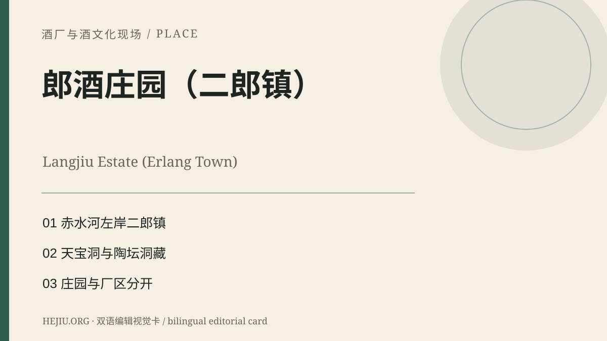

# 郎酒庄园（二郎镇）

郎酒庄园不是一座“酒主题酒店”，而是把生产、洞藏、品鉴、住宿和观光叠在赤水河左岸山谷里的复合空间。很多人冲着“天宝洞”来，到了才发现洞藏区、酿造区、庄园酒店各有入口和预约规则。先弄清你买的是参观、品鉴、住宿还是餐饮，再决定住不住山上；否则一天会在等车和找门之间耗掉。

图：郎酒庄园（二郎镇）专属双语视觉卡。项目自制双语视觉卡，用于识别主题，不是现场照片。

> **先给结论**
> **适合谁：** 想在一个山谷里集中看酱香酿造、洞藏与品鉴的人；适合从泸州或习水方向进入。
> **不适合谁：** 不愿预约、只想路过拍照的人；庄园不是公路边的开放观景台。
> **一句话：** 把参观、洞藏、品鉴、住宿拆开预约，山上住一晚比当天往返更稳。

## 庄园、厂区、洞藏分开看

第一层是郎酒庄园的接待与住宿空间，负责入住、餐饮、展陈与部分品鉴；第二层是正在运转的酿造厂区，有窖池、制曲、蒸馏、仓储与运输，不能自行进入；第三层是天宝洞、地宝洞等洞藏空间，恒温恒湿、坛体密集，通常按预约线路进入。三层都在山谷里，但门禁与安全要求不同。到游客中心先拿一张动线图，问清当天哪些点开放、哪些只能远观，不要拿着“庄园门票”去闯生产区。

## 赤水河左岸的酱香

二郎镇在赤水河左岸，河谷湿热、坡地多，酱香型白酒的制曲、堆积、入窖与多轮次蒸馏都围绕季节和微生物展开。看酿造区时，重点看高粱的破碎比例、曲块的培养、糟醅的堆积温度、窖池的密封与取酒轮次；不要只记“12987”这串数字，而要看它如何落在具体车间。赤水河两岸的微气候与水源是产区叙事的一部分，但并非唯一变量，原料、工艺与长期陈放同样决定酒体。若不能进入车间，在展陈里看剖面与流程图，再到观景台对照山谷朝向。

## 天宝洞与陶坛

天宝洞、地宝洞是天然岩洞，被用作陶坛储酒空间。洞里恒温恒湿、空气流动慢，陶坛透气但不渗漏，酒体在长期存放中缓慢变化。参观时看三件事：洞体的岩层与渗水、坛口的封护与编号、洞内的通道与消防；不要触摸坛体，也不要把手电筒直照酒坛封口。洞内光线暗、地面湿，穿防滑鞋，跟紧导览，不要为了拍照落在队伍后面。若只安排一个洞藏点，选官方开放且动线最短的；另一个点留给下次，不要在山上来回折腾。

## 怎么到、怎么住

二郎镇在四川古蔺县，通常从泸州、叙永或贵州习水方向进入；山路多，雨雾天车速慢，自驾要有夜间驾驶经验。庄园住宿与参观常绑定预约，房型、餐饮、接驳与品鉴套餐会调整，出发前看官方渠道并确认取消规则。当天往返很赶：从泸州到二郎镇单程就要数小时，建议山上住一晚，第二天再走。若不住庄园，二郎镇与习水县城有普通酒店，但早晚进出山要留足时间。行李尽量轻，山路转车频繁，大箱子不方便。

## 二郎镇与习水怎么串

二郎镇与贵州习水隔赤水河相望，可以把“郎酒庄园—二郎镇—习酒镇—土城”串成两天：第一天在四川侧看郎酒庄园与洞藏，住二郎或习水；第二天过河看习酒厂区外观与土城古镇，再往遵义或泸州返程。跨省路线要确认桥梁、班车与导航是否绕行，雨季注意塌方与封路。吃饭可以试古蔺麻辣鸡、赤水河鱼、豆花与腊肉，配酱香酒时控制量。买酒在官方店或授权店，跨省携带注意行李与托运规定。

## 山上住一晚，才看得见庄园的节奏

如果当天往返，你大概率只够看一个展陈点、吃一顿饭、在观景台拍几张照，然后赶路。住一晚的好处是能把“酿造—洞藏—品鉴”拆到不同时段：下午到，先走展陈与观景台，傍晚品鉴，第二天上午进洞藏或酿造区，中午前下山。这样既避开旅行团集中时段，也能在雨雾天留出机动。若只能一日，优先选一个洞藏点加展陈，不要同时追二郎镇、习酒镇与土城；山路会把时间吃掉。无论哪种安排，都把住宿、参观与品鉴分别确认，不要到了门口再问。山上餐饮选择有限，住一晚要提前问清早餐与晚餐时间；洞里冷，带一件薄外套。若遇雨雾，宁可少看一个点，也不要在山路赶夜路；接驳车末班时间以入住时告知为准，品鉴后不要在山路自驾。

## 出发前核对

- 分别确认参观、洞藏、品鉴与住宿
- 山路雨雾天预留机动时间
- 洞内穿防滑鞋，不触摸酒坛
- 司机不参加品鉴
- 跨省携带核对托运规定
- 确认庄园接驳车末班时间
- 洞藏区不脱队、不打闪光灯
- 山上住宿先问早餐与退房时间

## 这一页的边界与下一步

郎酒庄园建在二郎镇的山谷里，参观点分散在酿酒区、天宝洞/地宝洞、品鉴区和接待区之间，靠步行与内部车辆衔接。它不是开放景区，通常需要预约或有接待安排；散客能否进入、能看哪些点，要以当日政策为准。把“庄园参观”与“洞藏参观”分开确认，避免到了才发现某区域不开放。

从古蔺或习水方向进入都要走山路，雨季有落石和雾，夜间不建议赶路。庄园内台阶多、湿度高，穿防滑鞋；品鉴后不要自驾下山。若住庄园内，提前确认餐饮与房间档期，旺季价格和最低消费可能上浮。

这一页不评价酒款，也不承诺一定能看到某个洞。生产与接待安排优先于游客行程，遇到临时调整时，把博物馆或镇区作为备选。

## 参考资料

- 古蔺县人民政府 — 行政区划与人口 — https://www.gulin.gov.cn/mlgl/zjgl/hzqhyrk（古蔺县人民政府，核对 2026-11-25）
- 泸州市人民政府 — https://www.luzhou.gov.cn/（泸州市人民政府，核对 2026-11-25）
- 郎酒 — 郎酒集团 — https://www.langjiu.cn/（四川郎酒集团有限责任公司，核对 2026-11-25）
- GB/T 2260-2007 中华人民共和国行政区划代码（国家标准化管理委员会，核对 2026-11-25）

相关条目：[二郎镇](ref:town)、[古蔺郎酒路线](ref:route)、[郎酒](ref:brand)、[郎酒集团](ref:producer)、[酱香型白酒](ref:style)、[贵州省](ref:region)、[第一次喝白酒怎么选](ref:guide)、[中国酒史纲](ref:history)。
