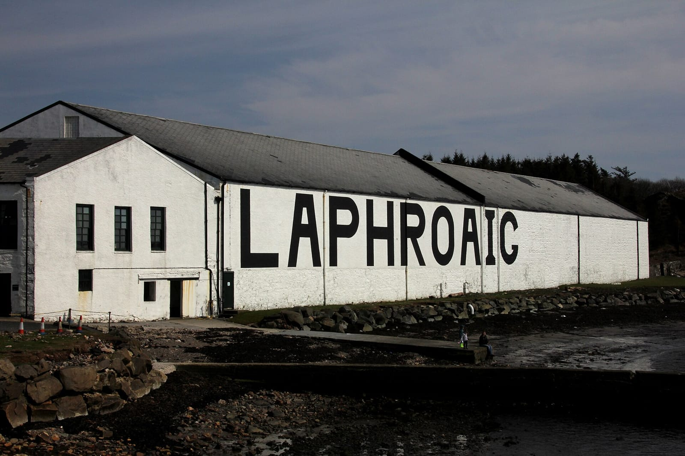

# 拉弗格蒸馏厂

拉弗格蒸馏厂在艾雷岛南岸，厂区几乎贴着海面，背后是泥煤地，旁边是基尔布赖德溪（Kilbride Stream）。它 1815 年由约翰斯顿家的亚历山大与唐纳德两兄弟创立，是艾雷岛上最早一批取得合法执照的蒸馏厂之一。今天游客看到的不是一座被围起来的“威士忌主题公园”，而是一个仍在运转的厂：麦芽在自家地板发麦，泥煤在窑里烧，七座蒸馏器按固定节奏出酒，游客中心只是这套生产系统旁边的一扇门。

> **到访信息**
> - 地址：Laphroaig Distillery, Port Ellen, Isle of Islay, Argyll PA42 7DU, Scotland, United Kingdom。
> - 开放与预约：以[官方页面](https://www.laphroaig.com/)为准；开放时间、场次和预约规则会随季节调整。
> - 交通与费用：出发前以官方页面为准，本页不承诺固定票价。
> - 营业状态：已核实；来源最近核对：2026-11-08。

图：拉弗格蒸馏厂相关实景照片。图片：Bjarne Henning Kvaal…，CC BY-SA 3.0，via Wikimedia Commons（[原图页面](https://commons.wikimedia.org/wiki/File:Laphroaig_Distillery_-_panoramio_(4).jpg)）。

> **先给结论**
> **一句话：** 这页判断拉弗格蒸馏厂值不值得专程去，以及到访前要核对什么。
>
> - **适合谁：** 正在计划去拉弗格蒸馏厂、想知道值不值得专程安排半天到一天的人。
> - **不适合谁：** 只想要“必去榜单”、不准备核对预约、交通和开放时间的人。
> - **先看这两点：**
>   - 散客不能自行进入生产区，必须参加预约项目。
>   - 最常见的误区是把拉弗格的“药味”当成添加了碘酒或药物。

## 1815 年：拉弗格蒸馏厂的关键起点
“Laphroaig”来自盖尔语，官方把它解释为“宽阔海湾旁的美丽凹地”。这个名字描述的是地形，不是风味。1815 年，亚历山大与唐纳德·约翰斯顿在这片海岸建立蒸馏厂；此后两百多年里，厂名与产权几经变化，但厂址没有搬走。今天它仍以单一麦芽威士忌为核心产品，官方把“1815 年创立”直接写在品牌叙事的最前面。

理解这家厂，要抓住三个与地理绑定的条件。第一是海：厂区建在岸边，仓库与酒窖长期受海风影响，酒在橡木桶里陈年时会带上咸味与海藻气息。第二是泥煤：艾雷岛的泥煤由苔藓、石楠与植物残体堆积而成，燃烧时的烟被用来烘烤麦芽，酚类化合物因此进入酒里。第三是水：基尔布赖德溪从厂边流过，是糖化与冷却用水的重要来源。三者叠加，才形成拉弗格那种被描述为“碘酒、海盐、药草与烟灰”的强烈风格；它不是靠添加剂做出来的，而是原料、燃料与陈年环境共同作用的结果。

艾雷岛在苏格兰威士忌版图里是一个特殊产区。岛上蒸馏厂密度高，但风格并不统一：有的偏重泥煤，有的相对清淡；有的坚持地板发麦，有的早已外购麦芽。拉弗格属于把“重泥煤”当作身份标识的一类，同时保留了自家发麦车间，这在今天的苏格兰并不常见。把拉弗格当成“所有艾雷威士忌的代表”会失真，把它当成“一条坚持旧工艺的重泥煤路线”更准确。

## 空间与酒单

游客中心里有小型博物馆、商店与酒廊吧，陈列围绕品牌史、发麦、蒸馏与陈年展开。真正值得看的是生产区：发麦地板、泥煤窑、糖化槽、发酵槽、蒸馏器与仓库。厂区不是博物馆式的复原场景，地面会有水，设备会有温度，气味会随工序变化。官方提醒厂区属于历史建筑，部分参观点有台阶，行动不便的游客需要在预订时说明，酒厂可以改安排以感官体验为主的替代方案。

酒单可以按“日常款—桶强与特殊桶—年度限定”来理解。10 年是最常见的入门款，泥煤、海盐与柑橘构成基本轮廓；Quarter Cask 在小桶中继续陈年，木材接触面更大，香草与椰子气息更明显；Lore 把不同桶型与年份拼在一起，酒体更厚；Càirdeas 是每年为 Friends of Laphroaig 推出的限定款，配方会变。官方没有在参观页列出全部酒款，具体供应以酒廊吧当天菜单为准。

Warehouse 1 是厂区里最有辨识度的空间之一：它是海边的传统铺地仓库，木桶直接堆在石地上，湿度与温度都比现代仓库更接近旧时代。官方的 Warehouse 1 体验会在这里开三只桶，持续约一个半小时，并允许参加者带走一瓶。这个项目的价值不在“喝到老酒”，而在于把“仓库不是布景，而是陈年发生的场所”讲清楚。

## 参观与点单方式

散客不能自行进入生产区，必须参加预约项目。官方页面列出几档：约 1.5 小时的 Lessons in Laphroaig，走一遍蒸馏流程并以品鉴收尾；“Distiller's Wares”约 2.5 小时，进入更多后台区域；Warehouse 1 体验约 1.5 小时，以三只桶为核心；另有约 4.5 小时的全流程步行项目，从基尔布赖德溪一直讲到装瓶。项目名称、时长与价格会调整，预订前以官网日历为准。

预约通过官网完成，旺季与 Fèis Ìle（艾雷岛威士忌节）期间名额紧张。每年有一段计划性静默期，2026 年官网标注为 7 月 8 日至 9 月 13 日，期间生产区不开放，参观会改成以历史、仓库与品鉴为主。这个信息很重要：如果你专为看蒸馏器而来，静默期会直接影响体验内容。

点单在游客中心的酒廊吧进行。第一次来，建议先点一杯 10 年建立基准，再按兴趣加 Quarter Cask 或当季限定；如果不确定，直接告诉吧台你平时喝什么、能接受多重的泥煤。这里的酒精度不低，品鉴项目通常会给水，加几滴水是正常做法，不是“不会喝”。不喝酒的人可以只参加厂区参观或在商店购物，不必勉强。

## 拉弗格蒸馏厂的地址与营业安排
地址是 Laphroaig Distillery, Port Ellen, Isle of Islay, Argyll PA42 7DU, Scotland, United Kingdom。官方只写到岛名与邮编，导航时按“Laphroaig Distillery”搜索即可。厂区在 Port Ellen 以北的数公里处，公共交通班次有限，通常自驾、打车或参加岛上的一日团；从大陆过来要在 Kennacraig 乘渡轮，航程约两小时，具体班次以 Caledonian MacBrayne 当日信息为准。自驾有停车场；沿 A846 的南岸三厂步道也可从 Port Ellen 骑到厂门口。

游客中心按 2026 年官网时刻表开放：3 月至 10 月每天 09:45–17:00，酒廊吧 10:00–16:30、最后点单 16:15；11 月每天 09:45–16:30，酒吧 10:00–16:00、最后点单 15:45；12 月周一至周五 09:45–16:30。12 月 24 日闭馆，次年 1 月 5 日重开。2026 年 7 月 8 日至 9 月 13 日为计划性静默期，生产区不开放，参观改为历史、仓库与品鉴内容。节假日与临时维护以官方渠道当日公告为准。

门票/预约：所有进入生产区的参观都必须提前在官网预约，旺季与 Fèis Ìle 期间很快售罄。2026 年经典导览（Lessons in Laphroaig / Classic Tour）每人 £22，约 1.5 小时，走完发麦、糖化、发酵与蒸馏流程并以品鉴收尾；Warehouse One 三桶品鉴约 £70、1.5 小时，含 100ml 手灌样酒；Whisky Trail 全日体验约 £160、4 小时。价格区间大致 £22–£160，均含品鉴，具体以官网预订页为准。18 岁以下可以随成人参观，但不能参加威士忌品鉴；部分仓库与生产区项目对行动不便者有额外限制，预订时应说明。最新导览场次、票价与生产区限制以 Laphroaig 官网预订页为准；页面核验于 2026-11-08。

## 礼仪与误区

最常见的误区是把拉弗格的“药味”当成添加了碘酒或药物。那种气息来自泥煤燃烧产生的酚类物质，以及海风环境下的陈年，不是配方里的添加剂。第二个误区是把“单一麦芽”理解成“单一桶”：单一麦芽只说明酒来自一家蒸馏厂、以麦芽为原料，一瓶里通常调和了多只桶。第三个误区是把艾雷岛等同于“越泥煤越正宗”，岛上风格差异很大，重泥煤只是其中一条路线。

参观时不要越过警戒线，不要触摸设备与桶塞，不要在生产区使用闪光灯拍工人。品鉴时不要一口干，威士忌的香气需要时间展开；酒厂给的水可以加，但不要要求可乐或冰块把酒“调淡”。如果开车，不要参加含品鉴的项目，岛上道路窄、天气变化快，酒精与疲劳叠加很危险。

还有一个细节：Friends of Laphroaig 的“一平方英尺土地”是会员权益，不是可以随意圈地的产权。游客中心可以查询地块编号与坐标，但那是象征性的荣誉租约，不要理解成真实的地产。

## 波特埃伦的周边街区
从 Port Ellen 出发，沿 A846 向北，可以把拉弗格与附近的拉加维林、阿贝等蒸馏厂串成一天的艾雷岛南岸路线；三家的风格与参观节奏不同，一天排三家会非常赶，排两家更从容。往东可以到 Kildalton 十字架与 Kildalton 小教堂，看岛上的中世纪石雕；往西到 Machir Bay 看海滩与沙丘。岛上没有轨道交通，路线要按自己的交通工具安排。

如果只留一天，建议上午参加拉弗格的厂区项目，中午回 Port Ellen 吃饭，下午选一家邻近酒厂或去海边；把“喝酒”和“开车”严格分开，是艾雷岛行程里最实际的一条规则。返回大陆的渡轮受天气影响，冬季容易停航，离开前留出缓冲。

## 同产区蒸馏厂与延伸阅读
拉弗格是理解[艾雷岛](ref:islay)风土与[苏格兰威士忌](ref:scotch)产业的一个具体入口；它把泥煤、海风与仓库陈年如何进入酒里，展示得比任何风味轮都直接。想进一步理解“地方味道”的形成，可以读[一杯酒，为什么有地方的味道？](ref:place-and-process)。

补充阅读：[苏格兰](ref:c-extra-1)、[威士忌](ref:c-extra-2)。

相关条目：[艾雷岛](ref:islay)、[苏格兰威士忌](ref:scotch)、[一杯酒，为什么有地方的味道？](ref:place-and-process)。

## 相关图像

图：苏格兰类别配图。图片：Alan Jamieson，CC BY-SA 3.0，via Wikimedia Commons（[原图页面](https://commons.wikimedia.org/wiki/File:Glenmorangie_Distillery_-_panoramio.jpg)）。关联图像：拉弗格蒸馏厂。
