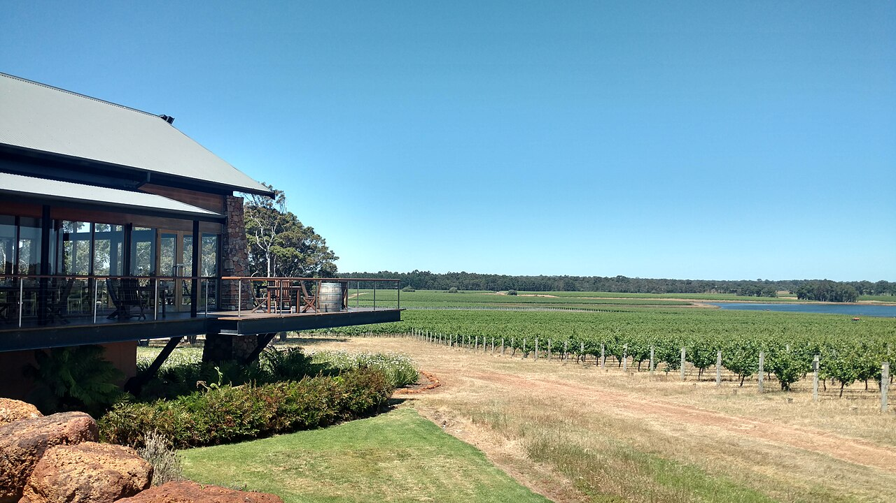

# 露纹酒庄

露纹酒庄是玛格丽特河“创始五家”之一：Horgan 家族 1969 年买下这片农场，1973 年正式建庄，1980 年推出首个 Art Series 霞多丽年份。今天它以 Block 20 霞多丽、Art Series 赤霞珠和 1985 年起的露纹音乐会，把酒、艺术与旅游绑在同一条品牌线上。

图："露纹酒庄"所在地区的一处实景。图片：Lasthib，CC BY-SA 4.0，via Wikimedia Commons（[原图页面](https://commons.wikimedia.org/wiki/File:2016_Margaret_River_Australia._Watershed_vineyard.jpg)）。这张照片用于说明"露纹酒庄"所在的街区或产区环境，不是"露纹酒庄"的店面记录。

> **先给结论**
> **一句话：** 这页判断露纹酒庄值不值得专程去，以及到访前要核对什么。
>
> - **适合谁：** 正在计划去露纹酒庄、想知道值不值得专程安排半天到一天的人。
> - **不适合谁：** 只想要“必去榜单”、不准备核对预约、交通和开放时间的人。
> - **先看这两点：**
>   - 露纹的参观核心是 cellar door、餐厅、Art Series 画廊与露天音乐会场地。
>   - 露纹酒庄位于玛格丽特河南部，地址在 Bussell Highway 1379 号，距玛格丽特河镇约十分钟车程。

## 1973 年：露纹酒庄的关键起点
露纹酒庄位于玛格丽特河南部，地址在 Bussell Highway 1379 号，距玛格丽特河镇约十分钟车程。它不像法塞尔那样从第一天就以酿酒为目的：1969 年，Denis 与 Tricia Horgan 买下这片 121 英亩的牧场，同时接手了一门管道生意，最初并没有酿酒的完整计划。转机出现在 1972 年，纳帕谷的 Robert Mondavi 到访，认为这里的海洋性气候、花岗岩基底上的红土砾石与漫长均匀的生长季，适合种出高品质霞多丽，并愿意担任顾问。

1973 年，Horgan 家族正式建立酒庄；1974 年先建苗圃，1975 年起分批种植；1979 年出第一个商业年份，1980 年推出首个 Art Series 霞多丽。这个时间线说明“1969 年创立”并不准确：1969 年是买地，1973 年才是建庄。露纹的早期路径也不是“先有酒庄再找市场”，而是先有产区判断、再有种植、最后才有品牌。

1980 年代初，Art Series 霞多丽在国际盲品中获得关注，露纹由此进入全球精品酒的视野。此后四十多年，酒庄一直由 Horgan 家族持有，第二代 Justin Horgan 与 Simone 参与经营；家族传承、长期投资与旅游业务，是理解露纹与普通商业酒庄差别的关键。

## 葡萄园与风土

露纹的葡萄园种在玛格丽特河南部起伏的砾石坡地上，土壤以花岗岩基底上的红土砾石为主，排水快、养分低，海洋调节让白天不至于过热、夜晚又足够凉。酒庄主要种植霞多丽、赤霞珠、西拉、雷司令与长相思，早期还种过黑皮诺；今天的产品结构集中在霞多丽与赤霞珠两条主线。

Art Series 霞多丽的核心是 Block 20：一块朝西北的下坡砾石地，种的是原始 Gin Gin 克隆，果粒小、酸度高、风味细而持久。这个地块的老藤与低产，让酒在年轻时显得紧，却有很长的陈年曲线。露纹的霞多丽不是靠重橡木取胜，而是靠果实的柑橘、白花、榛子与矿物感，加上发酵与酒泥带来的纹理；新桶比例与搅桶时间，决定它更偏清爽还是更偏饱满。

赤霞珠主要来自南部坡地，风格比 Wilyabrup 更偏“波尔多式”：黑醋栗、雪松、石墨与细密单宁，结构清楚但不过分厚重。露纹的 Art Series 赤霞珠在 Langton’s 分类中也有很高位置，常被拿来与玛格丽特河其他旗舰赤霞珠比较。酒庄的葡萄园管理强调可持续与低干预，尽量让地块差异进入酒里，而不是用统一配方抹平。

## 酿造与酒款

露纹的产品分三层：Art Series 是旗舰，Prelude 是中端，Siblings 是更日常的入门线。Art Series 覆盖霞多丽、赤霞珠、西拉、雷司令与长相思；每一年份的酒标都选用一位澳大利亚当代艺术家的作品，这一传统从 1980 年首个年份开始，首年艺术家是 Sidney Nolan。酒标不是装饰，而是酒庄把“艺术”写进品牌结构的方式：同一款酒，不同年份对应不同艺术家与不同画面。

酿造上，Art Series 霞多丽通常经过温和压榨、部分酒泥搅拌与法国橡木桶发酵/陈酿，新桶比例克制；Art Series 赤霞珠则用较长的浸渍与橡木桶陈年，目标是结构而非即时果味。露纹从 2002 年起全面改用螺旋盖，这在澳大利亚高端酒里曾是一个有争议的决定，理由是长期储存的稳定性与运输中的可靠性。

产量方面，露纹每个年份大约生产六万箱酒，既有旗舰，也有面向餐厅与零售的 Prelude、Siblings。旗舰酒的产量很小，价格高，适合陈年；Prelude 与 Siblings 更容易在日常场景里找到。理解这三层，比只记“Art Series”一个名字更能判断你手里的酒属于什么定位。

## 参观与空间

露纹的参观核心是 cellar door、餐厅、Art Series 画廊与露天音乐会场地。酒庄建在坡地上，视线越过葡萄园落到周围的桉树林与卡里树；餐厅、品鉴室与画廊连成一条室内外动线，适合把品鉴、午餐与看画排成半日。参观与餐厅最好提前预约，夏季音乐会期间周边交通与住宿会明显紧张。

Art Series 画廊收藏与酒标相关的澳大利亚艺术家作品，部分年份的原画、草图与限量版画会轮流展出。看画时不妨对照酒标：同一幅画在瓶身上被裁成很小的比例，颜色与构图会变；酒庄选择哪位艺术家、哪件作品，也反映它对那一年的自我描述。音乐会场地是一片被树林包围的草地，1985 年首场演出请来伦敦爱乐乐团，此后 Ray Charles、Kiri Te Kanawa、Diana Ross、Tom Jones、Sting 等人都曾登台。

## 「露纹酒庄」的上桌方式
Art Series 霞多丽适合稍微回温后饮用，大约十到十二摄氏度；温度太低会把榛子与白花香气压住，太高则酒精突出。赤霞珠适合十六到十八摄氏度，开瓶后给二十到三十分钟，不必长时间暴力醒酒。Art Series 霞多丽年轻时酸度高、结构紧，配海鲜、白肉、奶油酱与蘑菇都稳；陈年后会出现蜂蜜、烤榛子与更深的矿物感，配烤鸡、猪肉与软质奶酪更合适。

Art Series 赤霞珠适合烤羊排、炖牛肉、鹿肉与硬质奶酪；黑醋栗、雪松与石墨味能接住烤肉的焦香，单宁也能切开脂肪。Prelude 与 Siblings 更适合日常餐桌，配意面、烤肉、披萨与中式红烧肉都不挑。若在餐厅点酒，先问清年份与地块；露纹的旗舰霞多丽年份差异很大，暖年份更饱满，冷年份更紧、更酸。

## 露纹酒庄的地址与营业安排
从玛格丽特河镇出发，沿 Bussell Highway 向南约十分钟即可到达露纹；酒庄有停车位，音乐会和周末会比较紧张。品鉴、画廊与午餐可以排成三到四小时；如果只想快速喝一轮，至少留九十分钟。露纹与法塞尔、Cape Mentelle 可以排成一日路线，但不要一天排四个点：南部与北部之间的车程、预约与午餐时间很容易把行程撑满。

开放时间、餐厅菜单、品鉴费用与音乐会阵容都会变化，出发前以酒庄官网为准。带小孩或长辈时，先确认餐厅是否有儿童座椅、无障碍通道与休息区；音乐会场地是草地，行动不便者需要提前问清入场与停车安排。若遇到闭馆或活动包场，先查官网与电话，不要按旧攻略硬闯。

## 礼仪与常见误区

酒庄不是主题公园。按预约时间到达，穿能走草地的鞋，不在工作区拍照，不碰设备，不把品鉴杯带走；音乐会期间不要越过围栏进入后台或葡萄园。品鉴时把酒吐进吐酒桶是专业礼仪，不是失礼；如果开车，最好只喝一两杯，或者直接买瓶带走。

最常见的误区是把“露纹”只当成音乐会品牌。它首先是一座酒庄：Block 20 的霞多丽、南部坡地的赤霞珠、Art Series 的艺术家酒标与家族经营，才是音乐节能成立的底气。另一个误区是把 Art Series、Prelude 与 Siblings 当成同一层级；它们对应旗舰、中端与入门，价格、产量与陈年潜力都不同。

## 从露纹酒庄延伸到玛格丽特河
露纹适合作为玛格丽特河南部路线的核心站：从酒庄可以继续往南到 Cape Leeuwin 灯塔、Augusta 与 Hamelin Bay，也可以往北回玛格丽特河镇。若只有半天，选“露纹 + 一家对照酒庄 + 午餐”，不要跨到北部 Wilyabrup；若有一整天，可以把南部海岸与灯塔加进来，但要把车程与午餐时间算足。

想把露纹喝明白，最有效的方法不是一次买很多年份，而是同一趟里选 Art Series 霞多丽与 Prelude 霞多丽各一瓶，对比果味集中度、酸度、橡木与酒泥纹理；赤霞珠同理，用 Art Series 与 Siblings 对照。差异清楚之后，你再去比较其他酒庄，就不会只被“玛格丽特河”四个字带走。

相关条目：[玛格丽特河](ref:margaret-river)、[澳大利亚](ref:australia)、[霞多丽](ref:chardonnay)。

## 参考资料
- 相关条目：[margaret-river](ref:margaret-river)、[australia](ref:australia)、[chardonnay](ref:chardonnay)、[syrah](ref:shiraz)、[terroir](ref:art)。
- 本页不提供实时价格、菜单、音乐会阵容或营业状态；参观前以酒庄官网与产区协会为准。
- 想理解 Block 20 的特殊性，可以在品鉴时问清当年 Art Series 霞多丽的果实比例、桶陈时间与新桶比例，再与 Prelude 对比。

## 相关图像

图：风土（terroir）。图片：Friedrich Petersdorff，CC BY-SA 2.0 de，via Wikimedia Commons（[原图页面](https://commons.wikimedia.org/wiki/File:080110_zell_mosel.JPG)）。关联图像：露纹酒庄。
