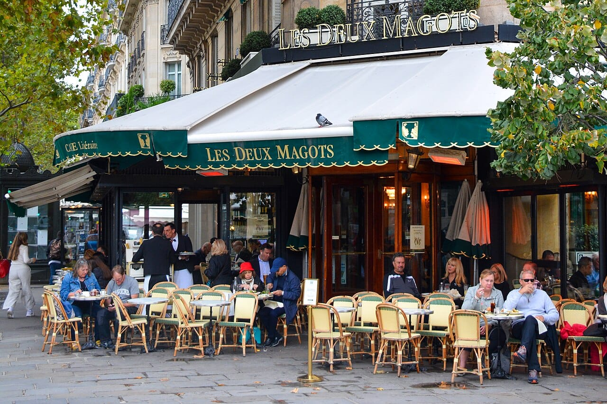
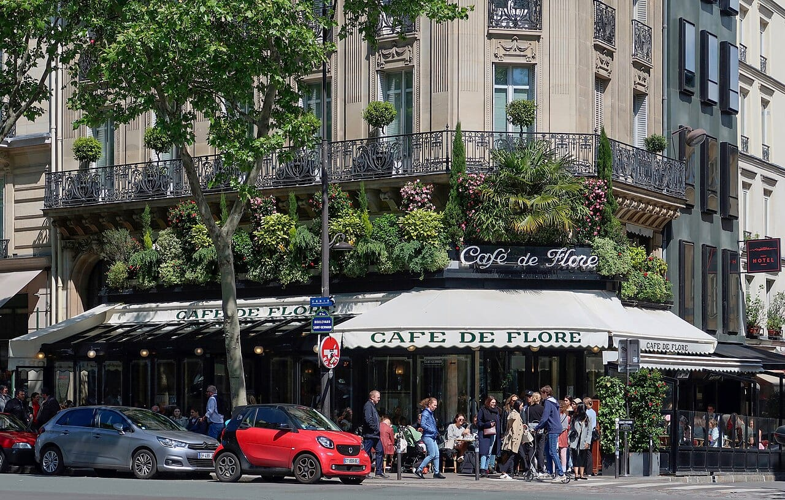

# 双叟咖啡馆

双叟咖啡馆（Les Deux Magots）位于巴黎第六区圣日耳曼德佩广场 6 号，正对圣日耳曼德佩教堂。它通常被介绍为“文学咖啡馆”，但更准确的说法是：一家由十九世纪商铺改造而来、至今仍在营业的咖啡馆，同时也是文学奖的颁发机构。店名里的“双叟”不是比喻，而是店内柱子上方两尊中国商人木雕像；它们原本属于同址的丝绸与新奇商品店，咖啡馆在 1885 年接手了这处空间。官方把历史从 1884 年算起，并在 2024 年做了 140 周年回顾。

图：双叟咖啡馆。图片：Cheng-en Cheng from Taichung City, Taiwan，CC BY-SA 2.0，via Wikimedia Commons（[原图页面](https://commons.wikimedia.org/wiki/File:Les_Deux_Magots,_25_September_2019.jpg)）。

## 1885 年：双叟咖啡馆的关键起点
这处地址在十九世纪先是经营丝绸、布料与新奇商品的店铺，1885 年转为供应酒水的咖啡馆。1914 年，经营者在原有基础上把它改造成更明亮的现代咖啡馆；此后，镜面、长椅与露台逐渐固定成今天看到的样子。1933 年，双叟咖啡馆创立“双叟文学奖”（Prix des Deux Magots），以对抗当时被认为过于学院派的龚古尔奖，奖励法语小说或随笔。这一点很关键：它让咖啡馆不只是名人到访的背景板，而是持续参与文学生产的机构。海明威、萨特、波伏娃、毕加索与多拉·玛尔等名字常被提起，但名人到访属于历史叙事，不等于今天能坐到“某人的位置”。

## 空间与酒单

咖啡馆分为室内与露台。室内是红丝绒长椅、镜面、木桌与吊灯，座位相对紧凑；露台面向广场与教堂，光线好，适合看人流。两尊中国商人雕像位于店内柱子上方，是空间里最直接的“旧商铺证据”。饮品以咖啡、茶与热巧克力为主，也有少量酒饮；餐食包括塔丁苹果挞、鞑靼牛肉、三明治与周末早午餐。官网把热巧克力列为招牌之一，周末早午餐时段为 11:00–15:30。这里不是鸡尾酒吧，不要拿“酒单深度”来要求它；它的供应更像巴黎咖啡馆的日常：一杯浓缩、一杯带奶的咖啡、一杯巧克力，配一份甜点或简餐。

## 第一次来怎么点

先选座位再点单。想看广场就坐露台，想聊天就进室内；正午与周末下午露台翻台慢，等位时不要站在通道中间。法语里“un café”默认是一小杯浓缩，想要牛奶咖啡可以说“café crème”，想要更淡可以说“café allongé”。热巧克力通常偏浓，适合配塔丁苹果挞或简单甜点；如果想吃咸的，鞑靼牛肉与三明治比“只喝一杯”更合适。两个人可以一人点咖啡、一人点巧克力，分食一份甜点，比每人一套更轻松。不要用英语反复要求“double espresso”，按菜单点更不容易出错。

## 双叟咖啡馆的地址与营业安排
地址：6 Place Saint-Germain-des-Prés, 75006 Paris（坐标 48.85424, 2.33320），正对圣日耳曼德佩教堂。

交通：地铁 4 号线 Saint-Germain-des-Prés 站出站即到广场；从塞纳河步行约十分钟。广场周边为步行与公交区域，自驾建议停在 Saint-Germain 一带的公共停车场。

开放时间与预约：官网订座页写明全年每天 7:30–1:00，含法定节假日（极个别例外）。订座只适用于午餐与晚餐，每组需 30 欧元银行卡预授权作担保，服务开始前 4 小时可免费取消；店方会保留部分桌位给现场客人，不预订也可以直接来，座位视当日情况安排。9 人以上团体、包场与商务活动需写邮件至 commercial@lesdeuxmagots.fr。

门票与消费：不收门票，按菜单点单；价格属圣日耳曼德佩游客区水平，咖啡与甜点单价不低。周末 11:00–15:30 有早午餐。着装没有硬性要求，smart casual 即可；露台风大时室内更舒服。不要携带大件行李或婴儿车挤露台，通道很窄。

「双叟咖啡馆」的开放时间、价格与预约，以[官网](https://www.lesdeuxmagots.fr/)的公开页面为准；核验日期为 2026-11-08，临时调整以官网当日公告为准。

## 礼仪与常见误区

在巴黎咖啡馆，坐下即意味着消费，不要只占座不点单；也不要把邻桌的椅子随意拖走。点单后服务节奏偏慢是常态，不是被忽视；需要结账时说“l’addition, s’il vous plaît”。小费不是强制，但可按账单取整或留少量。两尊雕像是店内文物式陈设，不要攀爬、触摸或把杯子放在雕像基座上；拍照时避开其他顾客的脸。最常见的误区是把这里当成“海明威纪念馆”：名人到访是历史，今天的座位、菜单与服务是另一回事。另一个误区是把“文学咖啡馆”理解成安静图书馆；周末下午的露台相当嘈杂。

## 什么情况不适合来

如果你只想花几欧元快速喝一杯、想找安静地方用电脑、或者期待一份完整的鸡尾酒单，这里都不合适。带小孩的家庭在露台高峰时段会很不方便；行动不便者建议先确认入口与座位动线。想体验夜生活的人也应去别处：这里是咖啡馆，不是酒吧。若你厌恶游客人群，避开周末上午到下午的时段，工作日上午通常最接近“街区咖啡馆”的状态。

## 从双叟咖啡馆延伸到花神咖啡馆
出门就是圣日耳曼德佩教堂，往北几条街是 Rue de Buci 与 Marché Saint-Germain，往南可走到塞纳河；欧仁·德拉克罗瓦博物馆在教堂后侧的小巷里。它与[花神咖啡馆](ref:flore)几乎在同一街口的两侧，可以按[圣日耳曼文学咖啡馆路线](ref:route-saint-germain)走半日：先在双叟看广场，再横过街口去花神。若只想对比两家，不必赶时间：两家都适合坐四十分钟以上，走得太快反而看不出差别。

## 同城酒馆与延伸阅读
咖啡馆与酒吧同属城市的公共生活：可以对照[酒吧与城市](ref:pub-and-city)，看座位、常客与营业时间如何塑造一个空间。若要继续走这条街区的文学地图，读[花神咖啡馆](ref:flore)与[圣日耳曼文学咖啡馆路线](ref:route-saint-germain)。

对照阅读：[认识一座城，从一间酒馆开始](ref:pub-and-city)、[圣日耳曼德佩文学咖啡馆半日路线](ref:route-saint-germain)。

把双叟咖啡馆放回左岸文学圈与咖啡馆竞争，可对照[认识一座城，从一间酒馆开始](ref:pub-and-city)与[圣日耳曼德佩文学咖啡馆半日路线](ref:route-saint-germain)。

**关键事实。**

| 项目 | 内容 |
| --- | --- |
| 一句话定位 | 巴黎圣日耳曼德佩的文学咖啡馆，1885 年开业，曾与海明威、萨特和波伏娃等名字联系在一起 |
| 地址 | 6 Place Saint-Germain-des-Prés, 75006 Paris |
| 城市/国家 | 巴黎 / 法国 |
| 营业状态 | 已核验营业 |
| 官网 | lesdeuxmagots.fr |

**来源与边界。** 本页关于「双叟咖啡馆」的关键事实，主要由以下来源交叉核对：Les Deux Magots（地址、历史与营业信息；1884 年起的官方历史叙事、1914 年改造与 2024 年 140 周年回顾）、Office de Tourisme de Paris（街区背景与咖啡馆文化）、Base Adresse Nationale（data.gouv.fr）（门牌地址的官方地理编码坐标 48.85424, 2.33320（十进制五位））。产品、地址或营业状态变化较快时，以 lesdeuxmagots.fr 的最新页面为准；价格、批次与状态会变，涉及这些字段时以页面所列来源的最新版本为准。正文为项目自写，来源只作核验，不复制原文。

## 相关图像

图：花神咖啡馆。图片：Celette，CC BY-SA 4.0，via Wikimedia Commons（[原图页面](https://commons.wikimedia.org/wiki/File:Caf%C3%A9_de_Flore,_172_boulevard_Saint-Germain,_Paris_6e.jpg)）。关联图像：双叟咖啡馆。
