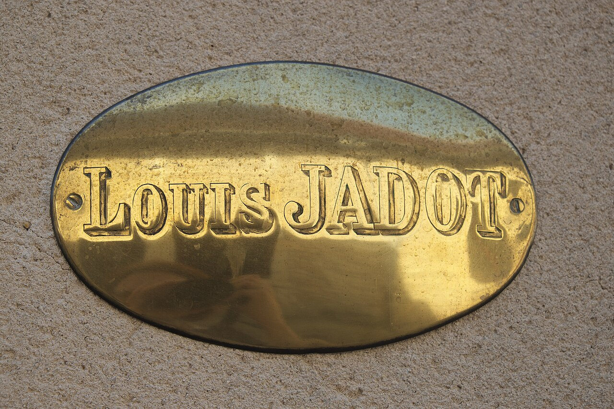

# 路易亚都酒庄

博讷城北的 Route de Savigny 上，一栋 19 世纪的宅邸与相连的发酵间、酒窖组成了路易亚都的日常。门口没有夸张的招牌，只有一块刻着“Maison Louis Jadot”的铜牌。它与罗曼尼康帝是两种完全不同的勃艮第：一边是极少数地块的独占与配额，另一边是从大区级到特级园、从自有园到收购葡萄的庞大酒商体系。理解路易亚都，关键不是“它是不是名庄”，而是“它如何把 200 多公顷葡萄园与上百个 appellation 组织成一个稳定的风格”。

图：博讷 Route de Savigny 上 Maison Louis Jadot 的铭牌。图片：GFreihalter，CC BY-SA 3.0，via Wikimedia Commons（[原图页面](https://commons.wikimedia.org/wiki/File:Beaune_Maison_Louis_Jadot_535.jpg)）。

## 1859 年：路易亚都酒庄的关键起点
路易亚都家族来自比利时，1794 年迁到博讷，很快开始购买一级园与特级园。1859 年，Louis Henry Denis Jadot 以自己的名字创立酒庄。他先学酒窖与品鉴，再学葡萄园，这种“先懂酒、再懂地”的顺序，后来成为 Maison 的方法：不是只拥有地块，而是把地块、年份与市场放在同一张桌子上判断。

酒庄在 1996 年建立自己的制桶厂，从选木、风干、烘烤到成品都在博讷完成；这在勃艮第酒商中并不常见。2024 年起，酒庄自有葡萄园获得有机认证。今天它拥有约 528 英亩（214 公顷）葡萄园，其中约 280 英亩位于金丘的一级园与特级园；酒款出口到 120 多个市场。它还拥有 Château des Jacques（博若莱）、Domaine Ferret（普伊-富赛）与 Maison Louis Picamelot 等产业，但日常总部仍在博讷。

## 建筑与空间

总部在 62 Route de Savigny。临街是办公与接待，往里是发酵间、陈酿酒窖与品鉴空间；再往后是制桶厂。这个布局很重要：葡萄进门、发酵、入桶、陈年、装瓶与销售发生在同一个院子里，酒商不再只是“买酒来卖”，而是把每个环节都握在手里。La Cuverie 是面向访客的品鉴与销售空间，开放时间固定，但生产区不随到随进。

酒窖是典型的博讷地下拱顶，潮湿、恒温、光线弱。新桶与旧桶按酒款与年份分开排列；制桶厂里能闻到新木与烘烤气味。参观时不要只看“有多少桶”，要看桶的来源、烘烤程度与使用年限：路易亚都强调克制的新桶比例，让村级酒与一级园保留果味，而不是被木桶盖住。

## 酒单与味觉

路易亚都的产品线很宽，最容易被记住的是三组。第一组是金丘的村庄级与一级园：Gevrey-Chambertin、Nuits-Saint-Georges、Beaune Premier Cru，以及位于博讷的独占园 Clos des Ursules。Clos des Ursules 是理解 Maison 风格的入口：红樱桃、覆盆子、香料与细颗粒单宁，陈年后出现皮革与林地气息。第二组是特级园：Corton、Corton-Charlemagne、Montrachet 等，产量小，价格高，但风格仍以“透明”而非“厚重”为目标。第三组是南部与博若莱：Pouilly-Fuissé、Mercurey、Château des Jacques 的 Moulin-à-Vent，用来观察酒商体系如何跨越产区。

白葡萄酒通常用较温和的压榨与发酵，保留柑橘、白花、榛子与矿物；红葡萄酒强调长浸渍、野生酵母（条件允许时）与克制的新桶。村级酒适合 3–6 年，一级园 6–12 年，特级园 10–20 年以上；不要把所有酒都当成“必须陈年”的酒。Clos des Ursules 与 Corton-Charlemagne 可以放，但大区级 Bourgogne 在年轻时就该喝。

## 怎么喝

白葡萄酒 10–12°C，红葡萄酒 14–16°C。年轻的红可以提前 30–60 分钟开瓶；一级园与特级园可以 1–2 小时，但不建议长时间暴力醒酒。酒杯用勃艮第杯或较大的白葡萄酒杯；白葡萄酒不要冰到 8°C 以下，否则香气会被锁住。

配餐上，村庄级红配烤鸡、蘑菇、硬质奶酪；一级园配鸭胸、红酒炖牛肉；Corton-Charlemagne 配龙虾、奶油蘑菇、烤鱼；Pouilly-Fuissé 配生蚝、扇贝。避免用重辣或强酸甜酱汁压过酒；路易亚都的酒体不属于“厚重型”，食物的油脂与盐分比香料更重要。

## 路易亚都酒庄的地址与营业安排
地址：62 Route de Savigny, 21200 Beaune。电话 +33 3 80 26 31 98。La Cuverie 商店开放时间：周一至周五 10:00–12:00、15:00–19:00（周三仅 15:00–19:00），周六 11:30–17:30；建议出发前电话确认。生产区参观与酒窖品鉴通常需要预约，或只在 Hospices de Beaune 拍卖周末等特别活动开放；不要把它当成每天滚动发团的景点。

从博讷站步行到酒庄约 20–25 分钟，打车 5–10 分钟；自驾从 A6 出口进入博讷后约 10 分钟。院内有访客停车区，但拍卖周末会非常紧张。周边可把 Hospices de Beaune、Château de Meursault 与 Drouhin 串成一天；如果只喝一家，La Cuverie 的品鉴比“赶三个酒庄”更有效率。

## 礼仪与常见误区

第一，酒商不是“没有葡萄园的二道贩子”。路易亚都既有自有园，也收购葡萄与酒，但发酵与陈年由自己完成；不要用“négociant”一词否定它的质量控制。第二，Maison 不是 Château。它没有一座供游客参观的城堡，也没有“庄园主宅”叙事；来这里看的是酒窖、桶厂与品鉴室。第三，不要在没有预约的情况下闯进生产区；酒窖湿滑、桶列狭窄，不是拍照背景。

第四，不要索要“酒庄直出”的老年份或未公开酒款；商店库存与配额有限，工作人员不能承诺不存在的东西。第五，不要把所有酒都冰到同一温度；白葡萄酒过冷会失去香气，红葡萄酒过热会显得松散。第六，购买时看清 appellation、年份与酒商装瓶信息；同一个“Louis Jadot”标签下，可能是大区级，也可能是特级园，价格与陈年能力差别很大。

## 从路易亚都酒庄延伸到勃艮第特级园路线
把路易亚都放在[勃艮第特级园路线](ref:route)的博讷段，上午看[博讷主医院](ref:hospices)，中午在 La Cuverie 品鉴，下午去[Château de Meursault](ref:meursault) 看另一类酒庄建筑。若想对比“酒商 vs 独占园”，可以第二天去[罗曼尼康帝](ref:drc) 的葡萄园外围绕一圈；一边是开放接待，一边是紧闭的大门，勃艮第的两种权力结构在同一片土地上并存。

只安排半天，建议 La Cuverie 品鉴加博讷旧城；一天则可以加 Meursault 与 Pommard。不要把车停在葡萄园行间，也不要在拍卖周末临时起意——那几天博讷全城堵车，预约与停车都要提前。

**关键事实。**

| 项目 | 内容 |
| --- | --- |
| 一句话定位 | 博讷的勃艮第酒商与酒庄，1859 年由 Louis Henry Denis Jadot 创立；自有葡萄园约 528 英亩（214 公顷），其中约 280 英亩为金丘的一级园与特级园 |
| 地址 | 62 Route de Savigny, 21200 Beaune, France |
| 城市/国家 | 博讷 / 法国 |
| 营业状态 | 已核验营业 |
| 官网 | louisjadot.com |

**来源与边界。** 本页关于「路易亚都酒庄」的关键事实，主要由以下来源交叉核对：Louis Jadot（1859 年创立、528 英亩葡萄园、280 英亩一级园与特级园、Frédéric Barnier 自 2010 年任技术总监、轻萃取与克制新桶；确认酒庄官方入口与博讷总部）、Bourgogne Tourisme（62 Route de Savigny 地址、电话、商店开放时间、1996 年自建制桶厂、2024 年有机认证、120 多个出口市场与参观/品鉴接待；酒窖与陈酿空间的特别开放、预约制参观与 2026 年 Hospices de Beaune 拍卖周末安排）。产品、地址或营业状态变化较快时，以 louisjadot.com 的最新页面为准；价格、批次与状态会变，涉及这些字段时以页面所列来源的最新版本为准。正文为项目自写，来源只作核验，不复制原文。

## 参考资料
- 同产区对照：[罗曼尼康帝](ref:drc)、[Château de Meursault](ref:meursault)、[Hospices de Beaune](ref:hospices)、[勃艮第特级园路线](ref:route)。
- 背景阅读：[勃艮第产区](ref:burgundy)。
- 本页不提供地图；参观与商店时间以官方渠道为准。

对照阅读：[罗曼尼康帝酒庄](ref:drc)、[博讷主宫医院](ref:hospices)。
