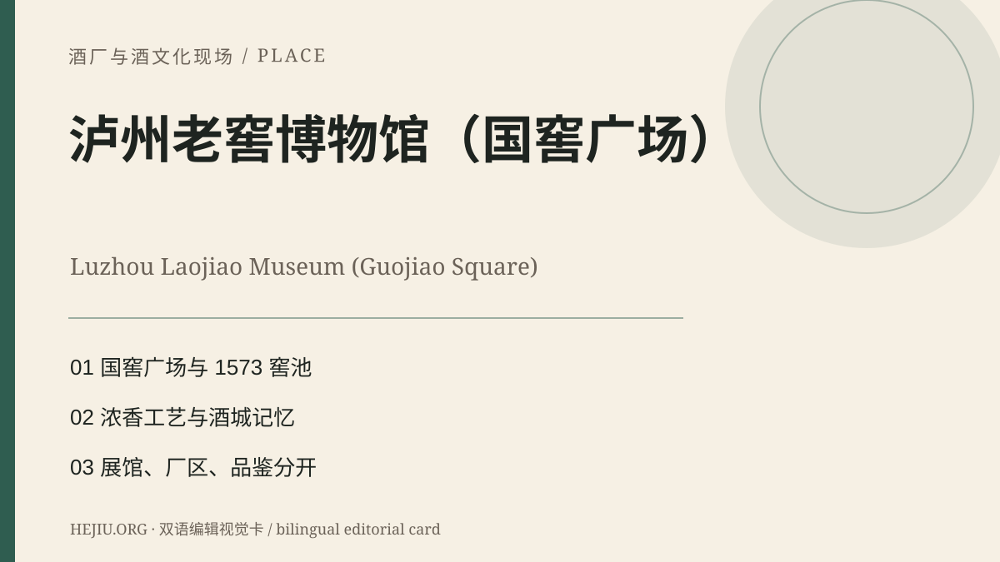

# 泸州老窖博物馆（国窖广场）

到泸州看酒，最容易犯的错是只盯着一口“1573 年”的窖池拍照，却不知道它为什么能连续使用，也不知道展馆、作坊和品鉴区各自能看到什么。国窖广场是一个把“遗产—工艺—城市”压在同一片街区里的入口：先弄清泸州老窖的窖池群与酿酒作坊是什么关系，再决定把时间花在展馆、窖池还是老城。

图：泸州老窖博物馆（国窖广场）专属双语视觉卡。项目自制双语视觉卡，用于识别主题，不是现场照片。

> **先给结论**
> **适合谁：** 想理解浓香型白酒“窖池—糟醅—蒸馏”体系的人；适合与泸州老城、长江边串成一日。
> **不适合谁：** 只想买酒、不愿预约和走路的人；展馆与生产区不是同一个自由入口。
> **一句话：** 先看展馆建立框架，再看国宝窖池，最后把品鉴与买酒分开。

## 展馆与窖池不是一回事

泸州老窖的参访空间大致分三层：国窖广场与展馆负责解释历史、工艺和品牌；1573 国宝窖池群与明清酿酒作坊是活态遗产，重点在窖池、窖泥和连续生产；品鉴与销售空间则负责让你坐下来喝一小杯。三层可以连成一条线，但开放方式不同：展馆按场馆公告，窖池与作坊按景区或官方预约，生产区域不能自行进入。先把“看展”“看池”“喝酒”分开，行程会顺很多。

## 1573 国宝窖池看什么

窖池的价值不在“老”这个字，而在窖泥里长期驯化的微生物群落。浓香型白酒用泥窖固态发酵，窖池越老、连续使用越稳定，酒体的己酸乙酯与窖香才容易出来。参观时看三件事：窖池的形制与分布、窖泥的颜色与维护、糟醅入窖与出窖的节奏。不要伸手摸窖泥，也不要往池里丢东西；有些区域可以拍照，有些不可以，按现场标识走。展馆里的模型和剖面能把“窖池怎么工作”讲清楚，先看模型再到现场，理解会快很多。

## 明清作坊与酒城记忆

泸州老窖的遗产不只是一口池，而是一组分布在城区的明清酿酒作坊。它们把“前店后坊”“江边运酒”“老城街巷”连在一起，说明泸州为什么能成为浓香型白酒的重要产地。看作坊时，注意发酵、蒸馏、陈放与运输的空间关系：酒糟从哪里来，蒸馏设备放在哪里，陶坛存放在哪一间，成品怎么出去。把这条物流线看明白，比记住一堆年份更有用。老城周边可以顺路看长江与沱江交汇、钟鼓楼与老街，但不要把“酒城”理解成一条全是酒馆的商业街。

## 预约、交通与停留时间

国窖广场在泸州市江阳区三星街一带，从泸州站或云龙机场打车都要预留时间；公交线路会变，以实时地图为准。只看展馆与广场，约两小时；加上窖池、作坊与品鉴，半天到一天更稳。景区开放时间、门票与预约方式会调整，出发前看官方渠道，不要拿旧攻略当现时信息。夏天窖池区气味重、地面可能湿滑，穿防滑鞋；品鉴后不要开车，泸州城区打车方便，但高峰时段要等。

## 周边怎么排

半天线路可以按“展馆—国窖广场—窖池群—老城”走，傍晚到长江边看江景。多留一天可以去张坝桂圆林、尧坝古镇或黄荆老林，距离都不近，需要单独安排。吃饭可以试泸州白糕、合江烤鱼、猪儿粑与长江鱼，配浓香型白酒时控制量。买酒时区分“厂方直营”“授权店”和普通烟酒店，保留发票；不要把“内部酒”“特供”当成捡漏，来源不清的酒不要带上车。

## 把酒城走成一条时间线

如果只有半天，按“展馆—国窖广场—窖池群—老城”走，重点看窖池形制、窖泥维护与明清作坊的空间关系；不要在展馆里停留太久，把现场留给窖池。留一天，可以把长江边、钟鼓楼与老街加进来，傍晚在江边收尾；泸州的酒城记忆不只在厂里，也在码头、街巷与餐馆。带长辈或孩子时，减少品鉴环节，把展馆模型和作坊物流线讲清楚，比让他们记住年份更有用。无论哪种走法，都把“看遗产”和“买酒”分开：先看完，再回官方店或授权店买，别在景区门口接“内部渠道”的话。如果只留两小时，先看展馆的工艺剖面，再到国窖广场看窖池外观，不要急着买酒；老城晚饭后打车回住处，酒后不要步行穿街。展馆与窖池的预约入口不同，出发前一天再核对一次；带长辈时把休息点先问清。展馆讲解提前十分钟到，票根放好；夏天带帽子。

## 出发前核对

- 确认展馆、窖池与作坊的预约入口
- 不要把展馆当成生产区
- 窖池区不触摸窖泥
- 品鉴后不驾车
- 买酒只走官方或授权店
- 国窖广场与老城之间留出步行时间
- 团队参观不要脱离导览路线
- 夏季窖池区地面湿滑，穿防滑鞋

## 这一页的边界与下一步

国窖广场的博物馆与活态窖池是两个看点，但参观节奏不同。博物馆以历史、酒器、文献和品牌叙事为主，适合先看；窖池群是仍在使用的生产设施，开放范围有限，不能进入窖池内部或触摸窖泥。把两者按“先理解、再看现场”的顺序安排，信息会更完整。

泸州城区不大，博物馆到老城、滨江一带可以步行或短途打车；若还要去酒业园区或其他酒厂，建议单独留半天。夏季酒城湿热，窖池附近气味浓，敏感人群可以缩短停留。

这一页不提供品鉴购买建议。馆内商店与市区渠道的价格、库存不同，先比价再决定；若要寄酒，确认包装和快递液体政策。把参观重点放在工艺与城市关系上，比只拍一张窖池照片更有收获。

## 参考资料

- 国窖之旅 — 泸州老窖 — https://www.lzlj.com/travel/（泸州老窖，核对 2026-11-25）
- 泸州老窖 — 窖池群与酿酒遗产 — https://www.lzlj.com/news/enterprise/13004.html（泸州老窖，核对 2026-11-25）
- 泸州老窖窖池群及酿酒作坊 — 泸州市人民政府 — https://www.luzhou.gov.cn/sq/lylz/wlmk/lswhpp/gjjwwbhdw/content_986905（泸州市人民政府，核对 2026-11-25）
- 泸州老窖景区旅游攻略 — 泸州本地宝 — http://m.luzhou.bendibao.com/tour/5894.shtm（泸州本地宝，核对 2026-11-25）

相关条目：[泸州老窖窖池群](ref:cellars)、[泸州老窖路线](ref:route)、[泸州老窖](ref:brand)、[泸州老窖集团](ref:producer)、[浓香型白酒](ref:style)、[四川省](ref:region)、[第一次喝白酒怎么选](ref:guide)、[中国酒史纲](ref:history)。

## 相关图像

图：泸州老窖。图片：Xiaomage de，CC BY-SA 4.0，via Wikimedia Commons（[原图页面](https://commons.wikimedia.org/wiki/File:Traditioneller_chinesischer_Destillationsapparat_in_der_Brennerei_Luzhou_Laojiao.jpg)）。关联图像：泸州老窖博物馆（国窖广场）。
