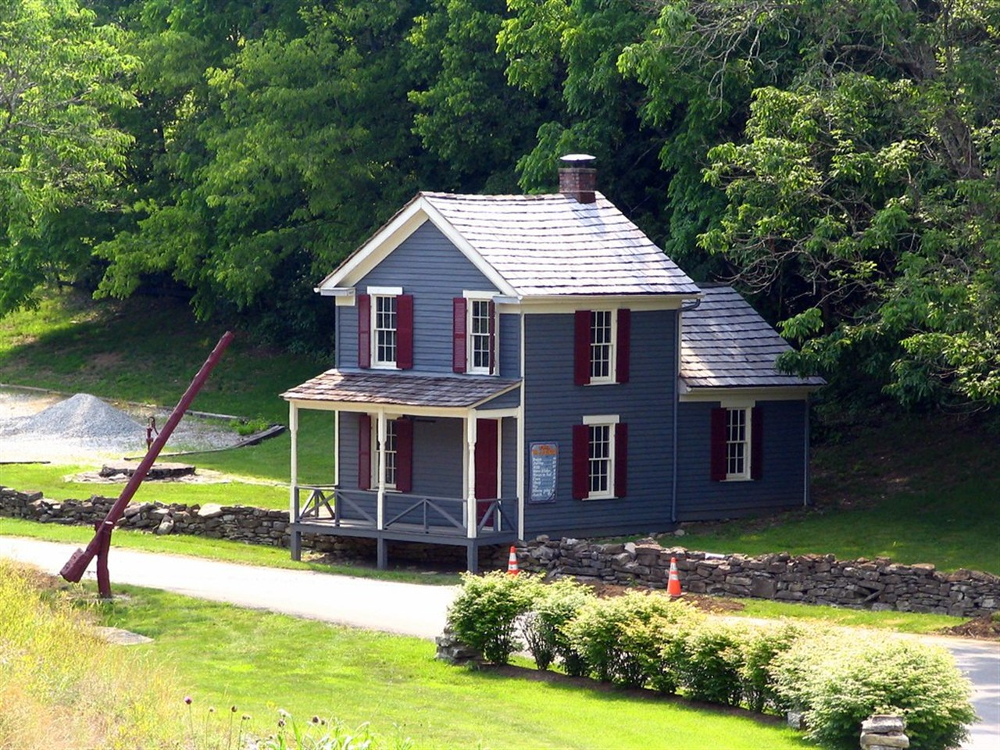
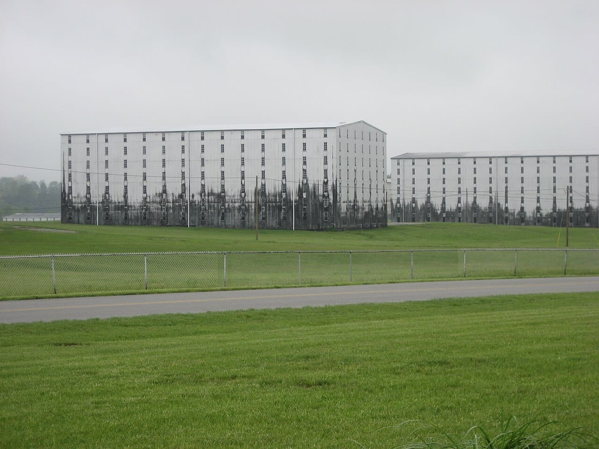

# 美格酒厂

洛雷托（Loretto）在肯塔基中部的丘陵里，离巴兹敦不远。美格（Maker's Mark）把厂区叫作 Star Hill Farm，这不是后来追加的观光名字：1950 年代选址时，Samuels 家看中的就是这片由石灰岩过滤的泉水和自有的集水区。今天参观者看到的是一处仍在运作的农场型酒厂，羊群、和牛、太阳能仓库、手工转桶与红蜡封瓶共存，国家历史地标的身份并没有让它停止生产。它也不是一座被玻璃罩起来的“故居”：游客脚下的路、远处的仓库与发酵间的气味，都是日常生产的一部分。

> **到访信息**
> - 地址：3350 Burks Spring Rd, Loretto, KY 40037, USA。
> - 开放与预约：以[官方页面](https://www.makersmark.com/)为准；开放时间、场次和预约规则会随季节调整。
> - 交通与费用：出发前以官方页面为准，本页不承诺固定票价。
> - 营业状态：已核实；来源最近核对：2026-11-08。

图：美格酒厂。摄影：Toll Booth at Maker's Mark Distillery。署名：SeeMidTN.com (aka Brent)，CC BY 2.0，来自 Flickr / Openverse（[来源](https://www.flickr.com/photos/94502827@N00/272886546)）。

## 星山农场的选址逻辑

波本对水质很敏感。肯塔基石灰岩会滤掉水中的铁，留下钙与镁，让糖化与发酵更稳定；美格官方说，这里是少数拥有自有水源与完整集水区的酒厂，泉水流进石灰岩湖，再进入糖化车间。把酒厂建在农场里，意味着原料、用水与废弃物处理可以在同一块地上循环：酒糟可以喂牲畜，牲畜的粪便回到田里，田里的红冬小麦又回到配方中。这套说法今天被归入“再生农业”，但在 1950 年代，它首先是一个务实的选址决定。

## 1952 至 1958：烧掉旧配方

1952 年，Bill Samuels Sr. 在现址开始建厂。他想要一款自己愿意日常喝的波本，不要尖锐的辛辣感。1953 年，他烧掉了家族旧配方，改用红冬小麦替代黑麦；Margie Samuels 则设计了瓶身、标签、名字与那层标志性的红蜡。官方还把她称为“波本旅游”的开创者：在酒厂还没有游客中心的时候，她已经邀请访客进来看看。1958 年，第一瓶手工蘸蜡的美格上市。1980 年，酒厂以“Burks' Distillery”之名被列为国家历史地标，成为美国第一家历史建筑仍在生产中被认定的蒸馏厂。此后，2010 年的 Maker's 46、2015 年的 Private Select 与 2025 年的 Star Hill Farm Whisky，都是在这套“小麦加手工”的框架里做增量。

## 红蜡、手工转桶与太阳能仓库

美格的工艺有两个容易被记住的动作。第一是转桶：仓库里的每个桶都由人工定期转动，让酒液与桶壁保持接触，官方说这样能让熟成更均匀；第二是蘸蜡：每瓶酒在厂内手工蘸上红蜡，蜡层厚度与滴落形状都不完全一样。蒸馏间使用连续蒸馏器与 doubler，发酵完成的醪液在这里变成新酒，再进入仓库。仓库使用太阳能供电，酒厂强调“按味道而不是按年份”决定装瓶时机。参观时留意仓库的楼层与桶架：波本在[橡木桶](ref:oak-ageing)中经历的不只是时间，还有温度波动、楼层高低与桶板纹理，这些变量比“年份”更能解释同一配方为什么会有差别。

## 参观类型与预约节奏

经典导览（Classic Maker's Mark Tour）约 1 小时 15 分钟，走完历史、糖化、发酵、蒸馏与仓库，最后在品鉴室结束；此外还有偏重生产细节的 Behind the Bourbon、覆盖农场的 Star Hill Farm Estate Whisky Tour、以橡木为主题的 Oak Experience，以及调酒课。所有体验都在官网预约，旺季与周末很快满员。到场需提前 15 分钟，带证件，目前刷卡为主、不收现金；室内外都有步行，必须穿闭趾鞋。停车场免费，但 Uber 与 Lyft 在洛雷托不可靠，回程容易叫不到车，最稳妥的是自驾或包车。若走 Maker's Mark Road 进入，道路窄且弯多，大型车辆应改走 Highway 52 方向的 Bill Samuels Jr. Road。

参观前后可以留在园区吃饭：Star Hill Provisions 供应午餐，Homeplace Bar 提供小食与鸡尾酒，商店与酒厂同为 9:30 至 17:00 营业。最受欢迎的项目之一是“自己蘸一瓶”（dip your own bottle），在商店买瓶后由工作人员指导蘸蜡；Founder's Series、Private Selection 与 Wood Finishing Series 属于厂内限定，库存每天变化。带小孩的家庭要注意，并非所有体验都允许未成年人，预约页会标明 21+ 的场次。

## 酒款：从经典款到 46

经典款美格是纯小麦配方：玉米提供甜味，红冬小麦带来柔软的口感，没有黑麦的胡椒感。Maker's 46 在熟成后加入法国橡木条，增加香草、焦糖与香料；Cask Strength 保留原桶强度，口感更厚；101 是较高酒精度的常规款；Private Select 由顾客选择十根不同烘烤程度的橡木条，再决定收尾方向。第一次来，建议用经典款、46 与 Cask Strength 做三点对比：同一基酒，差别来自橡木处理与稀释程度。经典款也很适合做[老式鸡尾酒](ref:old-fashioned)，但它的甜润意味着苦精与橙皮要稍微克制。

如果时间只够喝两杯，选经典款与 46：前者是基准，后者能说明“橡木条”不是营销词，而是可以尝出来的结构变化。Cask Strength 适合已经熟悉美格的人，加水后香气会打开；Private Select 则更适合带走，因为每一批的橡木组合都不同。厂内限定与旅游渠道限定不建议盲买，先在品鉴里确认自己喜欢哪一层甜味与香料，再决定瓶装。

## 在肯塔基波本地图上的位置

美国法规要求波本以玉米为主，玉米至少 51%，在新烧焦橡木桶中熟成，装瓶酒精度不低于 40%，标为“straight”的酒还需至少两年陈酿。美格用小麦替代黑麦，但玉米比例仍然过线，所以它依然是波本，而不是“小麦威士忌”。从洛雷托往东北约半小时是巴兹敦的[天堂山](ref:heaven-hill)，往北一小时左右是法兰克福的[水牛足迹](ref:buffalo-trace)；三家园区的气质差别很大，放在一天里对比，正好能看出“小麦派”与“黑麦派”的分野。想先补背景，可读[波本](ref:bourbon)与[肯塔基](ref:kentucky)条目。坐标 37.6478、-85.3489 取自公开地理条目，精确入口以官方渠道为准。

对照阅读：[波本威士忌](ref:bourbon)、[橡木桶陈酿](ref:oak-ageing)。

**关键事实。**

| 项目 | 内容 |
| --- | --- |
| 一句话定位 | 美国肯塔基州洛雷托的波本威士忌蒸馏厂，1952 年由 Bill Samuels Sr. 在 Star Hill Farm 创办，以红冬小麦替代黑麦、手工转桶与红蜡封瓶闻名；1980 年列为国家历史地标，参观需在官网预约 |
| 地址 | 3350 Burks Spring Rd, Loretto, KY 40037, USA |
| 城市/国家 | Loretto / 美国 |
| 营业状态 | 已核验营业 |
| 官网 | makersmark.com |

**来源与边界。** 本页关于「美格酒厂」的关键事实，主要由以下来源交叉核对：Maker's Mark Distillery（Star Hill Farm 参观类型、经典导览约 1 小时 15 分钟、免费停车与餐饮位置；3350 Burks Spring Rd 地址、提前 15 分钟到达、证件与无现金提示、闭趾鞋要求、营业时间与网约车不可靠的说明）、Prestige Malts（坐标 37.648384, -85.349526（本文取四位小数））、未注明（由原条目末尾参考资料迁移，未逐条复核访问日期）。产品、地址或营业状态变化较快时，以 makersmark.com 的最新页面为准；价格、批次与状态会变，涉及这些字段时以页面所列来源的最新版本为准。正文为项目自写，来源只作核验，不复制原文。

## 相关图像

图：Heaven Hill distillery, Bardstown, Kentucky。摄影：Shadle，CC BY-SA 3.0，来自 Wikimedia Commons。。图片：Shadle，CC BY-SA 3.0，via Wikimedia Commons（[原图页面](https://commons.wikimedia.org/w/index.php?curid=4136725)）。关联图像：美格酒厂。
