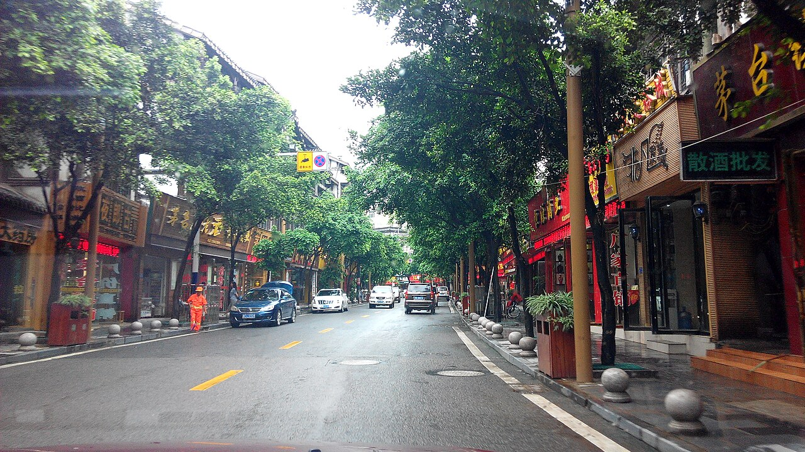

# 茅台酒厂（贵州茅台）

从仁怀市区往茅台镇走，公路沿赤水河下行，河谷两侧是陡峭的山壁与密集的厂房，空气里带着酒糟、曲香与潮湿粮食的气味。茅台酒厂就在这条河谷里，行政地址写作贵州省遵义市仁怀市茅台镇。它不是一座可以随便走进去的“酒庄”：核心生产区有严格管理，普通游客能稳定进入的是厂区内的中国酒文化城与部分指定参观点。把“茅台镇”“茅台酒厂”“中国酒文化城”三个概念分开，是理解这一站的前提。

> **到访信息**
> - 地址：贵州省遵义市仁怀市茅台镇。
> - 开放与预约：以[官方页面](https://www.moutaichina.com/)为准；开放时间、场次和预约规则会随季节调整。
> - 交通与费用：出发前以官方页面为准，本页不承诺固定票价。
> - 营业状态：已核实；来源最近核对：2026-11-08。

图：茅台酒厂（贵州茅台）相关实景照片。图片：Jula2812，CC BY-SA 4.0，via Wikimedia Commons（[原图页面](https://commons.wikimedia.org/wiki/File:Maotai_-_Kweichow_Moutai_Distillery_China,_Flasche_Etikett_Detail_(2).jpg)）。

> **先给结论**
> **一句话：** 这页判断茅台酒厂（贵州茅台）值不值得专程去，以及到访前要核对什么。
>
> - **适合谁：** 正在计划去茅台酒厂（贵州茅台）、想知道值不值得专程安排半天到一天的人。
> - **不适合谁：** 只想要“必去榜单”、不准备核对预约、交通和开放时间的人。
> - **先看这两点：**
>   - 普通散客不能自行进入茅台酒厂的核心生产区。
>   - 茅台酒是 53 度的酱香型白酒，典型风格被概括为“酱香突出、幽雅细腻、酒体醇厚、回味悠长、空杯留香”。

> **决策清单**
> 买之前、去之前，按这三步过一遍。
>
> - **厂区、展馆与参观边界：** 普通散客不能自行进入茅台酒厂的核心生产区。
> - **怎么喝、怎么买：** 茅台酒是 53 度的酱香型白酒，典型风格被概括为“酱香突出、幽雅细腻、酒体醇厚、回味悠长、空杯留香”。
> - **到茅台镇：交通、季节与礼仪：** 航空方面，遵义茅台机场已开通至北京、上海、广州、深圳、成都、昆明、杭州、西安、贵阳等三十个城市的航线；贵州省交通运输厅的信息显示，茅台机场至茅台镇的旅游专线于 2025 年 1。

## 赤水河谷里的酒厂

茅台集团总部位于赤水河畔的茅台镇，官方给出的平均海拔是 423 米，员工四万余人。赤水河是长江上游右岸的一级支流，贵州省发展和改革委员会的规划文件写明：干流全长 436.5 公里，流域总面积 20440 平方公里，贵州段干流 299 公里。河谷封闭、冬暖夏热、温润少风，河水经过紫色砂页岩层层过滤，这些条件共同构成了酱香型白酒的产地环境。

“离开茅台镇就酿不出茅台酒”是常见的说法，官方也强调核心产区的不可复制性。更准确的读法是：核心产区的气候、水源、土壤、微生物与长期形成的酿造体系互相绑定，换一个地方，即使照搬工序，也很难得到同样的风味。茅台集团官方介绍称，贵州茅台酒的核心产区地域范围占地 15.03 平方公里，集中国国家地理标志产品、中欧地理标志产品、有机食品与中国国家级非物质文化遗产于一身。这些身份不是营销装饰，而是产地、工艺与法律保护的叠加。

茅台镇本身是山地小镇，道路坡陡弯多，厂房沿河分布，居民区与生产区交错。参观时不要把“厂区”想象成一座平面展开的工业园：它更像沿着河谷铺开的城市工业带，不同车间、仓库与办公区之间有道路与门禁。理解这一点，就不会把“导航到茅台酒厂”当成“到了某个单一入口”。

## 从三大烧房到现代公司

茅台集团的前身是茅台镇上拥有百年酿酒历史的“成义”“荣和”与“恒兴”三大烧房。1950 年代初，地方政府先后收购、接办这三家烧房，整合为国营茅台酒厂；1953 年三家整合完成后，酒厂体系基本成形。1999 年，贵州茅台酒股份有限公司成立，2001 年在上海证券交易所上市。今天说的“贵州茅台”既可能指上市公司，也可能指集团，写作与购买时要看清主体。

1915 年，茅台酒在旧金山巴拿马太平洋万国博览会上获得金奖，这是品牌叙事中最常被引用的节点。1958 年，以敦煌“飞天献酒”为灵感的“飞天牌”商标问世，后来成为出口与高端产品的重要标识。把这些年份放回历史里看，茅台并不是一夜成名：它经历了烧房竞争、国营整合、计划经济、市场化与资本市场，才成为今天的规模。

对参观者来说，历史部分最值得看的不是“获奖故事”，而是三家烧房如何合并成一套生产体系。成义、荣和、恒兴各自有窖池、工艺与销售网络，整合后形成统一的原料、制曲、酿造与勾调标准；这套标准后来又演变为今天的工艺文件与质量控制。中国酒文化城的展馆会把这条线讲得更完整，厂区参观则更偏现场感受。

## 酱香工艺：一年一个周期

就「茅台酒厂（贵州茅台）」而言，茅台酒的工艺常被概括为“12987”：一年一个生产周期、两次投料、九次蒸煮、八次发酵、七次取酒。这个口诀便于记忆，但它是概括，不是完整的工艺文件；官方更常表述为“端午制曲、重阳下沙、九次蒸煮、八次发酵、七次取酒”，整个生产周期长达一年，再经三年以上陈贮、精心勾调后方可出厂。

官方公司介绍给出的另一组数字更具体：一瓶茅台酒从投料到出厂需要五年，历经制曲、制酒、贮存、勾兑、包装五大工艺过程、30 道工序、165 个工艺环节；生产坚持高温制曲、高温堆积、高温馏酒，一年一个生产周期，陶坛长期贮存，以酒勾酒。把这些数字与“12987”放在一起看，就能理解口诀只是入口：真正决定风味的是制曲温度、堆积发酵、馏酒取酒、陶坛陈贮与勾调的组合。

“端午制曲、重阳下沙”也不是文学修辞，而是与当地气候、原料与农时绑定的生产节律。端午前后气温升高，适合制曲；重阳前后高粱成熟、气温转凉，适合下沙投料。高粱是本地红缨子糯高粱，颗粒小、皮厚、耐蒸煮，能承受多轮次的蒸煮与发酵。参观时如果看到“下沙”二字，指的不是沙子，而是投料；这类术语在酒文化城与厂区讲解中都会出现。

## 厂区、展馆与参观边界

普通散客不能自行进入茅台酒厂的核心生产区。可稳定参观的是厂区范围内的中国酒文化城：它由茅台集团在 1993 至 1997 年投资修建，占地约 3 万平方米，设酒源、酒技、酒俗、酒器、茅台等展馆，是国家 4A 级旅游景区，2017 年获批贵州茅台酒博物馆。酒文化城是展陈空间，不是酿酒车间；它能把“酱香型白酒为什么这样酿”讲清楚，但不要期待走遍所有生产线。

若想进入制酒或包装车间，通常需要参加茅台官方或授权渠道组织的消费者体验、工业旅游或媒体活动。茅台官网曾报道“醉美茅台”体验行程，路线包括中国酒文化城、制酒与包装车间、茅酒之源与天酿剧场，四天行程让消费者从“参观”走向“参与”。这类行程的开放时间、名额、价格与是否进入车间，取决于当期产品与合作方，必须以官方公告为准。

最常见的误区是相信“内部特供”“员工酒”“可以带你进厂区”的说法。茅台集团与贵州茅台多次发布购酒提示，提醒消费者认准官方、正规渠道；厂区门禁与生产管理不是付费就能绕过的事情。若有人在校门口、停车场或社交平台上兜售“进厂名额”，直接拒绝，不要转账，也不要留下证件信息。

## 怎么喝、怎么买

茅台酒是 53 度的酱香型白酒，典型风格被概括为“酱香突出、幽雅细腻、酒体醇厚、回味悠长、空杯留香”。品鉴时用小杯，先闻香，再小口入口，让酒液铺满舌面；不要一口闷，也不要空腹喝。酱香型白酒的香气层次复杂，第一次喝的人可以先从少量开始，配一点主食或清淡菜肴，避免用重辣重油盖住香气。

购买要分清“喝”与“藏”。日常饮用可以在官方自营店、专卖店与官方线上渠道购买；想收藏或送礼，要确认年份、批次、包装与发票，保留购买凭证。价格随产品、年份与渠道变化，本页不写具体价格，以官方渠道为准。不要从门口兜售者、陌生微信群或所谓“内部渠道”买酒；也不要相信“扫码验真”以外的非官方鉴定承诺。若买到可疑产品，保留证据并向市场监管部门反映。

中国酒文化城内有付费品鉴与直营店，适合先少量试喝再决定是否购买；但展馆品鉴是 10 毫升量级，目的是闻香与入口，不是“喝一杯”。喝完不要开车，茅台镇山路多、坡陡弯急，代驾或打车更稳妥。带孩子的家庭可以把重点放在展馆与古镇街巷，品鉴由成年人决定是否参加。

## 进阶判断

图：贵州仁怀茅台镇街景，河谷地形、气候与酱香酒生产高度绑定。图片：Wahsaw，CC0，via Wikimedia Commons（[原图页面](https://commons.wikimedia.org/wiki/File:Streetview_of_Maotai(Moutai)_Town,_Renhuai_City,_Zunyi,_Guizhou.jpg)）。

| 目的 | 合适安排 | 注意 |
| --- | --- | --- |
| 参观 | 预约展馆与厂区 | 生产区通常不开放 |
| 买酒 | 官方渠道与授权店 | 防伪、发票与批次 |
| 学习 | 工艺展馆与品鉴 | 区分讲解与广告 |
| 到访 | 半日至一日 | 不酒驾、不闯车间 |

**茅台镇能随便进酒厂参观吗？** 不能。生产区涉及食品安全与工艺保密，通常只开放展馆、文化城或预约路线。到访前看官方预约信息，不要跟着“内部渠道”进厂。

**茅台镇只产茅台酒吗？** 不是。镇域内有多家酒厂与品牌，茅台酒只是其中最具代表性的产品。买酒要看生产商、产地、执行标准与防伪，不要只认地名。

**什么时候去茅台镇合适？** 避开最热与最冷的极端时段，春秋更舒适；酿造周期中的下沙、取酒等节点更有信息量，但生产区不一定开放。先查天气、交通与预约。

延伸阅读：[白酒](ref:baijiu)、[贵州](ref:guizhou)。

## 到茅台镇：交通、季节与礼仪

航空方面，遵义茅台机场已开通至北京、上海、广州、深圳、成都、昆明、杭州、西安、贵阳等三十个城市的航线；贵州省交通运输厅的信息显示，茅台机场至茅台镇的旅游专线于 2025 年 11 月 7 日试运营，全程通票 5 元/人，串联 1915 广场、国酒文化城、茅台集团等站点。线路、班次与票价会调整，出发前用“车来了”等实时工具查询。铁路可到遵义站或遵义高铁站，再转乘大巴、打车或旅游客运专线；仁怀市 2026 年的工作方案提出开通仁怀至遵义高铁站的旅游客运专线，实际运营以官方发布为准。

从仁怀市区到茅台镇约十几公里，打车或自驾半小时量级；从遵义市区约 1.5 小时，从贵阳约 3 小时，具体看路况与出发点。镇内道路坡陡弯多，节假日车流大，自驾应把车停在指定停车场，不要沿街随意停靠。夏季河谷闷热，冬季湿冷，参观展馆与厂区步行较多，穿舒适的鞋，带一件薄外套。

礼仪上，第一，厂区是生产重地，配合安检与工作人员指引，不要翻越围栏、进入未开放区域、在禁烟区吸烟或使用明火；第二，展馆内不要触摸展品、酒器与酒坛，拍照前看现场提示，部分展厅禁止闪光灯；第三，品鉴时少量慢饮，不想喝完就吐酒，不要劝酒、拼酒；第四，尊重当地生活，茅台镇是居民区与生产区交织的城镇，不要大声喧哗、堵路直播或随意进入民居。

页面核验日期 2026-11-08；参观政策、预约、品鉴、购买渠道、交通班次与价格以官方渠道为准，本页不提供地图。把茅台酒厂放回[白酒](ref:baijiu)与[贵州](ref:guizhou)的脉络，它展示的是赤水河谷如何把气候、原料、工艺与时间绑在一起；想继续读中国酒的历史，可以看[中国酒史](ref:chinese-wine-history)，想先看展馆，可以接上[中国酒文化城](ref:culture-city)。

补充阅读：[中国](ref:c-extra-1)。

相关条目：[白酒](ref:baijiu)、[贵州省](ref:guizhou)、[中国酒史纲：从谷物发酵到国家名酒](ref:chinese-wine-history)。
