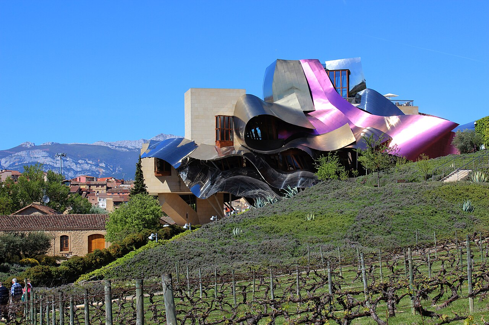

# 瑞格尔侯爵酒庄

从毕尔巴鄂往南，车进入里奥哈阿拉维萨的丘陵，Elciego 的屋顶与葡萄园之间，突然出现一条钛金属的波浪。那是 Frank Gehry 为瑞格尔侯爵设计的酒店，2006 年开业。它像一条被风吹起的丝带，覆盖在 19 世纪酒窖与葡萄园之上。瑞格尔侯爵不是“老酒庄加一个新地标”那么简单：它的历史、酒款与建筑，正好对应里奥哈从散装酒到瓶装酒、从传统到现代旅游的三次转折。

图：Frank Gehry 设计的瑞格尔侯爵酒店与葡萄园。图片：Roderich Kahn，CC BY-SA 4.0，via Wikimedia Commons（[原图页面](https://commons.wikimedia.org/wiki/File:Elciego_-_Marqu%C3%A9s_de_Riscal_Hotel_RK01.jpg)）。

## 1858 年：瑞格尔侯爵酒庄的关键起点
1858 年，Guillermo Hurtado de Amézaga，也就是后来的瑞格尔侯爵，在 Elciego 创立酒庄。他曾在法国波尔多生活，熟悉梅多克的分级与酿造；回到里奥哈后，他把波尔多的方法带进来，1862 年推出首批瓶装里奥哈酒。这在当时是新鲜事：大多数里奥哈酒还以桶装出售，瓶装与酒标意味着酒庄开始直接面对消费者。

1883 年，酒庄建成 El Palomar 陈酿库；1895 年，它在巴黎世界博览会获得文凭，里奥哈的酒第一次在欧洲舞台上被认真对待。1972 年，酒庄在 Rueda 建立新的白葡萄酒业务；1986 年，Barón de Chirel 问世，成为里奥哈“现代高端酒”的先声。2006 年，City of Wine 落成，Gehry 酒店、酒窖、餐厅与游客中心组成一个完整的酒旅目的地。2024 年，City of Wine 被 World’s Best Vineyards 评为第一。

## 建筑与空间

City of Wine 的核心不是酒店，而是 1858 年的原酒窖与 1883 年的 El Palomar。老酒窖是长条形的石砌空间，桶列在暗处延伸；El Palomar 是更开阔的陈酿库，用来存放 Gran Reserva 与老年份。Gehry 的酒店则完全相反：钛金属板在阳光下变色，波浪形屋顶把光线反射到葡萄园，室内是 61 间房、Caesar spa、餐厅与露台。

建筑上最值得看的是“新旧之间没有假装融合”。Gehry 没有复制石墙与拱券，而是用金属、玻璃与曲线把 21 世纪的酒店放在 19 世纪的酒窖旁边；老酒窖仍是生产空间，酒店是接待空间，二者通过庭院与步道连接。参观时不要只拍酒店：先看老酒窖的桶列与 El Palomar 的层高，再回到金属屋顶下，才能理解酒庄为什么要把“历史”与“当代”放在同一个园区。

## 酒单与味觉

Reserva 是理解瑞格尔侯爵的入口：Tempranillo 为主，加入 Graciano、Mazuelo 等，经美国橡木桶陈年，再在瓶中静置；香气有红樱桃、香草、皮革与烟草，口感圆润，适合 5–10 年。Gran Reserva 只在好年份做，陈年更长，颜色偏砖红，香气有干果、雪松、香料与皮革，结构更细。Barón de Chirel 是 1986 年推出的高端线，葡萄来自老藤，风格更集中，单宁更强，适合 10–20 年。

Tapias 是更晚近的单一园/精选线，强调地块与低产；Rueda 的 Verdejo 则是另一条清爽白葡萄酒线，柑橘、青草与矿物，适合夏天。不要把“Riscal”只等同于 Reserva：它的白葡萄酒、Barón de Chirel 与 Gran Reserva 是三种完全不同的表达。

## 怎么喝

红葡萄酒 16–18°C。Reserva 提前 30–45 分钟开瓶；Gran Reserva 可以提前 1 小时，或换瓶一次；Barón de Chirel 年轻时可 1–2 小时。酒杯用较大的红酒杯，倒酒不超过杯肚最宽处。白葡萄酒 8–10°C，不要冰到 6°C 以下。

配餐上，Reserva 配烤羊排、蘑菇、伊比利亚火腿；Gran Reserva 配熟成牛肉、炖菜、硬质奶酪；Barón de Chirel 配烤肉、野味与浓郁的菌菇；Verdejo 配海鲜、沙拉、软奶酪。避免过辣的菜，里奥哈的橡木与香料会被辣味盖住。

## 瑞格尔侯爵酒庄的地址与营业安排
地址：Calle Torrea 1, 01340 Elciego, Álava。酒庄参观从 City of Wine 的游客中心出发，酒窖与品鉴需预约；酒店、spa 与餐厅独立预订，不住店也可以预约餐厅，但酒庄体验与酒店前台是两套系统。从 Logroño 自驾约 30 分钟，从 Bilbao 约 1 小时 15 分，从 Vitoria-Gasteiz 约 45 分钟；镇上停车位有限，酒店有代客停车。

周边可以接 Laguardia（约 10 分钟）、Haro（约 40 分钟）、Briones（约 30 分钟）与 Logroño。若想把里奥哈两家酒庄放在一天，瑞格尔侯爵的建筑与[姆加](ref:muga) 的传统酒窖正好形成对照；但不要把两家都安排成“深度品鉴”，选一家看建筑、一家看酿造。

## 礼仪与常见误区

第一，Gehry 酒店不是酒庄的“免费观景台”。非住店客人可以进入公共区域与餐厅，但 spa、泳池与部分露台只对住店客人开放；拍照不要挡住住客。第二，不要把钛金属板当成可以触摸的雕塑；手上油脂与划痕都会留下痕迹。第三，酒庄参观不是“酒店参观”，两者预约系统不同，别在前台要求临时加酒窖行程。

第四，Reserva 不是“低端款”；它是里奥哈最典型的陈年风格，理解它比追求 Gran Reserva 更重要。第五，Barón de Chirel 不是“Riscal 的副牌”，它是独立的高端线，年份与地块选择都不同。第六，里奥哈的橡木味不是越重越好；美国桶、法国桶与桶龄都会改变风格，不要用“香草味重不重”一概而论。

## 从瑞格尔侯爵酒庄延伸到姆加
Elciego 在里奥哈阿拉维萨的中心，往北是 Laguardia 的中世纪城墙，往南是 Logroño 的 Ebro 河，往西是 Haro 的车站区酒庄。可以按“Elciego—Laguardia—Logroño”走一天，或把瑞格尔侯爵与[姆加](ref:muga)、[López de Heredia](ref:lopez)、[CVNE](ref:cvne) 分成两天，后者对应[哈罗车站酒庄路线](ref:route)。若只对建筑感兴趣，半天看酒店与老酒窖足够；若要喝 Gran Reserva，留出午餐与清醒的味觉。

从 Bilbao 出发可以把 Guggenheim 与 Riscal 放在同一天，但车程较长；从 Logroño 出发更轻松。不要把品鉴安排在开车前，里奥哈乡间道路窄，夜间照明一般。

**关键事实。**

| 项目 | 内容 |
| --- | --- |
| 一句话定位 | 里奥哈阿拉维萨 Elciego 的历史酒庄，1858 年由 Guillermo Hurtado de Amézaga 创立，1862 年推出首批瓶装里奥哈酒；2006 年 Frank Gehry 设计的酒店落成，2024 年获“世界最佳葡萄园”第一 |
| 地址 | Calle Torrea 1, 01340 Elciego, Álava, Spain |
| 城市/国家 | 埃尔谢戈 / 西班牙 |
| 营业状态 | 已核验营业 |
| 官网 | marquesderiscal.com |

**来源与边界。** 本页关于「瑞格尔侯爵酒庄」的关键事实，主要由以下来源交叉核对：Marqués de Riscal（Frank Gehry 设计、2006 年开业、61 间房、Caesar spa、餐厅与酒庄体验；酒庄参观、酒窖与品鉴体验、酒店与 City of Wine 的接待分区）。产品、地址或营业状态变化较快时，以 marquesderiscal.com 的最新页面为准；价格、批次与状态会变，涉及这些字段时以页面所列来源的最新版本为准。正文为项目自写，来源只作核验，不复制原文。

**并读。** 把「瑞格尔侯爵酒庄」与「姆加酒庄」、「洛佩兹雷迪亚酒庄」、「CVNE 酒庄」放在一起读时，先确认它们是同一层级还是上下游关系：先确认地址与营业状态，再比较历史、空间与点单体验。本页负责给出场所的基本坐标，对照条目补上具体案例与差异；读完再回到本页，才能分清哪些差别属于场所本身，哪些只是产地、批次或品牌选择。

## 参考资料
- 里奥哈对照：[姆加](ref:muga)、[López de Heredia](ref:lopez)、[CVNE](ref:cvne)、[Haro 车站酒庄路线](ref:route)。
- 背景阅读：[里奥哈产区](ref:rioja)。
- 本页不提供地图；酒店、参观与餐厅信息以官方渠道为准。
