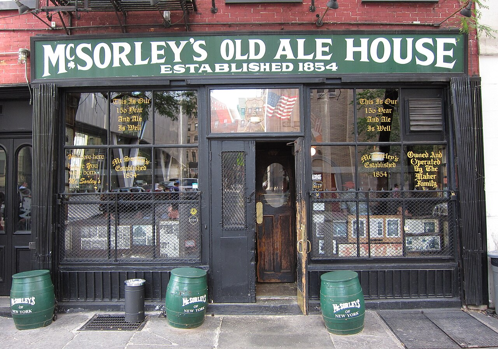

# 麦克索利老麦酒馆

麦克索利老麦酒馆（McSorley’s Old Ale House）位于纽约东村 15 East 7th Street，1854 年由爱尔兰移民约翰·麦克索利开办，最初叫“The Old House at Home”。它最著名的特征不是“老”，而是“窄”：一百多年里只供应一种酒——艾尔，而且只有淡色与深色两种选择。店内至今保留木桌、旧海报、吊灯与历代顾客留下的物件；1970 年，在法院与市政法令的压力下，它结束长期只接待男性的做法，向女性开放。门口那句“Be Good or Be Gone”是店规，也是这家酒馆的性格。

图：麦克索利老麦酒馆。图片：Leonard J. DeFrancisci，CC BY-SA 3.0，via Wikimedia Commons（[原图页面](https://commons.wikimedia.org/wiki/File:McSorley%27s_Old_Ale_House_001_crop.jpg)）。

## 1854 年：麦克索利老麦酒馆的关键起点
约翰·麦克索利 1851 年从爱尔兰泰隆郡来到纽约，1854 年在东七街开出这间爱尔兰工人酒馆。1864 年，所在建筑改建为五层公寓，他和家人搬到酒吧楼上；1888 年买下整栋楼。1905 年，店里曾短暂试卖烈酒，随后又回到只卖艾尔的路子。禁酒令时期，它以“Near Beer”维持经营；1936 年，常客丹尼尔·奥康奈尔买下酒馆，成为麦克索利家族之外的第一位老板。1940 年，《纽约客》记者约瑟夫·米切尔写下《The Old House at Home》，让这间社区酒馆进入全国视野；这些文章于 1943 年结集为《McSorley’s Wonderful Saloon》。1969 年，酒馆因拒绝女性入内被起诉；1970 年法院与市议会介入后开放；1994 年，老板马蒂·马赫的女儿特蕾莎成为第一位站在吧台后的女性。这条时间线解释了它为什么既像酒馆，又像一座仍在营业的历史档案室。

## 空间与酒单

店面窄而深，前厅与后厅都不大，木桌、木椅、旧报纸与照片占据墙面；灯架上挂着历年顾客留下的物件，纽约旅游局的材料还提到一副据称属于魔术师胡迪尼的手铐。酒单极其简单：淡色艾尔（light ale）与深色艾尔（dark ale），没有葡萄酒、鸡尾酒或烈酒菜单。历史上，店里会配免费奶酪与饼干，生洋葱也是招牌搭配；今天的具体供应与收费以现场为准。传统上常一次上两杯，客人按杯或按轮结账。这里的“选择困难”被刻意消除了：你只需要决定淡色还是深色。

## 第一次来怎么点

进门后先找位置，再直接告诉店员“Light or dark”。想喝清爽一点选淡色，想喝麦芽与烘烤味重一点选深色；不确定就各点一杯对比。店内常按两杯一组上酒，若只想喝一杯可以说明。不要问“有什么鸡尾酒”或“有没有葡萄酒”，这不是它的经营方式。菜单很轻，奶酪、饼干与洋葱等小食适合垫肚子，不要期待完整正餐。第一次来建议选工作日下午，人少、光线好，也能看清店内陈设；周末夜晚更像一场站着的社交实验。

## 麦克索利老麦酒馆的地址与营业安排
地址是 15 East 7th Street, New York, NY 10003, USA，位于东村，靠近 Cooper Union 与 Astor Place；坐标 40.72883, -73.98967。地铁 F 线到 Lower East Side–Second Avenue 站，步行约 5 分钟；6 号线到 Astor Place 站，步行约 4 分钟；附近也有 M1/M2/M3/M101 等公交沿 Third Avenue 与 Broadway 行驶。

官方页面列出的营业时间是周一至周六 11:00–次日 01:00，周日 12:00–次日 01:00；节假日与特殊活动可能调整，以官方渠道为准。`operating_status` 为 `verified`，表示官方页面在 2026-11-08 仍正常、未见停业公告，并不代表某个时段一定有座位。这里不接受预订，旺季与周末夜晚需要排队；只收现金（Cash Only），出发前请备好现金并现场确认。电话 212-473-9148。没有门票，也没有着装要求，casual 即可；价格在东村属于中等偏低，但别把“历史名气”理解成“廉价”。空间狭窄，行动不便者或推婴儿车者建议先电话确认动线。「麦克索利老麦酒馆」的开放时间、价格与预约，以[官网](https://mcsorleysoldalehouse.nyc/)的公开页面为准；核验日期为 2026-11-08，临时调整以官网当日公告为准。

## 礼仪与常见误区

把这里当酒吧，而不是博物馆：吧台前的位置是给喝酒的人，不要长时间占着拍陈设。高峰时拼桌是常态，坐下前问一句“Is this seat free?”比直接拉开椅子更合适。小费按美国酒吧习惯给，现金更方便；不要因为店员忙碌就反复催单。最常见的误区是拿“只接待男性”的旧政策开玩笑，或把 1970 年的改变说成“老板突然开明”；那是诉讼、法令与持续压力的结果。另一个误区是把“纽约最古老的酒馆”当成无争议事实：这是店方与常见叙述的说法，和历史学上的“持续经营”定义并不完全等同。名人到访的传说，包括林肯与约翰·列侬，属于店内口述传统，不宜当作已核实史实。

## 什么情况不适合来

如果你想喝葡萄酒、鸡尾酒或精酿的多种风格，这里不合适；如果你想要安静谈话、舒适座位或完整晚餐，也不合适。大团体在狭窄空间里很难安顿，周末夜晚尤其如此；带小孩的家庭应避开夜间高峰。对无障碍通行有要求的人，应先确认入口与店内通道。讨厌拥挤、烟味记忆或“老纽约”怀旧叙事的人，也会觉得这里更像标本而不是酒吧。

## 从麦克索利老麦酒馆延伸到白马酒馆
东村一带可顺路看 Cooper Union、Astor Place 与 St. Mark’s Place；往东走到 Tompkins Square Park 可以换换空气。若想把纽约两间“老酒馆”放在一起比较，可以再去西村的[白马酒馆](ref:white-horse)，但两地相距约两英里，建议乘地铁而不是硬走。白马的选择更多、文学神话更重；麦克索利则把“只卖艾尔”坚持成一种制度。两种“老”放在一起看，比单独打卡更能理解纽约酒馆的差别。

## 同城酒馆与延伸阅读
这里供应的艾尔属于更广的[啤酒](ref:beer)风格家族；把它放回[酒吧与城市](ref:pub-and-city)的脉络，更容易理解这类空间的待客方式。若想看同一城市里另一种“文学酒馆”的样本，读[白马酒馆](ref:white-horse)。

补充阅读：[A Ginjinha](ref:c-extra-1)。

对照阅读：[啤酒](ref:beer)、[白马酒馆](ref:white-horse)。

把 McSorley’s 放回纽约老酒馆与啤酒传统，可对照[啤酒](ref:beer)与[白马酒馆](ref:white-horse)。

**关键事实。**

| 项目 | 内容 |
| --- | --- |
| 一句话定位 | 纽约东村的历史酒馆，1854 年开业，以只供应淡色和深色艾尔、历史陈设闻名 |
| 地址 | 15 East 7th Street, New York, NY 10003, USA |
| 城市/国家 | 纽约 / 美国 |
| 营业状态 | 已核验营业 |
| 官网 | mcsorleysoldalehouse.nyc |

**来源与边界。** 本页关于「麦克索利老麦酒馆」的关键事实，主要由以下来源交叉核对：Wikipedia（历史、地址与营业信息）、City of New York（东村与历史酒馆背景）、McSorley’s Old Ale House（1854 年开业、只供应艾尔、1970 年向女性开放等店内历史时间线；营业时间（周一至周六 11:00–01:00、周日 12:00–01:00）、不收预订、只收现金与电话 212-473-9148）等 5 条来源。产品、地址或营业状态变化较快时，以 mcsorleysoldalehouse.nyc 的最新页面为准；价格、批次与状态会变，涉及这些字段时以页面所列来源的最新版本为准。正文为项目自写，来源只作核验，不复制原文。
