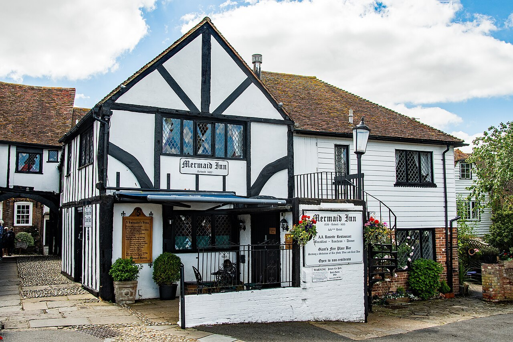
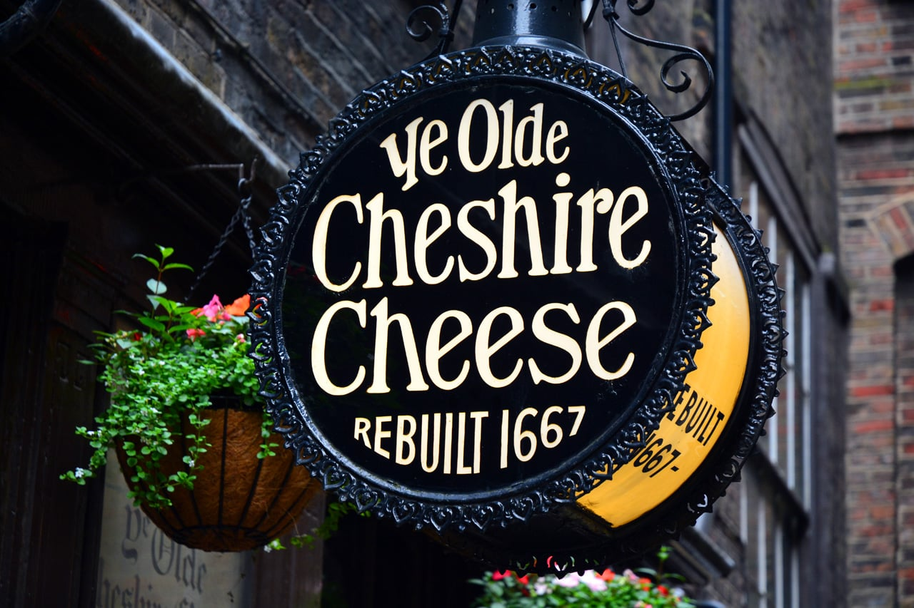

# 美人鱼客栈

美人鱼街的坡度会先提醒你：这不是一间可以“顺路喝一杯”的街角酒馆。拉伊（Rye）的旧城建在山丘上，鹅卵石街道窄而陡，美人鱼客栈的木质门脸嵌在这条街的中段。它同时是客栈、餐厅与酒吧，历史叙事、住宿功能和旅游期待叠在一起；理解这一点，才能解释为什么它的“酒单”看起来不像酒吧，而更像一间老酒店的公共客厅。

图：美人鱼客栈。摄影：The Mermaid Inn, Rye - 20220620121757。署名：Herman.vandenbroeck，CC BY-SA 4.0，来自 Wikimedia Commons（[来源](https://commons.wikimedia.org/w/index.php?curid=122527773)）。

## 1420 年：美人鱼客栈的关键起点
客栈官方历史把现存地窖的年代定在 1156 年。1377 年 6 月 22 日，法国劫掠者袭击拉伊并焚烧了镇上的多处建筑，客栈也在其中；1420 年，客栈在原址重建，这一年份通常被视为今天主体建筑的开端。因此，把“创立年份”简单写成 1156 或 1420 都会丢失信息：前者指地窖，后者指重建后的主体。本页在 front matter 中采用 1420 年，是取其作为现存建筑的起点。

拉伊在中世纪是英吉利海峡沿岸的重要港口，也属于 Cinque Ports 体系的一部分；港口淤积后，城镇的经济重心转移，旧城保留了密集的中世纪街道与建筑。美人鱼客栈的后期叙事则更“传奇”：18 世纪 30 至 40 年代，霍克赫斯特走私团伙（Hawkhurst Gang）在英格兰东南部活动，客栈被指为其会面与策划的次要地点之一；官方介绍还提到从地窖通往老钟客栈（Old Bell）的秘密通道。具体人物、次数与隧道长度多有传说成分，应与其他地方史材料对照阅读。

1993 年以来，客栈由两个家族接手经营，并逐步把“历史建筑”转化为可以住宿、吃饭、喝酒的复合空间。今天它有 31 间客房，房间分布在多道楼梯与不同楼层上，这个数字本身就说明：它首先是一间仍在运作的酒店，而不是一处只供参观的古迹。

## 空间与酒单

客栈内部的关键词是“层叠”：倾斜的天花板、会响的地板、狭窄的楼梯和不断变化的空间高度。公共区域包括以巨型壁炉闻名的 Giant's Fireplace Bar、Tudor Bar、Dr Syn's Lounge，以及 Linen Fold Panelled Restaurant；室外还有一面围墙围起的小庭院。部分房间与通道保留着秘密楼梯、暗门与祭司洞（priest hole）一类结构，官方导览会把这些点串起来讲。

酒单的重心不在鸡尾酒，而在“库存的广度”：官方介绍提到本地艾尔、52 种金酒与 90 多种威士忌。这个组合很符合一间老式英国客栈的待客逻辑：金酒与威士忌适合壁炉边慢慢喝，本地艾尔适合配晚餐，葡萄酒服务餐厅。它不追求城市酒吧那种季度更换的实验菜单，也不会用复杂装饰掩盖酒本身。

餐厅在官方旅游资料中被列为 2 AA Rosette，客栈本身为 3 AA Stars；这意味着餐饮是它认真经营的部分，而不是酒吧的附属。若只来喝一杯，Giant's Fireplace Bar 的气氛最集中；若要用餐，Linen Fold Panelled Restaurant 与 Dr Syn dining room 的体感不同，前者更正式，后者更私密。

## 怎么喝

第一次来，建议把目标定清楚：如果是白天路过，点一杯本地艾尔或一种金酒，坐在壁炉边看建筑细节；如果是住店，晚饭前在 Giant's Fireplace Bar 喝一杯，再进餐厅。金酒种类多，可以直接告诉服务人员你平时喜欢的风格（花香、柑橘、杜松子突出或偏甜），不要试图一次喝完整个酒单。威士忌同样按产区或口味询问，而不是按年份追逐。

餐厅与住宿建议提前通过官网或电话预订。酒吧通常可以现场入座，但客栈会被私人活动、婚宴与住客用餐占满，节假日尤其明显。不要把它当成“鬼屋”来点单：官方确实收集了大量闹鬼故事，Elizabethan Bedchamber、Dr Syn's Bedchamber 等房间常被提及，但那是叙事与营销的一部分，不是可以验证的历史事实。把鬼故事当作饭后消遣，比当作行程目标更合适。

## 美人鱼客栈的地址与营业安排
地址是 Mermaid Street, Rye, East Sussex TN31 7EY, United Kingdom，电话 +44 (0)1797 223065，邮箱 info@mermaidinn.com。从伦敦出发，通常乘高速列车到 Ashford International 换乘 Marshlink 线至 Rye，全程约 1.5 小时；官方说 Rye 车站到客栈步行约 5 分钟，实际是一段上坡的鹅卵石路，拖行李会明显变慢。客栈在旧城内提供约 15 个住客专用车位（含 Blue Badge 与 4 个电动车充电位，需向接待处预订），公共停车可用附近的收费停车场；旧城街道狭窄，不要把车开到美人鱼街门口。

开放时间：官网首页没有公布酒吧与餐厅的逐日营业时间，也未列出非住客的酒吧准入规则，这部分属于未核验项，需以官方渠道当日公告为准。餐厅与住宿可通过官网、电话或 OpenTable 预订；酒吧通常可现场入座，但婚宴、私人活动与住客用餐会占满空间。门票/预约：客栈本身不收门票；每月最后一个周日有 owner 带领的建筑导览，通常在 16:00 与 17:00 各一场，需提前向接待处预约，费用为向“Young Lives Vs Cancer”慈善捐款。消费属于英格兰东南部中高价位，住宿与餐厅偏贵，酒吧单杯中等偏上。没有正式着装要求，鹅卵石街面建议穿好走的鞋。建筑有多道楼梯、低门洞与不平整地面，行动不便者应在预订前与客栈沟通；公共区域不允许带宠物，客房需事先安排。「美人鱼客栈」的开放时间、价格与预约，以[官网](https://www.mermaidinn.com/)的公开页面为准；核验日期为 2026-11-08，临时调整以官网当日公告为准。

## 礼仪与常见误区

最常见的问题是把客栈当成公共博物馆：楼上是住客房间，走廊与楼梯不属于参观路线，不能推门“看看古董床”。第二个误区是把鬼故事当成事实。客栈自己也在经营这套叙事，但历史研究需要文献支撑；听到“某位贵族在此决斗”的故事，可以当作地方传说，不必追问证据。

第三个误区是把它当成城市鸡尾酒吧。这里的强项是金酒、威士忌、艾尔与餐厅，而不是现调复杂鸡尾酒；高峰期吧台人手有限，点单越简单越顺。第四，穿高跟鞋在鹅卵石街上走会很吃力，冬季石面湿滑；带小孩或推婴儿车要预留时间。最后，若你只想要一顿快速晚餐，这里不适合：它更接近“慢下来的客栈”，而不是高效的城市餐饮。

## 拉伊的周边街区
从美人鱼街往下走，可以到 Ypres Tower（拉伊城堡博物馆）、圣玛丽教堂（St Mary's Church）与 High Street；往西约十分钟是 National Trust 的 Lamb House，亨利·詹姆斯曾在此居住。若时间充裕，可以继续走到 Rye Harbour 或乘短程车去 Winchelsea。把客栈安排在旧城步行路线的中段，喝一杯、看建筑、再继续走，比专程折返更合理。

## 同城酒馆与延伸阅读
想理解这类场所，可以把[酒吧与城市](ref:pub-and-city)作为背景，也可以对照[啤酒](ref:beer)风格条目。

补充阅读：[柴郡奶酪酒馆](ref:c-extra-1)、[A Ginjinha](ref:c-extra-2)、[À la Mort Subite](ref:c-extra-3)。

相关条目：[啤酒](ref:beer)、[认识一座城，从一间酒馆开始](ref:pub-and-city)、[柴郡奶酪酒馆](ref:c-extra-1)。

## 相关图像

图：舰队街柴郡奶酪酒馆的悬挂招牌，写着店名与“Rebuilt 1667”。图片：Images George Rex，CC BY-SA 2.0，via Wikimedia Commons（[原图页面](https://commons.wikimedia.org/wiki/File:Ye_Olde_Cheshire_Cheese_rebuilt_1667_(14276567866).jpg)）。关联图像：美人鱼客栈。
