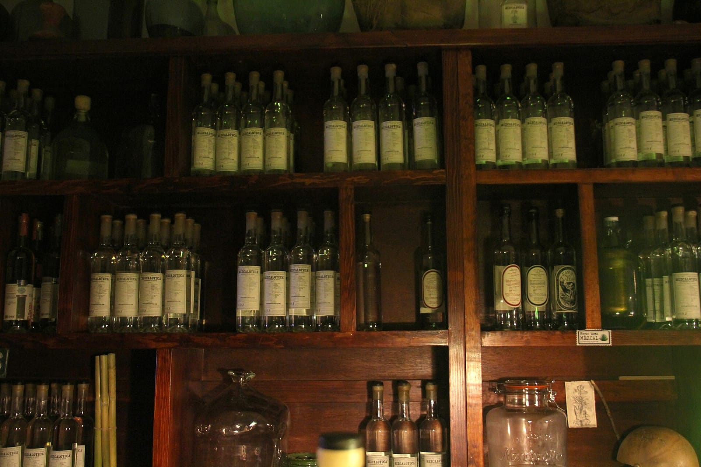
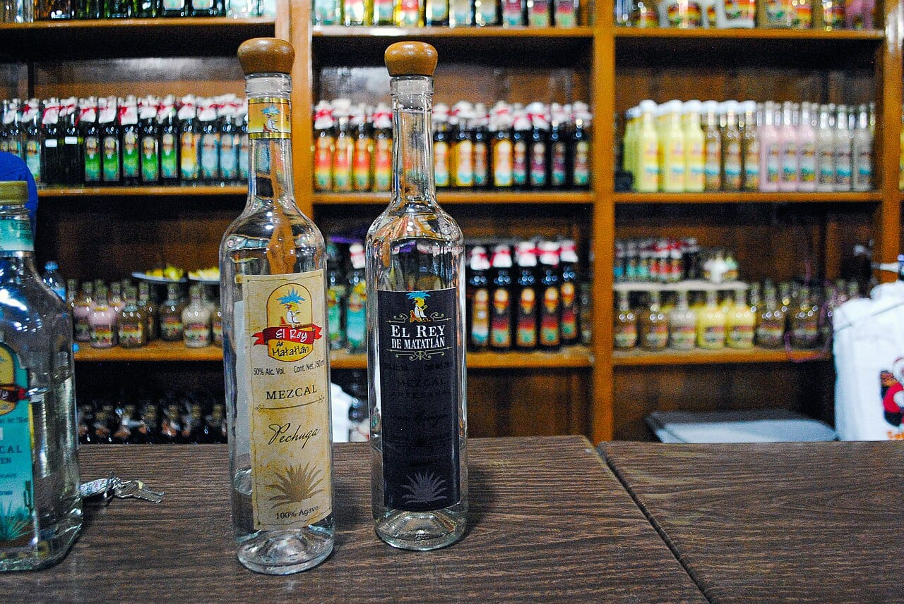

# 梅斯卡尔图书馆：瓦哈卡市中心的一间品鉴档案室

梅斯卡尔图书馆（Mezcaloteca）在瓦哈卡市历史中心 Reforma 街 506 号，门牌属于 Ruta Independencia 这一段，邮编 68000。它不是 palenque，也不靠厨房与鸡尾酒撑场：这里是一间品鉴室，把不同州、不同村子、不同品种与不同生产者的[梅斯卡尔](ref:mezcal)并排放在一张桌上，让人通过比较来学习。对刚到[瓦哈卡](ref:oaxaca)的人，它比任何酒单都更适合作为第一站。

图：梅斯卡尔图书馆：瓦哈卡市中心的一间品鉴档案室相关实景照片。图片：https://www.flickr.com/photos/bexwalton/，CC BY 2.0，via Wikimedia Commons（[原图页面](https://commons.wikimedia.org/wiki/File:Mezcaloteca.jpg)）。

## Reforma 街 506 号：一间不生产酒的品鉴室

从瓦哈卡市主广场（zócalo）步行过来约十分钟，Reforma 街这一段店铺密集，门口不显眼，容易走过。地址写作 Reforma 506, Ruta Independencia, Centro, 68000 Oaxaca de Juárez；导航可搜“Mezcaloteca, Reforma 506, Oaxaca”，门面小，认街号与招牌比认经纬度更可靠。电话是 +52 951 514 0082，营业时间与场次会随节日、私人活动调整，出发前最好先确认。

它不像普通酒吧那样随时可进。这里以预约制为主，按场次接待，目的是让讲解不被嘈杂打断；人数少时，提问与对比会更充分。只卖酒不品鉴的客人可以看在线商店，但“图书馆”的核心仍是坐下来喝、听、问。

## 从 2010 年开始的“图书馆”

梅斯卡尔图书馆在 2010 年开门，定位写得很清楚：一间品鉴室，致力于保存与传播传统梅斯卡尔的多样性及其生物文化过程。“图书馆”不是比喻——它有一套收藏逻辑，只是书换成了酒瓶，索引换成了村子、品种、生产者与批次。

藏品来自墨西哥多个州，并不限于瓦哈卡。筛选标准不是“贵”或“稀有”，而是能否被归入传统梅斯卡尔的范围：原料、烘焙、发酵、蒸馏与装瓶方式都要经得起追问。对消费者，这意味着菜单上的每一瓶都能讲出来历；对生产者，这意味着他们的名字与工艺被放在酒标之前，而不是之后。

## 藏品筛选：什么才算传统梅斯卡尔

在梅斯卡尔的世界里，“传统”常被当作营销词。这里的做法更接近编辑：先看龙舌兰是否在适合的地方、以适合的方式成熟，再看烘焙是否用土坑、发酵是否依赖环境酵母、蒸馏器是陶罐、木制还是铜壶。工艺不同，酒体就会不同——烟熏的厚薄、果香的明暗、矿物感的强弱，都能在杯子里找到对应。

品种是另一条线索。[龙舌兰](ref:agave)的 Espadín 常见、产量稳定，Tobalá 与 Arroqueño 更稀有、价格更高，ensamble（混酿）则把不同品种放在同一批发酵里。梅斯卡尔图书馆不把“稀有”自动等同于“好”，而是让你在同一场品鉴里喝到差异：同一品种不同村子，或同一村子不同生产者。这样喝，才知道差异来自风土、工艺还是批次。

## 一场 cata 如何组织

品鉴通常围绕“对比”展开，而不是逐瓶赞美。开场会给一只干净的杯子与少量水，先建立基准，再逐步增加烟熏、成熟度或品种的复杂度；每一款都问三个问题：原料是什么、在哪里做、怎么发酵与蒸馏。讲解会提到[发酵](ref:fermentation)环节，因为很多香气差异在这里已经决定，而不是在蒸馏器里才出现。

节奏由客人决定。想快速了解梅斯卡尔的人，可以走一条从清淡到厚重的线；已经喝过不少的人，可以直接点某个村子或某个品种做纵向比较。不要一次点太多，味觉会疲劳；也不要把品鉴当成拼酒，吐酒在这里是专业行为，不是失礼。

## 与酒厂的关系：把生产者放回酒标

梅斯卡尔图书馆不生产酒，它的角色是“编辑”与“翻译”：把分散在小村子里的生产者、他们的品种与工艺，整理成城里人可以理解的叙事。它也在线销售部分酒款，但选品逻辑仍围绕传统工艺，而不是大品牌的铺货能力。

这与生产端形成互补。以[雷亚尔米内罗帕伦克](ref:real-minero)为例，酒厂能让你看到土坑、木槌与陶罐，闻到正在发酵的醪液；回到城里，梅斯卡尔图书馆则把它的酒与别村、别品种放在一起，让你判断哪些味道来自工艺，哪些来自地方。生产现场给深度，品鉴室给横向坐标，两者缺一不可。想理解[场所与工艺](ref:place-process)的关系，最好两边都走一遍。

## NOM-070 是底线，不是结论

梅斯卡尔在 1994 年获得原产地命名，现行技术标准是 NOM-070-SCFI-2016：原料必须 100% 来自龙舌兰，在法定产区内按规范生产；按陈年分为 Joven、Reposado、Añejo，按生产方式区分 artesanal 与 ancestral。符合标准，说明它是合规的梅斯卡尔，不说明它好喝，也不说明生产者拿到了合理报酬。

梅斯卡尔图书馆的筛选在这条底线之上：它关心品种多样性、村子、蒸馏者与批次，也关心工艺是否被完整保留。对消费者，最实用的读标顺序是：先看 NOM 编号与“100% agave”，再看品种、村子与生产者，最后才看陈年与包装。把顺序倒过来，容易被故事牵着走。

## 预约、时段与到访提示

**预约**：以预约制为主，建议提前一至数日通过官网或电话确认场次；周末与假期更紧张。说明人数、语言需求与预算，店方会安排对应的品鉴。

**时段**：常见安排是下午到晚上，具体以店方确认为准；不要按固定时刻表直接上门。私人活动或节日可能包场。

**预算**：品鉴按酒款与杯量计价，稀有品种会明显更贵；先讲清预算，再让侍酒者配单，比逐杯加点更可控。

**到场**：从主广场步行约十分钟，穿好走的鞋；中心区晚上热闹，但仍要注意随身物品。品鉴后不要开车，瓦哈卡州对酒后驾驶有明确限制。

**礼仪**：先问再拍照，尤其不要对着其他客人；不要要求加冰或调酒，纯饮是对生产者更直接的尊重。喝不完可以吐，没人会介意。

把这里当作瓦哈卡梅斯卡尔之旅的“索引页”：先建立品种与村子的坐标，再决定去哪个 palenque。这样进村时，你知道自己在看什么，也更可能问到点子上。

对照阅读：[梅斯卡尔](ref:mezcal)、[雷亚尔米内罗帕伦克：圣卡塔里娜米纳斯的陶罐与种子](ref:real-minero)。

**关键事实。**

| 项目 | 内容 |
| --- | --- |
| 一句话定位 | 2010 年在瓦哈卡市 Reforma 街 506 号开门的品鉴室，不生产酒，而是以跨州、跨品种、跨生产者的收藏组织对比品鉴；以预约制为主，是理解传统梅斯卡尔与 NOM-070 关系的城市入口 |
| 地址 | Reforma 506, Ruta Independencia, Centro, 68000 Oaxaca de Juárez, Oaxaca, México |
| 城市/国家 | 瓦哈卡市 / 墨西哥 |
| 营业状态 | 已核验营业 |
| 官网 | mezcaloteca.com |

## 相关图像

图：梅斯卡尔。图片：ProtoplasmaKid，CC BY-SA 4.0，via Wikimedia Commons（[原图页面](https://commons.wikimedia.org/wiki/File:Mezcal_bottles_.jpg)）。关联图像：梅斯卡尔图书馆：瓦哈卡市中心的一间品鉴档案室。
