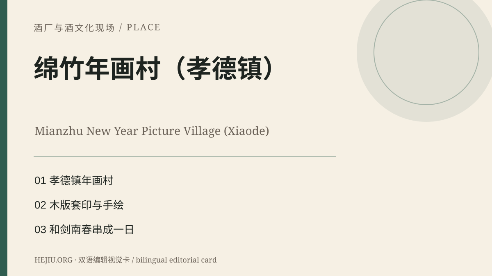

# 绵竹年画村（孝德镇）

绵竹年画是国家级非物质文化遗产，年画村把这项民间工艺从“博物馆里的展品”拉回到作坊、院墙与晒场。可它也不是想象中“家家户户都在画画”的古镇：有的院落是展陈，有的作场可以参观，有的体验项目要另收费，还有不少是面向团队的商品店。先弄清“看什么、做什么、买什么”，再决定在这里留两小时还是半天。

图：绵竹年画村（孝德镇）专属双语视觉卡。项目自制双语视觉卡，用于识别主题，不是现场照片。

> **先给结论**
> **适合谁：** 对木版年画、民间美术与亲子体验感兴趣的人；适合与剑南春酒坊遗址串成绵竹一日。
> **不适合谁：** 期待“原生态古镇”或只想拍网红墙的人；年画村是文化空间，不是仿古商业街。
> **一句话：** 先看工序与展陈，再选一项体验，最后买一件自己看得懂的作品。

## 年画村不是一条商业街

年画村的核心是绵竹木版年画的生产与展示，院落、作坊、展廊和体验区分布在不同点位，动线不像古镇那样一条街走到底。进入前先看导览图，分清公共展区、收费体验、作坊与店铺；不要看到开着的院门就往里走，有些是私人作场或团队预约区。村子仍有村民生活，拍照时避开人脸与院内私物，不要为了“生活感”追着老人小孩拍。把“参观”与“购物”分开，先看工序，再决定买什么。

## 木版年画的工序

绵竹木版年画通常要经过起稿、刻版、调色、套印与手绘开脸等环节。看作坊时，重点不是“颜色艳不艳”，而是版与版怎么对位、颜料如何保持湿度、纸张如何铺平、套印后哪里还要手工补画。绵竹年画的“填水脚”等技法常以快速、率性的笔触见长，但不同作坊的工序与风格差别很大，不要用一个模板概括全部。若允许拍摄，先问能否拍到师傅的手和工具；想体验，问清是拓印现成版还是从刻版开始，成品能否带走、是否另外收材料费。

## 怎么到、留多久

年画村在绵竹孝德镇，距绵竹市区不远，从成都出发通常经成绵高速或高铁到绵竹/德阳后转车，具体班次与接驳以实时查询为准。只看展廊与主要作坊，约两小时；加一项体验与午饭，半天；再串剑南春酒坊遗址，正好一日。村内步行居多，穿平底鞋；夏天晒场热，带水和帽子。若乘公共交通，返程车次少，提前问清末班时间，不要等到傍晚才找车。自驾停车按现场指引，不要把车开进院落窄巷。

## 体验与购买

体验项目常见的有拓印、填色、绘制小幅年画或刻版演示，价格、时长与适龄段各店不同，先问清再坐下。亲子家庭要注意颜料是否可洗、是否含刺激性成分，低龄孩子不要独立使用刻刀。买画时看三件事：纸张与颜料是否稳定、套印是否对位、是否有作者或作坊信息；不要只被“手工”两个字打动。小幅印刷品、明信片与文创适合带走，大幅原作要考虑卷装、防潮与运输。若价格明显低于常识，先问是不是机器印刷或复印。

## 和酒乡串线

绵竹把酒与年画放在同一座城里：上午看剑南春酒坊遗址，下午看年画村，是一天最顺的搭配。酒坊遗址看的是窖池、作坊与蒸馏，年画村看的是刻版、套印与手绘，两者都是“手上功夫”，但一个入口在生产，一个入口在民间美术。若带孩子，上午酒坊控制在一小时内，下午把时间留给体验；若带长辈，减少步行，选有座位的展廊与作坊。午饭在绵竹市区吃米粉、板鸭或家常菜，下午回村，不要在最晒的时段走晒场。

## 把“看画”变成“看懂一张画”

进村先不要急着买。选一个开放的展廊，看一张年画从线稿到套印再到手绘开脸的过程；再选一个作坊，比较两幅同题材作品的版位、色彩与笔触差异；最后才进体验区，亲手印一张小画。这样两三个小时下来，你会知道自己喜欢的是传统人物、门神、戏曲故事，还是现代文创，也更不容易被“大师作品”的话术带走。若时间只够一小时，就放弃体验，集中看展廊与一个作坊；若带孩子，把体验放在前面，避免他们看完展就失去耐心。若只留一小时，放弃体验，集中看一个展廊与一个作坊，再买一张小幅印刷品；村里仍有居民，拍照前先问，不要堵在院门口。返程前确认停车位置与末班车；买画前先问包装。

## 出发前核对

- 先看导览图，分清展区与私院
- 体验前问清价格、时长与材料
- 孩子不独立使用刻刀
- 买画看套印、纸张与作者信息
- 公共交通提前问末班
- 团队预约区不要擅自进入
- 夏季晒场避开正午
- 买大幅作品先考虑卷装与防潮

## 这一页的边界与下一步

年画村是绵竹年画的展示与体验社区，不是酒厂，也不是一座封闭景区。它的看点在于作坊、画师、印制体验和村落空间；节庆前后活动更多，平日部分作坊可能只开半天。把它与剑南春酒坊遗址放在同一天，是“酒 + 年画”的常见组合，但两者之间仍需车程。

参观时尊重作坊的工作节奏：拍摄前询问，体验课程提前预约，别把未干的画样随意挪动。村里餐饮选择有限，旺季最好提前订位；若带孩子，预留动手体验的时间，比赶场更有意义。

这一页不把年画村写成“白酒产区景点”。它适合理解地方手艺与生活，而不是替代酒厂参观。若时间只够一处，优先按你的兴趣选，不必为了“顺路”硬塞。

## 参考资料

- 绵竹市人民政府 — 美丽绵竹 — https://www.mz.gov.cn/meilimianzhu.htm（绵竹市人民政府，核对 2026-11-25）
- 剑南春 — 关于剑南春 — https://www.jnc.cn/about（四川剑南春（集团）有限责任公司，核对 2026-11-25）
- 德阳市人民政府 — https://www.deyang.gov.cn/（德阳市人民政府，核对 2026-11-25）
- GB/T 2260-2007 中华人民共和国行政区划代码（国家标准化管理委员会，核对 2026-11-25）

相关条目：[剑南春酒坊遗址](ref:cellars)、[绵竹剑南春路线](ref:route)、[四川省](ref:region)、[中国](ref:regioncn)、[酒与绘画](ref:art)、[中国酒史纲](ref:history)、[第一次喝白酒怎么选](ref:guide)、[剑南春](ref:brand)。
