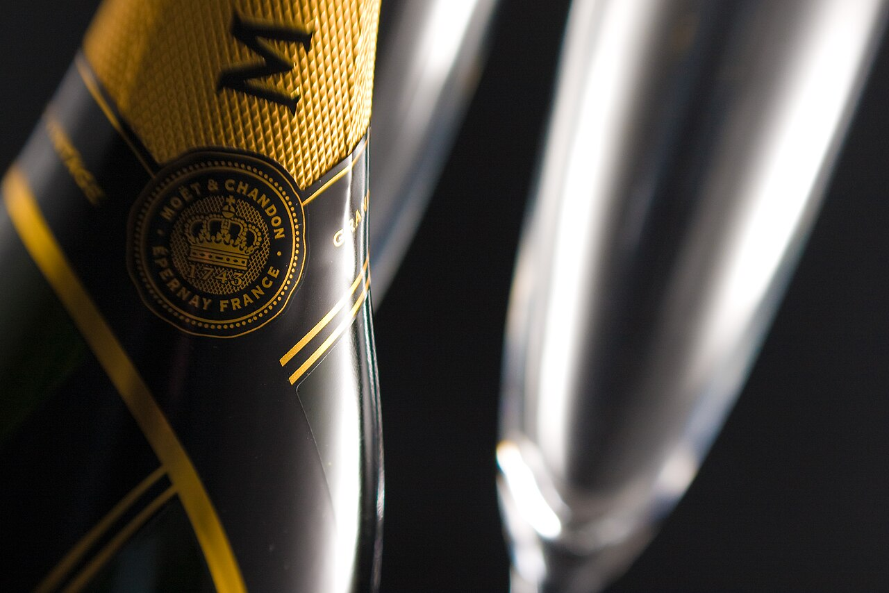

# 酩悦香槟

酩悦香槟（Moët & Chandon）在埃佩尔奈的香槟大道（Avenue de Champagne）。这条街是香槟区最集中展示“酒庄—城市”关系的地方：一栋栋府邸背后连着白垩酒窖，酒窖里堆着数以百万计的酒瓶，地面上则是游客、门店与餐厅。酩悦的访客入口并不张扬，但地下空间规模惊人——官方称其酒窖网络约 28 公里，是香槟区最大的地下网络之一，并作为“香槟区山坡、酒庄与酒窖”的一部分列入联合国教科文组织世界遗产。

图：酩悦香槟。图片：Andreas Levers from Potsdam, Germany，CC BY 2.0，via Wikimedia Commons（[原图页面](https://commons.wikimedia.org/wiki/File:Mo%C3%ABt_et_Chandon.jpg)）。

> **先给结论**
> **一句话：** 这页判断酩悦香槟值不值得专程去，以及到访前要核对什么。
>
> - **适合谁：** 正在计划去酩悦香槟、想知道值不值得专程安排半天到一天的人。
> - **不适合谁：** 只想要“必去榜单”、不准备核对预约、交通和开放时间的人。
> - **先看这两点：**
>   - 参观以预约制为主，官方建议提前在线订位，尤其是周末与旅游旺季。
>   - 第一个误区是把酩悦当成可以随时走进去喝一杯的酒吧。

## 1743 年：酩悦香槟的关键起点
1743 年，克洛德·酩悦（Claude Moët）在埃佩尔奈创立酒庄。他的孙子让—雷米·酩悦（Jean-Rémy Moët）把业务推向欧洲宫廷与国际市场，并因与拿破仑的交往而常被写进品牌叙事。需要把“品牌故事”与“可核验事实”分开：1743 年的创立、酩悦家族在埃佩尔奈的经营、19 世纪的国际扩张，这些有官方与集团资料支撑；至于某场宴会、某位皇帝的具体偏好，很多属于后世反复讲述的传说，参访时不必把每句话都当成史料。

今天酩悦属于 LVMH 集团，与 Dom Pérignon、Krug 等香槟品牌同属一个奢侈品体系，但各自有独立的定位与酒窖。酩悦的核心产品是 Moët Impérial 与 Rosé Impérial，向上有 Grand Vintage 系列；参观中会讲到调配、补糖（dosage）、陈年与除渣，这些是理解香槟工艺的基础。把酩悦简单理解成“庆祝用的大品牌”，会忽略它在香槟工艺标准化与国际贸易中的历史角色。

## 空间与酒单

香槟大道的访客入口把人带进地下白垩酒窖。官方介绍称，酒窖网络约 28 公里，常年低温，夏天也明显凉于地面；参观路线会经过堆叠的酒瓶、拱顶与陈年空间，讲解香槟从基酒调配到二次发酵、陈年与除渣的流程。地面上的建筑则承担接待、品鉴与酒吧功能，部分空间可以看到香槟大道的街景。地下与地上是两套节奏：酒窖安静、潮湿、光线有限，酒吧与品鉴室则更接近城市社交空间。

酒单以酩悦的核心系列为主：Moët Impérial、Rosé Impérial、Grand Vintage，以及不同年份与限量版本。参观套餐通常包含两杯或以上的品鉴，具体酒款随套餐变化；若想喝到更老年份或更稀缺的酒款，需要选择更高档的体验，不能默认基础门票能喝到全部系列。香槟属于起泡酒传统中的[起泡酒](ref:sparkling-wine)一类，但香槟区的法规、土壤与调配方式让它与普通起泡酒区分开来；参观时听到的“cuvée”“dosage”“dégorgement”等词，正是这套体系的技术语言。

## 参观或点单方式

参观以预约制为主，官方建议提前在线订位，尤其是周末与旅游旺季。标准酒窖导览加品鉴约 1 小时 30 分钟，由酒庄大使带领，通常提供法语或英语场次；不同套餐包含的酒款数量与等级不同，预订页会写明。参观前建议提前几分钟到达，办理入场与寄存；酒窖内温度低，即使夏天也建议带一件外套。官方页面提到酒窖设有电梯与无障碍入口，行动不便的访客可以在预订时说明需求。

如果不想下酒窖，也可以只去香槟大道的酒吧或品鉴空间，按杯或按瓶点单；酒吧的营业时间与预订方式与参观分开，旺季最好也提前确认。第一次来，建议选包含酒窖导览的套餐，而不是只在酒吧喝一杯：酩悦的价值有一半在地下空间与陈年规模，酒吧只能提供酒款，不提供这套空间经验。若时间紧，选最短的导览套餐即可，不必追求最贵的年份套餐。

## 酩悦香槟的地址与营业安排
地址：18 Avenue de Champagne, 51200 Épernay, France（坐标 49.04307, 3.95968）。官网 2026 年的到访页明确写 18 号；部分旧页面或第三方资料仍写 20 号，预约确认信与现场指示牌优先。

交通：从巴黎东站（Gare de l'Est）乘直达火车约 80 分钟到埃佩尔奈站，出站步行约 5 分钟即到；自驾从巴黎经 A4 高速约 90 分钟。埃佩尔奈市内停车位有限，旺季建议停在香槟大道外围的公共停车场再步行。

开放时间：每天 9:30–17:00（导览与接待），商店 9:30–18:00。节假日与特殊活动可能调整，酒窖导览名额按场次放出。

预约与票价：导览可在官网或指定票务页在线预订，也可现场购票，但位置有限、旺季常常售罄，建议提前订。2026 年 11 月官网列出的常规套餐：Impérial Moment 48 欧元（1 小时 30 分，含 2 杯：Impérial 与 Rosé Impérial）；Signature 65 欧元（1 小时 30 分，含 2 杯：Impérial 与 Grand Vintage）；Grand Vintage 85 欧元（1 小时 30 分，含 2 杯白/桃红年份香槟）；Moët Collection 190 欧元与 Haute Œnologie 220 欧元（各约 2 小时，含老年份或顶级系列）。导览通常提供法语与英语场次，预订时看清语言与时长。

酒窖设电梯与无障碍入口，行动不便的访客可在预订时说明；酒窖常年低温，夏天也需外套。参观当天不要安排得太满：酒窖导览加品鉴至少需要半日，若还要去另一家香槟酒庄，中间应留出吃饭与移动时间。香槟大道上多家酒庄步行可达，但一天安排两到三家已经足够。

「酩悦香槟」的开放时间、价格与预约，以[官网](https://www.moet.com/)的公开页面为准；核验日期为 2026-11-08，临时调整以官网当日公告为准。

## 礼仪与误区

第一个误区是把酩悦当成可以随时走进去喝一杯的酒吧。酒窖参观需要预约，旺季常常满位；没有预订时，最多只能在酒吧碰运气，不能默认能下酒窖。第二个误区是把酩悦与 Dom Pérignon 混为一谈。Dom Pérignon 是同一集团下的独立品牌，有独立的酒款与叙事；在酩悦的参观里听到这个名字，不等于门票包含 Dom Pérignon 品鉴。

第三个误区是穿得太薄。香槟酒窖常年低温、湿度高，短袖与凉鞋在下面会很难受；带一件外套、穿防滑的鞋更实际。拍照时注意不要用闪光灯直射酒瓶与酒标，也不要触碰堆叠的酒瓶；酒窖是工作空间，不是摄影棚。品鉴时不要一口喝完，香槟的气泡会掩盖香气层次，先闻、再小口、让酒在口中回温。若还要开车，使用吐酒桶或干脆不喝，不要用“香槟度数低”作为理由。

还有一个常见误会是“香槟大道上的酒庄都一样”。酩悦的规模、参观动线与品牌叙事与其他酒庄差别很大；有的酒庄以家族小批次为主，有的以大型酒窖与艺术空间为主。把酩悦与[巴黎之花](ref:perrier-jouet)安排在同一天时，前者看规模与工艺，后者看艺术与霞多丽风格，顺序上可以先大后小，避免审美疲劳。

## 从酩悦香槟延伸到香槟
香槟大道本身值得慢慢走：除了酩悦，还有巴黎之花、Mercier、Pol Roger 等酒庄，以及香槟区的城市建筑与街景。埃佩尔奈不大，从车站到香槟大道步行即可；若想看得更远，可以乘火车到兰斯（Reims），参观兰斯大教堂与另一批香槟酒庄，车程约 40 分钟。香槟区的山坡、酒庄与酒窖是世界遗产，但遗产范围分散在多个村镇，不能只靠一条街看完。

对只安排一天的旅行者，建议上午从巴黎出发，中午到埃佩尔奈，下午参加酩悦的酒窖导览，傍晚在香槟大道散步并去酒吧；若住一晚，第二天再去巴黎之花或兰斯。把酩悦放在第一站，是因为它的导览能把香槟工艺的“标准流程”讲清楚，之后再看其他酒庄更容易比较。香槟区属于[香槟](ref:champagne)产区，但不要把“香槟大道”当成整个产区；真正的葡萄园在山坡与村庄里，需要另安排半天。

## 同产区酒庄与延伸阅读
- [香槟](ref:champagne)：香槟区的法规、村庄与山坡。
- [起泡酒](ref:sparkling-wine)：香槟与其他起泡酒的工艺差异。
- [巴黎之花](ref:perrier-jouet)：同一座城市里的另一种香槟参观。
- [产地与工艺](ref:place-and-process)：理解风土、调配与陈年的基础。
- [LVMH](ref:lvmh)：理解品牌组合与奢侈品集团背景。
