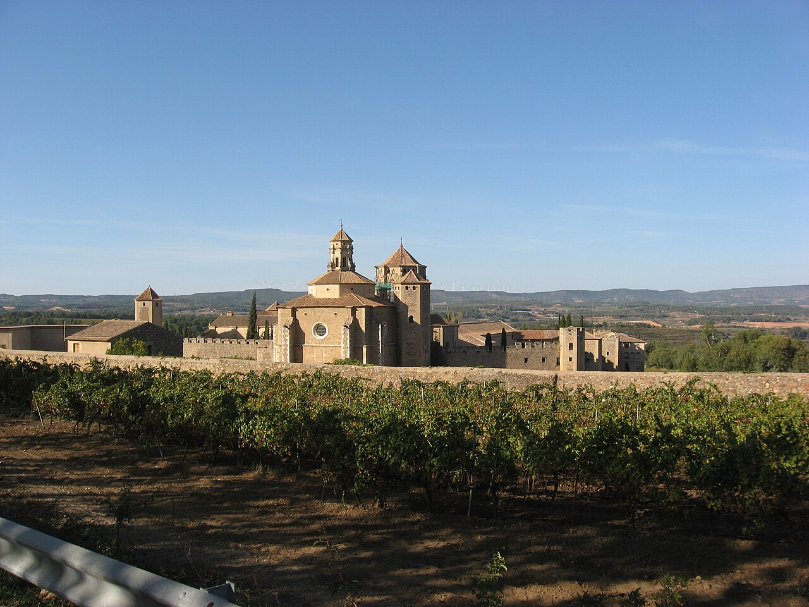
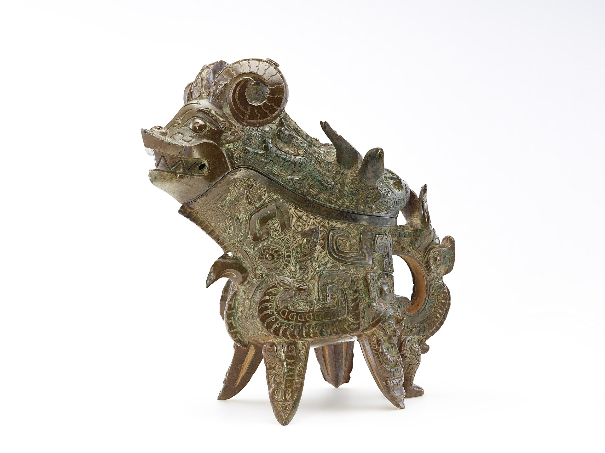

# 波布莱修道院

波布莱修道院在加泰罗尼亚塔拉戈纳省 Vimbodí i Poblet 市镇，普拉德斯山脉脚下。1151 年，巴塞罗那伯爵拉蒙·贝伦格尔四世把此地交给熙笃会，修道院由此建立；阿拉贡王室把这里作为皇家万神殿，13 至 15 世纪形成今天的建筑群。1991 年列入 UNESCO 世界遗产。它是“熙笃会之路”（Ruta del Cister）三座修道院中最大的一座，另外两座是 Santes Creus 与 Vallbona de les Monges。它今天仍是熙笃会修士生活的修道院，不是遗址公园。

图：波布莱修道院。图片：Sergi Esteve (sel_commons)，CC BY-SA 3.0，via Wikimedia Commons（[原图页面](https://commons.wikimedia.org/wiki/File:Monestir_de_Poblet.JPG)）。

## Vimbodí i Poblet的酒庄来历
波布莱的历史有两层。第一层是宗教与王权：熙笃会从勃艮第传入加泰罗尼亚，强调简朴、劳动与自给自足；阿拉贡王室把波布莱选为安葬地，使它从一座普通修道院变成王国最重要的宗教中心之一。第二层是农业：熙笃会修士与圣殿骑士一起，在 12 世纪推动了孔卡德巴尔贝拉（Conca de Barberà）的葡萄种植与酿酒，今天修道院周围的葡萄园景观就是这段历史的延续。

修道院在 19 世纪曾经历解散与荒废，20 世纪逐步修复，重新由熙笃会团体使用。这个背景很重要：游客看到的是修复后的历史建筑，但它不是被腾空的博物馆，教堂、回廊与部分生活空间仍承担宗教功能。参观时遇到的静默、围栏与礼仪器具，都不是布景。

## 空间与展陈

参观分三部分：修道院建筑群、博物馆，以及修道院对面的解说中心。建筑群包括教堂、回廊、皇家墓群、修士宿舍与厨房等，风格从罗马式过渡到哥特式；回廊的柱头与教堂的祭坛是重点。博物馆收藏宗教艺术与修道院历史文物；解说中心用影像解释熙笃会的生活方式与建筑逻辑。官方提供“Poblet, guia oficial”手机应用，参观时必须戴耳机，避免打扰修士与其他人。

看建筑时可以把注意力放在三处。教堂是空间的核心，中殿比例克制，装饰明显少于同期的本笃会教堂，这与熙笃会强调简朴的会规有关。回廊连接礼拜、阅读与日常生活的空间，柱头雕刻出自 13 至 15 世纪的工匠之手，值得逐一看过。皇家墓群提醒人，这里同时是阿拉贡王室的权力象征，不只是修士的居所。修道院对面的解说中心用模型与影像解释建筑如何逐世纪扩建；先看模型再进建筑群，会更容易读懂平面与轴线。

酒庄 Abadia de Poblet 位于修道院范围内，是加泰罗尼亚唯一位于修道院内的酒庄，属 Raventós Codorníu 集团，归属 DO Conca de Barberà。它使用 trepat、garrut、garnatxa 等本地品种，延续熙笃会在 12 世纪推动葡萄种植的传统。酒庄与修道院空间相邻，但运营独立：修道院讲宗教与建筑，酒庄讲葡萄与酿造，不要把两者混成一张门票。

## 参观方式

修道院参观不需要跟团，买票后按应用路线走。门票为成人 8 欧元、优惠 6 欧元（65 岁以上、学生、Carnet Jove、残疾卡、7 岁以上儿童、大家庭与失业者，需出示证明）；“熙笃会之路”三处联票的价格本次未核验。售票在修道院商店，闭馆前 30 分钟停止，单次参观容量上限约 100 人。开放时间为周一至周六 10:00–12:30、15:00–17:30，周日 10:30–12:30、15:00–17:30；1 月 1 日与 6 日、12 月 25–26 日闭馆，圣周与特殊音乐会另有调整。

酒庄参观与品鉴是独立产品，不包含在修道院门票内，需要另向 Abadia de Poblet 预约；具体是否开放、语言与价格以酒庄官方回复为准。若只为葡萄酒而来，先确认酒庄当天是否接待，再安排修道院；若只为建筑与历史而来，修道院本身已足够半天。两者都参加时，把酒庄放在修道院之后，避免在宗教空间里带着酒杯走动。

## 波布莱修道院的地址与营业安排
**地址**：Plaça de la Corona d'Aragó, s/n, 43448 Poblet, Vimbodí i Poblet, Tarragona, Spain（加泰罗尼亚政府 patrimoni 页面亦写作 Zona del Monasterio, 43448 Vimbodí i Poblet）。

**交通**：自驾从巴塞罗那走 AP-7 与 AP-2，9 号出口往 l'Espluga de Francolí 方向；从莱里达走 AP-2 的 8 号出口；从塔拉戈纳走 A-27 与 N-240，约 45 分钟车程。火车到 l'Espluga de Francolí 站，距修道院约 3 公里，需转乘出租车或步行；出租车数量有限，周末与节假日建议提前预约。

**开放时间**（2026-11-08 核验）：周一至周六 10:00–12:30、15:00–17:30；周日 10:30–12:30、15:00–17:30。售票在闭馆前 30 分钟停止，单次参观容量上限约 100 人。1 月 1 日与 6 日、12 月 25–26 日闭馆；2026 年 4 月 2 日下午与 4 月 3 日下午闭馆，4 月 6 日全天闭馆；特殊日子首场 10:45 开始。

**门票与预约**：成人 8 欧元，优惠 6 欧元（65 岁以上、学生、Carnet Jove、残疾卡、7 岁以上儿童、大家庭与失业者，需出示证明）。个人参观通常现场购票，官方未明确要求提前预约，但须在售票截止前入内；团队与学校团体建议先联系院方。修道院门票不含 Abadia de Poblet 酒庄的参观与品鉴，酒庄需另行预约。

**参观须知**：院内有台阶与石板路，穿舒适的鞋；夏季山区日照强，带水。

「波布莱修道院」的开放时间、价格与预约，以[官网](https://www.poblet.cat/)的公开页面为准；核验日期为 2026-11-08，临时调整以官网当日公告为准。

## 礼仪与误区

这里是仍在运作的修道院，不是单纯的景点。进入教堂与回廊要安静，着装覆盖肩膀与膝盖，不要使用闪光灯，不要饮食，不要带宠物（导盲犬除外）。参观必须戴耳机，这是院方规定，不是针对游客的冷淡。误区一是把波布莱当成“酒庄”，它首先是修道院，酒庄只是其中一部分；误区二是把 Abadia de Poblet 的酒当成 Priorat 或 Rioja，它属于 Conca de Barberà；误区三是以为门票含品酒，修道院门票不含酒庄品鉴。

还有一个实际误区是低估交通。公共交通到 l'Espluga de Francolí 后仍有约 3 公里，出租车数量有限，周末与节假日更要提前安排。自驾的人不要把车停在修道院门口的狭窄路段，按指示停到停车场。参加宗教活动时不要拍照与走动，等仪式结束再继续参观。

## Vimbodí i Poblet的周边街区
修道院在普拉德斯山脉边缘，周边是 Poblet 自然公园，适合把“修道院 + 葡萄园 + 山村”串成一天。往东北约 3 公里是 l'Espluga de Francolí，有史前洞穴、现代主义酒窖与 Museu Terra；再往北是 Vimbodí 与 Montblanc。若走“熙笃会之路”，可继续去 Santes Creus 与 Vallbona de les Monges，但三处分散，至少需要两天。只安排半天的话，修道院与酒庄各留一小时到一个半小时，比赶去两座修道院更合适。

从巴塞罗那出发可以当天往返，但会把大部分时间花在路上；更从容的做法是在 l'Espluga 或 Montblanc 住一晚，第二天再走修道院与葡萄园。若继续往内陆走，可以接上 Priorat 或 Penedès，但那是另一条酒区路线，不适合与波布莱硬塞进同一天。

## 同产区酒庄与延伸阅读
波布莱把[葡萄酒](ref:wine)放进修道院的日常与仪式里，也让人看到[西班牙](ref:spain)葡萄酒不只有里奥哈与普里奥拉托；[酒与仪式](ref:ritual)提供了理解熙笃会与葡萄酒关系的另一条线索。

补充阅读：[世界酒史纲：从发酵饮料到全球产业](ref:c-extra-1)、[A Ginjinha](ref:c-extra-2)。

相关条目：[葡萄酒](ref:wine)、[西班牙](ref:spain)、[酒与礼：从乡饮酒礼到今天的敬酒](ref:ritual)。

## 相关图像

图：酒与礼：从乡饮酒礼到今天的敬酒相关实景照片。图片：anonymous，CC0，via Wikimedia Commons（[原图页面](https://commons.wikimedia.org/wiki/File:Ritual_wine_ewer_(gong)_with_masks_(taotie),_dragons,_and_real_animals.jpg)）。关联图像：波布莱修道院。
