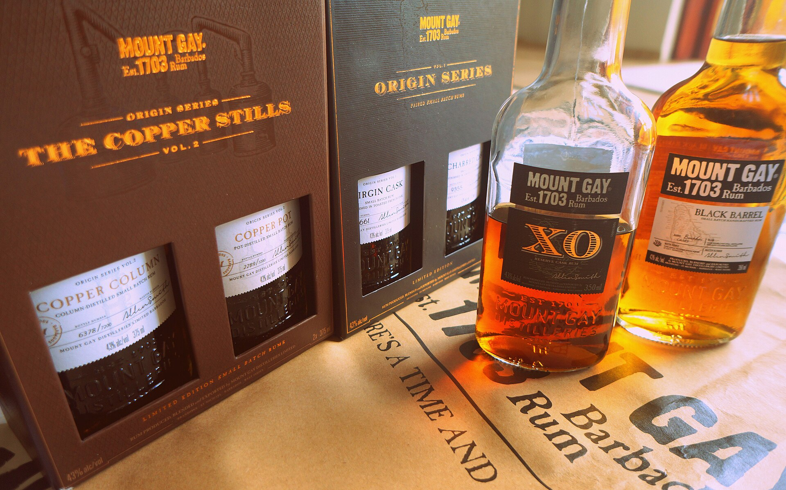
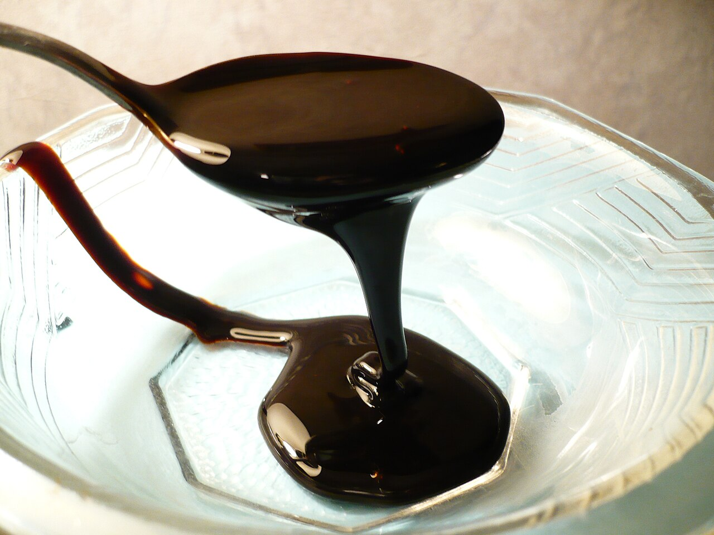

# 芒特盖酒厂

芒特盖酒厂（Mount Gay Distillery）在巴巴多斯最北端的圣露西教区，而不是首都布里奇顿附近那个常被称作“Mount Gay”的访客中心。很多人把两者混为一谈：南岸圣迈克尔教区的访客中心靠近海滨，交通方便，适合短时品鉴；北端这里才是真正的生产厂区，大宅、老水井、发酵房、蒸馏室与陈年仓库连成一条完整的参观动线。品牌把 1703 年作为起点，并称自己是持续运营时间最长的朗姆酒蒸馏厂；这类“最老”说法属于品牌史的一部分，参访时更值得看的是它如何用糖蜜、壶式与柱式蒸馏以及热带陈年维持稳定风格。

图：芒特盖酒厂相关实景照片。图片：Aneil Lutchman，CC BY-SA 2.0，via Wikimedia Commons（[原图页面](https://commons.wikimedia.org/wiki/File:Mount_Gay_Distilleries_Origin_Series,_Black_Barrel_and_XO.JPG)）。

## 北端圣露西：先分清厂区与访客中心

厂区地址写作 Mount Gay, Saint Lucy, Barbados，没有门牌号，导航时不要把“Mount Gay Visitor Centre”当成目的地。访客中心在圣迈克尔教区的布兰登斯一带，靠近布里奇顿，车程短、场次多；蒸馏厂在北端，从布里奇顿开车约一小时量级，沿途会经过甘蔗田、村落与较窄的乡道。官方参观页面明确提醒：蒸馏厂线路不含交通，最好乘出租车或包车前往，并和司机约好返程时间。

导航可搜“Mount Gay Distillery, St. Lucy, Barbados”，按预约确认单上的集合点走，不要直接开进生产区。厂区不是主题公园，入口与集合点按预约确认单执行；周边餐饮选择少，官方也说明厂内不提供餐食，出发前先吃饭或自备简单干粮。若同行者不便长距离步行，应优先考虑南岸访客中心，而不是北端厂区。

## 1703 年契约与“最老”的边界

1703 年，芒特盖一带已有明确的蒸馏记录，品牌把这一年作为创立起点。18 世纪，约翰·盖伊·阿莱恩爵士（Sir John Gay Alleyne）管理这片庄园，品牌后来以他的名字命名；这段地方史解释了“Mount Gay”这个名字的来历，也解释了为什么北端厂区被称作“一切开始的地方”。把 1703 年理解为一条可追溯的契约与经营起点，比把它当成某一天突然诞生的品牌更准确。

“持续运营时间最长”是品牌与旅游资料常用的表述，它说明的是连续性，不是质量排名。巴巴多斯还有四方、圣尼古拉斯修道院与西印度朗姆酒厂等生产者，各自的历史叙事与产品风格并不相同。参观时可以把时间线当作理解产区的入口：先看[巴巴多斯](ref:barbados)如何把糖业、港口与朗姆酒连在一起，再回到瓶中风味。

## 从糖蜜到双蒸馏：厂区动线

标准厂区导览从大宅（Great House）开始，经过老井（Well House）、发酵房（Fermentation House）、蒸馏室（Distillation Room）与陈年仓库（Aging Bonds）。老井的水经过珊瑚石灰岩过滤，矿物质含量低，是品牌叙事里“巴巴多斯风土”的具体载体；[糖蜜](ref:molasses)则来自岛上糖业，加水稀释后接种酵母发酵。发酵完成后的酒液进入蒸馏环节，厂内同时使用铜制壶式蒸馏器与柱式蒸馏器：壶式保留更多酯类与厚重酒体，柱式得到更干净、轻盈的酒液，两者按比例调配成品牌的基础风格。

在蒸馏室可以直观看到[壶式蒸馏](ref:pot-still)与[柱式蒸馏](ref:column-still)的差别，不需要背参数。壶式是间歇式，一批一批来；柱式是连续式，酒液在塔板间不断上升。芒特盖的 Eclipse 就明确标注使用铜制壶式与柱式蒸馏，再进入美国威士忌桶陈年。把设备、原料与酒款放在同一条动线上看，比单看酒标更容易理解“平衡型巴巴多斯朗姆”是怎么做出来的。

## 热带陈年与天使的分享

厂区仓库没有恒温恒湿设备，酒液在热带高温高湿环境中陈年。温度让橡木桶中的香气与颜色更快进入酒液，湿度则影响蒸发速率；每年有一部分酒液通过桶壁与桶塞蒸发，这就是常说的“天使的分享”。在加勒比，这个比例通常高于温带产区，具体数值因仓库位置、桶型与年份而异，酒厂不一定公开，参访时不必追问一个精确百分比。

芒特盖使用美国威士忌桶、波本桶与干邑桶等不同类型橡木桶，XO 的官方说明是陈年 5 到 17 年，再调和装瓶。热带陈年带来的香草、焦糖、干果与香料感，和温带陈年的节奏不同：它不是“越老越木头”，而是在较短时间内形成较深的颜色与较饱满的口感。理解[橡木桶陈年](ref:oak-ageing)的基本逻辑，再对照仓库里的桶型与层架，会比只看年份数字更有用。

## 酒款：Eclipse、XO 与 Black Barrel

Eclipse 是理解芒特盖风格的基准款：铜制壶式与柱式蒸馏，美国威士忌桶陈年，香气里有香草、杏仁、熟香蕉与黑巧克力，适合纯饮，也适合调酒。XO 是更圆润复杂的路线，官方说它在 5 到 17 年之间陈年，使用美国威士忌桶、波本桶与干邑桶；品牌资料还称它是朗姆酒类别里第一个 XO，由调酒师杰里·爱德华兹（Jerry Edwards）在 1991 年创作。Black Barrel 先用美国威士忌桶陈年，再在深度烘烤的波本桶中完成六个月收尾，风格更木质、更浓烈。

更高端的 1703 Master Select 与限量版则用来展示调酒团队的选桶能力。现任首席调酒师特鲁迪安·布兰克（Trudiann Branker）是巴巴多斯第一位女性首席调酒师，品牌资料提到她负责调配数十种原酒。酒款名称可以帮助建立预期，但不要把它当成等级表；同一品牌里，Eclipse 与 XO 的差别更多是风格与用途，而不是“入门”与“高级”的简单排序。[朗姆酒](ref:rum)的类别框架也值得先读一遍。

## 预约、着装与现场规则

厂区参观必须提前在官网预约，标准蒸馏厂导览约两小时，2026 年页面价格为每人 60 美元，含欢迎饮品、全程讲解、厂区与仓库参观，以及数款标志性酒款的品鉴。开放时间通常为周一至周六 10:00–16:30，周日与银行假日不开放；价格、场次与语言会调整，出发前以官网为准。另有约三小时的 Discovery Experience 与含晚餐的 Storied Dinner Tour，适合时间充裕的人。

规则比南岸访客中心严格：所有参观者必须年满 18 岁，儿童与婴儿不得参加，没有例外；上衣必须遮住手臂，鞋子必须是包脚、防滑的鞋，穿凉鞋可能被要求租鞋；线路约有一英里步行与长时间站立，不适合行动不便者、孕妇，也不适合轮椅。厂内不提供餐食与交通，建议提前 15 分钟到达办理签到。取消政策是开始前两天可退 50%，之后不退；天气或不可抗力导致停开时，酒厂会改期或退款。

## 把这一站放进巴巴多斯朗姆路线

北端厂区适合与东海岸的圣尼古拉斯修道院、东南部的[四方朗姆酒厂](ref:foursquare-rum-distillery)串成一日路线，但三地分散，公共交通班次有限，最好包车或请当地司机。若只想轻松品鉴，留在南岸访客中心更合适；若想看真正的生产设备与仓库，北端这一站不可替代。无论怎么安排，都要指定不喝酒的司机；品鉴时吐酒是正常做法，巴巴多斯对酒后驾驶有明确限制。

把芒特盖与四方对照，会看到两种不同的巴巴多斯：前者以老庄园、老井与双蒸馏讲连续性，后者以旧糖厂改造、开放式参访与“不添加”路线讲现代性。两篇一起读，再回到[朗姆酒](ref:rum)与[巴巴多斯](ref:barbados)的框架，路线就不只是打卡清单。

## 相关图像

图：糖蜜。图片：Badagnani，CC BY 3.0，via Wikimedia Commons（[原图页面](https://commons.wikimedia.org/wiki/File:Blackstrapmolasses.JPG)）。关联图像：芒特盖酒厂。
