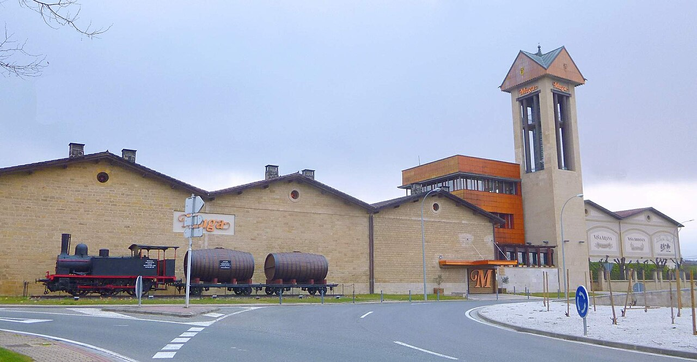
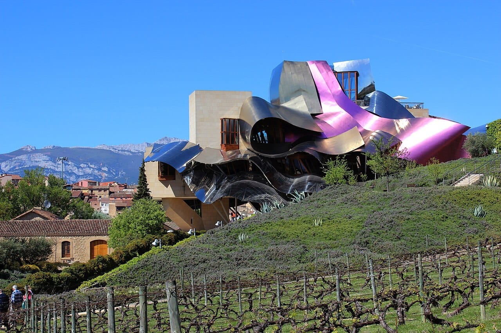

# 姆加酒庄

哈罗车站区（Barrio de la Estación）是一条很短的街，却挤着里奥哈最密集的老酒庄。姆加的门面是一栋 200 年的石宅，门口没有夸张的招牌，院子里却停着橡木桶与制桶工具。它不像瑞格尔侯爵那样用 Gehry 的金属波浪吸引目光，而是把“桶”放在第一位：自己选木、自己制桶、自己修桶，连发酵槽都是橡木的。理解姆加，先理解这家酒庄对“木”的执念。

图：哈罗车站区的姆加酒庄建筑与酒桶。图片：Zarateman，CC0，via Wikimedia Commons（[原图页面](https://commons.wikimedia.org/wiki/File:Haro_-_Bodegas_Muga_1b.jpg)）。

## 1932 年：姆加酒庄的关键起点
1932 年，Isaac Muga 与 Aurora Caño 在哈罗创立酒庄。他们从一个小酒坊开始，逐渐买下车站区的老宅与地块。今天酒庄由家族第三代经营，仍保持“家族所有、家族管理”的结构。姆加不是里奥哈最大的酒庄，却是最能让人看到传统工艺链条的酒庄之一：葡萄、压榨、发酵、陈年、制桶、修桶，几乎都在同一个院子里完成。

酒庄的名字在里奥哈常与“传统”连在一起，但传统不是一成不变。姆加在 1990 年代开始做更现代的 Torre Muga 与 Aro，同时保留 Prado Enea 的长时间陈年。它没有把老酒窖改成博物馆，而是继续使用橡木大槽、蛋清澄清与重力倒罐；这些工艺费时、费人，却是酒庄风格的一部分。

## 建筑与空间

姆加的老宅与酒窖是典型的哈罗车站区建筑：石墙、木梁、地下拱顶、窄长的通道。发酵间里有巨大的橡木槽，不用不锈钢；酒窖里是成排的橡木桶，部分桶龄很长，酒庄会定期检查、修复或更换。制桶车间就在旁边，木料堆在院子里， cooper 用火烤桶、装箍、试水。参观时你能闻到新木、旧木、酒液与潮湿石头的混合气味，这是姆加最真实的空间体验。

车站区本身也是“建筑”：19 世纪的铁路把哈罗连到毕尔巴鄂与马德里，酒庄沿铁路建仓库与酒窖，方便装桶、装瓶与出口。今天老车站还在，铁轨旁的酒庄群成为里奥哈葡萄酒旅游的核心。姆加不靠一栋奇观建筑取胜，而是靠一组仍在工作的老房子。

## 酒单与味觉

Muga Reserva 是入口：Tempranillo 为主，加入 Garnacha、Graciano 与 Mazuelo，经橡木桶陈年，风格平衡，红樱桃、香草、烟草与皮革。Selección Especial 是更严格的选果版本，结构更集中。Prado Enea Gran Reserva 是酒庄的经典：只在好年份做，长时间在橡木桶与瓶中陈年，香气有干果、雪松、蘑菇、皮革与香料，单宁细，适合 15–25 年。Torre Muga 是 1990 年代开始的现代线，葡萄来自老藤，新桶比例更高，风格更浓、更黑莓与香料。Aro 是更晚的限量线，产量小，风格最集中。

姆加的白葡萄酒也值得注意：以 Viura 为主，部分在橡木桶中发酵，柑橘、白花、坚果与矿物，适合配海鲜。不要把姆加只当成“红葡萄酒酒庄”；它的白与甜酒同样能说明酒庄对木与时间的控制。

## 怎么喝

红葡萄酒 16–18°C。Reserva 提前 30 分钟开瓶；Prado Enea 提前 1 小时，或换瓶一次；Torre Muga 年轻时可 1–2 小时；Aro 需要更长时间，但不要用暴力醒酒。白葡萄酒 10–12°C，不要冰到 8°C 以下。

配餐上，Reserva 配烤羊排、火腿、蘑菇与炖豆；Prado Enea 配熟成牛肉、野味、硬质奶酪；Torre Muga 配烤肉与浓郁酱汁；Aro 配红肉与松露。白葡萄酒配海鲜、烤鱼与软奶酪。避免过辣；里奥哈的橡木与香料需要油脂来托住。

## 姆加酒庄的地址与营业安排
地址：Calle Barrio de la Estación s/n, 26200 Haro, La Rioja。酒庄参观约 90 分钟，含酒窖、制桶车间与两款酒品鉴，价格 30 欧元；提供西班牙语与英语，最多 10 人，参与者需满 12 岁，取消需提前 48 小时。参观需预约，具体时段以官网为准。从 Logroño 自驾约 30 分钟，从 Bilbao 约 1 小时 15 分，从 Vitoria-Gasteiz 约 45 分钟；哈罗车站区停车位有限，建议提前到。

周边可以走[哈罗车站酒庄路线](ref:route)：姆加、[López de Heredia](ref:lopez)、[CVNE](ref:cvne) 都在步行范围内。若想把里奥哈的传统与现代对照，可以再去[瑞格尔侯爵](ref:riscal) 看 Gehry 酒店；但一天不要安排三家深度品鉴。

## 礼仪与常见误区

第一，制桶车间不是“拍照道具”；木料、火与工具都有风险，必须跟向导走，不要触碰半成品桶。第二，蛋清澄清不是“落后工艺”；它是酒庄控制单宁与澄清度的传统方法，不要用“现代化”一概否定。第三，Prado Enea 不是“姆加的副牌”；它是独立的 Gran Reserva 线，年份选择与陈年都不同。

第四，12 岁以下不能参加参观，这是酒庄规则，不是歧视；带孩子的家庭可以改为在镇上吃饭或分开参观。第五，不要要求“临时加人”或“迟到入场”；小团参观与酒窖空间有限，迟到会影响整组。第六，里奥哈的橡木味不是越重越好；桶龄、烘烤与陈年时间都会改变风格。

蛋清澄清与重力倒罐是酒庄的工艺选择，不是所有酒款都同一路线；Reserva 与 Aro 的陈年策略也不同。

Reserva 与 Prado Enea 的陈年桶龄和时长不同；Torre Muga 与 Aro 又是另一套选园逻辑。

## 从姆加酒庄延伸到López de Heredia
哈罗车站区可以步行串起姆加、[López de Heredia](ref:lopez) 与 [CVNE](ref:cvne)；往南是哈罗老城与葡萄园，往北是 Briones 的中世纪小镇，往东是 Logroño。若只有半天，姆加参观加车站区散步足够；一天可以加 Briones 或 Laguardia。把[瑞格尔侯爵](ref:riscal) 放在另一天，避免建筑与品鉴都赶。

不要把姆加的品鉴安排在开车前；哈罗到 Logroño 的公路车流大，夜间乡间道路照明一般。若乘火车来，哈罗车站就在酒庄区旁边，步行即可，但班次不密，要提前查时刻。

**关键事实。**

| 项目 | 内容 |
| --- | --- |
| 一句话定位 | 哈罗（Haro）车站区的家族酒庄，1932 年由 Isaac Muga 与 Aurora Caño 创立；酒庄保留 200 年历史的老宅、橡木大槽与自建制桶车间，坚持蛋清澄清、重力倒罐与长期橡木陈年 |
| 地址 | Calle Barrio de la Estación s/n, 26200 Haro, La Rioja, Spain |
| 城市/国家 | 哈罗 / 西班牙 |
| 营业状态 | 已核验营业 |
| 官网 | bodegasmuga.com |

**来源与边界。** 本页关于「姆加酒庄」的关键事实，主要由以下来源交叉核对：Bodegas Muga（1932 年创立、200 年历史老宅、Barrio de la Estación、自建制桶车间、橡木大槽、蛋清澄清、重力倒罐与长期橡木陈年；Isaac Muga 与 Aurora Caño、三代家族经营、传统与创新并行的酒庄理念）。产品、地址或营业状态变化较快时，以 bodegasmuga.com 的最新页面为准；价格、批次与状态会变，涉及这些字段时以页面所列来源的最新版本为准。正文为项目自写，来源只作核验，不复制原文。

## 参考资料
- 里奥哈对照：[瑞格尔侯爵](ref:riscal)、[López de Heredia](ref:lopez)、[CVNE](ref:cvne)、[哈罗车站酒庄路线](ref:route)。
- 背景阅读：[里奥哈产区](ref:rioja)。
- 本页不提供地图；参观价格、时段与规则以官方渠道为准。

对照阅读：[瑞格尔侯爵酒庄](ref:riscal)、[CVNE 酒庄](ref:cvne)。

## 相关图像

图：Frank Gehry 设计的瑞格尔侯爵酒店与葡萄园。图片：Roderich Kahn，CC BY-SA 4.0，via Wikimedia Commons（[原图页面](https://commons.wikimedia.org/wiki/File:Elciego_-_Marqu%C3%A9s_de_Riscal_Hotel_RK01.jpg)）。关联图像：姆加酒庄。
