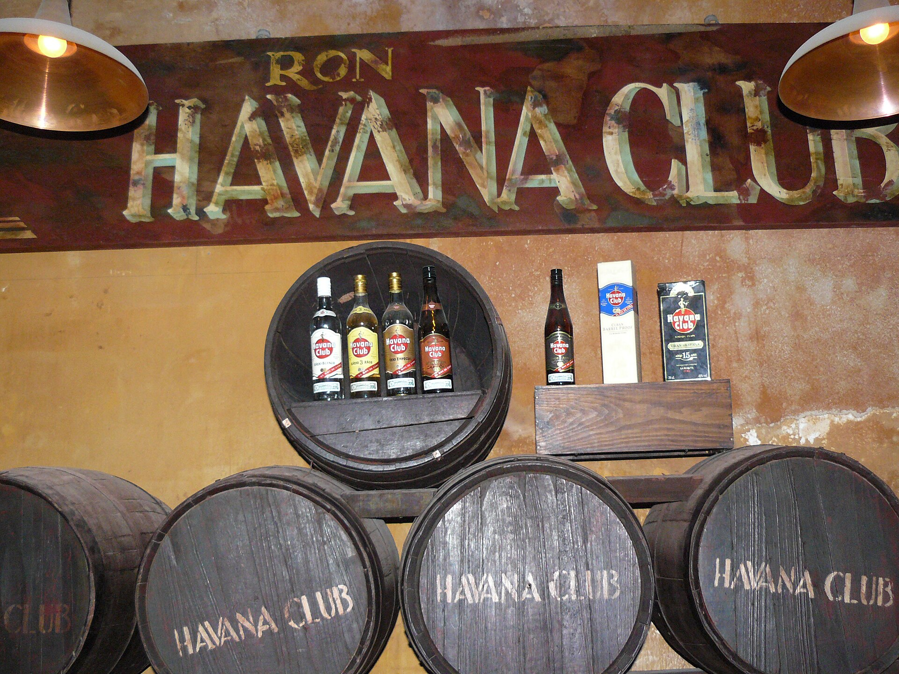
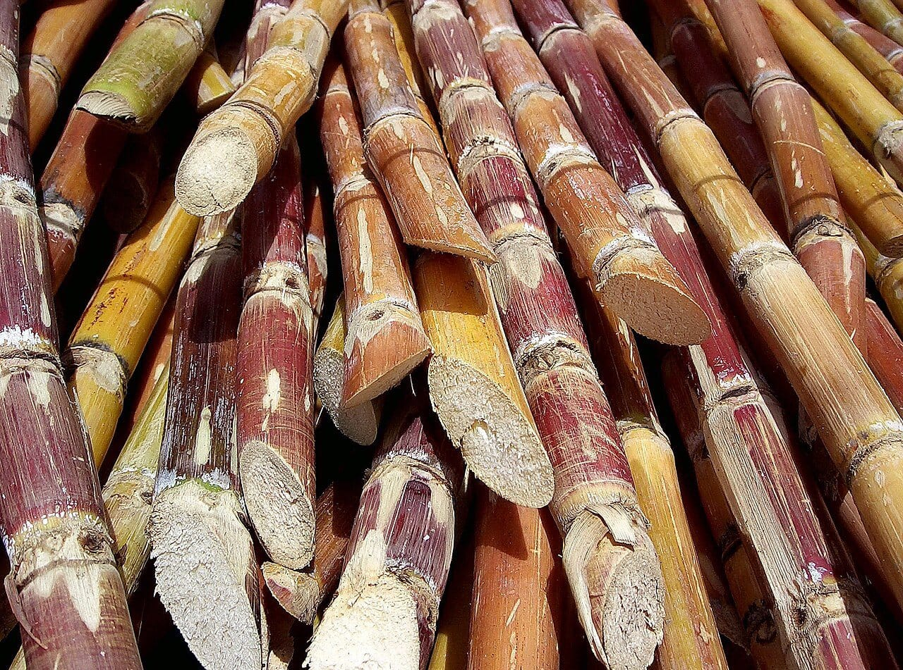

# 哈瓦那朗姆酒博物馆

哈瓦那朗姆酒博物馆（Museo del Ron Havana Club）在哈瓦那老城的港口大道 262 号，与索尔街（Sol）转角，门面是一栋 18 世纪的殖民时期宅邸。它由 Havana Club 品牌运营，2000 年 3 月 31 日开馆，展线从甘蔗、糖蜜与发酵讲起，经过蒸馏与陈年，最后落到吧台与商店。对第一次到古巴的人来说，这里不是“酒厂参观”，而是一座把朗姆酒放回糖业、港口与城市生活的博物馆。

图：哈瓦那朗姆酒博物馆相关实景照片。图片：Antonio Bermudez Chi…，CC BY 3.0，via Wikimedia Commons（[原图页面](https://commons.wikimedia.org/wiki/File:Museo_Havana_Club_-_panoramio.jpg)）。

## 港口大道 262 号：一栋 18 世纪宅邸

博物馆在哈瓦那老城北侧、靠近港湾的港口大道上，从圣弗朗西斯科广场一带步行过来不远。建筑是典型的殖民时期宅邸：厚墙、高窗、内院与回廊，黄色外墙在街上很好认。展览分布在宅邸的多个空间里，参观时会不断在室内展厅与庭院之间切换；这种空间节奏本身就是展品的一部分，说明朗姆酒博物馆不是在一座新建展馆里摆酒瓶，而是利用老城建筑讲老城产业。

导航可搜“Museo del Ron Havana Club, Avenida del Puerto 262”，老城单行道多，步行到门口更稳。地址在不同资料里有 262 与 162 两种写法，本文采用 Havana Club 官网与古巴通讯社 2026 年报道的 262 号；现场以门牌与官方地图为准。博物馆位于步行友好的老城区，建议穿好走的鞋，不要把行程安排得太紧。

## 2000 年开馆与 Havana Club 的角色

博物馆在 2000 年 3 月 31 日开馆，由 Havana Club 品牌运营。它把品牌史与古巴朗姆酒史放在一起讲：一方面展示甘蔗、糖厂、蒸馏与陈年，另一方面展示 Havana Club 的产品线与古巴调酒文化。对品牌来说，这是一座“品牌博物馆”；对游客来说，它也是理解古巴朗姆酒最方便的入口之一。两者并不矛盾，但看展时要意识到叙事立场。

古巴的朗姆酒传统与“朗姆酒大师”（Maestros del Ron Cubano）的知识体系在 2022 年被联合国教科文组织列入人类非物质文化遗产代表作名录。博物馆的展览与品鉴活动会提到这批大师的传承，强调经验、感官判断与代际传授，而不只是设备与配方。把这一点放进参观重点，会比只记品牌名更有收获。

## 展线：甘蔗、模型糖厂与陈年仓库

展线从[甘蔗](ref:sugarcane)开始：甘蔗如何传入古巴、如何压榨、糖蜜如何成为朗姆酒的原料。馆内有一座比例很大的模型糖厂，带有微型蒸汽机与传动装置，用来解释甘蔗从田间到糖厂的过程；这类模型是博物馆最受孩子与摄影者欢迎的部分。接着是发酵、蒸馏与陈年：可以看到旧式蒸馏设备、橡木桶与制桶工具，理解[糖蜜](ref:molasses)如何变成酒液，再进入桶中陈年。

陈年部分会提到[天使的分享](ref:angels-share)：酒液在热带仓库中蒸发，每年损失一部分，剩下的酒液颜色更深、风味更集中。博物馆用桶、工具与图像解释这套过程，而不是让游客只看一排酒瓶。最后一站通常是酒吧与商店：酒吧提供经典古巴鸡尾酒，商店出售 Havana Club 全系列与限定装瓶。把展线与一杯酒连起来，是这座博物馆最有效的参观方式。

## 吧台、商店与周五的“朗姆与传统”

博物馆的酒吧不是普通 museum café，而是展览的延伸：调酒师用 Havana Club 做经典与当代古巴鸡尾酒，游客可以在参观后坐下来喝一杯。商店则集中展示 Havana Club 的产品线，从日常的 3 年、7 年到更高端的 Selección de Maestros 等。对想买酒的人，这里的选择比普通超市完整；但价格与库存会变，不要把它当成免税店。

博物馆每周五下午三点起有“朗姆与传统”（Tardes de Ron y Tradición）活动，包含现场音乐、以 Havana Club 为基酒的调酒比赛与抽奖。2026 年 11 月 10 日与 12 日，博物馆还将举办第三期“朗姆之魂”（El alma del Ron）特别项目，两场各两小时，内容涉及甘蔗与朗姆酒的历史、糖蜜与新鲜甘蔗烈酒的演示、陈年变化，以及高端 Havana Club 的品鉴；费用为 3,000 古巴比索，预约电话 52858630。活动信息会更新，参加前先向博物馆确认。

## 体验线路：45 分钟到近两小时

博物馆把参观做成不同长度的体验：基础导览约 45 分钟，走完展线后在结尾品鉴一杯 Havana Club；“Los Pilares”约 1 小时 15 分钟，品鉴 3 年、7 年与 Selección de Maestros 三款代表性酒；“Shaker”约 1 小时 30 分钟，在调酒师带领下学做两款古巴经典鸡尾酒；“Los Reyes de la Habana”约 1 小时 40 分钟，把朗姆酒与古巴雪茄配对；“Prestige”约 1 小时 45 分钟，品鉴更高端的限定酒款；“Embotellado”约 1 小时 40 分钟，可以参与装瓶并带走一瓶带自己签名的酒。

第一次来选 45 分钟基础导览就够，想认真喝就选 Los Pilares 或 Prestige；对鸡尾酒感兴趣选 Shaker，对雪茄感兴趣选 Los Reyes。线路名称与价格会调整，现场以博物馆票务页为准。不要默认“门票含所有品鉴”，不同线路包含的酒款数量与等级不同。

## 预约、时间与实用提示

博物馆每天开放，常见营业时间为 9:00–16:30，具体场次与闭馆日以官网和现场公示为准。参观建议提前在线预约，旺季、邮轮停靠日与周末下午容易满场；如果只想喝酒，可以直接去酒吧，但酒吧也可能被活动占用。团队、私人品鉴与雪茄配对需要更早安排。

到访时带护照或身份证件，遵守馆内拍摄提示；部分展厅光线暗、地面有台阶，穿防滑鞋。品鉴时不要空腹，先闻香、小口喝，不想喝完可以留在杯中；如果还要开车，绝对不要饮酒。哈瓦那老城适合步行，但午后炎热，带水与帽子比赶场更重要。

## 博物馆之外：把朗姆放回古巴酒文化

把这座博物馆放进一天的行程，可以上午看展与品鉴，中午在老城吃饭，下午去海明威常去的酒吧点一杯[莫吉托](ref:mojito)或[代基里](ref:daiquiri)，晚上再回到港口大道看夜景。博物馆讲的是“如何生产”，酒吧讲的是“如何饮用”，两者合起来才是古巴朗姆酒文化。对只想打卡的人，45 分钟足够；对想理解风味的人，至少留出两小时，并把品鉴与酒吧体验分开。

哈瓦那的这座博物馆以品牌与城市为中心，圣地亚哥的那座则以东部产业与地方记忆为中心；两座馆合起来，能看到古巴朗姆酒的两条叙事线。无论先去哪一座，都先读[朗姆酒](ref:rum)的基本类别，再带着问题去看展，收获会比被动跟着导览多。

对照阅读：[朗姆酒](ref:rum)、[糖蜜](ref:molasses)。

## 相关图像

图：收获后切段的甘蔗茎，可见节与节间。图片：ruurmo，CC BY-SA 2.0，via Wikimedia Commons（[原图页面](https://commons.wikimedia.org/wiki/File:Cut_sugarcane.jpg)）。关联图像：哈瓦那朗姆酒博物馆。
