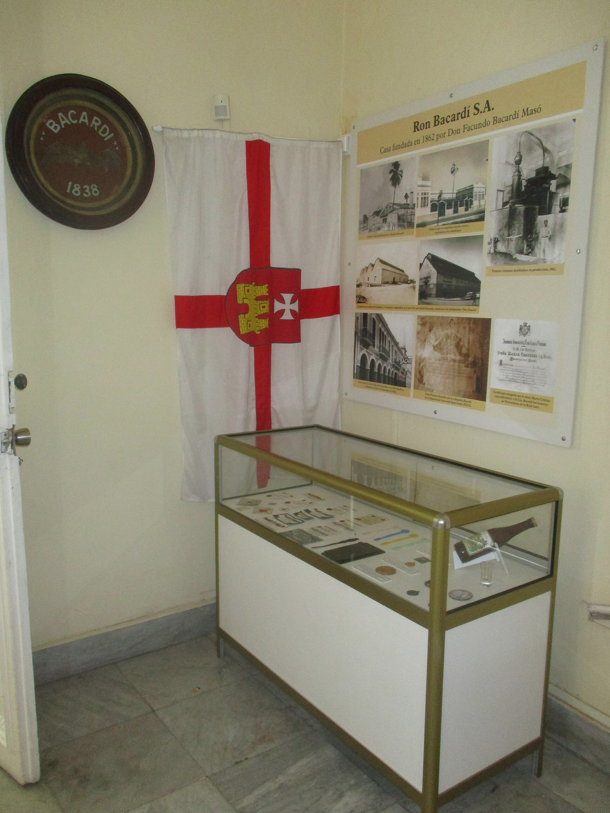
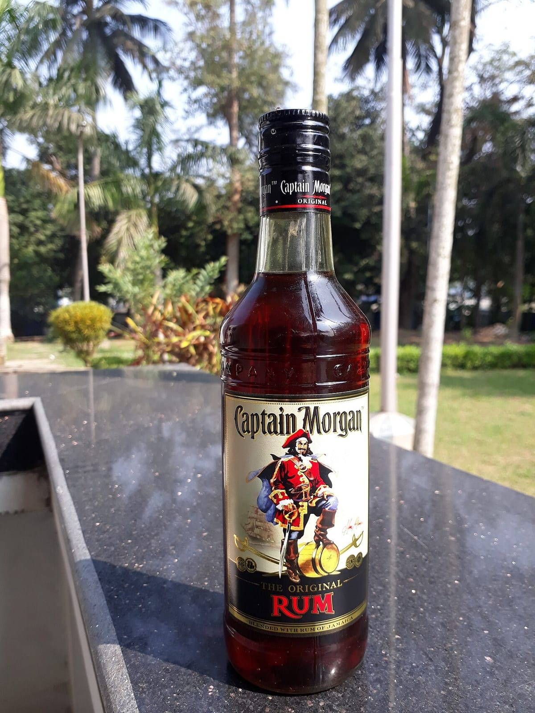

# 圣地亚哥朗姆酒博物馆

圣地亚哥朗姆酒博物馆（Museo del Ron）在圣地亚哥-德古巴老城的圣巴西利奥街 358 号，夹在皮奥·罗萨多街与圣费利克斯街之间。它占着一栋 1889 年建成的两层宅邸，1996 年 6 月 24 日作为朗姆酒博物馆开放，用六个展厅、一条旧装瓶线与一座酒馆，讲古巴东部——尤其是圣地亚哥——的朗姆酒产业。与哈瓦那那座由 Havana Club 运营的品牌博物馆相比，这里更小、更地方，也更像一座城市产业记忆的陈列室。

图：圣地亚哥朗姆酒博物馆相关实景照片。图片：Pintolin，CC BY-SA 4.0，via Wikimedia Commons（[原图页面](https://commons.wikimedia.org/wiki/File:Espacio_Bacard%C3%AD.jpg)）。

## 圣巴西利奥街 358 号的老宅

博物馆在圣地亚哥历史中心，步行可达塞斯佩德斯广场与赫雷迪亚街一带。建筑是折衷主义与新古典主义混合的两层宅邸，临街有围栏与一个小花园，入口处摆着一台新古典风格的蒸馏器；这些细节让它在老城街景里很容易辨认。宅邸最初为军官金德拉姆·莫索·德拉托雷（Kindelán Mozo de la Torre）所建，后来属于巴卡第公司财务主管马里亚诺·戈麦斯·比利亚萨纳（Mariano Gómez Villasana），20 世纪中期后经历多种用途。

导航可搜“Museo del Ron Santiago de Cuba, San Basilio 358”，用馆名比只输街名更可靠。门牌与街名有几种写法：San Basilio 358、Bartolomé Masó 358，指的是同一条街的不同名称；导航时用“Museo del Ron Santiago de Cuba”比只输街名更稳。老城街道窄、单行道多，开车来要预留找车位的时间，步行或打车更省心。另有旅游页面称博物馆现设于城东的 Ronera Santiago de Cuba；旧宅与酒厂展区的关系在公开资料中并不一致，出发前以官方渠道确认。

## 1889 年宅邸与 1996 年建馆

宅邸建于 1889 年，最初是私人住宅；1959 年革命后，1972 年曾作为古巴-苏联友好之家，1994 年又成为“La Quinta Esperanza”文化空间。1996 年 6 月 24 日，它正式作为 Museo del Ron 开放。这个时间线说明：博物馆不是从零新建的展馆，而是把一栋有多次身份转换的老宅改造成产业博物馆；展陈与建筑之间的关系，比展柜里的酒瓶更值得看。

圣地亚哥的朗姆酒史可以追溯到 1862 年，当地资料把这座城市称作“轻朗姆酒的摇篮”（Cuna del Ron Ligero）。加泰罗尼亚与法国移民、港口、铁路与糖厂把蒸馏设备带到东部，圣地亚哥因此形成了与哈瓦那不同的产业传统。理解这一点，再看博物馆里的旧设备与品牌故事，就不会把它当成“哈瓦那博物馆的分馆”。

## 六个展厅：从甘蔗到装瓶线

第一展厅讲[甘蔗](ref:sugarcane)的起源、传入古巴与制糖过程；第二展厅用生产流程图解释朗姆酒的酿造；第三展厅陈列当代朗姆酒瓶，其中包括 Havana Club 的多个系列；第四展厅在庭院里展示制桶与陈年用桶，是馆内最完整的桶具收藏；第五展厅是一条 1930 年代的装瓶线，七台原装机器仍在展出；第六展厅讲圣地亚哥朗姆酒产业史，分为 Ron Caney 与 Matusalén 两家旧厂的模型，以及 1959 年前的工厂照片与酒标。

这条展线把“原料—生产—品牌—陈年—装瓶—地方史”串起来，信息密度比哈瓦那博物馆更偏地方志。参观时不要只看酒瓶：庭院里的桶、装瓶线上的机械、墙上的老照片，才是理解东部产业的关键。馆内收藏了八十多种古巴与加勒比朗姆酒，其中不少是外国游客捐赠的，这部分展品会随捐赠变化，不必按固定清单期待。

## 圣地亚哥为何自称朗姆摇篮

古巴朗姆酒的起源叙事通常把东部放在前面：甘蔗种植、糖厂与蒸馏设备较早在这里形成规模，1862 年被视为圣地亚哥朗姆酒产业的重要节点。圣地亚哥的朗姆酒大师传统延续了八代以上，强调感官判断与代际传授；2022 年，“古巴朗姆酒大师”的知识被联合国教科文组织列入人类非物质文化遗产代表作名录，这让地方传统获得了国际层面的承认。

不过，“摇篮”是地方叙事，不是排他性的法规结论。哈瓦那、圣何塞等地也有重要酒厂，古巴朗姆酒的整体风格由多家生产者共同塑造。把圣地亚哥放回[朗姆酒](ref:rum)与古巴糖业的历史里，会比争论“谁更早”更有意义。博物馆的价值也不在“最早”，而在它保存了东部产业的地方记忆。

## 酒款与品尝：从 Matusalén 到 Ron Santiago

馆内展示的品牌包括已经消失的 Matusalén、仍在生产的 Ron Santiago、Caney、Caribbean Club 等。圣地亚哥是 Ron Santiago de Cuba 的产地，这款酒以东部风土与较轻盈的酒体著称；Caney 则是本地另一条历史品牌线。博物馆的酒馆提供朗姆酒品尝与鸡尾酒，门票通常包含讲解与一杯品尝，具体酒款与价格以现场为准。

品尝时可以把“轻朗姆”与“重朗姆”对照：圣地亚哥的许多酒款酒体较清、香气偏柑橘与甘蔗，适合纯饮也适合调酒；牙买加的高酯朗姆则更厚重、更具溶剂感。把[糖蜜](ref:molasses)、[蒸馏](ref:distillation)与[壶式蒸馏](ref:pot-still)的差别搞清楚，再喝一口，就能理解为什么同一座岛上会出现不同风格。

## 门票、时间与到访方式

常见开放时间是周一至周六 9:00–17:00，门票约 2 欧元，含讲解与品尝；酒馆营业到较晚，适合参观后坐下来喝一杯。价格、讲解语言与场次会调整，出发前以现场公示或古巴旅游官方渠道为准。团队参观建议提前电话联系，博物馆电话在不同资料中写作 +53 22 62 3737，拨打前先确认区号与线路。

博物馆在历史中心，周边还有塞斯佩德斯广场、大教堂、Casa de la Trova 与迭戈·贝拉斯克斯故居，适合串成半日步行路线。上午参观、中午在老城吃饭、下午听音乐，是比“赶来赶去”更合适的节奏。若带着孩子，装瓶线与模型通常比酒标更有吸引力；但品鉴环节要按年龄与当地规定处理。

## 与哈瓦那博物馆的分工

哈瓦那的 Museo del Ron Havana Club 由品牌运营，展线更国际化，品鉴线路更多，酒吧与商店更强；圣地亚哥的 Museo del Ron 由地方产业记忆出发，展品更杂、更旧，建筑与城市的关系更紧密。两座馆不是替代关系，而是古巴朗姆酒叙事的两个端点：一个讲品牌与国家市场，一个讲东部地方产业与移民技术。

如果只去一座，第一次到古巴、想快速建立框架的人可以选哈瓦那；已经在东部、想理解圣地亚哥为什么自称“摇篮”的人，应该来这座。参观前读一遍[产地与工艺](ref:place-and-process)，再看展线，会更容易把甘蔗、糖蜜、蒸馏与陈年连成一条线。

相关条目：[朗姆酒](ref:rum)、[甘蔗](ref:sugarcane)。

## 相关图像

图：一瓶 Captain Morgan 原味朗姆酒，深色酒液与品牌标签。。图片：Pinakpani，CC BY-SA 4.0，via Wikimedia Commons（[原图页面](https://commons.wikimedia.org/wiki/File:Bottle_of_Captain_Morgan_Rum_01.jpg)）。关联图像：圣地亚哥朗姆酒博物馆。
