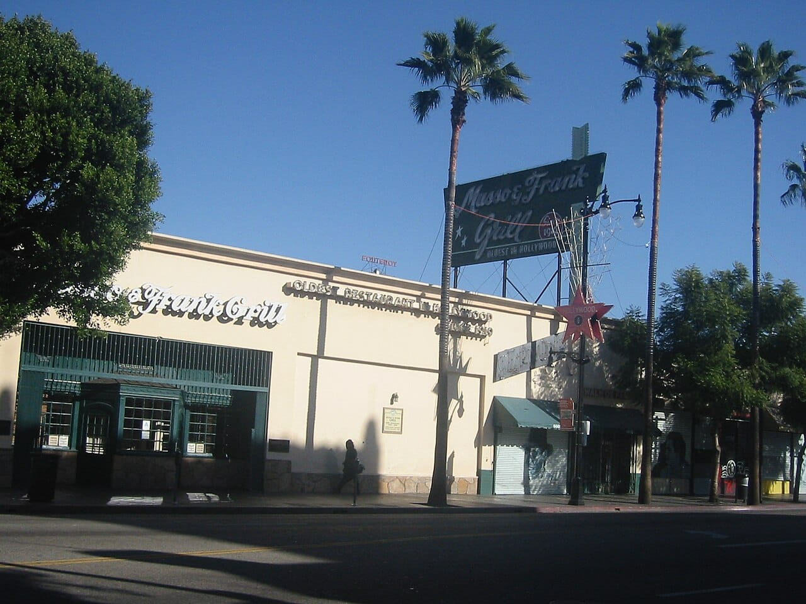
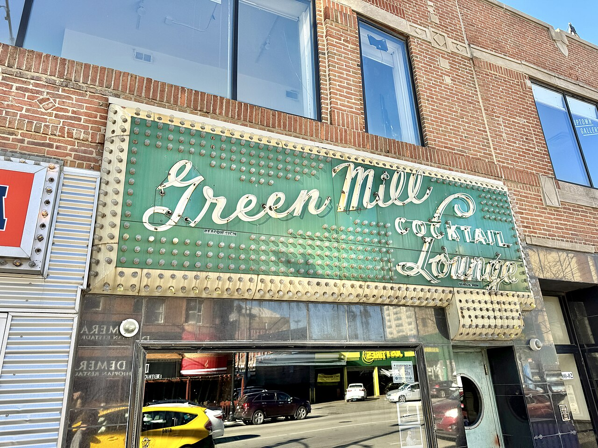

# 穆索与弗兰克烤肉馆

好莱坞大道 6600 号段并不安静：星光大道上的游客、销售员、穿着卡通服装的表演者混在一起，霓虹招牌一块接一块。穆索与弗兰克（Musso & Frank Grill）就在这段街上，门面是一栋低矮的米色建筑，屋顶架着绿色手写体招牌，门口两棵棕榈树把影子投在墙上。它没有把“好莱坞”做成主题装饰，而是把好莱坞的旧工作方式保留下来：红色制服侍者、木质卡座、干马天尼、法兰绒蛋糕，以及一种“先让你坐稳，再慢慢上菜”的节奏。

图：好莱坞大道 Musso & Frank Grill 的完整店面与屋顶招牌；餐厅 1919 年以 Frank's Café 开业，1920 年代与 Joseph Musso 合伙后改为现名，照片为后来的历史街景，不是 1919 年开业当天的原貌。图片：Gary Minnaert，Public domain，via Wikimedia Commons（[原图页面](https://commons.wikimedia.org/wiki/File:Musso%26Franks_05.jpg)）。

## 1919 年：穆索与弗兰克烤肉馆的关键起点
1919 年 9 月 27 日，好莱坞本地报纸刊登了一则小消息：Frank Toulet 在 6669 Hollywood Boulevard 开出 Frank's Café。几年后，Toulet 与来自俄勒冈的餐厅经营者 Joseph Musso 合伙，餐厅改名为 Musso & Frank's Grill，并请来法国厨师 Jean Rue 设计菜单。1927 年，两位意大利移民 Joseph Carissimi 与 John Mosso 买下餐厅；后来他们把店搬到隔壁的 6667 Hollywood Boulevard，也就是今天的位置。

1934 年，餐厅的“Back Room”开放。那是一个被严格门卫把守的私人空间，专门接待好莱坞精英；今天的“New Room”仍保留着 Back Room 原来的吧台、灯具与家具。1955 年，New Room 加入，形成今天两个主要用餐空间的格局。餐厅由 Mosso 家族的后代经营，官方说今天的所有者是 John Mosso 的三位孙女及其子女——这解释了为什么它不像很多“历史餐厅”那样被改造成连锁品牌，而仍有一种家族生意的连续性。

“好莱坞最老餐厅”是它最常被使用的称号。更准确的说法是“好莱坞持续营业最久的餐厅之一”：1919 年开业，开业后十余年搬到现址，除了短暂整修外一直在营业。它不是洛杉矶县最老的餐厅，也不是美国最老的餐厅；把“好莱坞”这个限定去掉，就会变成另一个更容易被质疑的说法。

餐厅的文化名单很长：F. Scott Fitzgerald、William Faulkner、Raymond Chandler、Charles Bukowski 等作家，Chaplin、Valentino、Marilyn Monroe 等电影人，都曾在不同年代出现在这里。它也是好莱坞作家与制片人“谈项目、改剧本、喝一杯再回去上班”的地方。今天这些名字被印在菜单与墙上，但餐厅没有把自己做成“名人博物馆”；红色制服侍者仍按老方式端菜，吧台仍按老配方调马天尼，这种日常感比任何展板都更有说服力。

## 空间与酒单

餐厅分为前厅、主餐厅与 New Room。前厅靠近吧台，光线较亮，适合等位或快速喝一杯；主餐厅是红色皮质卡座与深色木饰，桌距比现代餐厅宽；New Room 更安静，保留 1934 年 Back Room 的旧吧台与灯具。红色制服是服务团队的传统着装，不是主题装扮；它从 20 世纪中期沿用至今，成为餐厅识别度的一部分。

菜单是经典的烤肉馆与欧陆菜组合：干式熟成牛排、prime rib、羊排、龙虾、法式洋葱汤、鸡肉派、sand dabs（一种加州小鱼），以及甜点法兰绒蛋糕（flannel cakes）。吧台以干马天尼、曼哈顿、古典鸡尾酒与威士忌为主，也有葡萄酒与啤酒。它不是“创新加州料理”餐厅，优势在于火候、酱汁、服务节奏与空间；若期待小盘、共享、现代摆盘，会与它的性格不合。

## 怎么喝

第一次来，建议先坐吧台喝一杯干马天尼，再入座吃正餐。点马天尼时说清楚要干型还是 extra dry、要不要橄榄或 twist；如果不确定，让吧台按经典比例做。正餐可以从洋葱汤或半打生蚝开始，主菜选牛排或 prime rib，配一杯赤霞珠、波尔多或威士忌。法兰绒蛋糕适合收尾，它更像“热薄饼配黄油与糖”，不是现代法式甜点。

时间上，晚餐开门时到达最舒服，吧台还有位置，餐厅也未满；晚上八点后进入高峰，没有预订会等很久。午市比晚市轻松，适合看空间细节。若想感受旧好莱坞的“下班后”气氛，选周二至周四晚间，比周末更安静。

## 穆索与弗兰克烤肉馆的地址与营业安排
地址是 6667 Hollywood Boulevard, Los Angeles, CA 90028。它位于好莱坞大道北侧，靠近 Highland 与 Hollywood/Highland 地铁站；周边是星光大道、TCL 中国剧院与杜比剧院。官方营业时间为周二至周六 17:00–23:00、周日 16:00–22:00，周一休息；节假日与私人活动会调整。

餐厅接受预订，晚餐与周末建议提前订；吧台通常留给散客，先到先得。没有严格着装要求，但它是正式餐厅，商务休闲比短裤拖鞋更合适。美国法定饮酒年龄为 21 岁，点酒需带证件。小费按税前 18%–20% 是常规；如果点了整瓶酒或得到切肉服务，可以适当提高。

## 礼仪与常见误区

第一个误区是把“好莱坞最老”说成“洛杉矶最老”或“美国最老”；餐厅的限定词是“Hollywood”，去掉会失真。第二个误区是把红色制服当成“主题表演”；那是服务团队的传统制服，不是 cosplay。第三个误区是只拍照不消费；这里是营业餐厅，吧台与卡座优先给用餐客人。第四，不要要求侍者讲名人八卦；他们首先在做服务工作。第五，干马天尼不是“越干越好”，点单时按自己口味说清楚，不要为了“地道”点一杯自己喝不下的酒。

## 从穆索与弗兰克烤肉馆延伸到丽兹海明威酒吧
从餐厅出来，沿好莱坞大道走几分钟就是星光大道、TCL 中国剧院与杜比剧院；往北可到 Hollywood Bowl 方向，往南可去 Sunset Boulevard。把 Musso & Frank 放进“好莱坞一日”很自然：白天看剧院与博物馆，傍晚在这里喝马天尼、吃牛排，再去听一场演出。想比较不同城市的“作家与酒吧”传统，可以读[丽兹海明威酒吧](ref:hemingway)、[干马天尼](ref:martini)、[绿磨坊](ref:green-mill)、[Buena Vista Café](ref:buena-vista)与[认识一座城，从一间酒馆开始](ref:pub-city)。

**关键事实。**

| 项目 | 内容 |
| --- | --- |
| 一句话定位 | 好莱坞大道上的 Musso & Frank Grill，1919 年以 Frank's Café 开业，1920 年代改名，1930 年代形成今日空间；红色制服侍者、干马天尼、法兰绒蛋糕与好莱坞作家常客构成它的传奇 |
| 地址 | 6667 Hollywood Boulevard, Los Angeles, CA 90028, United States |
| 城市/国家 | 洛杉矶 / 美国 |
| 营业状态 | 已核验营业 |
| 官网 | mussoandfrank.com |

## 参考资料
- [丽兹海明威酒吧](ref:hemingway)
- [干马天尼](ref:martini)
- [绿磨坊爵士酒吧](ref:green-mill)
- [Buena Vista Café](ref:buena-vista)
- [认识一座城，从一间酒馆开始](ref:pub-city)

本页于 2026-11-21 核对 Musso & Frank Grill 官方页面。营业时间为周二至周六 17:00–23:00、周日 16:00–22:00，周一休息；晚餐与周末建议订位，吧台通常留给散客。餐厅的“好莱坞最老”限定词不能去掉，红色制服是服务传统而非主题表演，干马天尼也不是越干越好，正文已逐条说明。本页图片是好莱坞大道 Musso & Frank Grill 的完整店面与屋顶招牌，不是内景；图注已标摄影者与许可，文字许可见文末 rights 字段。

## 相关图像

图：芝加哥 Uptown 区 Broadway 的 Green Mill Cocktail Lounge 霓虹招牌；俱乐部起源于 1907 年前后的 Pop Morse's Roadhouse，现址建筑 1914 年完成，现空间在 1935 年成形。图片：Warren LeMay from Chicago, IL, United States，CC BY-SA 4.0，via Wikimedia Commons（[原图页面](https://commons.wikimedia.org/wiki/File:Green_Mill_Cocktail_Lounge_Sign,_Broadway,_Uptown,_Chicago,_IL_(54842064706).jpg)）。关联图像：穆索与弗兰克烤肉馆。
