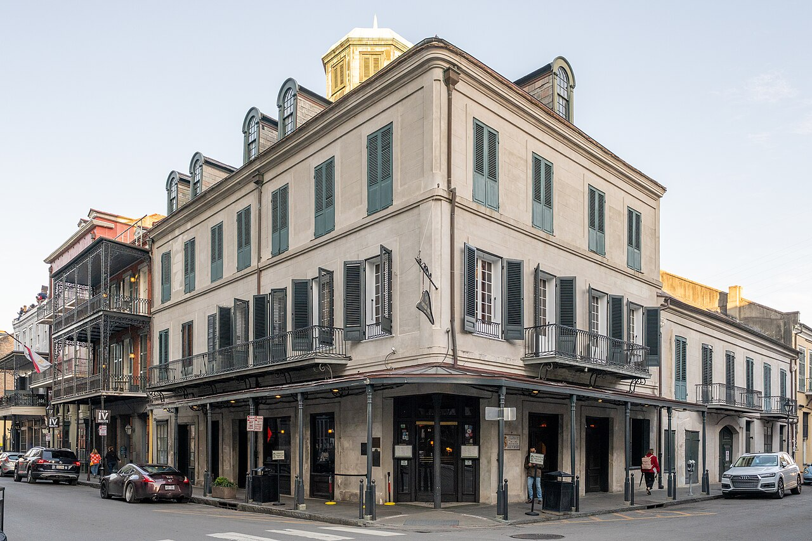
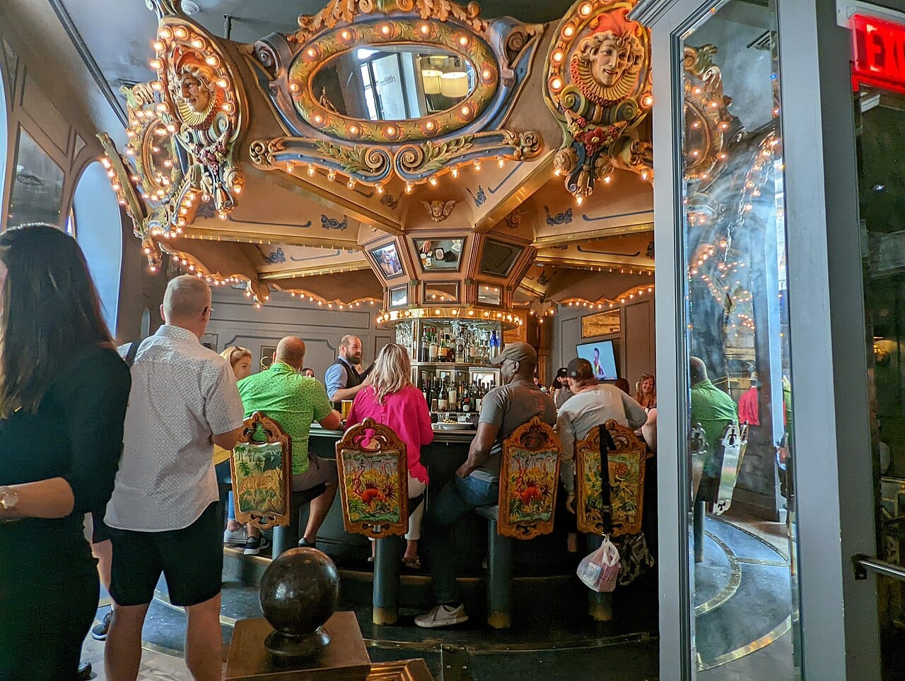

# 拿破仑屋

新奥尔良法国区的 Chartres 与 St. Louis 街角，有一栋三层、灰白灰泥墙、带小穹顶的老屋。它没有法国宫廷式的华丽，反而更像一栋被潮气、雨水与时间反复擦过的加勒比式宅子。门口的酒旗写着“Napoleon House Since 1797”，但真正的故事比门牌更绕：这里从未住过拿破仑，却因为一个“请他來避难”的计划，永久地改了名字。

图：新奥尔良 Chartres 与 St. Louis 街角的拿破仑屋；门牌写 1797 年，主楼在 1814 年由 Girod 扩建。图片：ajay_suresh，CC BY 4.0，via Wikimedia Commons（[原图页面](https://commons.wikimedia.org/wiki/File:The_Napoleon_House_-_New_Orleans_February_2026.jpg)）。

## 1797 年：拿破仑屋的关键起点
官方记载建筑建于 1797 年，最初是 Nicholas Girod 的住宅；Girod 在 1812–1815 年任新奥尔良市长。1821 年，他提出让被流放到圣赫勒拿的拿破仑来此避难，计划还未成行，拿破仑就去世了，屋子却从此被称为“拿破仑屋”。另有地方史指出，门牌上的 1797 可能指隔壁由 Girod 兄弟建的两层附楼，而主楼在 1814 年扩建，因此“1797”与“1814”两个年份并不矛盾，只是指向不同部分。19 世纪这里做过住宅、杂货店与进口商行；1914 年 Impastato 家族接手，Uncle Joe 把楼下的店变成餐厅与酒吧；2015 年 Ralph Brennan 从 Impastato 家族手中接棒，承诺保留旧墙、旧地板与古典音乐。1970 年，这栋楼被列为 National Historic Landmark。

建筑时间线值得再拆一层。官方把起点写 1797 年；地方建筑史认为主楼在 1814 年由 Girod 扩建，门牌沿用较早的附楼年份。Girod 1812–1815 任市长，1815 年辞职后把精力放在 Chartres 街的宅子；1821 年他参与邀拿破仑来新奥尔良避难的计划，拿破仑同年去世，计划落空。19 世纪这里做过杂货、进口商行与住宅；1914 年 Impastato 家族买下，Uncle Joe 用 Victrola 放歌剧唱片，逐渐把楼下变成餐厅。1970 年列为 National Historic Landmark；2015 年 Ralph Brennan 接手后，保留古典音乐、旧吧台与 muffuletta 做法。2019 年 Tales of the Cocktail 把“Timeless American”奖给它，理由不是 novelty，而是长期维持的地方性。

## 空间与酒单

室内最显眼的是斑驳的灰泥墙、旧木吧台、不均匀的地砖与从天花板垂下的酒旗；墙上挂着与拿破仑、法国大革命和新奥尔良历史有关的画与旧物。主餐厅与庭院都可用餐，庭院在天气好时更像一个被老墙围住的露台。酒单的招牌是 Pimm's Cup：官方说 Uncle Joe 在英国旅行时喝到这种低酒精的夏日饮品，把它带回新奥尔良，并称这里是美国第一家供应 Pimm's Cup 的店；做法是 Pimm's No. 1、柠檬水、7-Up 与一片黄瓜。吃的以 muffuletta 最有名，面包夹腌肉、奶酪与橄榄酱，上桌前会加热；此外有 jambalaya、gumbo、red beans and rice 等新奥尔良家常菜。

拿破仑屋的 Pimm’s Cup 与 muffuletta 是三明治与鸡尾酒组合的经典点法，但菜单会随季节调整；把历史名店当成固定菜单，容易点不到想试的那一口。

Pimm’s Cup 是这里的常见点单，庭院与旧吧台比菜单更像历史现场；muffuletta 则把西西里移民的食品传统留在了新奥尔良。

## 怎么喝

如果只喝一杯，点 Pimm's Cup，坐在庭院或靠窗的位置，让黄瓜与柠檬水的清爽压住新奥尔良的湿热；想喝烈一点，可以问吧台要 Sazerac 或当地精酿。吃饭则建议两人分一份 muffuletta，再点一份 gumbo 或 jambalaya，避免同时点太多淀粉与腌肉。这里不接受预订，午餐与傍晚较早时段更容易找到位子；爵士乐节、狂欢节与周末晚上会排长队。古典音乐是店里的固定背景，不要要求换成流行歌。

## 拿破仑屋的地址与营业安排
地址是 500 Chartres Street, New Orleans, LA 70130，位于法国区中心，步行可到 Jackson Square 与 St. Louis Cathedral。最近的有轨电车是 Canal Street 线，坐到 Canal 与 Bourbon 附近再走几分钟；法国区街道窄，开车不如步行。每日 11:00–22:00，不接受预订，具体节假日安排查官网。着装随意，但法国区夏季湿热，室内外温差大，带一件薄外套更舒服。菜单价格中等，Pimm's Cup 与 muffuletta 是多数人的组合。

## 礼仪与常见误区

第一，拿破仑从未到过这里；“避难邀请”是历史计划与城市传说，不是“他住过的房间”。第二，门牌上的 1797 与主楼 1814 年扩建并不矛盾，不要用“官方造假”来解释。第三，Pimm's Cup 的配方在不同资料里有差异，官方版本以 Pimm's No. 1、柠檬水、7-Up、黄瓜为核心，不要擅自加入“秘密配料”当成唯一正解。第四，这里是餐厅与酒吧，不是拿破仑博物馆；墙上的物件可以看，但不要触碰，也不要把餐桌当成拍照道具长时间占用。第五，muffuletta 的橄榄酱很咸，第一次吃可以先要半份。

1797 年建成与 1821 年拿破仑传说要分开；建筑年代不等于酒吧开业年份，1914 年起的家族经营又是另一条线。

## 从拿破仑屋延伸到老苦艾酒屋
从拿破仑屋出来，往南两条街是 Jackson Square 与 St. Louis Cathedral，往东可到 French Market，往西北可到 Bourbon Street 的[老苦艾酒屋](ref:old-absinthe)与[旋转木马酒吧](ref:carousel)。这三处可以组成一条“法国区历史酒吧半日线”：先在这里吃 muffuletta，再去老苦艾酒屋喝 Absinthe Frappé，最后到 Hotel Monteleone 的旋转木马酒吧喝 Vieux Carré。若想理解酒馆与城市空间的关系，可读[酒馆史](ref:taverns)与[认识一座城，从一间酒馆开始](ref:pub-city)；禁酒令如何改变新奥尔良的酒馆生态，见[禁酒令](ref:prohibition)。

**关键事实。**

| 项目 | 内容 |
| --- | --- |
| 一句话定位 | 新奥尔良法国区 500 Chartres Street 的历史建筑与酒吧，1797 年建成，因 1821 年邀拿破仑避难的传说得名，1914 年起由 Impastato 家族经营 |
| 地址 | 500 Chartres Street, New Orleans, LA 70130, USA |
| 城市/国家 | 新奥尔良 / 美国 |
| 营业状态 | 已核验营业 |
| 官网 | napoleonhouse.com |

**来源与边界。** 本页关于「拿破仑屋」的关键事实，主要由以下来源交叉核对：Napoleon House（1914 年 Impastato、2015 年 Ralph Brennan、Pimm's Cup 与 muffuletta 的招牌地位；1797 年建筑、Nicholas Girod、1821 年避难邀请、Uncle Joe 与古典音乐传统）、NOLA Tours（交叉核对“1797 门牌”与 1814 年主楼扩建的时间差、Creole 建筑特征；以官方叙述为主）。产品、地址或营业状态变化较快时，以 napoleonhouse.com 的最新页面为准；价格、批次与状态会变，涉及这些字段时以页面所列来源的最新版本为准。正文为项目自写，来源只作核验，不复制原文。

## 参考资料
- [酒馆史：从酒肆、客栈到酒吧](ref:taverns)
- [认识一座城，从一间酒馆开始](ref:pub-city)
- [禁酒令：禁令改变供给，不消灭需求](ref:prohibition)
- [老苦艾酒屋](ref:old-absinthe)
- [旋转木马酒吧](ref:carousel)

本页于 2026-11-21 核对 Napoleon House 官方页面。每日 11:00–22:00、不接受订位，狂欢节与爵士乐节期间排队会变长，出发前查官网。1797 年建成、1814 年扩建、1914 年起家族经营是三条不同时间线；拿破仑从未到过这里，“避难邀请”属于城市传说，Pimm’s Cup 的配方差异也已在正文保留限定。本页图片是拿破仑屋的街角外观与小穹顶，不是室内或菜单；图注已逐张署名，图片许可见来源页。

对照阅读：[酒馆史：从酒肆、客栈到酒吧](ref:taverns)、[禁酒令：禁令改变供给，不消灭需求](ref:prohibition)。

## 相关图像

图：Hotel Monteleone 内旋转木马酒吧的彩绘吧台与顶棚；吧台 1949 年安装，现有木马顶棚为 1992 年加建。图片：Carnaval.com Studios，CC BY 2.0，via Wikimedia Commons（[原图页面](https://commons.wikimedia.org/wiki/File:Carousel_Bar_at_Hotel_Monteleone,_New_Orleans,_April_2022.jpg)）。关联图像：拿破仑屋。
