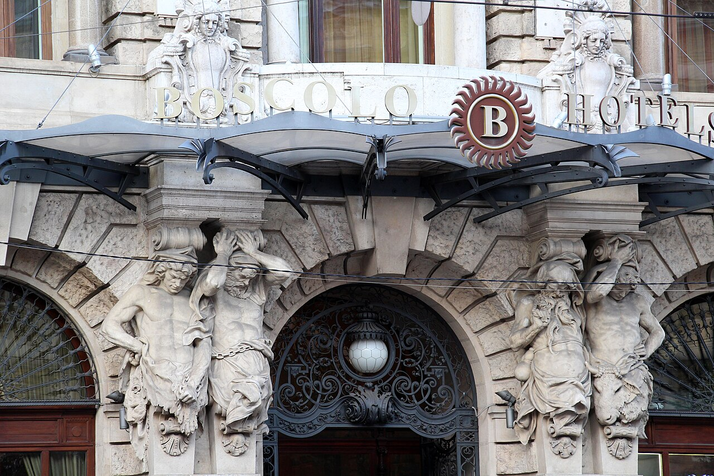

# New York Café

从 Blaha Lujza tér 地铁站出来，沿着 Erzsébet körút 走三分钟，就能看到 New York Palace 的深色立面与“NEW YORK CAFÉ”的金色字母。推门进去，第一眼不是桌子，而是穹顶：镀金灰泥、壁画、吊灯与大理石柱把空间撑得像一座歌剧院，服务生端着银盘穿过人群，钢琴声在拱顶下被放大。它被称为“世界最美咖啡馆”，这个称号既是赞美，也是压力——因为来看穹顶的人，往往比来喝咖啡的人多。

图：New York Café 的黄金色主厅与穹顶。图片：Fred Romero from Paris, France，CC BY 2.0，via Wikimedia Commons（[原图页面](https://commons.wikimedia.org/wiki/File:Budapest_-_New_York-palota_(37595301645).jpg)）。

## 1894 年：New York Café的关键起点
New York Café 于 1894 年 10 月 23 日随 New York Palace 开业，位于大楼底层。New York Palace 由 Alajos Hauszmann 主持设计，Flóris Korb 与 Kálmán Giergl 参与，是布达佩斯“世纪之交”最雄心勃勃的商业建筑之一。咖啡馆开业后很快成为作家、编辑、诗人、画家与演员的会客厅；官方叙述说，当时最有影响力的报纸编辑就在楼上的画廊工作，作家在楼下喝咖啡、争论、写稿。Nyugat（《西方》）杂志的作家群——Mihály Babits、Dezső Kosztolányi、Frigyes Karinthy 等——把这里的大理石桌当成办公室。

最著名的传说，是开业时店主把钥匙扔进多瑙河，表示“咖啡馆永不关门”。这个故事的真实性难以证实，但它准确表达了 New York Café 的自我定位：它不是一个按点打烊的店，而是布达佩斯夜生活与文学生活的永动机。二战后，咖啡馆严重受损，被改作体育用品店；1954 年以 Hungária 的名字复业，但在社会主义时期长期失修。2000 年代初，New York Palace 与咖啡馆经历大规模修复，2006 年以 New York Café 的名字重新开放。今天它属于酒店综合体，咖啡馆、餐厅与 Nyugat 酒吧共享同一栋楼。

## 建筑与空间

New York Café 的室内是“意大利文艺复兴复兴 + 布达佩斯世纪末”的混合：镀金穹顶、壁画、大理石柱、镜面、吊灯、红色丝绒座椅与深色木饰。Gusztáv Mannheimer 的壁画与 Károly Senyei 的镀金灰泥是空间的两大视觉支柱；站在大厅中央抬头，能看到层层叠叠的拱顶与灯光，像一座被切开的天主教堂。空间分为底层大厅、夹层/楼上画廊与餐厅区；楼上靠栏杆的位置可以俯视大厅，是拍照与看人的最佳角度。

但它并不安静。游客、团队、生日聚会、婚礼与商务晚餐共享同一空间，钢琴与弦乐演出会在下午与晚上出现。想拍空镜，必须在早上开门后尽快到；想安静谈话，建议订楼上的角落或餐厅区。不要为了拍照站到椅子上、跨过围栏或把手机伸到吊灯下；大厅的动线是给服务员与客人用的，不是摄影棚。

## 酒单与味觉

New York Café 的菜单是“匈牙利经典 + 奥匈帝国怀旧”的组合：牛肉 goulash、渔夫汤、鸡腿 paprikash、Wiener schnitzel、烤鹅肝，以及 Dobos、Sacher、Eszterházy 等经典蛋糕。最出名的饮品是“24K 金箔卡布奇诺”——在奶泡上撒金箔，价格约 13 欧元；它更像一件可以喝的纪念品，味道本身并不比普通卡布奇诺复杂。甜点里值得试的是 Somlói Galuska（海绵蛋糕、核桃、葡萄干与巧克力奶油）与 New York 巧克力蛋糕。

酒单覆盖香槟、葡萄酒、匈牙利 Tokaji、鸡尾酒与咖啡鸡尾酒。Nyugat 酒吧是晚上更安静的选择，适合点一杯鸡尾酒或 Tokaji，配小食。白天可以点咖啡与蛋糕，晚上则可以点正餐与酒；18:00 后的晚餐建议预订，白天按到场顺序入座。价格属于布达佩斯高端旅游咖啡馆区间，金箔卡布奇诺与下午茶套餐是主要“溢价项”。

## 怎么喝

最佳到店时间是早上 7:30–9:30，或下午 16:30 后。早上人最少，穹顶与大厅几乎空着，可以慢慢看壁画；下午茶时段旅行团最多，门口会排队到街上。中午 11:00–15:00 是高峰，若不想排队，可以改去餐厅或晚上再来。18:00 后只接受晚餐预订，且最多 10 人；团队与活动要提前联系餐厅。

点单时先决定“只喝咖啡/吃蛋糕”还是“正餐”。只喝咖啡可以坐大厅，点一杯卡布奇诺或 Melange，配一块 Somlói Galuska；正餐建议坐餐厅区，点 goulash 或 paprikash，配一杯匈牙利红酒。金箔卡布奇诺适合拍照，但不要为了金箔点两杯；一杯足够。结账时服务费通常已包含，仍可按服务留零钱。

## New York Café的地址与营业安排
- 地址：Erzsébet körút 9–11, 1073 Budapest。
- 营业：周一至周三 07:00–24:00；周四至周日 07:00–01:00（官方 About 页）。
- 交通：地铁 M2 Blaha Lujza tér，步行 3 分钟；电车 4、6 路 Blaha Lujza tér 下车。
- 预订：18:00 后晚餐可预订，最多 10 人；白天不接受预订，按到场顺序入座。
- 价格：咖啡与蛋糕属高端旅游区价位；金箔卡布奇诺约 €13；正餐与酒单更高。
- 着装： smart casual；没有硬性 dress code，但晚餐与演出时段会有礼服客。
- 无障碍：主入口有台阶，室内通道宽但人多；轮椅建议提前联系餐厅确认入口与电梯。

## 礼仪与常见误区

第一，不要以为“世界最美咖啡馆”只有装潢；它仍是营业中的咖啡馆与餐厅，客人要吃饭、谈事、过纪念日，拍照请让出动线。第二，不要站在椅子上或跨过围栏拍穹顶；大厅的栏杆与楼梯不是观景台。第三，不要只点一杯水就占正餐桌；午餐与晚餐时段，正餐区通常要求点菜。第四，不要把“钥匙扔进多瑙河”当成已证实的事实；它是开业传说，不是档案记录。第五，不要把 1954 年的 Hungária 复业与 2006 年的 New York Café 修复混为一谈；两个时间点代表不同的政治与商业阶段。第六，不要期待“安静的历史咖啡馆”；这里的声场是旅游城市级的，想安静就订楼上角落或晚上去 Nyugat 酒吧。

## 从New York Café延伸到Gerbeaud
从 New York Café 往西步行十分钟是 Astoria 与 Deák Ferenc tér，往南是 Rákóczi út 与 Blaha Lujza tér，往西北是匈牙利国家博物馆与 Andrássy út。可以把这一站排成“New York Café 早餐 → 匈牙利国家博物馆 → Andrássy út → 英雄广场 → 晚上 Gerbeaud 甜点”。若想把布达佩斯咖啡馆做成一条路线，可以先去 [Gerbeaud](ref:gerbeaud) 吃传统甜点，再到 New York Café 看穹顶；维也纳的 [Café Central](ref:central)、[Café Hawelka](ref:hawelka) 与 [Café Sperl](ref:sperl) 则能把“奥匈咖啡馆”放进更大的脉络。完整的维也纳咖啡馆夜晚可以参照 [维也纳咖啡馆之夜路线](ref:vienna-route)。

**关键事实。**

| 项目 | 内容 |
| --- | --- |
| 一句话定位 | 布达佩斯 Erzsébet körút 9–11 号的 New York Café，1894 年随 New York Palace 开业；它用镀金穹顶、壁画、大理石柱与吊灯，把“世界最美咖啡馆”变成布达佩斯的城市名片 |
| 地址 | Erzsébet körút 9-11, 1073 Budapest, Hungary |
| 城市/国家 | 布达佩斯 / 匈牙利 |
| 营业状态 | 已核验营业 |
| 官网 | newyorkcafe.hu |

## 参考资料
- New York Café 官方首页：<https://newyorkcafe.hu/en/>，用于核对地址、今日餐饮与“世界最美咖啡馆”定位。
- New York Café 官方 About 页：<https://newyorkcafe.hu/en/cafe-about-us/>，用于核对 1894 年、战后体育用品店、1954 年 Hungária、2006 年修复、营业时间与预订规则。
- Accor Limitless 的 New York Café 文章：<https://all.accor.com/a/en/limitless/thematics/food-drink/new-york-cafe-budapest.html>，用于核对壁画、镀金灰泥、Nyugat 作家群与金箔卡布奇诺。
- 同城的 `place:gerbeaud` 是布达佩斯另一套“皇家甜点店”叙事，`place:cafe-central`、`place:cafe-hawelka`、`place:cafe-sperl` 代表维也纳咖啡馆的不同类型。
- 若把中欧咖啡馆串成路线，读 `route:vienna-coffee-house-evening` 与 `place:gerbeaud`。
- 相关条目：[Gerbeaud](ref:gerbeaud)、[Café Central](ref:central)、[Café Hawelka](ref:hawelka)、[Café Sperl](ref:sperl)、[维也纳咖啡馆之夜路线](ref:vienna-route)
