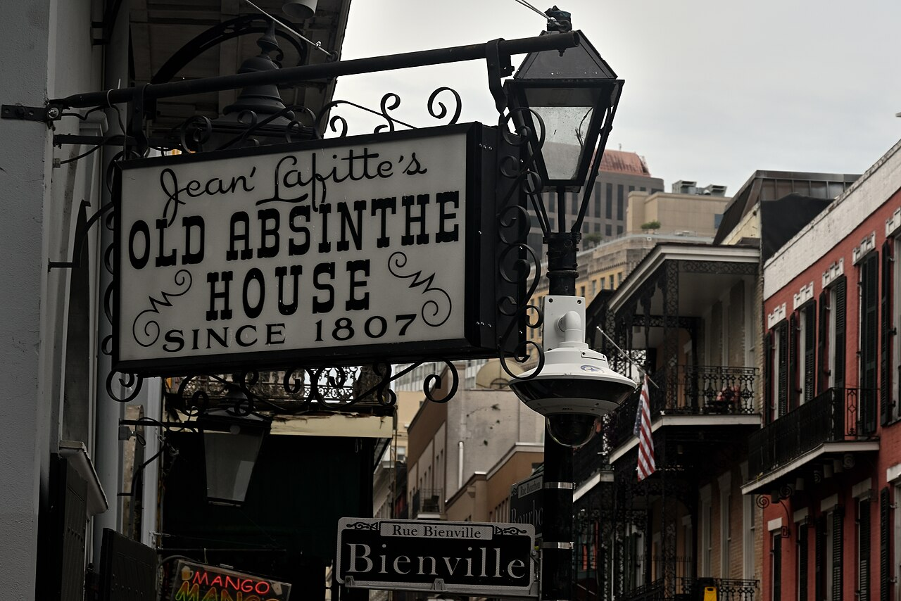

# 老苦艾酒屋

Bourbon 街与 Bienville 街的转角，一栋两层灰泥老楼把街口切成一个钝角。白天，它看起来像法国区任何一栋被旅游商店包围的历史建筑；到了晚上，门口的霓虹与酒旗把“Old Absinthe House”几个字照得很亮。它的故事不在“苦艾酒是否致幻”这类都市传说里，而在一条更具体的时间线：进口商行、咖啡酒馆、苦艾酒室、禁酒令、餐厅与酒吧，这栋楼几乎把新奥尔良两百年的饮酒史压在同一块地砖上。

图：Bourbon 与 Bienville 街角老苦艾酒屋的悬挂招牌（招牌写 Since 1807）；建筑 1798 年动工、1806 年完成，酒吧功能在 1835 年后才逐步形成。图片：Tom Hilton，CC BY 2.0，via Wikimedia Commons（[原图页面](https://commons.wikimedia.org/wiki/File:Old_Absinthe_House,_New_Orleans,_August_2022.jpg)）。

## 1806 年：老苦艾酒屋的关键起点
这栋楼 1798 年动工、1806 年完成，最初是西班牙进口商行 Font & Juncadella 的物业，地面层卖食品、烟草、鞋、布料与成桶的西班牙酒。1835 年，它取得第一张酒牌；1846 年前后，地面层变成 Aleix's Coffee House——“coffee house”在当时是新奥尔良对酒吧的委婉说法。1874 年，来自巴塞罗那的 Cayetano Ferrer 租下这里，把店名改成“Absinthe Room”，并在吧台后创作了 Absinthe House Frappé：苦艾酒、糖浆与碎冰，用大理石滴水装置慢慢把水滴进酒杯。1912 年美国禁苦艾酒，1920 年禁酒令生效，这栋楼一度面临被拆的命运，但最终以餐厅与夜总会的形态留下来；1943 年 Owen Brennan 购入，后来又转手，如今由 Rue Bourbon 运营。

这栋楼的早期历史还有一层。1798 年动工、1806 年完成，业主是西班牙加泰罗尼亚的 Font & Juncadella 商行；它最初不是酒吧，而是进口与佣金商行，地面层卖食品、烟草、鞋、布料与成桶酒。1835 年取得第一张酒牌，1846 年前后 Aleix 家族把地面层做成 Aleix's Coffee House；1874 年 Cayetano Ferrer 租下，改名 Absinthe Room，并做出 Absinthe House Frappé。1912 年美国禁苦艾酒，1920 年禁酒令生效，建筑一度被计划拆除，但最终以餐厅与夜总会形态留下。1943 年 Owen Brennan 购入，后来由 Rue Bourbon 运营；吧台上那对大理石滴水装置是这段历史少有的实物证据，不是现代道具。

## 空间与酒单

建筑是两层灰泥砖墙，二楼有锻铁阳台，转角处几乎正对街道；室内保留旧木吧台、斑驳墙面与大量与苦艾酒、爵士乐、拳击和法国区历史有关的物件。最值得看的是吧台上那对大理石苦艾酒滴水装置（absinthe fountains）：水从龙头一滴一滴落到方糖上，再渗进酒杯，这是 19 世纪巴黎式喝法的遗存。酒单以 Absinthe Frappé、Sazerac、Pimm's Cup 与经典新奥尔良鸡尾酒为主；也有普通啤酒与葡萄酒。它不是严肃的苦艾酒品鉴室，强项是“在历史空间里喝一杯带苦艾酒名字的酒”。

吧台后的滴水装置仍是 Absinthe House Frappé 的标志性器具，大理石台面与黄铜龙头保留着 19 世纪的酒吧形制。

## 怎么喝

第一次来可以点 Absinthe Frappé，要求按传统方式加碎冰与薄荷；若想喝更烈的苦艾酒，问吧台要“drip”版本，看他们怎么用水与糖平衡。不要一上来就点高度数纯饮，苦艾酒的草本与苦味对不习惯的人并不友好。Sazerac 适合想喝短饮的人，Pimm's Cup 则适合新奥尔良的湿热天气。白天比深夜更适合看建筑与吧台，晚上则更热闹；如果只想拍照，先在门口拍外观，不要把三脚架架在街角挡住行人。

## 老苦艾酒屋的地址与营业安排
地址是 240 Bourbon Street, New Orleans, LA 70130，位于 Bourbon 与 Bienville 的转角。法国区内步行即可，最近的有轨电车是 Canal Street 线；从 Canal 与 Bourbon 步行约十分钟。营业时间以官网与门口公示为准，通常白天到深夜；21 岁以上才能饮酒。着装随意，但 Bourbon Street 夜间人多、地面湿滑，穿防滑鞋比穿高跟鞋更实用。消费中等，Absinthe Frappé 通常比普通鸡尾酒略贵；点单前确认是否含纪念杯。

## 礼仪与常见误区

第一，苦艾酒不会让人产生“割耳”式的幻觉；所谓致幻主要来自 19 世纪医学与道德恐慌，现代研究认为与其高酒精度、杂质和当时的饮用方式更有关。第二，传统喝法不是“点火烧糖”；滴水装置与方糖是为了稀释与释放香气，火焰表演是后来的酒吧效果，不是 19 世纪标准。第三，这栋楼 1806 年完成，但“酒吧”功能是 1835/1836 年后才逐步形成，不要写成“1806 年就是酒吧”。第四，Absinthe House Frappé 的配方在不同资料里有差异，官方与档案馆都把它归到 Cayetano Ferrer 的 1874 年创作，但不要把某一家酒吧的版本当成唯一正解。第五，这里是营业中的酒吧，不是苦艾酒博物馆；吧台上的滴水装置是旧物，不要动手拧龙头。

建筑 1806 年完成、1835 年取得酒牌、1874 年创作 Absinthe House Frappé，是三条不同事件；把酒屋历史压缩成一个年份会丢失关键信息。

## 从老苦艾酒屋延伸到拿破仑屋
从老苦艾酒屋出来，沿 Bourbon 街往东北可到 Jean Lafitte's Blacksmith Shop 与 Lafitte's 老屋，往西北可到[拿破仑屋](ref:napoleon)，再往北可到 Hotel Monteleone 的[旋转木马酒吧](ref:carousel)。这三处可以组成一条“法国区历史酒吧线”：先在拿破仑屋吃 muffuletta，再到这里喝 Absinthe Frappé，最后到旋转木马酒吧喝 Vieux Carré。禁酒令如何改变这类酒吧的供给，见[禁酒令](ref:prohibition)；酒馆与城市空间的关系，见[酒馆史](ref:taverns)与[认识一座城，从一间酒馆开始](ref:pub-city)。

**关键事实。**

| 项目 | 内容 |
| --- | --- |
| 一句话定位 | 新奥尔良 Bourbon 与 Bienville 街角的历史酒吧，建筑完成于 1806 年，1835 年取得酒牌，1874 年 Cayetano Ferrer 在此创作 Absinthe House Frappé |
| 地址 | 240 Bourbon Street, New Orleans, LA 70130, USA |
| 城市/国家 | 新奥尔良 / 美国 |
| 营业状态 | 已核验营业 |
| 官网 | ruebourbon.com |

**来源与边界。** 本页关于「老苦艾酒屋」的关键事实，主要由以下来源交叉核对：Rue Bourbon（现址、营业信息与场所定位）、New Orleans & Company（1806 年进口商行、1874 年 Cayetano Ferrer 创作 Absinthe House Frappé 与大理石滴水装置）、New Orleans City Archives & Special Collections（Font & Juncadella 1806 年建楼、1846 年 Aleix's Coffeehouse、1874 年租下并改名 Absinthe Room）等 5 条来源。产品、地址或营业状态变化较快时，以 ruebourbon.com 的最新页面为准；价格、批次与状态会变，涉及这些字段时以页面所列来源的最新版本为准。正文为项目自写，来源只作核验，不复制原文。

## 参考资料
- [禁酒令：禁令改变供给，不消灭需求](ref:prohibition)
- [酒馆史：从酒肆、客栈到酒吧](ref:taverns)
- [认识一座城，从一间酒馆开始](ref:pub-city)
- [拿破仑屋](ref:napoleon)
- [旋转木马酒吧](ref:carousel)

本页于 2026-11-21 核对 Old Absinthe House 官方页面。营业时间通常从白天到深夜，21 岁以上才能饮酒，Bourbon Street 夜间人多、地面湿滑，出发前查官网与门口公示。建筑 1806 年完成、1835 年取得酒牌、1874 年创作 Absinthe House Frappé，正文已把三条时间线分开；苦艾酒致幻传说与“点火烧糖”表演也不等于 19 世纪标准喝法。本页图片是老苦艾酒屋的悬挂招牌，不是店内吧台；图注已标摄影者与许可，文字许可见文末 rights 字段。
