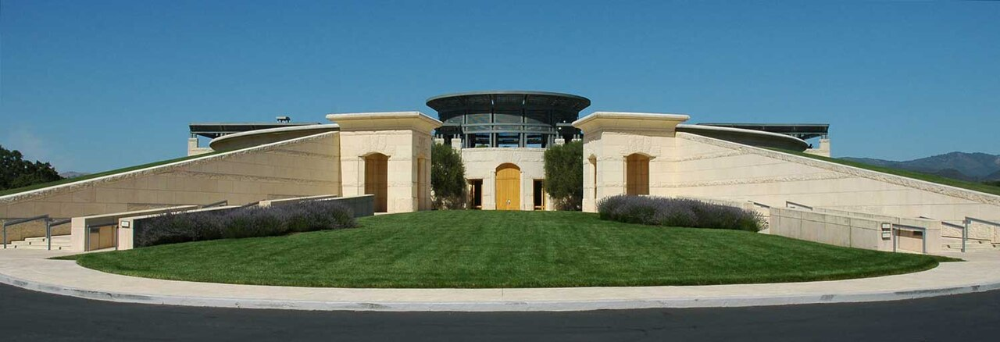

# 作品一号酒庄

作品一号酒庄在纳帕谷奥克维尔，与罗伯特·蒙大维酒庄隔 29 号公路相望。它 1979 年由罗伯特·蒙大维与菲利普·德·罗斯柴尔德男爵共同创立，从一开始就只做一件事：每年酿一款波尔多式混酿。这种做法在纳帕谷并不常见，因为多数酒庄会同时做赤霞珠、霞多丽、长相思等多个产品线；作品一号把品牌、酒款与年份压成一条线，参观也围绕这一款酒展开。

图：作品一号酒庄。图片：No machine-readable author provided. Cszmurlo assumed (based on copyright claims).，CC BY 2.5，via Wikimedia Commons（[原图页面](https://commons.wikimedia.org/wiki/File:Opus-One-Szmurlo.jpg)）。

> **先给结论**
> **一句话：** 这页判断作品一号酒庄值不值得专程去，以及到访前要核对什么。
>
> - **适合谁：** 正在计划去作品一号酒庄、想知道值不值得专程安排半天到一天的人。
> - **不适合谁：** 只想要“必去榜单”、不准备核对预约、交通和开放时间的人。
> - **先看这两点：**
>   - 酒庄只接受预约，不接待未预约的散客。
>   - 第一个误区是把作品一号当成“纳帕的拉菲”或“美国一级庄”。

## 1979 年：作品一号酒庄的关键起点
合作的起点通常写作 1978 年。官方叙述说，两位创始人在木桐酒庄用一小时谈定了计划：不做法国的复制品，也不做加州的单品种宣言，而是用纳帕的葡萄、波尔多的混酿逻辑，做一款能在两个世界之间站住的酒。1979 年酒庄正式成立并酿出首个年份，1984 年首次上市。这个时间差说明它不是“当年建厂、当年成名”的速成故事，酒在桶里与瓶里都经过了等待。

两位创始人的身份决定了酒庄的气质。菲利普·德·罗斯柴尔德男爵是木桐酒庄的主人，经历过 1973 年木桐由二级庄升为一级庄；罗伯特·蒙大维是纳帕现代葡萄酒的推动者，刚刚在 1966 年建立了自己的酒庄。两人的合作把旧世界的分级、调配与陈年观念，与新世界的葡萄园管理、市场能力放在一起。今天酒庄由罗斯柴尔德男爵公司（Baron Philippe de Rothschild S.A.）与星座集团（Constellation Brands）共同持有，股权结构变了，但“一款酒”的策略没有变。

1976 年的巴黎审判是这段合作的背景音。那场盲品让加州酒进入国际视野，也让欧洲酒庄开始认真对待纳帕；没有那次冲击，木桐与蒙大维的合资不会这么快被讨论。但作品一号不是巴黎审判的直接产物，它更像两位经营者对“合作能否长期成立”的一次制度实验：股权、酿造、品牌与销售都要写清楚，不能只靠友情。

酒庄建筑 1991 年启用，位置在奥克维尔葡萄园中，外观把古典比例与现代材料放在一起。它不像蒙大维那样以开放的拱门迎接路人，而是把参观者收进一个相对安静的空间；这种“少即是多”的姿态，与只酿一款酒的策略一致。建筑不是本文的重点，但它解释了为什么这里的参观节奏比邻近酒庄慢。

## 空间与酒单

酒单只有一款正牌酒：Opus One。它是赤霞珠主导的波尔多式混酿，通常加入梅洛、品丽珠、小维多与马尔贝克，比例随年份变化。酒庄不对外公布固定配方，因为每年葡萄的成熟度与结构不同；这也是“年份差异”在作品一号身上比在单品种酒更明显的原因。正牌之外还有 Overture，一款不标年份的副牌酒，用不同年份的调配来保持稳定风格，1993 年开始生产。

参观空间包括接待区、地下酒窖与面向葡萄园的露台。酒窖用于陈年与调配，温度低、光线暗，参观时会讲橡木桶比例、换桶与澄清；露台用于品鉴，天气好时可以看见奥克维尔的葡萄园。整个动线不长，重点在讲解与品鉴，而不是“走遍生产线”。如果你期待看到大型不锈钢罐与装瓶线，这里会让你失望；作品一号把生产细节收在幕后，把前台留给酒与风景。

品鉴通常以正牌酒为主，部分项目会加入 Overture 或不同年份的对比。酒庄不会像大型酒庄那样提供十几款酒的酒单，因为产品线本来就窄。对第一次接触的人来说，一次品鉴足以建立对酒庄风格的判断；对已经喝过多个年份的人，重点应放在年份差异与陈年潜力上，而不是“多喝几款”。

## 参观与点单方式

酒庄只接受预约，不接待未预约的散客。官网写明品鉴与体验均需预约，预约最多可提前两个月，每月 1 日开放新一批名额；开放时间通常为每日 10:00–16:00，元旦、1 月部分日期、复活节、感恩节与圣诞前后闭馆。具体日期每年调整，预约日历为准。这个规则比蒙大维严格，临时起意开车过去，很可能只能在外围看看建筑。

预约通过官网的预订系统完成，需要选择日期、时段与人数，并预付或提供信用卡担保。取消规则随项目不同，临近日期取消可能收费。21 岁以下不能参加含酒项目；酒庄没有为儿童设计的参观，带孩子的家庭需要提前询问是否可以在非品鉴区域等候。

点单在品鉴时进行，通常由工作人员按顺序倒酒，不需要自己去吧台点。想比较年份，可以在预约时选择包含多个年份的项目；想只喝一杯，单杯选择有限，因为酒庄不以酒吧模式运营。购买整瓶可以在接待区完成，部分稀有年份需要现场确认库存。不要期待折扣或试饮后临时加杯，这里的服务节奏是围绕预约设计的。

## 作品一号酒庄的地址与营业安排
地址是 7900 St. Helena Highway, Oakville, CA 94562, USA；坐标 38.44149, -122.39963。酒庄在 29 号公路东侧，与蒙大维酒庄相距很近，步行可达但没有人行专用道，开车或打车更安全。从纳帕市区出发约 20 分钟，从扬特维尔约 10 分钟，从旧金山经 29 号公路约 1.5 小时；停车位有限，预约时会收到到达与停车说明。

公共交通依赖 VINE 巴士，班次不密；也可以用 Uber/Lyft 等网约车，但回程车在酒庄密集的路段不一定好叫，最好提前预约。最现实的方式是自驾加指定司机或包车；品酒前后不要安排紧凑行程，预约时段通常需要提前到达，迟到可能缩短体验。

参观必须预约：官网写明所有品鉴与体验均为预约制，最多可提前两个月，每月 1 日放出新名额；开放时间通常为每日 10:00–16:00，元旦、1 月部分日期、复活节、感恩节与圣诞前后闭馆，具体以预约日历为准。加州法定饮酒年龄为 21 岁，含酒项目会查证件，国际驾照或护照可以使用；酒庄没有为儿童设计的参观，带孩子需提前询问。

票价按项目分档（2026 年参考）：Estate Tasting 约 150 美元/60 分钟，含两款 Opus One 与 Overture；Opus One Experience 约 250 美元/90 分钟；Art of the Table 约 793 美元/2.5 小时（含 22% 服务费，周一至周五，最少 4 人，需提前 14 天预订）。价格与项目会调整，以官网预订页为准，以上金额仅作参考。`operating_status` 为 `verified`，表示官网与预订渠道在 2026-11-08 仍正常、未见停业公告，不代表当天一定有位置。参观以室内与露台为主，穿着不必正式，但酒窖温度低，带一件外套更舒服。「作品一号酒庄」的开放时间、价格与预约，以[官网](https://www.opusonewinery.com/)的公开页面为准；核验日期为 2026-11-08，临时调整以官网当日公告为准。

## 礼仪与误区

第一个误区是把作品一号当成“纳帕的拉菲”或“美国一级庄”。它是波尔多式的混酿，也确实由罗斯柴尔德家族参与创立，但纳帕没有法国那样的官方分级，“一级庄”只是市场比喻，不是法定等级。第二个误区是把 Overture 当成“次品”：它是不同年份调配的副牌酒，目的是稳定风格，不是正牌酒的淘汰液。

第三个误区是以为“只酿一款酒”等于“只有一个配方”。正牌的混酿比例每年变化，葡萄来自奥克维尔的不同地块，陈年与新桶比例也调整；把它理解成“固定配方的工业化产品”，会错过年份差异。第四个误区是忽略预约制度：酒庄不设现场到访品酒，也不像邻近酒庄那样有大片公共庭院，临时到访的体验会非常有限。

品鉴时不要一口干，也不要把酒含在嘴里说话；吐酒是正常做法，尤其在一连串年份对比中。不要用手掌捂杯肚，不要加冰或加苏打水。拍照可以，但酒窖内光线暗，禁用闪光灯；不要触摸桶塞与酒标。若开车，提前说明，酒庄通常会提供吐酒桶或打包服务，但安全责任在驾驶者。

## 奥克维尔的周边街区
作品一号与蒙大维酒庄隔路相望，把两家放在同一天是奥克维尔最经典的对比路线：上午蒙大维的庄园与 To Kalon，下午作品一号的预约品鉴。两家都位于 29 号公路沿线，中间还有奥克维尔杂货店（Oakville Grocery），适合买午餐。往北是卢瑟福与圣赫勒拿，往南是扬特维尔，酒庄密集，一天排三家会非常赶。

若从旧金山出发，建议在纳帕住一晚，把品鉴安排在上午，下午走 Silverado Trail 看葡萄园而不是再喝酒。纳帕谷在采收季（8 月至 10 月）交通拥堵，29 号公路与 Silverado Trail 之间要留出移动时间。把“喝酒”和“开车”分开，是这条路线唯一不能妥协的规则。

## 同产区酒庄与延伸阅读
作品一号酒庄是理解[纳帕谷](ref:napa)与[葡萄酒](ref:wine)国际化的一个案例：它用一款酒把两个家族、两个产区的信誉绑在一起。关于 1976 年那场让纳帕进入视野的盲品，可以读[1976 年巴黎审判](ref:judgment-of-paris)。

补充阅读：[美国](ref:c-extra-1)、[罗伯特·蒙大维酒庄](ref:c-extra-2)。

相关条目：[纳帕谷](ref:napa)、[葡萄酒](ref:wine)、[1976年巴黎审判：加州酒击败法国名庄](ref:judgment-of-paris)。
