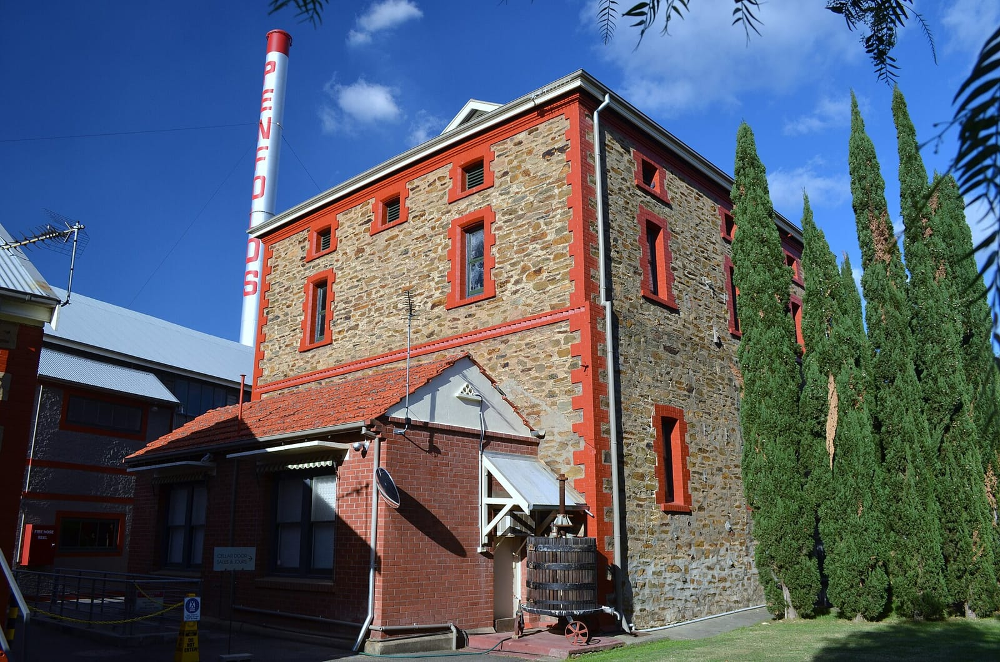

# 奔富玛吉尔庄园

玛吉尔庄园是奔富的起点，也是阿德莱德城里最容易到达的葡萄酒历史现场。它距市中心约 8 公里，葡萄园、Grange Cottage 与石造酒窖仍在原址，周围是住宅区与山麓道路。这里不是一片被围起来的乡村庄园，而是“城市边缘的单一葡萄园”：你可以在一顿饭的时间里看完 1844 年的建园故事、1950 年代的 Grange 试验，以及奔富如何把试验变成产品线。

图：奔富玛吉尔庄园相关实景照片。图片：Bahnfrend，CC BY-SA 3.0，via Wikimedia Commons（[原图页面](https://commons.wikimedia.org/wiki/File:Penfolds_Magill_Estate,_2014(2).JPG)）。

## 1844 年：城市边缘的单一葡萄园

1844 年，Christopher 与 Mary Penfold 在玛吉尔种下从欧洲带来的葡萄插条，正式建立奔富。酒庄最初做加强酒、克莱雷与雷司令，葡萄园与酒窖围绕现在的 Grange Cottage 展开；1870 年 Christopher 去世后，Mary 接手管理，把酒庄从家庭作坊推向南澳最大的葡萄酒企业之一。今天从门市走到葡萄园边缘，仍能看到这片坡地的尺度：不大，却足够支撑一个品牌的神话。

“城市单一葡萄园”这个说法容易让人误会。它不等于葡萄园被城市包围，也不等于所有奔富酒都来自这里；它指的是玛吉尔这块地本身仍在城市边缘生产葡萄，并且与酒庄建筑、酒窖和历史空间连在一起。理解这一点，才不会把玛吉尔当成一个纯展示的“故居”，也不会把奔富的全部产品都归到这片坡地。

## 从 Grange Cottage 到地下酒窖

Grange Cottage 是 Penfold 夫妇最初的住所，石造酒窖则是早期酿造与储存的核心。今天的参观路线会把这两处与现代化设施放在同一条叙事里：先看创业者的生活空间，再看酒窖如何扩展，最后进入品鉴室。建筑不是布景，它解释了为什么玛吉尔能在城市扩张中保留下来：酒窖、住宅与葡萄园共同构成一个完整的生产单元，而不是孤立的纪念物。

参观时值得留意的是“距离”。从门市到葡萄园、从酒窖到餐厅都不远，但每一段都对应不同的功能：门市负责接待与零售，酒窖负责储存与陈年，餐厅负责把酒放回餐桌。把它们走一遍，比只看一张历史年表更容易理解酒庄的日常；参观结束后不妨再绕葡萄园边缘走一圈，城市与藤蔓之间的距离会变得非常直观。

## Grange 与 Bin 系列：试验如何成为产品

奔富的试验传统有清晰的时间线。1948 年，Max Schubert 出任首席酿酒师；1950 年代，他开始 Grange 的长期陈年试验，把不同产区、不同桶型与不同年份放进同一个比较体系。1959 年，第一款 Bin 系列以酒窖存放区命名，Bin 28 成为这个体系的起点；1960 年，董事会要求正式恢复 Grange 生产，试验由此变成旗舰产品。这里的“试验”不是一次性的营销故事，而是持续的产品开发方法。

[西拉](ref:shiraz)提供骨架，[橡木桶陈年](ref:oak-ageing)决定时间如何被写进酒里。Grange 的风格不是单一年份的产物，而是跨产区选果、跨桶型组合与长期观察的结果；Bin 系列则把这种能力下放到更日常的价格带。理解这条线索，再看玛吉尔的酒单，就不会只把 Grange 当成“贵价酒”，而会看到它背后的试验逻辑。

## 门市、餐厅与体验

门市每周七天 10:00–17:00 开放，提供导览、品鉴与不同长度的体验。公开价格里，Magill Heritage 为 60 澳元，Ultimate Penfolds 为 175 澳元；更高阶的收藏、签名与铂金项目需要单独预约或询价。第一次到访建议选含历史讲解与酒窖参观的项目，把 1844 年、1948 年与 1959 年三个节点串起来；已经熟悉奔富的人，可以把重点放在老年份、实验性释放或餐厅配酒。

Magill Estate Restaurant 做精致餐饮，Magill Estate Kitchen 更轻松，适合在参观后补一顿午餐或一杯酒。餐厅与门市是两套预约，想同时安排要分别确认；具体菜单、价格与时段以官方页面为准。玛吉尔的价值不只在酒，也在“城市里还能看到完整酒庄”的体验，所以留出步行与看建筑的时间。

## 开放、预约与到达

地址是 78 Penfold Road, Magill, South Australia 5072, Australia。从阿德莱德市中心开车约 15 分钟，公共交通可以到附近，但换乘与步行会让到访时间变长；自驾最直接，酒后回程应叫车或指定司机。停车按现场指引，不要停在葡萄园行间或酒窖作业区。坐标以官方渠道为准，导航直接输入地址。

预约通过官网的体验页面完成，选择日期、时段与人数；不同项目的取消规则与集合点不同。周末、节假日与采摘季前后更容易满，想进酒窖或吃餐厅要更早确认。门市的开放时间相对稳定，但餐厅与特别体验会调整；出发前再看一次官方页面，尤其是公共假日。

## 常见误区

第一，把玛吉尔当成奔富唯一的葡萄园。它是起点与城市单一葡萄园，奔富的果实来自多个产区。第二，以为门市就是完整生产线参观。这里的重点是历史空间、酒窖与品鉴，不是所有酿造环节都开放。第三，把 Grange 当成“从一开始就成功”的产品。它在 1950 年代是秘密试验，1960 年才被正式恢复生产。第四，忽略餐厅与门市是两套预约。第五，把巴罗萨与玛吉尔混为一谈；玛吉尔在阿德莱德山麓，行政上不属于巴罗萨谷，但与[巴罗萨](ref:barossa)的葡萄与历史紧密相连。

对照阅读：[巴罗萨](ref:barossa)、[红葡萄酒](ref:red-wine)。

**关键事实。**

| 项目 | 内容 |
| --- | --- |
| 一句话定位 | 奔富在阿德莱德山麓的起点，1844 年建园，距市中心约 8 公里，是少见的城市单一葡萄园；门市每周七天 10:00–17:00 开放，提供酒窖参观、品鉴与餐厅体验，Grange 与 Bin 系列的试验传统在此有清晰的历史线索 |
| 地址 | 78 Penfold Road, Magill, South Australia 5072, Australia |
| 城市/国家 | 阿德莱德 / 澳大利亚 |
| 营业状态 | 已核验营业 |
| 官网 | penfolds.com |

**来源与边界。** 本页关于「奔富玛吉尔庄园」的关键事实，主要由以下来源交叉核对：Penfolds（Magill Estate Cellar Door 的地址、电话与联系邮箱；Magill Heritage 60 澳元与 Ultimate Penfolds 175 澳元的公开价格，以及更高阶项目需单独预约）、Wine Australia（巴罗萨谷底与高海拔带的 Shiraz 风格差异，作为玛吉尔与巴罗萨关系的背景）。产品、地址或营业状态变化较快时，以 penfolds.com 的最新页面为准；价格、批次与状态会变，涉及这些字段时以页面所列来源的最新版本为准。正文为项目自写，来源只作核验，不复制原文。

## 参考资料

本页依据奔富官方 Magill Estate 门市页、联系页、品牌史页与预约页，以及 Wine Australia 的巴罗萨谷资料核验，页面核验日期 2026-11-09。若要把这一站放进行程，可继续读[巴罗萨葡萄酒路线](ref:route)；关于品种与工艺背景，见[西拉](ref:shiraz)、[红葡萄酒](ref:red-wine)与[橡木桶陈年](ref:oak-ageing)。开放时间、价格与预约规则以官方渠道为准。

## 相关图像

图：巴罗萨相关实景照片。图片：No machine-readable author provided. ScottDavis assumed (based on copyright claims).，CC BY-SA 3.0，via Wikimedia Commons（[原图页面](https://commons.wikimedia.org/wiki/File:Tanunda.jpg)）。关联图像：奔富玛吉尔庄园。
