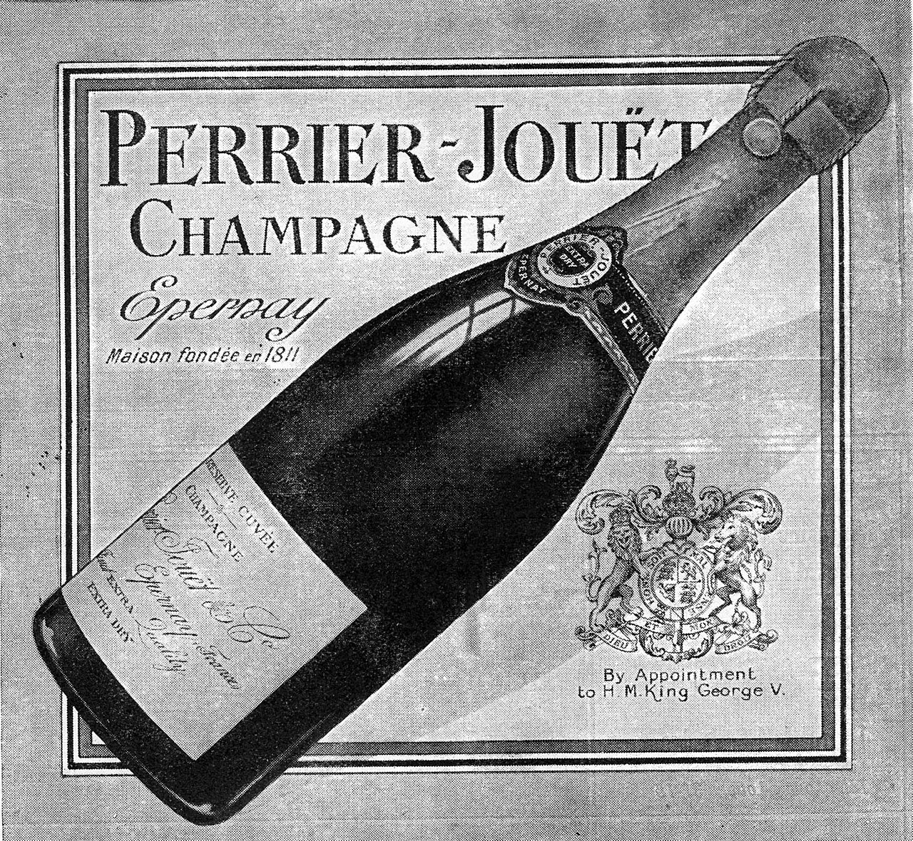

# 巴黎之花

巴黎之花（Perrier-Jouët）在埃佩尔奈的香槟大道，访客常去的两个地址是 26 Avenue de Champagne 的 Cellier Belle Epoque 与 11 Avenue de Champagne 的 Maison Belle Epoque。前者是餐厅、香槟酒吧与精品店，后者是创始家族旧宅，今天用于艺术收藏与高级餐饮体验。它不是一座以“地下酒窖参观”为主的酒庄：官方明确说明部分品鉴体验不含酒窖导览，参访的重点是霞多丽、艺术新风格（Art Nouveau）与餐桌体验。

图：巴黎之花。图片：unknown (no credits)，Public domain，via Wikimedia Commons（[原图页面](https://commons.wikimedia.org/wiki/File:Champagne_Perrier-Jou%C3%ABt-1923.jpg)）。

## 1811 年：巴黎之花的关键起点
1811 年，皮埃尔—尼古拉·佩里耶（Pierre-Nicolas Perrier）与罗丝—阿德莱德·茹埃（Rose-Adélaïde Jouët）在埃佩尔奈创立酒庄。两人在 1810 年结婚，次年把各自对葡萄酒、自然与艺术的兴趣合并成一个品牌。酒庄从成立之初就把霞多丽作为签名品种，今天我们看到的“花香、轻盈、细腻”风格，很大程度上来自这个选择。官方称霞多丽占其自有葡萄园的 56%，而香槟区整体约为 30%，这个比例解释了它在混酿中的取向。

1846 年，酒庄为偏好更干口感的英国市场推出 Cuvée K，官方称其为世界上第一款轻补糖的“brut”风格香槟；这款酒的剩余瓶与 1825 年份一起保存在埃佩尔奈的酒窖中。1902 年，奥克塔夫·加利斯（Octave Gallice）请埃米尔·加莱（Émile Gallé）设计酒瓶，四只绘有日本白色银莲花的玛格南瓶交付，后来演变成 Belle Epoque 系列。1964 年，Belle Epoque 成为品牌象征；1983 年推出 Belle Epoque Rosé，1998 年推出 Belle Epoque Blanc de Blancs；1971 年 Grand Brut 上市，1985 年 Blason Rosé，2017 年 Blanc de Blancs。2017 年，Maison Belle Epoque 完成修复并重新开放；2020 年，Séverine Frerson 成为酒庄第八位、也是首位女性酒窖大师；2021 年，酒庄启动实验性葡萄栽培计划。

## 空间与酒单

Cellier Belle Epoque 在 26 Avenue de Champagne，空间更接近“全日餐厅 + 香槟酒吧 + 精品店”：不需要预订即可进入，适合点一杯香槟、吃一顿简餐或买酒。Maison Belle Epoque 在 11 Avenue de Champagne，是创始家族旧宅，官方称其拥有欧洲最大的法国艺术新风格私人收藏，包括 Hector Guimard、Louis Majorelle、Émile Gallé 与 Henri de Toulouse-Lautrec 等作品，并叠加当代艺术委托。这栋建筑有联合国教科文组织世界遗产身份，参观与用餐需要预订，不能把它当成随到随看的博物馆。

酒单以霞多丽为主轴：Grand Brut、Blanc de Blancs、Belle Epoque、Belle Epoque Rosé、Belle Epoque Blanc de Blancs 等。Belle Epoque 的银莲花瓶是品牌最容易被识别的符号，但酒款本身并不只有“花香”一个维度；不同年份、除渣时间与补糖量会改变口感。香槟属于[起泡酒](ref:sparkling-wine)传统，而巴黎之花的风格更偏向轻盈与酸度，适合搭配海鲜、白肉与清淡的酱汁。若只喝一杯，选 Blanc de Blancs 最能理解它的霞多丽主线；若想比较，先 Grand Brut 再 Belle Epoque，差异会更清楚。

## 参观或点单方式

巴黎之花提供多种体验，而不是单一的酒窖导览。官方列出的“The Art of Chardonnay”是一小时导览品鉴，含两款酒款，需预订，地点在 Cellier Belle Epoque，并明确说明不含酒窖参观。Maison Belle Epoque 提供五道式午餐或晚餐，需预订，适合把参观与餐饮合并安排。Cellier Belle Epoque 的全日菜单与香槟酒吧不需要预订，适合临时到访；但周末与旺季仍建议先确认座位与营业时间。

第一次来，建议把“喝一杯”和“吃一顿”分开：先在 Cellier 点一杯 Blanc de Blancs，了解酒庄的霞多丽风格；若对艺术新风格与旧宅感兴趣，再预订 Maison Belle Epoque 的餐食或体验。不要默认所有体验都包含酒窖；巴黎之花的参观更偏向品鉴、建筑与餐桌，而不是像酩悦那样以地下酒窖规模为核心。若时间只够一小时，选“The Art of Chardonnay”比临时点单更有结构。

## 巴黎之花的地址与营业安排
地址：26 Avenue de Champagne, 51200 Épernay, France（Cellier Belle Epoque，坐标 49.04252, 3.96104）；Maison Belle Epoque 在 11 Avenue de Champagne。两处相距不远，步行即可。

交通：从埃佩尔奈车站步行约 10 分钟到香槟大道；从兰斯乘火车约 40 分钟，自驾从兰斯约 30 分钟。现场没有停车位，旺季建议把车停在公共停车场再步行；建筑提供免费 Wi-Fi 与无障碍通道。

开放时间：Cellier Belle Epoque 周日至周四 11:30–20:30、周五至周六 11:30–22:00，全天餐饮与香槟酒吧无需预订；Maison Belle Epoque 的午餐为周二至周六、晚餐为周二至周四，均需预订。节假日与特殊活动可能调整，出发前以官网为准。

门票与预约：The Art of Chardonnay 为一小时导览品鉴，95 欧元，含两款酒款，明确不含酒窖参观，需在线预订；Cellier 的三款香槟配餐菜单 130 欧元；Maison Belle Epoque 的五道式美食体验 390 欧元，需预订。若只喝一杯，酒吧按单点计费，不需要买套餐。所有体验的场次、语言（法语或英语）与可订日期以官网预订页为准。

香槟大道适合步行，但夏天遮阴少，冬天风大，安排时留出室内休息时间。「巴黎之花」的开放时间、价格与预约，以[官网](https://www.perrier-jouet.com/)的公开页面为准；核验日期为 2026-11-08，临时调整以官网当日公告为准。

## 礼仪与误区

第一个误区是把“巴黎之花”当成一座可以随意参观的酒窖。它的访客体验以品鉴、餐饮与旧宅为主，部分体验不含酒窖导览；想下酒窖的人应该选择明确标注“cellar tour”的产品，而不是默认所有门票都一样。第二个误区是把 Maison Belle Epoque 当成博物馆。它是私人宅邸与餐饮空间，开放时间与进入方式受预订控制，不能按博物馆的节奏随到随看。

第三个误区是只认银莲花瓶。Belle Epoque 的瓶子很有辨识度，但酒庄的日常风格更多体现在 Grand Brut 与 Blanc de Blancs 里；只喝一款限量瓶，反而看不出霞多丽主线。第四个误区是把艺术新风格收藏当成装饰背景。若对设计史感兴趣，预订时应确认能否参观相关空间，因为餐饮与活动安排会影响动线。

品鉴时不要喷浓香水，香槟的香气很细，香水会盖住花果与酵母气息。不要用闪光灯直射酒瓶与艺术品；在 Maison Belle Epoque 内，家具与装饰属于收藏品，不能随意触摸。若还要开车，使用吐酒桶或选择无酒精饮料；香槟的气泡让人容易低估酒精速度。带孩子的家庭要提前确认餐厅是否适合儿童，旧宅不是游乐空间。

## 从巴黎之花延伸到酩悦香槟
香槟大道是埃佩尔奈最集中的香槟酒庄街，巴黎之花可以与[酩悦香槟](ref:moet-et-chandon)、Mercier、Pol Roger 等安排在同一天。建议上午先参加酩悦的酒窖导览，理解香槟工艺与地下酒窖规模；中午在 Cellier Belle Epoque 吃饭；下午再看 Maison Belle Epoque 或沿街散步。反过来也可以：先在小而精的巴黎之花建立风格印象，再去大酒庄看规模，差异会更明显。

若住一晚，第二天可以乘火车去兰斯看大教堂与另一批酒庄，或开车去香槟区的村庄与葡萄园。巴黎之花属于[香槟](ref:champagne)产区，但香槟大道只是产区的城市展示面；真正的葡萄园在山坡上，需要另安排半天。把巴黎之花与艺术史、设计史放在一起看，会更容易理解它为什么把银莲花、餐桌与建筑放在同一套叙事里；这也与[葡萄酒与绘画](ref:wine-and-painting)的跨艺术话题相通。

## 同产区酒庄与延伸阅读
- [香槟](ref:champagne)：香槟区的法规、村庄与山坡。
- [起泡酒](ref:sparkling-wine)：香槟与其他起泡酒的工艺差异。
- [酩悦香槟](ref:moet-et-chandon)：同一座城市里的另一种香槟参观。
- [保乐力加](ref:pernod-ricard)：巴黎之花所属的集团背景。
- [葡萄酒与绘画](ref:wine-and-painting)：酒标、艺术与消费文化的关系。
