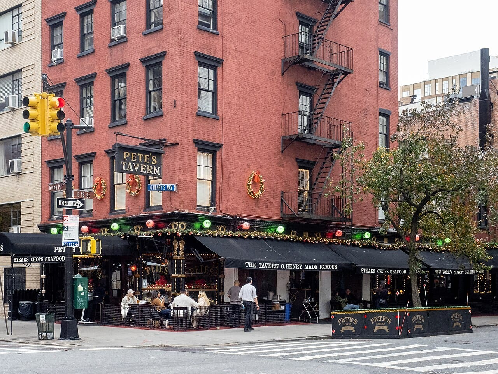

# 皮特酒馆

皮特酒馆在纽约东 18 街与 Irving Place 的转角，门牌 129 East 18th Street，属于格拉梅西公园（Gramercy Park）一带。它把自己称为“纽约持续经营时间最长的餐厅与酒吧”：建筑建于 1851 年，底层最初的饮酒生意始于 1864 年。走进去，先看到的是一张很长的玫瑰木吧台、压花锡天花板与旧瓷砖地面；这些东西比任何一块说明牌都更能解释它为什么还在营业。

图：皮特酒馆。摄影：Pete's Tavern (51708610272)。署名：ajay_suresh，CC BY 2.0，来自 Wikimedia Commons（[来源](https://commons.wikimedia.org/w/index.php?curid=112875512)）。

## 1864 年：皮特酒馆的关键起点
这栋建筑 1851 年建成时是 Portman Hotel，底层在 1864 年开出一间“grocery and grog store”，既卖杂货也卖酒，这是店方追溯的起点。1899 年，Tom 与 John Healy 买下它，改名 Healy's Café；1922 年，Peter D'Belles 接手，Pete's Tavern 这个名字从此固定下来。名字换了三次，空间却基本沿用一个酒馆的格局：吧台、卡座、后吧与楼上的房间。

店方把 O. Henry 的故事放在很前面：这位原名 William Sydney Porter 的作家是附近常客，1903 年在店里第二张卡座写下《The Gift of the Magi》（麦琪的礼物），1903 到 1907 年住在同一条街的 55 Irving Place，并在短篇《The Lost Blend》里提到 Healy's。纽约旅游局的简介把写作年份写作 1905、卡座写作第一张，与店方口径不一致；这类细节适合当作酒馆传说来听，不必当成精确的文学史结论。

禁酒令时期，店面伪装成花店，门口摆着鲜花，熟客从侧门进来，对上暗号后被带到一扇假冰箱门后喝酒；1933 年 12 月 5 日禁酒令废除，花店招牌才摘下。今天店里仍保留那扇门的铰链。它“纽约最老”的说法依赖定义：若按同一地址持续经营，店方有充分依据；若按建筑年龄或品牌连续性，纽约还有别的竞争者。把它理解成“一间还在营业的老酒馆”，比争论排名更接近实际体验。

## 空间与酒单

店内的主体是一张约四十英尺长的玫瑰木吧台，后吧、锡天花板、瓷砖地面与卡座都按店方说法自 1864 年沿用至今。两个餐厅保留旧格局，墙上挂满本地人、名人与旧照片；楼上还有一间带硬木地板与砖墙的派对房。室外的咖啡座是纽约较早的露天餐区之一，店方把它追溯到 1950 年代初。

酒单的重心不是复杂调酒，而是“酒馆式”的完整吧台：一款名为 1864 House Ale 的自有啤酒、Guinness Stout 等生啤、相当长的威士忌与波本清单，以及经典鸡尾酒。官方烈酒单列出从 Buffalo Trace、Eagle Rare 到 Pappy Van Winkle 的不同年份，价格跨度很大；这说明它同时服务日常客人与愿意为稀有酒付费的客人。食物是美式正餐与酒吧小食的组合，纽约旅游局把菜系标为传统美式与意大利菜，实际菜单会随季节调整。第一次来，点一杯 1864 House Ale 最能说明这家店的身份；想喝烈酒，再让服务生按预算推荐。

## 怎么喝/点什么

进门后先判断自己想坐哪一区：吧台适合只喝酒、看人；卡座与餐厅适合吃饭；天气好时可以坐室外。想体验历史，吧台与后吧之间走一圈比专门找“O. Henry 卡座”更自然，因为那张桌子通常有人，店里也不会为传说保留空位。

点单可以从 1864 House Ale 开始，再配一份酒吧小食；如果想吃正餐，菜单上的美式与意大利菜比“只点一杯酒”更能体现它作为餐厅的一面。威士忌单很长，先告诉服务生预算与偏好（波本、单一麦芽或爱尔兰威士忌），不要自己盯着年份数字硬选。鸡尾酒以经典款为主，适合作为第二杯；不要要求复杂的分子调酒。

最佳时段是工作日下午到傍晚：光线落在旧木吧台上，客人不多，服务生也有时间聊两句。周末晚上与节假日会吵很多，想安静吃饭的人应该避开。官方页面列出周一至周五 16:00–18:00 的 happy hour，具体酒款与价格以现场为准。

## 皮特酒馆的地址与营业安排
地址是 129 East 18th Street, New York, NY 10003, USA，位于东 18 街与 Irving Place 转角、格拉梅西公园旁；坐标 40.73653, -73.98672。地铁 4、5、6、L、N、Q、R、W 线到 14th Street–Union Square 站，步行约 4–6 分钟；从 23rd Street 站走过来也不远。

营业时间常见记录为每日 12:00–次日 02:00，厨房周日至周四约 23:00 停止出餐、周五周六至午夜；不同来源在打烊时间上略有出入（Time Out 旧页面写 11:00 开门），官方页面在核验日未给出完整时段表，具体时段与节假日安排请以官方渠道为准。`operating_status` 为 `verified`，表示官网与预订渠道在 2026-11-08 仍正常、未见停业公告。这里没有门票；正餐可通过官方页面的预订链接（Resy）订位，dining room 时段约 12:00–22:45，Bar Room 与加热露台仅接受 walk-in。21 岁以下客人可以坐在餐厅餐桌，但不能在吧台区，订位时请说明有未成年人。电话 212-473-7676，店内没有停车场，建议乘地铁。价格在曼哈顿属于中档，纽约旅游局标为两个美元符号；点稀有威士忌时另当别论。着装没有硬性要求，casual 即可。历史建筑的入口与通道条件不一，行动不便者建议先电话确认。「皮特酒馆」的开放时间、价格与预约，以[官网](https://www.petestavern.com/)的公开页面为准；核验日期为 2026-11-08，临时调整以官网当日公告为准。

## 礼仪与常见误区

第一，把这里当餐厅与酒吧，而不是博物馆。吧台前的座位是给喝酒的人，不要为了拍旧木纹占着不动；卡座有人用餐时，不要站在桌边等“空镜”。第二，不要用“纽约最老”当唯一事实。店方的说法有依据，但“最老”按什么算，学界与媒体并没有统一答案；把争议说出来，比替店家宣布结论更合适。

第三，O. Henry 的故事属于店方叙事：写作年份与卡座编号在不同资料里有出入，可以听，但不必纠正邻桌。第四，禁酒令的“花店”故事同样来自店内传承，细节生动，但缺少独立档案；把它当酒馆记忆，而不是历史考试答案。第五，小费按美国习惯给，账单里可能已经加收大桌服务费，先看清单再补。最后，不要期待安静、精致或实验性的鸡尾酒体验；这里的声音与人群都属于纽约酒馆的日常。

## 纽约的周边街区
从 Union Square 站出来，先看广场与周边的书店、地铁口，再沿 Irving Place 往北走一个街区就到。格拉梅西公园本身是私人公园，只有持有钥匙的住户能进，游客可以在栏杆外看；往东两个街区是 Theodore Roosevelt Birthplace，往南走约十分钟可到 Flatiron Building 与 Madison Square Park。若想把纽约的老酒馆串起来，可以继续步行或乘地铁到东村的麦克索利老麦酒馆，或到西村的白马酒馆；三间店的“老”各有不同：皮特是餐厅与酒馆的合体，麦克索利把只卖艾尔坚持成制度，白马则背着文学神话。

## 同城酒吧与延伸阅读
皮特酒馆适合与麦克索利老麦酒馆对照：两者都自称历史悠久，但一个靠完整餐饮与长酒单维持，另一个靠极窄的酒单与仪式感。若对纽约酒馆的文学叙事感兴趣，可以再读白马酒馆。把三间店放在同一次行程里，会比单独打卡更清楚“历史”在这座城市如何被经营。

## 同城酒吧与延伸阅读
- [纽约历史酒馆路线：东村到格拉梅西](ref:new-york-historic-pubs)
- [雇员专属酒吧](ref:employees-only)
- [麦克索利老麦酒馆](ref:mcsorleys-old-ale-house)

补充阅读：[A Ginjinha](ref:c-extra-1)、[À la Mort Subite](ref:c-extra-2)。

相关条目：[纽约历史酒馆路线：东村到格拉梅西](ref:new-york-historic-pubs)、[雇员专属酒吧](ref:employees-only)、[麦克索利老麦酒馆](ref:mcsorleys-old-ale-house)。

## 相关图像

