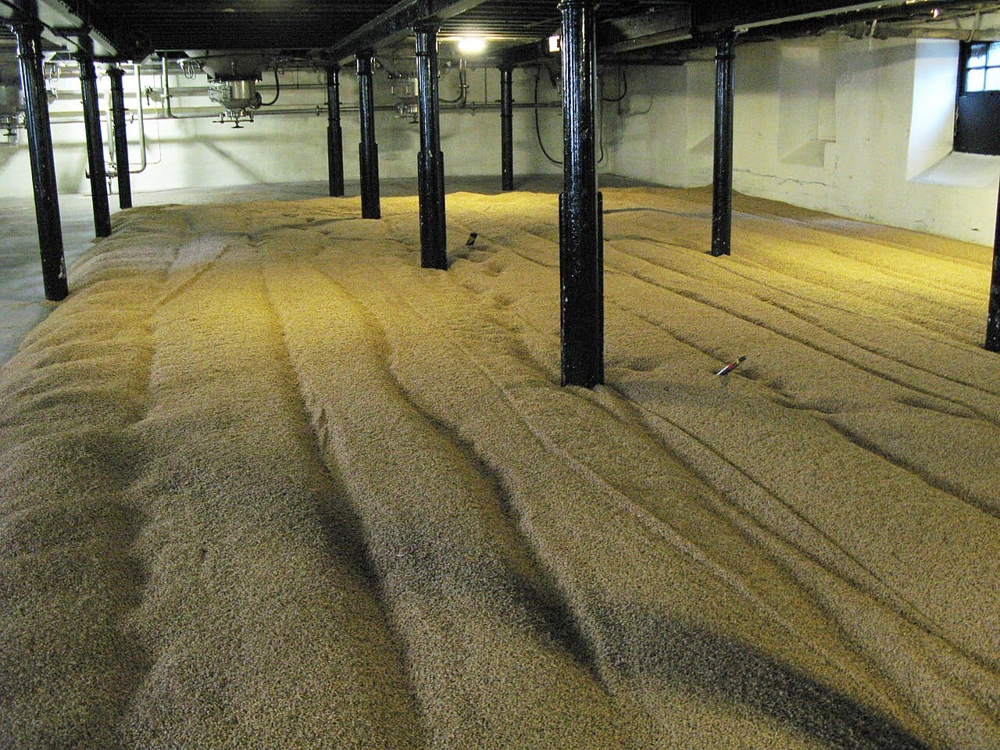

# 比尔森啤酒厂：金色拉格的诞生地

比尔森啤酒厂在捷克西部的 Plzeň，地址是 U Prazdroje 7。它不是一个只供拍照的工业遗址，而是仍在出酒的生产厂区：游客沿着参观动线经过历史糖化车间、现代糖化设备、灌装线与地下酒窖，最后在酒窖里喝一杯未过滤的原浆。理解这座厂，关键不在“老”，而在它把一套 19 世纪的酿造方法保留到了今天，并让这套方法成为全球淡色拉格的模板。

图：比尔森啤酒厂：金色拉格的诞生地相关实景照片。图片：Txllxt TxllxT，CC BY-SA 4.0，via Wikimedia Commons（[原图页面](https://commons.wikimedia.org/wiki/File:Plze%C5%88_-_Sady_5._kv%C4%9Btna_-_View_East_over_Ml%C3%BDnsk%C3%A1_strouha_towards_Plze%C5%88sk%C3%BD_Prazdroj_(Pilsner_Urquell_Brewery).jpg)）。

## 一座城市与一种风格

Plzeň 在布拉格以西约 90 公里，13 世纪建城，1295 年获得城市权利。这里的酿造传统与水源关系密切：当地水质偏软，矿物质含量低，适合酿造颜色浅、苦味清晰的底层发酵啤酒。19 世纪上半叶，波希米亚的啤酒市场仍以顶部发酵、颜色偏深、质量不稳定的啤酒为主，Plzeň 的市民酒厂决定请一位巴伐利亚酿酒师来改造工艺，这才有了后来的故事。

城市与酒厂的关系不是单向的。酒厂用水、用工、用铁路，把 Plzeň 变成一座啤酒城市；城市的名字又反过来成为风格名。今天走在市中心，仍能看到与啤酒有关的建筑、餐馆与广告，但酒厂本身已经是一个现代化的生产与参观复合体，不能把“老城”与“老厂”混为一谈。

## 1842 年那锅酒改变了什么

1842 年 10 月 5 日，Josef Groll 在 Plzeň 酿出第一锅金色下层发酵啤酒。它的关键组合是：浅色麦芽、萨兹（Saaz）酒花、软水、低温发酵与低温熟成。麦芽提供干净的甜味与浅金色，萨兹酒花给出细腻的草本与香料苦味，软水让苦味显得清晰而不粗糙，低温发酵则让酒体保持干净。这套组合后来被称为“比尔森式”（Pilsner），并迅速被各地酒厂模仿。

需要区分的是“风格”与“品牌”。Pilsner 作为一种淡色拉格风格，今天在世界各地都有生产；Pilsner Urquell 则是 Plzeň 这家酒厂的具体品牌，名字意为“比尔森的原初来源”。酒厂官方强调只在 Plzeň 酿造，这不是说其他地方不能酿“皮尔森风格”，而是说这个品牌的生产地点固定在这里。

## 厂区里的三层时间

参观动线通常从历史糖化车间开始。铜制糖化锅、木制发酵槽与旧式冷却设备被保留下来，空间尺度与今天的设备完全不同。接着是现代糖化与发酵区域，管道、罐体与控制系统占据主要画面；最后是灌装线，玻璃瓶与易拉罐在高速运转的传送带上移动。三层时间叠在同一片厂区里，让人能直观看到“传统方法”与“现代规模”如何共存。

酒厂仍坚持三重煮出糖化（triple decoction）：把部分醪液分出、加热煮沸，再送回主醪，重复三次。这个过程耗能、耗时，但能带来更深的麦芽香与更饱满的酒体。官方把它称为“平行酿造”的一部分，具体参数属于生产技术细节，参观时不必追问配方比例；理解“为什么要多这一步”比记住数字更有意义。

参观通常约 100 分钟，全程有讲解，语言场次需在预约时确认。厂区面积大，部分路段乘厂内巴士；灌装线是否开放取决于当天生产安排，不能保证看到所有环节。历史建筑、现代设备与生产安全区混在一起，参观时必须跟着导览走，不能自行进入车间。

## 酒窖里的原浆

地下酒窖是整条动线最有说服力的部分。砂岩拱顶、低温高湿的环境、排列的橡木桶，构成与地面车间完全不同的空间。酒厂在这里保留少量木桶陈酿，用于展示与品鉴；参观者通常能喝到未过滤、未巴氏杀菌的原浆，直接从桶中取出，泡沫厚、香气新鲜，苦味与麦芽甜都比瓶装版本更直接。

原浆不等于“更好”，它只是另一种状态：酵母与悬浮物带来更厚的口感，也让保质期变短；过滤与杀菌则换来稳定与运输便利。把原浆与市售瓶装放在一起比较，能清楚感到“新鲜度”与“稳定性”的取舍。酒窖温度低，参观时带一件外套；品尝通常是一小杯，不要把它当作无限量试饮，酒精与低温都会影响判断。

## 比尔森风格与产地名字

描述比尔森风格时，常见的指标是颜色、苦度与原麦汁浓度。颜色从浅金到深金，苦度用 [IBU](ref:ibu) 表示，具体数值随酒厂与批次变化；原麦汁浓度决定酒体与酒精潜力，但不能单独判断苦味。比尔森的核心不是某个固定数字，而是“浅色麦芽 + 萨兹酒花 + 软水 + 下层发酵 + 低温熟成”的组合，以及由此带来的干净、清脆、苦味清晰的平衡。

法规层面，欧盟自 2008 年起保护“Czech Beer / České pivo”这一受保护地理标志（PGI），对产地、原料与传统工艺提出要求；它保护的是“捷克啤酒”这一名称的使用条件，不是把“Pilsner”这个词变成某一家的专利。把[比尔森风格](ref:pilsner)、[拉格](ref:lager)与[捷克](ref:czechia)的条目放在一起读，会更容易分清风格名、品牌名与产地保护三件事。酿造端的基础环节，如[制麦](ref:malting)，也决定了麦芽能否支撑这种浅色而又有骨架的酒体。

## 到访前要弄清的事

地址是 U Prazdroje 7, 301 00 Plzeň。从布拉格乘火车约一小时到 Plzeň 主站，再步行或换乘公交到酒厂；从市中心步行也可达。参观需通过 Prazdroj Visit 预约，旺季与周末建议提前几天买票；英语场次有限，具体时间、票价与语言以官网当日信息为准。酒厂仍在生产，临时停产、检修或活动可能导致某些区域关闭。

参观结束后可以在厂区餐厅吃饭，也可以回到市中心比较其他酒馆。若想把“比尔森风格”与“捷克酒馆文化”连起来，布拉格的[弗勒克啤酒屋](ref:u-fleku)是一个方便的对照：那里是自酿与酒馆场景，这里是规模化生产与风格源头。两处都值得去，但不要用同一套期待去衡量。

最后提醒：酒厂参观涉及生产区域，需穿包脚的鞋，跟随导览，不要触摸设备或越过警戒线；品鉴后不要驾车。开放状态与票务以官方渠道为准，页面核验日期为 2026-11-08。

相关条目：[皮尔森啤酒](ref:pilsner)、[拉格啤酒](ref:lager)。

## 相关图像

图：制麦。图片：Lakeworther，CC BY-SA 3.0，via Wikimedia Commons（[原图页面](https://commons.wikimedia.org/wiki/File:Highland_park_malting_floor.jpg)）。关联图像：比尔森啤酒厂：金色拉格的诞生地。
