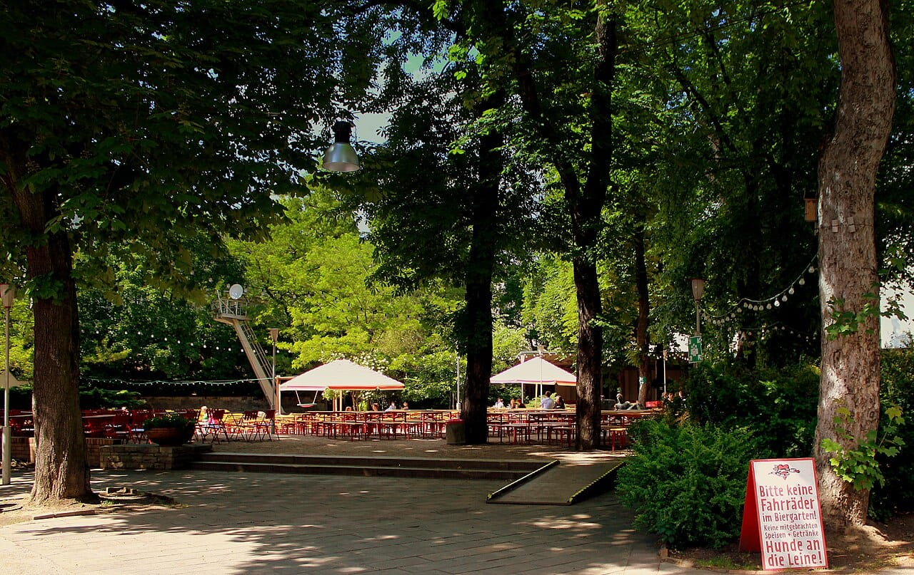
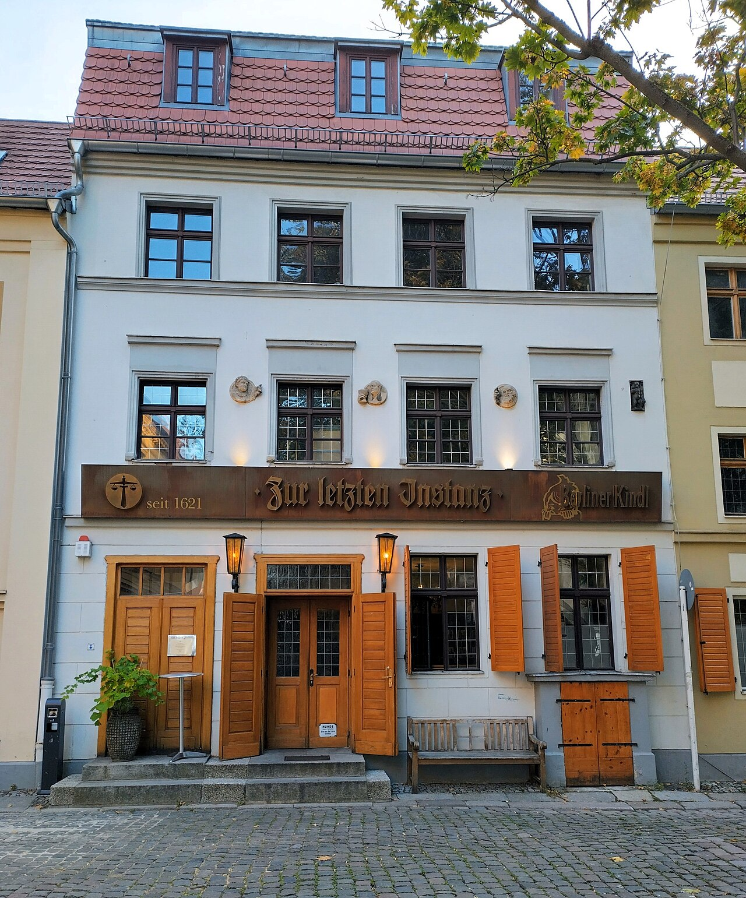

# Prater Garten

从 U2 Eberswalder Straße 出来，沿 Kastanienallee 走两分钟，会看到一栋旧式 Berliner Rundbogen 建筑，红色“PRATER”字母挂在立面上。门洞后面不是街道，而是一整片被栗树遮住的院子：长木桌、红白格子遮阳伞、砾石地、啤酒杯碰撞的声音。它离 Mauerpark 与 Kastanienallee 的咖啡馆只有几分钟，却像一块被城市忘掉的乡村空地——这就是柏林最老啤酒花园的日常。

图：Prater Garten 的栗树荫与长桌，柏林普伦茨劳贝格。图片：calflier001，CC BY-SA 2.0，via Wikimedia Commons（[原图页面](https://commons.wikimedia.org/wiki/File:PRATERGARTEN_BIER_GARTEN_NEAR_TO_ELBERWALDER_STRASSE_U_BAHN_STATION_BERLIN_GERMANY_JUNE_2013_(9058790131).jpg)）。

## 1837 年：Prater Garten的关键起点
Prater Garten 的起点，官方口径是 1837 年；Monumente 的遗产研究则说它“约 1830 年”在普伦茨劳贝格成形。两个说法并不矛盾：1830 年代这片区域还在柏林城墙外，酒馆先以简单的啤酒与咖啡供应出现，1837 年成为有记载的营业点。1852 年，Kalbo 家族接手并把这里扩成娱乐场所；1856/1857 年，临街建起带舞厅与活动大厅的两层建筑，也就是今天红色“PRATER”立面背后的主体。1867 年，店主以维也纳的 Prater 游乐园为灵感，把这里命名为“Prater”——并不是因为柏林与维也纳有直接关系，而是因为“Prater”在当时就是“游乐、饮酒、散步”的代名词。

20 世纪，Prater 的功能不断叠加：1871 年德国工人协会在这里开成立大会，Rosa Luxemburg 与 August Bebel 在 Prater-Saal 演讲；1905 年建起露天剧场；1949 年起长期作为 DEFA 电影院；1991 年一度关闭，1996 年啤酒花园重新开放。2017 年开始，建筑进入大规模修复，Volksbühne 把这里当作第二演出场地。今天的 Prater 是“啤酒花园 + 餐厅 + 剧院”的复合体：院子是日常的，建筑是纪念性的，两者共用同一扇门。

## 建筑与空间

啤酒花园的核心是院子：高大的栗树、砾石地、成排的长木桌与红色遮阳伞。桌子不铺桌布，椅子是长凳，客人自己找位置、自己端酒，陌生人拼桌很常见。院子边缘是点单与取酒的区域，旺季会排两条队；室内餐厅则是另一套节奏：深色木饰、旧式吊灯、柏林菜与桌边服务。临街建筑的红砖、圆拱与“PRATER”字母是最好认的地标，门洞把街道与院子隔开，走进去像换了一个城市。

空间的使用方式是“先找桌子，再去点酒”。高峰时不要站在过道中间等朋友，也不要把包放在长凳上占位；这里拼桌是常态，空位就是给下一个人的。想安静一点，可以坐院子边缘或室内餐厅；想感受柏林夏天的公共生活，就坐中央长桌，和陌生人共用一壶水、一篮面包与一场偶然的谈话。

## 酒单与味觉

Prater 的酒单以柏林与德国啤酒为主：Pils、Helles、Weizen、Radler，以及季节性啤酒；也提供软饮、咖啡与简单鸡尾酒。啤酒用大杯（0.5L 或 1L）供应，夏天最常点的是 Pils 与 Radler。食物是柏林酒馆风格：prezel、香肠、酸菜、土豆沙拉、炸鸡/烤鸡、肉丸与季节菜；芦笋季（Spargel）会有专门的芦笋菜单。它不是精致餐厅，而是“喝酒 + 吃饱”的啤酒花园厨房。

想认真喝啤酒，可以点一杯 Pils，配 pretzel 或香肠；想轻一点，Radler 或 Weizen 更适合下午。柏林夏天下午的阳光很强，啤酒要趁凉喝；如果坐在栗树下，温度会低几度，酒体更容易保持。餐厅的柏林菜分量偏大，两人点一份主菜加一份小食通常就够。价格属柏林中等，啤酒花园比市中心旅游餐厅便宜。

## 怎么喝

最佳时间是四月到九月的晴天，下午三点到傍晚。周一到周五下午人少，周六周日从中午开始满座；下雨或降温时，啤酒花园会关闭或只开室内餐厅。官方说啤酒花园“天气好时每日 12:00 起开放”，餐厅周一至周六 17:00 起、周日 12:00 起；具体季节与天气要看官网当日公告。想拍空镜，最好在开门后半小时内到；想感受气氛，傍晚六点后最热闹。

点单时先找桌子，记住桌号（如果有），再去取酒/点单。啤酒花园通常是先付后取或桌边结账，视区域而定；不确定就问服务员。喝完的空杯要放回指定回收处，不要把杯子带走。夏天院子里的水龙头可以洗手，但不要用来洗杯子或倒酒。带孩子来的家庭很多，狗也常见；如果不喜欢嘈杂，可以坐室内餐厅。

## Prater Garten的地址与营业安排
- 地址：Kastanienallee 7-9, 10435 Berlin。
- 营业：啤酒花园 4–9 月天气好时每日 12:00 起；餐厅周一至周六 17:00 起，周日 12:00 起。冬季与雨天以官网公告为准。
- 交通：地铁 U2 Eberswalder Straße，步行 2 分钟；电车 M1、M10 在 Eberswalder Straße 下车。
- 预订：啤酒花园不接受预订，现场找位；餐厅可电话预订，团队建议提前联系。
- 价格：啤酒与简单食物属柏林中等价位；餐厅主菜更高。
- 支付：建议带现金/EC 卡；旺季网络可能不稳定。
- 无障碍：院子是砾石地，轮椅与婴儿车通行较费力；室内餐厅入口有台阶，建议提前联系。

## 礼仪与常见误区

第一，不要把 Prater Garten 与维也纳 Prater 游乐园混为一谈；柏林 Prater 的名字来自维也纳，但它是普伦茨劳贝格的啤酒花园。第二，不要以为“1837 年”是院内每一栋建筑的年份；1856/1857 年才是临街餐厅主体，院子本身更早。第三，不要在高峰时用包或外套占一整条长凳；拼桌是这里的默认规则。第四，不要把空杯放在桌上就离开；啤酒花园有指定的杯子回收处。第五，不要期待“桌边服务到院子每个角落”；旺季很多区域是自助取酒。第六，不要在最热闹的周末下午带大件行李或婴儿车硬挤；院子通道是砾石，进出都慢。

## 从Prater Garten延伸到Zur letzten Instanz
从 Prater 出门，往北是 Mauerpark 的周日跳蚤市场与露天卡拉 OK，往南是 Kastanienallee 的咖啡馆与小店，往西是 Arkonaplatz 与 Weinbergspark。可以把这一站排成“Mauerpark 周日市集 → Prater 啤酒花园午餐 → Kastanienallee 咖啡馆 → Weinbergspark 日落”。若想把柏林啤酒文化做成一条路线，可以先去 [Zur letzten Instanz](ref:instanz) 吃 Berliner 传统菜，再到 Prater 喝一杯 Pils；慕尼黑的 [Hofbräuhaus](ref:hofbrauhaus) 与 [Augustiner-Bräu](ref:augustiner) 是另一套“大啤酒馆”传统，班贝格的 [Schlenkerla](ref:schlenkerla) 代表烟熏啤酒，布鲁日的 [De Halve Maan](ref:halve-maan) 则是啤酒厂 + 酒馆的组合。

**关键事实。**

| 项目 | 内容 |
| --- | --- |
| 一句话定位 | 柏林普伦茨劳贝格 Kastanienallee 7–9 号的 Prater Garten，是柏林最老的啤酒花园之一；官方把起点定在 1837 年，遗产研究则说它“约 1830 年”成形 |
| 地址 | Kastanienallee 7-9, 10435 Berlin, Germany |
| 城市/国家 | 柏林 / 德国 |
| 营业状态 | 已核验营业 |
| 官网 | pratergarten.de |

## 参考资料
- Prater Garten 官方首页：<https://pratergarten.de/>，用于核对地址、啤酒花园季节/天气规则与餐厅营业时间。
- Monumente Online 的 Prater 专文：<https://www.monumente-online.de/de/ausgaben/2024/3/Prater.php>，用于核对“约 1830 年”起源、1856 年建筑、1871 年工人协会、1949 年 DEFA、1996 年重开与 2017 年修复。
- Top10 Berlin 的 Prater 页面：<https://www.top10berlin.de/de/cat/essen-267/spargelessen-3104/prater-gaststatte>，用于核对今日餐饮与芦笋季菜单。
- Berlin.de 的 Prater Garten 页面：<https://www.berlin.de/restaurants/biergarten/9241029-3621819-prater-garten.html>，用于交叉核对“柏林最老啤酒花园”、栗树长桌与地址。
- 同城的 `place:zur-letzten-instanz` 是柏林老酒馆，`place:hofbrauhaus`、`place:augustiner-braeu`、`place:schlenkerla` 与 `place:de-halve-maan` 代表德国/比利时啤酒文化的不同样本。
- 相关条目：[Zur letzten Instanz](ref:instanz)、[Hofbräuhaus](ref:hofbrauhaus)、[Augustiner-Bräu](ref:augustiner)、[Schlenkerla](ref:schlenkerla)、[De Halve Maan](ref:halve-maan)

## 相关图像

图：柏林最后一审餐厅。图片：Julia Roessing，CC0，via Wikimedia Commons（[原图页面](https://commons.wikimedia.org/wiki/File:Zur_letzten_Instanz_Restaurant_Berlin_2026-09-29.jpg)）。关联图像：Prater Garten。
