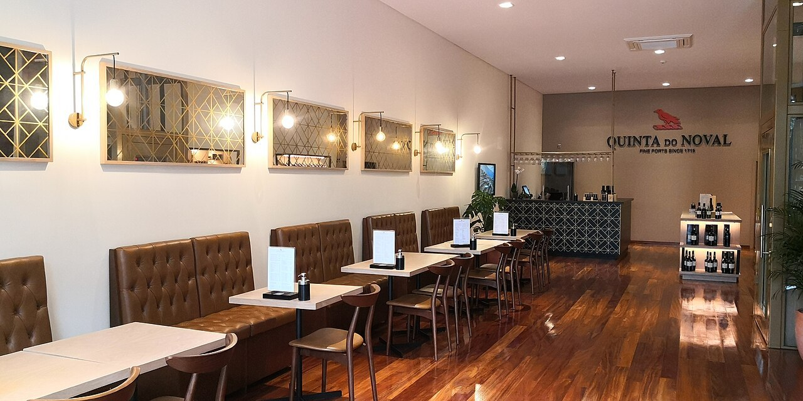

# 诺瓦尔酒庄

诺瓦尔酒庄（Quinta do Noval）在葡萄牙杜罗河谷皮尼昂（Pinhão）附近的 Vale de Mendiz，地址是 Quinta do Noval, Vale de Mendiz, 5085-110 Pinhão。它是一座以葡萄园命名的波特酒庄，酒庄自称是唯一仍以自家葡萄园命名历史波特酒商。名字在 1715 年就出现在土地登记里，但今天人们谈论的诺瓦尔，更多是 1894 年重建后的样子：片岩梯田、石 lagar 里的足踩发酵、长时间的木桶陈年，以及那块名为 Nacional 的未嫁接老藤地。

图：诺瓦尔酒庄。摄影：Quinta do Noval wine shop 1。署名：sanjorgepinho，CC BY-SA 4.0，来自 Wikimedia Commons（[来源](https://commons.wikimedia.org/w/index.php?curid=94306217)）。

## 皮尼昂上方的谷地

从皮尼昂沿乡道往上走，葡萄园在片岩坡地上层层展开，Vale de Mendiz 就在这条谷地里。杜罗河谷的夏天炎热干燥，片岩保水能力差，老藤根系必须往岩缝里扎；产量因此不高，果实却更集中。酒庄的建筑群围绕老农舍、酿造间、lagar 与陈年库展开，仍以生产为主，不是把旧房改成展陈的“游客中心”。

通常从波尔图乘火车到皮尼昂，再换出租车或预约接送；自驾从皮尼昂过来不远，但乡道窄、弯多。酒庄没有公开的固定散客时段，具体入口、停车位置与集合点以预约确认邮件为准；酒庄未公开可直接引用的坐标，本文不填经纬度，坐标以官方渠道为准。

## 1715 与 1894：两条时间线

1715 年是名字第一次出现在土地登记中的年份。若泽·马里亚·雷贝洛·瓦伦特重修老藤、建住宅与酒窖，但根瘤蚜危机随后摧毁了杜罗的葡萄园。

1894 年，波尔图酒商安东尼奥·若泽·达·席尔瓦（António José da Silva）买下仍受根瘤蚜影响的诺瓦尔，重新种植葡萄并恢复酒庄。他去世后，女婿路易斯·瓦斯康塞洛斯·波尔图继续投资。1923 年，Nacional 第一次出产；1967 年，加亚新城酒窖火灾烧毁档案与部分酒窖，酒庄把库存迁回杜罗，在山坡上建了控温仓库。1993 年，Van Zeller 家族把酒庄卖给 AXA Millésimes，克里斯蒂安·西利（Christian Seely）出任总经理，葡萄园重植与建筑整修从此加速。

把 1715、1894 与 1993 三个年份分开看，才不会把“古老”误当成“从未中断的同一家公司”。1715 是文献起点，1894 是现代酒庄的起点，1993 是资本与重装的起点。

## Nacional：一块未嫁接的老藤地

Nacional 不是另一座酒厂，而是诺瓦尔葡萄园核心的一小块地，种着未嫁接的本地品种老藤。它的酿造方式与酒庄其余葡萄相同：在石 lagar 里足踩，之后进入木桶。酒庄前总经理西利说得很清楚，Nacional 之所以不同，是因为葡萄与土地，而不是因为酿造间里做了什么特别处理。

这块地的产量极小。在声明年份，Nacional 通常只装 200 至 250 箱；同年份的诺瓦尔 Vintage 约为 1,200 至 5,000 箱，而 Vintage 又只占声明年份总产量的一成左右。酒庄从 1994 年起定下规则：只有品质无可争议时才声明 Nacional。1996 年，酒庄其余地块没有声明 Vintage，Nacional 却单独声明；2007 年则相反，诺瓦尔 Vintage 成立，Nacional 没有。

未嫁接，指葡萄藤长在自己的根上，不接美国砧木。根瘤蚜压力让这种老藤少见，种植风险也高；它不等于自动更好，但老藤、低产与本地品种叠加，确实能给出更集中的香气。品鉴时不要只找“力量”，也要注意紫罗兰、黑莓、香料与矿物感，以及年轻的单宁。

## 石 lagar 与陈年：波特酒在这里成形

波特酒的甜，不是加糖，而是把发酵停在半路。葡萄破碎后，果皮、果肉与果汁一起在石 lagar 中发酵，颜色、单宁与香气被萃取出来；当糖分转化到合适程度，加入葡萄蒸馏酒，酵母被杀死，发酵停止，残糖留下来。加强之后的酒精度通常在 19 至 22 度之间，甜度则取决于停止发酵的时点。这个“加强”动作，正是波特酒与普通杜罗红葡萄酒的分水岭。

诺瓦尔的顶级酒款仍用足踩。几十个人在花岗岩石槽里并排踩葡萄，用体温与脚掌压力温和萃取，避免过度破碎果梗与种子。1967 年火灾之后，诺瓦尔把库存迁回杜罗，在酒庄里完成陈年，不再依赖加亚新城的河畔酒窖。木桶从不装满，酒液在桶壁与空气之间缓慢氧化，一部分酒液以“天使份额”的形式蒸发，剩下的酒更集中、更圆。

陈年长度决定酒款类型。Vintage 通常在木桶中放约两年，然后装瓶，在瓶中继续发展；LBV 在桶中陈年四到六年，装瓶后可以直接喝，也可能带沉淀；Colheita 是单一年份的茶色波特，至少在木桶中陈年七年，装瓶时已经带有坚果、焦糖与干果气息。三者不是等级高低，而是不同的时间路线。

## Vintage、LBV 与 Colheita：产品线怎么读

诺瓦尔的产品线可以按“是否声明年份”与“陈年方式”两条轴来读。Quinta do Noval Vintage Port 只在声明的年份生产，酒体深、单宁强，适合长期存放；Nacional Vintage 是其中的小块地版本，产量更少，价格更高，年轻时往往更封闭。LBV Unfiltered 不经冷稳与过滤，保留更多颜色与单宁，喝之前要小心沉淀。Colheita 则是另一条线，单一年份、长时间桶陈，开瓶即可喝。

2004 年起，酒庄也开始生产杜罗法定产区的未加强葡萄酒：Cedro do Noval 是较易饮的入门款，Touriga Nacional 单品种更集中，Vinhas do Passadouro 来自 2019 年收购的地块。第一次来，可把重点放在 Vintage 与 LBV 的对比。

侍酒温度不必太低：Vintage 16 至 18 摄氏度，LBV 与 Colheita 约 14 至 16 摄氏度。Vintage 需要醒酒，年轻年份可醒一到两小时；LBV 与 Colheita 通常不必久醒。配餐上，Vintage 适合蓝纹奶酪、黑巧克力与烤肉，Colheita 适合坚果塔、焦糖布丁与干果。

## 预约、季节与到访细节

所有参观都必须提前预约，酒庄在联系页面上写得很明确。电话 +351 22 377 0270，邮箱 noval@quintadonoval.pt；联系地址是加亚新城的办公室，实际参观在 Vale de Mendiz 的酒庄。预约时说清人数、语言、是否自驾、想看葡萄园还是酿造间；参观内容、时长与费用按人数与季节安排，未在官网公开固定价目，需以酒庄回复为准。

采收期通常在九月至十月，是酒庄最忙的时候，参观名额少、道路也更拥挤；如果想看 lagar 运作，要提前更久询问，并接受“当天以生产安排为准”的可能。春季与初夏气候较温和；盛夏午后炎热，带水与帽子；酒窖与陈年库温度低，带一件薄外套。

杜罗河谷道路窄，酒后不要自驾。从皮尼昂乘火车来，回程班次有限，先查好时间，或选择含接送的行程。`operating_status: verified` 只说明酒庄在营业，不代表可以直接上门。

把这站放进杜罗行程时，可以对照下游的[克拉斯托](ref:crasto)，看两家酒庄如何处理片岩、老藤与波特酒；再读[杜罗](ref:douro)与[波特](ref:porto)两个产区条目，理解为什么历史上的酒液要顺河运到波尔图；工艺上则可延伸阅读[波特酒](ref:port)、[加强](ref:fortification)与[天使份额](ref:angels)。

对照阅读：[克拉斯托酒庄](ref:crasto)、[波特](ref:porto)。

## 相关图像

图：克拉斯托酒庄类别配图。图片：Vitor Oliveira from Torres Vedras, PORTUGAL，CC BY-SA 2.0，via Wikimedia Commons（[原图页面](https://commons.wikimedia.org/wiki/File:Rio_Douro_-_Portugal_(32615481975)_(cropped).jpg)）。关联图像：诺瓦尔酒庄。
