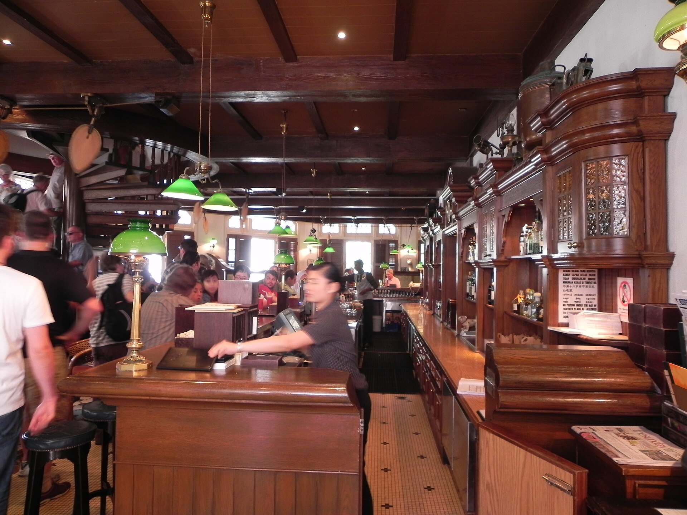

# 莱佛士长廊酒吧

莱佛士长廊酒吧（Long Bar）在莱佛士酒店旁的 Raffles Arcade 二层，不在酒店大堂里。莱佛士酒店于 1887 年开业，酒吧则以 1915 年在这里首次调出的新加坡司令（Singapore Sling）闻名。它的名气太大，排队、拍照和“把花生壳丢在地上”的仪式常常盖过酒本身；理解它为什么长成现在这个样子，比记住一杯酒的配方更有用。

图：莱佛士长廊酒吧相关实景照片。图片：Hajotthu，CC BY 3.0，via Wikimedia Commons（[原图页面](https://commons.wikimedia.org/wiki/File:Raffles_Hotel_Long_Bar_A.JPG)）。

## 1915–1920：莱佛士长廊酒吧的历史节点
莱佛士酒店是新加坡殖民时期留下的地标，Long Bar 原本是酒店里的社交酒吧。官方页面说，20 世纪初它位于 Cad's Alley，被称作“种植园主的会面处”，桌子朝向 Bras Basah Road，客人一边喝酒一边看街上的人。那个年代，女性在公共场合饮酒并不被接受，女性客人通常只能喝茶或果汁。

1915 年，酒店的酒保 Ngiam Tong Boon 用金酒、菠萝汁、青柠汁、库拉索、Bénédictine、石榴糖浆和樱桃利口酒调出一杯粉红色、看起来像果汁的长饮。它的甜味、颜色和杯型都像在“伪装”酒精，因此很快流行起来。这个社会背景解释了新加坡司令为什么是低酒度、偏甜、入口像果汁，而不是一杯强调基酒强度的现代鸡尾酒。

今天的酒吧位于 Raffles Arcade 二层，空间分两层，装饰取材于 1920 年代马来亚种植园生活。它仍由莱佛士酒店经营，但物理位置已经从酒店主楼转到相邻的拱廊，这个细节会直接影响你怎么找入口。

## 空间与酒单

酒吧的核心是一条标志性的长吧台，深色木饰、做旧质感与热带种植园纹样把空间包起来；两层的高度让它比普通酒店酒吧更像一个“场景”，而不是一个安静的休息室。座位密集，白天和傍晚都有游客，靠窗和靠吧台的位置最受欢迎。

酒单以新加坡司令为绝对主角，也有不含酒精的 Singapore Sling Zero。官方介绍称，今天的新加坡司令使用本地蒸馏的 Brass Lion Singapura Gin，并以橙皮、柑橘皮和暖香料来补充风味；这说明它已经不是 1915 年的原始配方，而是经过多次调整的当代版本。除招牌长饮外，酒吧也供应经典鸡尾酒和佐酒小食，具体菜单以现场为准。

花生是这里的另一个“展品”。官方页面说，花生壳落地的习惯始于 1900 年代：周末来聚会的马来亚橡胶园主和种植园主习惯把剥下的壳随手扫到地上，久而久之成了传统。酒吧会提供花生，并明确邀请客人把壳扫到地上——这大概是新加坡唯一被鼓励“乱丢”的地方。

价格属于新加坡酒店酒吧的高位。新加坡司令的具体售价会随菜单调整，本页不写死数字；按酒店酒吧的定位，单人一杯酒加小食的预算应明显高于普通街区酒吧。页面核验日期为 2026-11-08，实际价格以官方菜单为准。

## 怎么喝

这里只接受现场排队，不接受预订（walk-in only）。官方给出的相对空闲时段是开门前后的 11:00–11:30、下午 14:00–15:30，以及工作日 21:00 以后；傍晚旅游团和酒店客人叠加时，等待时间会明显变长。若行程紧，建议把这里放在上午第一站，而不是晚饭后。

第一次来，点一杯标准版新加坡司令即可，先判断自己是否喜欢这种甜、长、低酒度的风格。觉得过甜，可以改点无酒精的 Sling Zero，或选一杯更偏酸、更短的金酒类鸡尾酒；不要把“来都来了”变成硬喝两杯。花生是配酒的小食，不是主食，空着肚子连喝两杯长饮很容易不舒服。

喝法上没有复杂规矩：坐着喝、慢慢喝，别把杯子带走，也别把花生壳扫到吧台外或酒店庭院里。官方的“丢壳”许可只限酒吧内部。若恰逢 6 月 27 日“新加坡司令日”，官方页面说前 100 名带一整颗菠萝到店的客人可以换一杯酒，这类活动每年细节可能变化，出发前看当年公告。

着装建议是 smart casual。新加坡天气热，但酒店和酒吧的空调很足，带一件薄外套比穿背心拖鞋更稳妥；部分酒店区域对着装有基本要求，穿得太随意可能影响进入。

## 莱佛士长廊酒吧的地址与营业安排
地址是 #02-01 Raffles Arcade, 328 North Bridge Road, Singapore 188719；从 North Bridge Road 入口进入比从酒店正门（1 Beach Road）绕行更直接，两者相距不远，但不要以为进了酒店大堂就能看到酒吧。电话 +65 6412 1816。

官方营业时间：周日至周三 11:00–22:30（最后入座），周四至周六 11:00–23:30（最后入座）；节假日、包场与临时调整仍以官方渠道为准（2026-11-08 复核）。只接受现场排队，不接受预订；官方建议的相对空闲时段是开门前后 11:00–11:30、下午 14:00–15:30 以及工作日 21:00 以后，实际等待时间随人流变化。

无门票，按杯消费。价格属新加坡酒店酒吧高位，新加坡司令的具体售价随菜单调整，单人一杯加小食的预算明显高于普通街区酒吧，以官方菜单与账单为准。

交通：地铁 Esplanade、City Hall 或 Bras Basah 站都在步行范围内，具体出口与步行时间按当天导航走；打车可以直接报 Raffles Arcade 或 North Bridge Road 入口。晚高峰滨海湾一带堵车，地铁通常更稳。

「莱佛士长廊酒吧」的开放时间、价格与预约，以[官网](https://www.raffles.com/singapore/dining/long-bar/)的公开页面为准；核验日期为 2026-11-08，临时调整以官网当日公告为准。

## 礼仪与常见误区

第一个误区是把它当成安静的酒店酒廊。它是一个高知名度的旅游场景，噪音、排队和拍照都很正常；想安静聊天，应该去酒店其他酒吧或附近街区酒吧，而不是在这里等一个“空镜”。

第二个误区是以为花生壳可以随便丢。许可范围仅限酒吧内部，而且是为了维持这个历史习惯；把壳带出门口、丢进酒店花园或塞进花盆，不是“入乡随俗”，只是给清洁人员添麻烦。

第三个误区是把新加坡司令当成“烈酒”。它是长饮，甜度高、酒精度相对低，设计初衷甚至是让酒精看起来像果汁；如果你期待的是短饮的强度，会失望。也不要执着于“1915 年原版配方”，今天的版本已经使用不同的基酒与配比。

第四个误区是关于预订。官方明确只接受 walk-in，电话也不是用来订位的；如果是酒店住客或隔壁餐厅的客人，可能有衔接安排，但不应把它理解成保证入座。

不适合来这里的情况很具体：预算很紧、讨厌排队、想要安静谈事、或者只喝现代风格鸡尾酒的人。反过来，如果你对殖民时期城市生活、鸡尾酒史和“一杯酒如何成为城市符号”感兴趣，这里仍然值得一次。

## 新加坡的周边街区
酒吧在莱佛士城（Raffles City）与政府大厦一带的边缘，步行可到 Chijmes、Bras Basah 街区、新加坡国家博物馆和土生文化馆。往南走是新加坡河与滨海湾，往东北是 Bugis 与武吉士街区。

半日路线可以这样排：上午 11 点前到 Long Bar 排队，喝一杯后逛 Raffles Hotel 的拱廊与庭院；中午在 Raffles City 或 Chijmes 吃饭；下午去国家博物馆或土生文化馆；傍晚走到新加坡河、鱼尾狮或滨海湾。这样既避开了酒吧的傍晚高峰，也把“历史建筑—博物馆—水岸”串成一条线。

如果只想喝酒，不建议把 Long Bar 和滨海湾的酒吧排在同一晚：两边都要排队，移动又耗时。把它当作白天的一站，晚上再去别处，体验会更完整。

## 同城酒馆与延伸阅读
要理解这类酒吧在城市公共生活中的位置，可以读[酒吧与城市](ref:pub-and-city)；它也比较了咖啡馆、pub 与 beer hall 的差别。本页只处理莱佛士长廊酒吧这一处场所，不展开新加坡司令的完整配方史。

补充阅读：[新加坡司令](ref:c-extra-1)、[金酒](ref:c-extra-2)、[A Ginjinha](ref:c-extra-3)、[À la Mort Subite](ref:c-extra-4)。

相关条目：[认识一座城，从一间酒馆开始](ref:pub-and-city)、[新加坡司令](ref:c-extra-1)、[金酒](ref:c-extra-2)。
