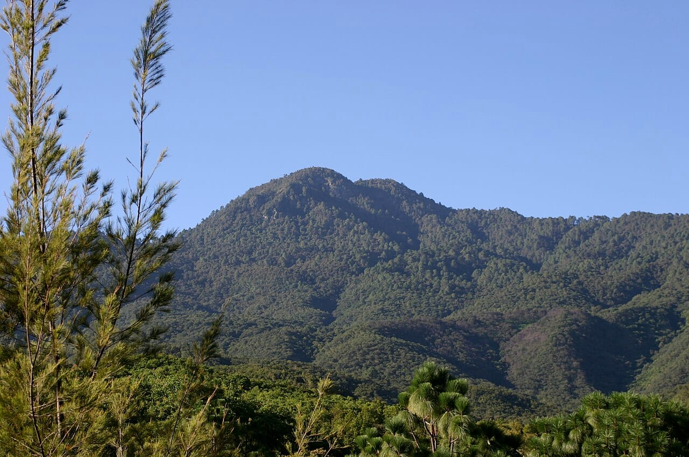

# 雷亚尔米内罗帕伦克：圣卡塔里娜米纳斯的陶罐与种子

雷亚尔米内罗（Real Minero）的 palenque 在瓦哈卡州中央谷地南缘的圣卡塔里娜米纳斯（Santa Catarina Minas），地址是 Iturbide 街无门牌号。这里不是一座面向旅游大巴的示范厂，而是安赫莱斯（Ángeles）家族仍在使用的生产现场：土坑烘烤、木槌手捣、陶罐二次蒸馏，产量小，批次差异被当作特征而不是缺陷。它也是理解[梅斯卡尔](ref:mezcal)与[瓦哈卡](ref:oaxaca)产区关系的一个具体入口——不是所有梅斯卡尔都来自瓦哈卡，但瓦哈卡的这一套做法足够有代表性。

图：雷亚尔米内罗帕伦克：圣卡塔里娜米纳斯的陶罐与种子。摄影：File:Abraham Minero, Edu Oriol, Juan Carlos Pérez y David Mateos.JPG。署名：Campeones 2008，CC0，来自 Wikimedia Commons（[来源](https://commons.wikimedia.org/w/index.php?curid=15773790)）。

## 中央谷地南缘的圣卡塔里娜米纳斯

圣卡塔里娜米纳斯在瓦哈卡市以南约三十公里，沿 131 号公路，车程约三十分钟。村子挂在斜坡上，主路窄，palenque 在 Iturbide 街一侧，门口不起眼；自驾最方便，也可以在瓦哈卡市包车或参加小团。导航可搜“Real Minero, Santa Catarina Minas, Oaxaca”，palenque 在 Iturbide 街一侧，停车沿主路找空位。

这里属于中央谷地。村子的经济长期围绕龙舌兰与梅斯卡尔展开，许多家庭都有自己的小厂。走进村子，先看到矮墙、土砖与晒着的玉米。

## 从“Papá Chico”到 1978 年的 La Concepción

家族把源头追到十九世纪末，记忆中的第一位导师是弗朗西斯科·安赫莱斯（Francisco Ángeles），村里人叫他“Papá Chico”。在那个做梅斯卡尔仍属灰色地带的年代，他带着后辈进山，用最简陋的方式蒸馏“Mezcal Minero”。这条家族线后来传到洛伦索·安赫莱斯·门多萨（Lorenzo Ángeles Mendoza）手里。

1978 年，洛伦索与尼古拉斯·阿雷利亚内斯（Nicolás Arellanes）买下家族第一座 palenque，也就是今天的 La Concepción，这是雷亚尔米内罗真正的起点。1978 年到 2002 年之间，酒没有品牌，装在塑料桶或回收瓶里，用玉米芯塞住，贴一张手写小纸片出售。2004 年出现第一枚正式酒标；2005 年，墨西哥梅斯卡尔标准已经生效，酒厂停用“Minero”这个旧称，改用规范里的“Mezcal Joven”。2009 年首次出口德国，2015 年进入美国市场。今天品牌由第五代的格拉谢拉、阿德里亚娜、米里亚姆三姐妹与母亲坎德拉里亚·卡雷尼奥共同打理。

## 土坑、木槌与陶罐：一套不肯提速的工艺

工艺从地下开始。采收的龙舌兰被切去叶片，只留 piña，放进锥形土坑，用木柴与火山石加热，再覆盖土与纤维闷烤数天。烤软的 piña 不送辊式磨机，而是放进木制 canoa，由人抡起木槌（mazo）一下一下砸碎。接下来是自然发酵，再进入陶罐做二次蒸馏；陶罐的导热慢、容量小，蒸馏师要靠闻与看火候来判断掐头去尾的时点。

这套流程的产量远低于铜壶加大罐的组合，酒精度也常偏低，但风味更“薄而长”：烟熏不压果香，矿物感与龙舌兰的苦甜更清楚。酒厂也做 pechuga——在第二次蒸馏时把鸡肉、水果与香料挂在罐内，让蒸汽带过这些味道。参观时值得看的是土坑边缘的焦痕、canoa 内壁被砸出的凹槽，以及陶罐接缝处的修补；它们比“传统”两个字更能说明[蒸馏](ref:distillation)与[陶罐](ref:potstill)在这里的重量。

## 龙舌兰花园、种子库与 milpa

雷亚尔米内罗不只做酒，还经营一座民族植物学花园，属于 Proyecto LAM。园里保存十七种龙舌兰，其中十四种已经通过种子繁殖；种子库还收留了 lumbre、blanca、canastuda、becuela 等数量稀少的品种。酒厂把龙舌兰与玉米、豆类、南瓜种在同一片地里，用 milpa 的混作方式维持土壤与授粉昆虫。

这套做法直接关系到[龙舌兰](ref:agave)的长期供给：野生或半野生品种被采得越快，价格越高，纯粹靠收购的酒厂就越难稳定。自己留种、育苗、记录母本，成本高，但能让某些品种不在市场上消失。对访客而言，花园不是拍照点，而是理解“为什么这瓶酒有这种味道、为什么它可能越来越贵”的前置知识。酒厂从 2006 年起把参观纳入这套项目，导览也从“看设备”变成“看生命周期”。

## NOM-070 与“ancestral”的边界

梅斯卡尔在 1994 年获得原产地命名，现行技术依据是 NOM-070-SCFI-2016：原料必须是 100% 龙舌兰，在法定产区内完成规定工艺；按陈年分为 Joven、Reposado、Añejo，按生产方式又区分 artesanal 与 ancestral。ancestral 这一路强调土坑烘烤、手工捣碎、自然发酵与陶罐或木制蒸馏器等要素，雷亚尔米内罗的流程正好落在这条线上，但它的酒标长期使用“Mezcal Joven”这一陈年类别，因为酒液本身不经橡木桶。

原产地命名覆盖瓦哈卡多个市镇，也覆盖其他州；圣卡塔里娜米纳斯属于瓦哈卡的核心带之一。监管体系能保证“这瓶酒确实是龙舌兰蒸馏酒”，却不能保证小农能得到合理价格，也不能保证野生品种不被过度采挖。看瓶标时，NOM 编号与“100% agave”是底线；再往下问品种、村子、蒸馏器与批次，才进入雷亚尔米内罗这类小厂真正关心的层面。

## 三小时导览与预约

参观通过官网或 WhatsApp 预约，不接受当天随意进入。常规导览约三小时：先走 Proyecto LAM 的民族植物学花园，看龙舌兰从 quiote 到种子的周期；再进 palenque，看土坑、canoa、发酵与陶罐蒸馏；最后品四款不同的酒。成人每人 750 墨西哥比索，5 至 17 岁 500 比索；只参加品鉴不住宿、不吃饭的客人也可单独预约，费用 500 比索。

时段是周一至周五 10:00 与 15:00，周六只有 10:00，且需提前至少 48 小时预订，周日不开放。每组 1 至 25 人，讲解仅用西班牙语；需要翻译或交通，酒厂可以报价代订，也可以自行安排。加传统午餐的成人费用为 1,500 比索，需至少六人。预约保留十五分钟，迟到可能取消。

## 到访提示：把时间留给村子

**交通**：从瓦哈卡市自驾约三十至四十分钟，走 131 号公路；村内道路窄，把车停在不妨碍通行的位置。没有自驾的人可在瓦哈卡市包车，或让酒厂协助安排并询价。

**现场**：土坑与蒸馏区温度高、灰大，穿耐脏、包脚的鞋，带水与帽子；陶罐与木槌是生产工具，不要擅自搬动。拍摄前先问，尤其是人物与家庭空间。

**品鉴**：四款酒通常按品种或批次排列，先从清爽的 Espadín 开始，再进入 Tobalá、Arroqueño 等更厚重的品种；每杯少量，吐酒是正常做法。梅斯卡尔酒精度不低，空腹容易过量。

**边界**：参观后不要开车。瓦哈卡州对酒后驾驶有明确限制，执法以当地为准；把行程交给不喝酒的司机，或干脆在村子里多留一晚。

若想把“酒厂现场”与“城市品鉴”连起来，可以接着读[梅斯卡尔图书馆](ref:mezcaloteca)：那里把不同村子、不同品种的酒并排放在一张桌上，正好补上生产端看不到的比较视角。

对照阅读：[梅斯卡尔](ref:mezcal)、[梅斯卡尔图书馆：瓦哈卡市中心的一间品鉴档案室](ref:mezcaloteca)。

## 相关图像

图：瓦哈卡。图片：Prsjl，CC BY-SA 4.0，via Wikimedia Commons（[原图页面](https://commons.wikimedia.org/wiki/File:Oaxaqa_(41).jpg)）。关联图像：雷亚尔米内罗帕伦克：圣卡塔里娜米纳斯的陶罐与种子。
