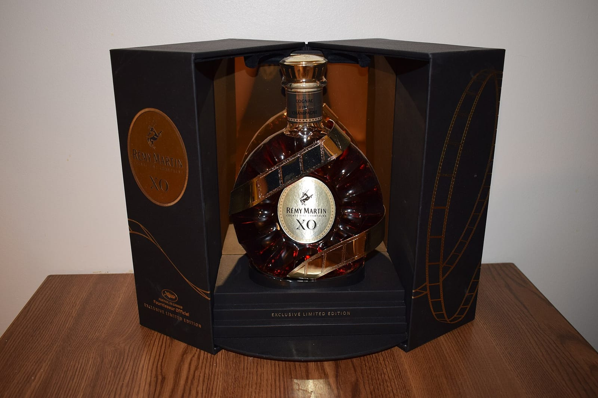

# 人头马干邑酒庄

人头马（Rémy Martin）是 1724 年由同名葡萄农在干邑创立的酒商，也是把“优质香槟干邑”（Fine Champagne）作为核心身份的少数大品牌之一：只用大香槟区与小香槟区的生命之水，其中至少一半来自大香槟区。它的参观点分散在三处——干邑老宅、梅尔潘（Merpins）生产基地与瑞亚克勒科克（Juillac-le-Coq）的葡萄园蒸馏厂，这让参观体验更接近一次产地溯源，而不是单一游客中心的品牌展示。

图：人头马干邑酒庄相关实景照片。图片：Erko，CC BY-SA 4.0，via Wikimedia Commons（[原图页面](https://commons.wikimedia.org/wiki/File:R%C3%A9my_Martin_XO_Cannes_2016_Special_Edition_Cognac.jpg)）。

## 1724 年：一位葡萄农以自己的名字卖酒

1724 年，年轻的干邑葡萄农雷米·马丁开始以自己的名字销售干邑。1738 年，法王路易十五因赏识其酒质，授予他种植新葡萄藤的特权；这段历史后来被做成 1738 Accord Royal。1830 年，酒庄推出首款大香槟区干邑；1870 年，为配合海外业务，选用半人马（Centaur）作为标志——那是 Paul-Émile 的星座射手座。

1924 年，André Renaud 成为酒庄首位调配师，后来兼任主席；1927 年，酒庄以大小香槟区调配出 VSOP Fine Champagne；1938 年，“Fine Champagne”获得法律承认；1948 年起，只生产大小香槟区的干邑；2024 年，酒庄迎来 300 周年。这条时间线说明，人头马不是先有葡萄园再找市场，而是先确定“只做两个分区”，再围绕这个承诺建立葡萄园、合作酒农与调配体系。

## 只取大香槟与小香槟

干邑产区按土壤与气候分为六个 cru。人头马的葡萄只来自 Grande Champagne 与 Petite Champagne；Fine Champagne 的规则是：全部生命之水出自这两个分区，且大香槟区至少占 50%。大香槟区的石灰岩土壤与坡向，通常带来更长的陈年潜力与更细的香气；小香槟区则补充结构与果味。把这条规则与[干邑](ref:cognac)产区页对照，就能明白“优质香槟干邑”不是香槟起泡酒，而是一个法定地理与调配概念。

原料以白玉霓为主，经二次壶式蒸馏，在法国橡木桶中陈年。酒庄的风格目标不是“某一块田的个性”，而是通过调配把大小香槟区的酒液组合成稳定、可识别的人头马：果香、香草与香料，口感圆润。理解[蒸馏](ref:distillation)与[调配](ref:blending)的分工，比记住某一款酒的年份更有用。

## 三处参观点：老宅、梅尔潘与瑞亚克

干邑老宅位于 20 rue de la Société Vinicole，是品牌历史与 LOUIS XIII 体验的所在地：Anniversary Tour 35 欧元、2 小时，讲 300 年历史；鸡尾酒工作坊 35 欧元、1 小时 15 分；LOUIS XIII The Introduction 300 欧元、2 小时；午间餐酒体验 110 欧元、4 小时。老宅被官方标注为“旅游与残障”认证场所，有电梯与轮椅。

梅尔潘生产基地在干邑城外，参观以电动小火车穿过大酒窖，1 小时 30 分、25 欧元，重点看陈年与装瓶的规模。瑞亚克勒科克在大香槟区葡萄园中，是酒庄的新蒸馏厂：可步行或骑电动自行车，2 小时、60 欧元，从葡萄园一路看到蒸馏。把老宅与生产基地串起来的“A Day at Rémy Martin”为 55 欧元。以上价格与场次会调整，预订前看官网。

## 与轩尼诗不同的参观逻辑

轩尼诗把参观集中在理查·轩尼诗码头的单点游客中心，用 10 条线路覆盖从 19 欧元的快闪团到 550 欧元的私人团；人头马则把参观点拆成三处，最低 25 欧元，最贵的是 1500 欧元与 3580 欧元的 LOUIS XIII 深度体验（后者在 Grollet 庄园）。前者像品牌旗舰，后者更像产区溯源：你要在葡萄园、酒窖与蒸馏厂之间移动，才能拼出完整的生产链。

渠道上，人头马属于 Rémy Cointreau 集团，轩尼诗属于 LVMH；产品结构也不同，人头马把资源集中在 Fine Champagne 与 LOUIS XIII 两个价位端，轩尼诗则以 VS、VSOP、XO 的大众与礼品市场为基座。这些差异不影响酒质高低，却直接决定了你在两处会看到什么样的展陈、纪念品与讲解重点。

## 实用信息：地址、预约与到达

老宅地址是 20 rue de la Société Vinicole, 16100 Cognac, France；梅尔潘与瑞亚克勒科克需另行导航，建议先在官网确认集合点。参观与精品店开放时间为周一至周六 10:00–18:00，需提前在线预约；预约可在到访前 72 小时免费更改或取消；电话 +33 5 45 35 76 66。儿童可参加大部分线路，但品鉴仅限 18 岁以上。坐标以官方渠道为准。

从干邑火车站步行可达老宅；两处城外站点有访客停车位，自驾更灵活。看点按兴趣分配：历史与品牌选老宅，规模与陈年选梅尔潘，葡萄园与蒸馏选瑞亚克勒科克。若只有半天，老宅的 35 欧元线路加精品店最省时；若想看清“从葡萄到酒”的全过程，应把瑞亚克勒科克单独留出半天。

## 读懂“优质香槟干邑”标签

标签上的 Fine Champagne 描述的是原料来源，不是等级；VSOP 的最低酒龄是 4 年，XO 是 10 年（2018 年起由 6 年提高），XXO 是 14 年。等级越高不代表你更喜欢，只代表最低年份门槛更高。人头马的产品线从 VSOP、1738 Accord Royal 到 XO、Tercet 与 LOUIS XIII，价位跨度很大，试饮时按“果香—香料—陈年”的顺序比较，比按价格排序更有意义。

最后要区分“酒庄”与“品牌”：人头马在干邑与周边拥有葡萄园与合作酒农网络，但它的核心能力仍是调配与长期陈年。把[白兰地](ref:brandy)的整体分类放在心里，再回到[干邑](ref:cognac)的规则，就能理解为什么同一家酒庄可以用不同分区的酒液讲出同一种风格；若把视野再放宽到[法国](ref:france)的产地体系，也能看出 AOC 如何把地名、工艺与市场声誉绑在一起。

对照阅读：[干邑](ref:cognac)、[蒸馏](ref:distillation)。

**关键事实。**

| 项目 | 内容 |
| --- | --- |
| 一句话定位 | 1724 年由同名葡萄农创立的干邑酒商，只使用大香槟与小香槟区的生命之水，参观分散在干邑老宅、梅尔潘生产基地与瑞亚克勒科克蒸馏厂三处，价格从 25 欧元起 |
| 地址 | 20 rue de la Société Vinicole, 16100 Cognac, France |
| 城市/国家 | 干邑 / 法国 |
| 营业状态 | 已核验营业 |
| 官网 | remymartin.com |

**来源与边界。** 本页关于「人头马干邑酒庄」的关键事实，主要由以下来源交叉核对：Rémy Martin（三处参观点、线路时长与价格、周一至周六开放时间及预约取消规则；六个 cru、Fine Champagne 的构成要求与大香槟至少占一半的表述）、BNIC（干邑法定产区与二次壶式蒸馏的行业规则）、INAO（干邑原产地命名的管理框架）。产品、地址或营业状态变化较快时，以 remymartin.com 的最新页面为准；价格、批次与状态会变，涉及这些字段时以页面所列来源的最新版本为准。正文为项目自写，来源只作核验，不复制原文。

**并读。** 把「人头马干邑酒庄」与「干邑」、「白兰地」、「蒸馏」放在一起读时，先确认它们是同一层级还是上下游关系：先确认地址与营业状态，再比较历史、空间与点单体验。本页负责给出场所的基本坐标，对照条目补上具体案例与差异；读完再回到本页，才能分清哪些差别属于场所本身，哪些只是产地、批次或品牌选择。

## 相关图像

图：干邑。图片：Didier Descouens，CC BY-SA 3.0，via Wikimedia Commons（[原图页面](https://commons.wikimedia.org/wiki/File:Cognac_glass.jpg)）。关联图像：人头马干邑酒庄。
