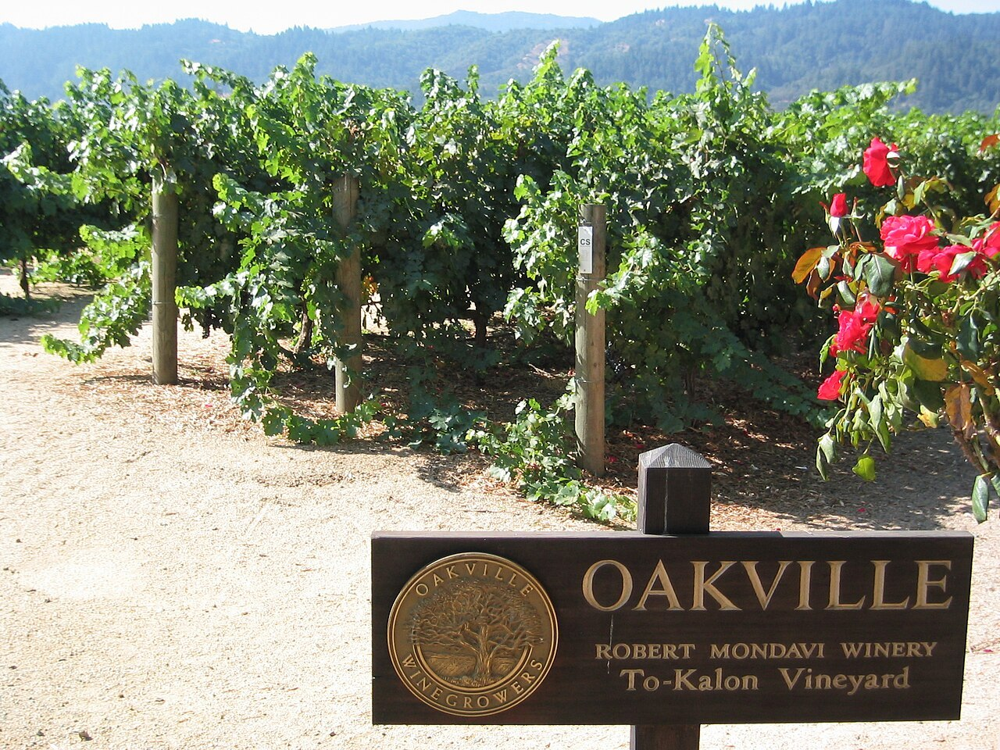
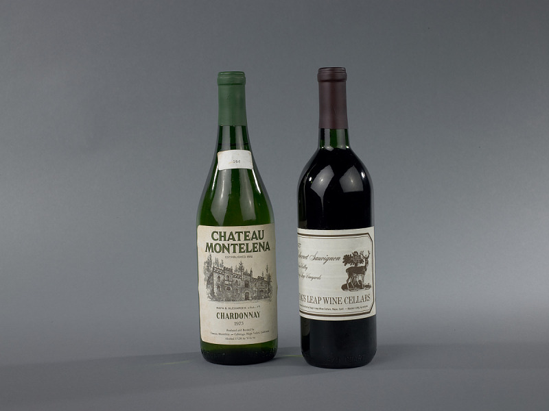

# 罗伯特·蒙大维酒庄

罗伯特·蒙大维酒庄在纳帕谷奥克维尔（Oakville），紧邻 29 号公路，拱门与钟楼是这条公路最容易被认出的轮廓之一。它 1966 年由罗伯特·蒙大维创立，官方称其为禁酒令结束后纳帕谷第一家大型新酒庄。2023 年起酒庄闭门改造，2026 年 4 月 20 日、也就是创业 60 周年时重新开放。今天看到的庄园保留了 1966 年克利夫·梅（Cliff May）设计的拱门与塔楼，又在旁边加入了新的接待空间。

图：罗伯特·蒙大维酒庄。摄影：Robert Mondavi winery。署名：Greg Dunham from Kirkland, WA, USA，CC BY 2.0，来自 Wikimedia Commons（[来源](https://commons.wikimedia.org/w/index.php?curid=2945111)）。

> **先给结论**
> **一句话：** 这页判断罗伯特·蒙大维酒庄值不值得专程去，以及到访前要核对什么。
>
> - **适合谁：** 正在计划去罗伯特·蒙大维酒庄、想知道值不值得专程安排半天到一天的人。
> - **不适合谁：** 只想要“必去榜单”、不准备核对预约、交通和开放时间的人。
> - **先看这两点：**
>   - 酒庄建议提前预约，官网 FAQ 明确说“建议预约，因为经常订满”，但现场在有位时也接受未预约客人。
>   - 第一个误区是把“蒙大维”当成一个酒庄。

## 1966 年：罗伯特·蒙大维酒庄的关键起点
罗伯特·蒙大维不是纳帕谷最早的酿酒者，但他把“纳帕可以做出世界级葡萄酒”这句话变成了产业共识。1966 年，他与家族分道扬镳后，在奥克维尔买下土地，以 To Kalon 葡萄园为核心建立自己的酒庄。官方叙述强调，他是禁酒令之后在当地开设大型酒庄的第一人；在当时的美国，这个判断并不被普遍接受，欧洲才是优质酒的代名词。

酒庄的建筑与它的理念绑定。克利夫·梅设计的传教站风格（Mission style）建筑，以拱门、钟楼、白墙与庭院组成一个开放的公共空间，而不是把酒厂藏在高墙后面。纳帕县地标机构把这座 1966 年建成的酒庄列为地标，建筑风格写作西班牙殖民复兴。它的意义不只在好看：蒙大维把品酒室、艺术活动与餐饮放在酒庄里，让“来酒庄”成为一种文化消费，而不只是批发买酒。

To Kalon 是理解这家酒庄的另一把钥匙。这片葡萄园位于奥克维尔，土壤与微气候适合赤霞珠，也有足够的老藤与地块差异。蒙大维不是 To Kalon 的唯一所有者，今天这片历史葡萄园由多家酒庄持有；但把 To Kalon 变成市场熟知的名字，蒙大维起了关键作用。酒庄的 Reserve 赤霞珠、To Kalon 系列与 Napa Valley 赤霞珠，都以这片园子的不同地块为骨架。

1976 年的巴黎审判（Judgment of Paris）常被拿来解释纳帕的崛起。那场盲品让加州酒进入国际视野，蒙大维是参与者之一；但把纳帕的成功全部归功于一场比赛，会忽略 1960 至 1970 年代在葡萄栽培、温控发酵、法国橡木桶与市场推广上的长期投入。蒙大维的贡献，更多在于把“品种命名、酒庄旅游、餐酒搭配”这些现代美国葡萄酒的语法建立起来。

## 空间与酒单

改造后的庄园以中央庭院与拱门为核心，品酒空间分布在室内与露台，视线越过葡萄园可以看到 To Kalon 的方向。新的接待建筑没有复制老建筑的形态，而是用倒置的山墙屋顶与旧拱门形成对话；这种处理是否好看见仁见智，但它至少没有把 1966 年的立面拆掉重来。

酒单可以分三层看。第一层是 Napa Valley 系列的赤霞珠与长相思，价格相对可及，适合建立对酒庄风格的基准。第二层是 Estates 与 To Kalon 系列，强调地块与年份差异，酒体更集中。第三层是 Reserve 与限量酒，产量小，通常在参观项目的最后出现。蒙大维在 1960 年代末以“Fumé Blanc”之名推广橡木桶发酵的长相思，这个命名后来被美国酒庄广泛使用；今天酒庄仍有 Fumé Blanc，但风格比早期更克制。

参观项目按深度分档：约 60 分钟的 Pioneer Tasting，在 Vineyard Room 或其露台品鉴 Napa 与 Estates 酒款；约 90 分钟的 Legend Tasting and Tour，以 To Kalon 的 Reserve 酒款为主，最后进入改造后的专属空间；约 90 分钟的 Mondavi Table 是餐酒搭配，每天 11:30 与 13:30 两场；约 120 分钟的 To Kalon Collective，把 Schrader、To Kalon Vineyard Company、Double Diamond 与蒙大维四家在同一片园子里的表达放在一起对比。项目与价格会调整，预约页为准。

## 参观与点单方式

酒庄建议提前预约，官网 FAQ 明确说“建议预约，因为经常订满”，但现场在有位时也接受未预约客人。预约通过官网进入订位系统，选择日期、时段与项目；团体人数较多时需要单独联系。21 岁以下不能参加含酒品鉴的项目，带孩子的家庭要提前确认是否有无酒精选项。

点单的实用顺序是“先白后红、先轻后重”。Pioneer Tasting 适合第一次来的人，能在 60 分钟内建立基准；如果已经熟悉纳帕赤霞珠，直接选 Legend 或 To Kalon Collective 更有信息量。餐酒搭配项目适合把酒当午餐的一部分，不适合赶行程的人。不要把所有项目排在同一天：酒精摄入、开车与时间都会让体验变形。

酒庄在改造期间曾把品鉴迁到纳帕市中心的 Arch & Tower；2026 年 4 月庄园重开后，市中心店是否继续营业、以何种形式营业，需看官网当日信息。把“庄园重开”理解成“所有旧项目原样回归”会不准确，新的动线与项目组合已经变化。

## 罗伯特·蒙大维酒庄的地址与营业安排
地址是 7801 St. Helena Highway, Oakville, CA 94562, USA；坐标 38.44149, -122.40939（OpenStreetMap 节点 4344574800）。酒庄在 29 号公路东侧，从纳帕市区开车约 20 分钟，从扬特维尔向南约 10 分钟，从旧金山经 29 号公路约 1.5 小时；停车在庄园入口附近，旺季中午车位紧张。

公共交通在纳帕谷很有限，VINE 巴士沿 29 号公路运行但班次不密，打车或网约车更现实，回程车最好提前预约；品酒必须安排指定司机，加州对酒驾执法严格，血液酒精浓度达到 0.08% 即违法。

酒庄于 2026 年 4 月 20 日完成改造重开，官网列出的营业时间为每日 10:00–16:00，节假日与特殊活动会调整，以预约页显示的可选时段为准。预约是建议而非强制：官网 FAQ 说“建议预约，因为经常订满”，现场有位时也接受未预约客人；预约通过官网订位系统选择日期、时段与项目，6 人以上团体需联系 reservations@robertmondaviwinery.com 或 (888) 766-6328 ext.2。含酒品鉴仅限 21 岁以上，会查证件，外国驾照或护照均可。

票价按项目分档（2026 年参考）：Pioneer Tasting 约 60 美元/60 分钟；The Mondavi Table 餐酒搭配约 95 美元/90 分钟（每日 11:30 与 13:30 两场）；Legend Tasting and Tour 约 150 美元/90 分钟；To Kalon Collective 约 180 美元/120 分钟。价格与项目会调整，以官网预约页为准。`operating_status` 为 `verified`，表示官网与预约渠道在 2026-11-08 仍正常、未见再次闭园公告，不代表当天一定有位置。「罗伯特·蒙大维酒庄」的开放时间、价格与预约，以[官网](https://robertmondaviwinery.com/)的公开页面为准；核验日期为 2026-11-08，临时调整以官网当日公告为准。

## 礼仪与误区

第一个误区是把“蒙大维”当成一个酒庄。Robert Mondavi Winery、Woodbridge by Robert Mondavi、Robert Mondavi Private Selection 是不同的产品线，产地与定位不同；在超市看到的低价蒙大维，不等于奥克维尔庄园的酒。第二个误区是把 To Kalon 当成蒙大维独有：这片历史葡萄园由多家持有，酒标上写 To Kalon 不代表同一家酒庄。

品酒礼仪方面，吐酒是正常做法，不是浪费；酒庄通常提供吐酒桶，尤其在一连串品鉴中。不要用手指捏杯肚，握杯脚或杯底；不要往酒里加冰或可乐。拍照可以，但不要挡住其他客人的视线，也不要把酒杯带出品酒室。穿着没有硬性规定，但庄园以户外步行为主，皮鞋与高跟鞋在碎石路上不舒服。

第三个误区是以为“重开”等于“随时能进”。2026 年重开初期预约紧张，周末与采收季（8 月至 10 月）尤其如此；没有预约直接开车到门口，很可能只能逛商店。第四个误区是忽略年龄与身份检查：美国法定饮酒年龄是 21 岁，品酒项目会查证件，外国驾照或护照都可以，但过期证件不行。

## 奥克维尔的周边街区
奥克维尔是纳帕谷 29 号公路的核心段，酒庄密集。往北几百米就是作品一号酒庄（Opus One），两家的建筑与定位形成有趣对比：一边是开放的传教站风格庄园，一边是预约制、几乎只做一款酒的现代建筑。往南是扬特维尔，餐厅与旅馆集中；往北是卢瑟福（Rutherford）与圣赫勒拿，适合安排第二天的行程。

半日路线可以是：上午蒙大维的 Legend Tasting，午餐在扬特维尔，下午作品一号或奥克维尔的其他酒庄；若只安排一天，不要超过两家酒庄加一顿正餐。纳帕谷的交通在周末与采收季会堵，29 号公路与 Silverado Trail 之间要留出移动时间。把“喝酒”和“开车”分开，是这条路线最重要的前提。

## 同产区酒庄与延伸阅读
罗伯特·蒙大维酒庄是理解[纳帕谷](ref:napa)与[葡萄酒](ref:wine)产业化的一条入口；它把葡萄园、建筑、市场与餐酒文化放在同一个庄园里。关于 1976 年那场改变纳帕地位的盲品，可以读[1976 年巴黎审判](ref:judgment-of-paris)。

补充阅读：[美国](ref:c-extra-1)、[作品一号酒庄](ref:c-extra-2)。

相关条目：[纳帕谷](ref:napa)、[葡萄酒](ref:wine)、[1976年巴黎审判：加州酒击败法国名庄](ref:judgment-of-paris)。

## 相关图像

图：1976 年巴黎盲品会的获奖酒样，加州与法国葡萄酒评价体系的分水岭。图片：Unknown author Unknown author，Public domain，via Wikimedia Commons（[原图页面](https://commons.wikimedia.org/wiki/File:Judgment_of_Paris_1976_Winners_NMAH-2006-7043.jpg)）。关联图像：罗伯特·蒙大维酒庄。
