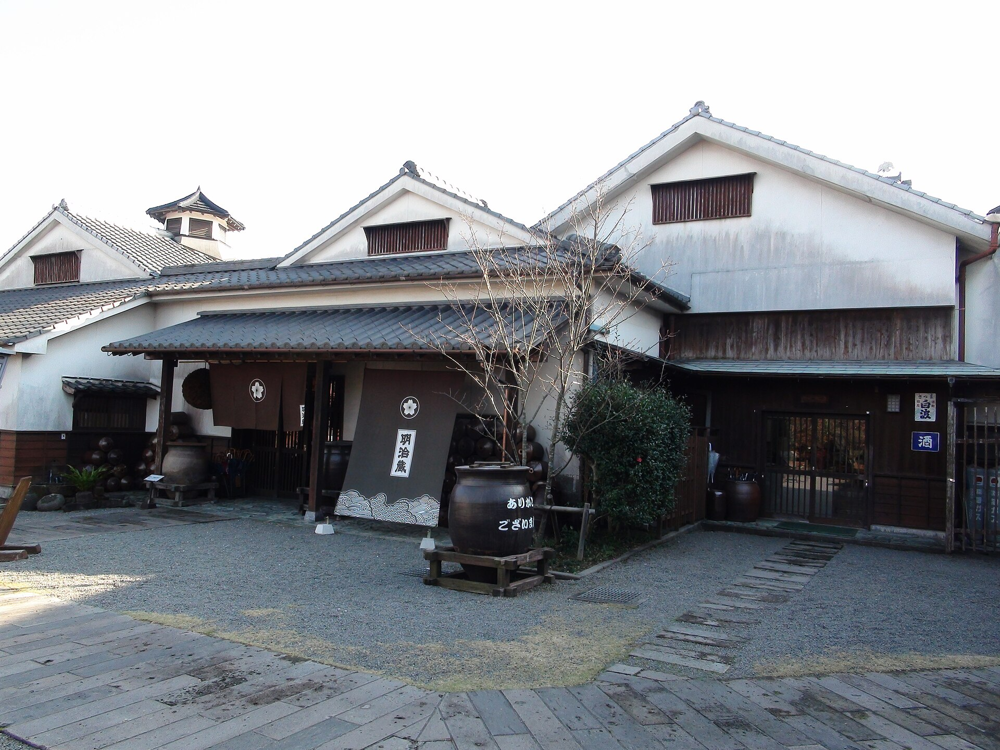

# 萨摩酒造明治藏

萨摩酒造明治藏位于[日本](ref:japan)鹿儿岛县枕崎市立神本町 26 号，正式名称是花渡川蒸馏所明治藏。它保存了明治时代延续下来的藏屋与手艺，今天仍由杜氏与藏人按传统工序酿造本格烧酒，参观者可以在近处看到制曲、发酵与蒸馏，而不只是隔着玻璃看展板。入馆免费，开馆时间为 9:00–16:00，12 月 30 日至 1 月 3 日休馆；馆内商店出售“萨摩白波明治藏”“黑白波明治藏”等 25 度产品，也有 37 度的明治藏原酒。

图：萨摩酒造明治藏相关实景照片。图片：Sakaori ( talk )，CC BY 3.0，via Wikimedia Commons（[原图页面](https://commons.wikimedia.org/wiki/File:Satsuma_Shuzo%27s_Kedogawa_Shochu_factory_and_museum,_Meijigura.JPG)）。

## 枕崎港与花渡川

枕崎在萨摩半岛最南端，面向东海，风大、湿度高，渔业与烧酒是两条并行的产业。明治藏坐落在花渡川边，河名也成了蒸馏所的名字。从鹿儿岛市区沿南萨纵贯道开车约六十分钟；从 JR 枕崎站下车再坐车约五分钟；从鹿儿岛机场开车约一百分种；从指宿约六十分钟，从知览约三十分钟。这个位置决定了它不像城市里的博物馆那样随时可达，更适合与枕崎港、指宿或知览串成一日线。

把酒藏放回港口看，原料与运输的关系会清楚很多。甘薯在县内种植，收获后要尽快处理，酒藏与产地之间的距离直接影响鲜度；米麹、瓶罐与成品则靠公路进出。枕崎不是最方便的观光点，却保留了“产地即酒藏”的尺度，街道不长，藏屋与海风只隔几条巷子。

## 明治以来的藏与技

明治藏之所以用“明治”命名，是因为这里的藏屋与酿造方式可以追溯到明治时代，本格烧酒的制法也在那个时期逐步定型。今天的参观不是复原演出：藏内仍有职人作业，器具、木桶、蒸笼与管道按实际工序摆放，部分区域因安全与卫生限制不能停留太久。理解这一点，就不会把“老藏”误读成静止的遗址。

本格烧酒在酒税法里属于单式蒸馏烧酒，原料经制曲、一次发酵、二次仕込与单式蒸馏得到，和连续式蒸馏的甲类烧酒不是同一条路线。[日本烧酒](ref:shochu)的香气与原料个性，很大程度来自这种单式[蒸馏](ref:distillation)与[壶式蒸馏器](ref:potstill)的组合；设备看起来简单，控火与切酒却依赖经验。藏内展示的价值，正在于把“经验”变成可以观察的动作。

## 白曲、黑曲与甕仕込

鹿儿岛烧酒的曲分白曲与黑曲。白曲源自鹿儿岛，柠檬酸生成能力强，发酵清爽，成品香气较轻、口感干净；黑曲更早从冲绳泡盛系统传来，酶系与酸度不同，酿出的酒更厚、更带泥土与浓郁香气。明治藏的白波与黑白波正好把两条曲路并排放在货架上：同样以甘薯与[米](ref:rice)麹为原料，同样 25 度，差别来自曲种与发酵管理。

甕仕込是另一条线索。明治藏用陶制甕壺进行仕込与贮藏，陶壁透气、导热慢，温度变化比不锈钢罐温和，酒液在甕中完成发酵与初步熟成。甕的容量小、清洗与搬运靠人力，效率不如大罐，但它带来的圆润感与甘薯香，是这家酒藏愿意保留的理由。参观时若看到一排排甕壺，不要只当成布景：它们是工艺选择，也是产能限制。

## 参观动线：从制曲到蒸馏

参观通常从藏屋的历史与花渡川讲起，再进入制曲与发酵区。甘薯蒸熟、摊凉、拌曲，第一次发酵在甕或槽中进行，随后加入第二次仕込的原料继续发酵，成熟醪再进入单式蒸馏器。蒸馏段能闻到明显的甘薯香与酒精气，蒸汽管与冷却槽周边温度高，动线通常会与设备保持距离。

试饮与商店在动线末端。馆内提供试饮空间，可以比较白曲与黑曲的差别；不喝酒的人也能看展板、买土产。馆内销售的产品包括 25 度的常规酒与 37 度原酒，度数越高，入口的刺激与香气浓度越明显，兑水或加冰后又是另一种状态。若开车，全程不试饮；若搭车，先把想比较的两款各喝一小口，再决定买哪一瓶。

## 度数、税则与甕贮藏

酒税法对烧酒的课税以 20 度为基准：每升 200,000 日元，酒精分超过 20 度后每增加 1 度加算 10,000 日元。25 度是本格烧酒长期沿用的标准装瓶度数，也是多数酒藏的主力规格；20 度则贴着课税基准，酒体更轻、更适合佐餐。两档之间的价差不只来自原料与工时，也来自这条按度累加的税则。买酒时看度数，比看“原酒”二字更能判断税负与风格。

甕贮藏让酒在装瓶前有一段缓慢的整合期。陶甕的微氧交换与温度缓冲会削弱新酒的尖锐感，也让甘薯的甜香更圆；但贮藏不是越久越好，香气会随时间的推移从新鲜转向熟成，太长则失去芋烧酒最讨喜的那一面。酒藏会根据产品定位决定甕藏时间，而不是把“长期贮藏”当成统一标准。

## 交通、开放与到访提示

地址是枕崎市立神本町 26 号，开馆 9:00–16:00，入馆免费，12 月 30 日至 1 月 3 日休馆。参观与团体接待最好提前电话确认，尤其是年末年初与台风季；鹿儿岛县观光页与酒造官网都列出电话，遇到临时休馆以官网公告为准。停车场免费，可接待大型巴士。

从鹿儿岛中央站搭 JR 指宿枕崎线到枕崎站，再转车约五分钟；从鹿儿岛机场开车约一百分种，路程比想象中长，返程要留时间。坐标以官方渠道为准，本页不给出经纬度。藏内部分区域地面湿滑、蒸汽明显，穿防滑鞋、避开运转设备；带小孩时先问清楚可停留的范围。

若想把“酒藏参观”与“产地风景”放在一起，可以把枕崎港、指宿的砂蒸温泉与知览的武家屋敷排在同一天；但如果只有半天，宁可只来明治藏，把试饮与商店慢慢走完。这里不是大型主题园区，价值在于看见一套仍在使用的甕与蒸馏设备，以及一套没有被旅游动线改写的工序。

相关条目：[日本烧酒](ref:shochu)、[蒸馏](ref:distillation)、[壶式蒸馏器（pot still）](ref:potstill)。

## 参考资料

- [花渡川蒸溜所 明治蔵](https://www.meijigura.com/)，萨摩酒造，核验地址、开馆时间、免费入馆、休馆日与产品度数。
- [よくある質問](https://www.satsuma.co.jp/con-qanda.html)，萨摩酒造，核验明治藏参观时间与电话。
- [萨摩酒造「明治藏」](https://www.kagoshima-kankou.com/cn/attractions/11074)，鹿儿岛县观光联盟，核验地址与营业时间。
- [酒税率一覧表](https://www.nta.go.jp/taxes/sake/shiori-gaikyo/shiori/2026/pdf/05_01.pdf)，国税厅，核验烧酒以 20 度为基准的课税结构。
- [焼酎王国！](https://www.kagoshima-kankou.com/gourmet/shochu/siru)，鹿儿岛县观光联盟，核验鹿儿岛烧酒文化与产区背景。

页面核验日期 2026-11-09；开馆时间、参观安排与商品信息以官方渠道为准。
