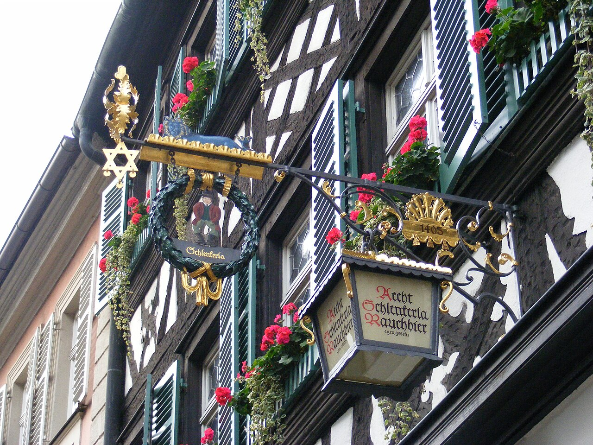

# 施伦克拉烟熏啤酒馆

图：施伦克拉烟熏啤酒馆。图片：User:Mattes，Public domain，via Wikimedia Commons（[原图页面](https://commons.wikimedia.org/wiki/File:Schlenkerla_-_Nasenschild_in_Bamberg.JPG)）。

## 1405 年：施伦克拉烟熏啤酒馆的关键起点
施伦克拉在班贝格老城的 Dominikanerstraße 6，位于主教座堂下方的小巷里。1405 年的文献第一次提到这处房产，班贝格旅游局的介绍把这一年作为酒馆可追溯的起点；此后建筑多次易主，今天由 Trum 家族经营到第六代。它首先是一家"历史啤酒厂附设酒馆"（Historischer Brauereiausschank），不是单纯的餐馆，酒是在店里酿造、从木桶直接打出来的。

店名"Schlenkerla"来自班贝格方言，词根与"晃荡、摇摆"（schlenkern）有关。常见的解释有两种：一说早期端酒的人走路带着晃动，二说与老建筑的空间格局有关。词源本身没有唯一答案，不必当成定论；能确定的是，这个名字在本地远比"酒馆正式名称"更常用。

班贝格以啤酒厂密度高著称，烟熏啤酒（Rauchbier）是这座城市最有辨识度的特产。施伦克拉的招牌写作 "Aecht Schlenkerla Rauchbier"，"Aecht"在德语里是"真正的、正宗的"，用作品牌区分，不是说别家的酒是假的。把这家店放回[酒馆史](ref:history-of-taverns)的脉络，会更容易理解它为什么同时是"酿酒厂""酒馆"和"地方记忆载体"。

## 空间与酒单

酒馆保留木质护墙、老式灯具与深色家具，空间被分成几个大小不一的房间，桌椅紧凑，墙上挂着与酿造、家族有关的物件。它不是博物馆式的复原，而是仍在营业的老房子；地面、门框与楼梯的磨损本身就是历史的一部分。

啤酒的核心是烟熏麦芽。麦芽在进入糖化之前，用山毛榉木（Buchenholz）的烟熏制，烟味进入麦芽，再进入酒液，所以烟熏不是"上桌前加的香精"，而是原料处理的结果。常见酒款可以这样记：Rauchbier Märzen 是招牌，深色、酒体中等，烟熏与麦芽甜同时出现；Rauchbier Weizen 是小麦版本，香蕉与丁香香气叠加烟熏，口感更柔；Rauchbier Lager 颜色较浅、烟熏较轻，适合第一次尝试；Rauchbier Urbock 是季节性的烈性款，烟熏更厚、酒体更强。

食物是法兰肯家常菜：Schäuferle（烤猪肩）配酸菜与面包、Bratwurst 配酸菜、烤猪肉与洋葱、黑麦面包与黄油。菜单不以精致取胜，咸、酸、烤肉与烟熏啤酒的组合才是重点。具体菜式随季节变化，以现场菜单为准。

## 第一次去怎么点

第一次来，建议先点一杯小杯的 Rauchbier Lager 或 Märzen，确认自己能接受烟熏强度，再决定要不要换 Weizen 或加大杯。烟熏啤酒的香气在温度过低时会被压住，传统供应温度比冰镇拉格高一些；不要要求"越冰越好"，也不要用冰水漱口后再喝。

配餐上，Märzen 配烤猪肩或香肠最稳：烟熏、烤肉、酸菜的酸度互相支撑。Weizen 适合配较清淡的菜或单独喝，Urbock 适合冷天与重口味菜。若同行的有人完全不接受烟熏味，这家店没有"无烟熏"的替代酒款，最好换一家；班贝格另有以淡色烟熏啤酒闻名的 Spezial，强度不同，但仍属烟熏家族。

时段上，中午与下午较早的时候更容易找到座位，晚上本地人与游客都多。旅游旺季周末建议预留等位时间；店里不接受"只参观不消费"的长时间停留，想拍照先点单，且不要对着其他客人拍。

## 施伦克拉烟熏啤酒馆的地址与营业安排
**地址**：Dominikanerstraße 6, 96049 Bamberg, Germany。

**交通**：从班贝格中央车站（Bamberg Hbf）步行到老城约 15–20 分钟，进入老城后按主教座堂方向走；公交与出租车只能到老城边缘，最后一段仍是步行。老城石板路不平，穿稳一点的鞋更合适。

**开放时间**：官网写明全年每日 9:30–23:30，厨房连续 11:00–22:00，早上 9:30 起供应 Frühschoppen；天气好时，Dominikanerhof 啤酒花园从复活节开放到十月。圣诞节与跨年夜有特殊营业安排，须看官网公告。此前旅游局的 10:00–24:00 为旧信息，已按官网更正。

**预约与门票**：不收门票，按点单消费。散客现场找座与拼桌；当天订位可打 +49 951 56050，其他日期建议通过官网订位表或邮件。团体、啤酒花园与圣诞季建议提前询问。

价格在班贝格属于中等偏旅游区水平，啤酒按杯计价，食物分量实在；两个人点一份主菜加两杯酒通常够。着装休闲，不需要正装。德国不少老店仍偏好现金，备一些现金更稳妥。

「施伦克拉烟熏啤酒馆」的开放时间、价格与预约，以[官网](https://www.schlenkerla.de/)的公开页面为准；核验日期为 2026-11-08，临时调整以官网当日公告为准。

## 礼仪与常见误区

拼桌先问一句，得到允许再坐；不要把外套与包占满长凳。碰杯时看着对方眼睛，这是德语区的常见习惯。结账时把侍者叫来，报出含小费的总额，小费一般凑整或 5%–10%，不要把现金留在桌上走人。不要自带食物与饮料，也不要把酒杯或酒桶塞进包里。

常见误区有四个：把烟熏味当成"烧焦"或"劣质"；以为 1405 年等于"连续酿酒六百年"（它是房产与酒馆首次见于文献的年份）；把 "Aecht" 理解成对同行的贬低；把这里当成可以安静办公的咖啡馆。它晚上很吵，木桌硬，灯光暗，适合吃饭与聊天，不适合长时间用电脑。

不适合来这里的人也很明确：完全不喜欢烟熏味的人、想喝多种清淡啤酒的人、赶时间只想喝一杯就走的游客。它的价值在于"一种味道做到底"，而不是选择多。

## 班贝格的周边街区
出门往上走就是班贝格主教座堂（Bamberger Dom）、旧皇宫与新皇宫，往下走可到老市政厅与桥上建筑，再往河边是小威尼斯（Klein-Venedig）一带的旧渔屋。把施伦克拉放在中午：先吃烤猪肩配烟熏啤酒，再上山看教堂，傍晚沿河走回老城。

班贝格老城是世界文化遗产，街巷窄、坡道多，路线以步行为主。若想把啤酒主题做得更完整，可以在老城另找一家啤酒厂附设酒馆对照，但同一天喝两家烟熏啤酒容易味觉疲劳，建议分开安排。节假日与周末的晚间，老城餐饮普遍满座，提前或错峰更实际。

## 同城酒馆与延伸阅读
- [啤酒](ref:beer)：烟熏啤酒在啤酒风格谱系中的位置。
- [酒吧与城市](ref:pub-and-city)：酒馆如何用空间、酒单与营业时间组织公共生活。
- [酒馆史：从酒肆、客栈到酒吧](ref:history-of-taverns)：啤酒厂附设酒馆的历史脉络。

补充阅读：[A Ginjinha](ref:c-extra-1)。

对照阅读：[啤酒](ref:beer)、[酒馆史：从酒肆、客栈到酒吧](ref:history-of-taverns)。

把 Schlenkerla 放回班贝格烟熏啤酒与酒馆史，可对照[啤酒](ref:beer)与[酒馆史：从酒肆、客栈到酒吧](ref:history-of-taverns)。
