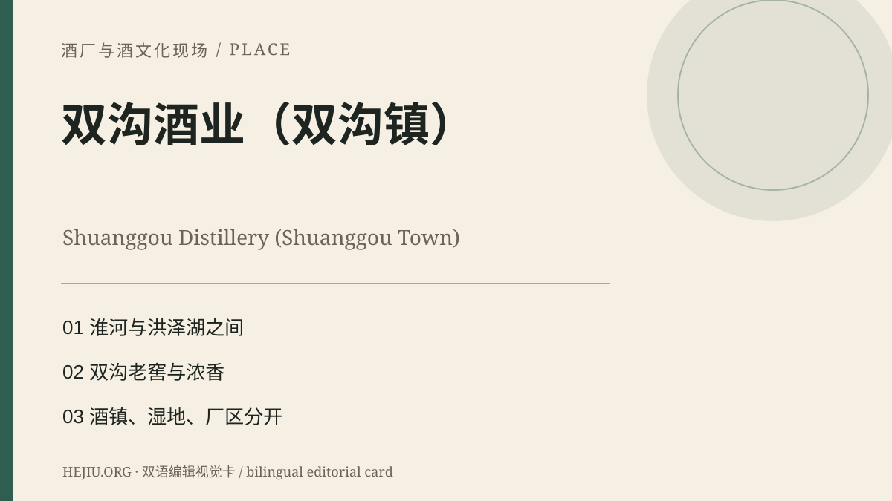
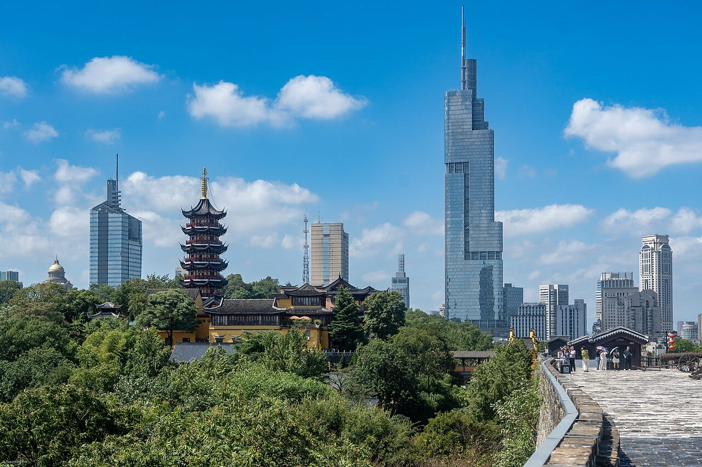

# 双沟酒业（双沟镇）

双沟镇在淮河与洪泽湖之间的水乡，酒厂、镇区与湿地彼此相邻。很多人从洋河一路过来，把双沟当成“顺路再看一个厂”，结果只在大门口拍张照。双沟的价值在于它把浓香型白酒的老窖、制曲、蒸馏与酒镇生活放在同一片水网里；先分清厂区、展陈与镇区，再决定是半天顺访，还是和泗洪湿地安排一整天。

图：双沟酒业（双沟镇）专属双语视觉卡。项目自制双语视觉卡，用于识别主题，不是现场照片。

> **先给结论**
> **适合谁：** 走苏北酒旅、想看浓香老窖与水乡酒镇关系的人；适合与洋河、洪泽湖串线。
> **不适合谁：** 只想要“酒厂打卡”、不愿预约的人；生产区有门禁与安全边界。
> **一句话：** 先看展陈与老窖，再看镇区与水网，品鉴和买酒分开。

## 酒镇、湿地与厂区

双沟镇是生活与酒业混在一起的镇区，有住宅、菜市场、小餐馆、酒厂班车与货运；双沟酒业的生产厂区是独立工业空间，有制曲、窖池、蒸馏、陶坛库与包装物流；洪泽湖与淮河湿地则是另一套生态空间，负责水源、航运与候鸟。三者相邻，却不是一张门票。到镇上先问清厂区访客入口、展陈位置与停车点，不要把车开到车间门口；湿地观鸟与厂区参观也要分开安排，否则两边都赶。

## 双沟酒业看什么

双沟以浓香型白酒为主，重点看老窖池、窖泥维护、制曲房、蒸馏与陶坛陈放。浓香型白酒用泥窖固态发酵，窖池连续使用越久，窖泥里的微生物群落越稳定，己酸乙酯与窖香才容易出来。看窖池时注意池壁厚度、池底泥层、作坊通风与排水；看制曲房时注意曲块排列、温度与翻曲；看陶坛库时注意容量、编号、温湿度与消防。不要只记“老窖”两个字，要看它如何被日常养护。

## 怎么到、留多久

双沟镇在泗洪县南部，通常从宿迁、泗洪或淮安方向进入；高铁到宿迁或泗洪后转车，班次以实时查询为准。只看展陈与厂区外观，约两小时；加老窖、品鉴与镇区，半天；再串洪泽湖湿地，需要一整天。镇区步行可达，但厂区与湿地之间要打车或自驾。夏天湿地蚊虫多，带驱蚊用品；雨后地面湿滑，穿防滑鞋。若从洋河过来，把双沟安排在上午，下午去湿地，避免返程太晚。

## 预约与品鉴边界

厂区参观通常按团队、时段与线路组织，是否开放、能否拍照、是否收费以官方公告为准。正在运转的车间有蒸汽、机械、叉车与酒糟堆放，不能自行进入，也不要翻越围栏。品鉴要问清酒精度、容量与收费，小杯慢饮，不空腹；司机不喝，品鉴后不要开车。买酒去官方店或授权店，保留发票；不要把“内部酒”“接待酒”当成捡漏，来源不清的酒不要带上车。带长辈时，减少车间步行，把展陈里的模型先看懂。

## 洪泽湖与泗洪

双沟不只是酒：洪泽湖湿地、泗洪老城与淮河风光能把“水乡酒镇”补完整。半天可以按“厂区展陈—双沟镇—湿地观鸟”走；多留一天可以去泗洪洪泽湖湿地景区、穆墩岛或临淮镇，但湿地范围大，点位之间车程不短。吃饭可以试泗洪小龙虾、洪泽湖鱼、面皮与家常菜，配浓香酒时控制量。若带孩子，湿地优先于酒厂；若带长辈，厂区展陈优先于长距离湿地步道。

## 把双沟放进“水乡的一天”

上午先到双沟酒业，看展陈与老窖，把浓香型白酒的窖池、制曲与陈放看明白；中午在镇上吃饭，下午去洪泽湖湿地或泗洪老城，傍晚返程。这个顺序把室内展陈放在上午、户外湿地放在下午，避开正午暴晒与团队集中。若只有两小时，选展陈加镇区，不要硬加湿地；若带长辈，减少车间步行，把展陈模型先看懂，再到老窖现场对照。买酒放在返程前，别在厂区门口接“内部渠道”的话。如果只做一件事，就在上午看展陈与老窖，把泥窖发酵、制曲与陶坛陈放的流程看一遍；下午再去湿地或老城，不要在同一天把厂区、湿地和洪泽湖深处都塞满。湿地范围大，点位之间车程长，选一个观鸟点就够；夏天带驱蚊用品，雨后穿防滑鞋。镇上吃饭按本地饭点，过了午后选择变少；返程班车提前问，别等到傍晚。提前问清。

## 出发前核对

- 确认厂区访客入口与展陈位置
- 湿地与厂区分开安排
- 品鉴后不开车
- 买酒只走官方或授权店
- 夏天带驱蚊用品
- 穿防滑鞋
- 从洋河过来先查班车
- 带长辈减少车间步行
- 展陈讲解先问场次
- 老窖区不触摸池壁
- 湿地观鸟带望远镜
- 镇上吃饭先问辣度
- 返程前确认末班车
- 买酒核对批次
- 穿长裤防蚊

## 这一页的边界与下一步

双沟酒业位于洪泽湖边的双沟镇，厂区与镇区相连，参观动线通常包括老作坊、酒文化展示和品鉴。它不是一座独立的工业旅游景区，开放范围与接待方式会随生产调整；出发前确认能否进入车间、是否需要预约。

从宿迁市区到双沟有班车和自驾路线，路程不算长，但镇区道路窄、货运车辆多；酒厂周边餐饮选择有限，旺季提前订位。洪泽湖湿地与酒厂可以组合成一日线，但不要把两个点排得太紧。

这一页不评价具体酒款，也不保证能买到限量产品。把参观重点放在老窖池与湿地粮食的关系上，买酒则比较厂区、市区与电商渠道的价格和售后。

## 参考资料

- 洋河酒厂文化旅游区简介 — 洋河股份 — https://www.chinayanghe.com/culture/whzl/cqly/（江苏洋河酒厂股份有限公司，核对 2026-11-25）
- 宿迁洋河工业文化旅游区 — 官网 — https://ly.chinayanghe.com/（宿迁洋河工业文化旅游区，核对 2026-11-25）
- 洋河股份 — 官网 — https://www.chinayanghe.com/（江苏洋河酒厂股份有限公司，核对 2026-11-25）
- 宿迁市人民政府 — https://www.suqian.gov.cn/（宿迁市人民政府，核对 2026-11-25）

相关条目：[洋河酒厂文化旅游区](ref:yanghe)、[宿迁洋河路线](ref:route)、[洋河（双沟母品牌）](ref:brand)、[洋河股份](ref:producer)、[浓香型白酒](ref:style)、[江苏省](ref:region)、[第一次喝白酒怎么选](ref:guide)、[中国酒史纲](ref:history)。

## 相关图像

图：江苏省。图片：xiquinhosilva，CC BY 2.0，via Wikimedia Commons（[原图页面](https://commons.wikimedia.org/wiki/File:Nanjing_CBD_from_City_Wall.jpg)）。关联图像：双沟酒业（双沟镇）。
