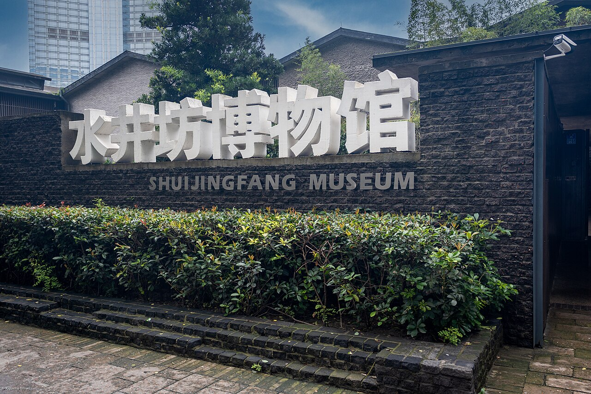

# 水井坊博物馆

成都锦江区水井街靠近东门大桥与合江亭，锦江在不远处拐弯。街边一栋不起眼的建筑里，藏着中国第一处经科学考古发掘的古代白酒酿造作坊遗址。1998 年，全兴酒厂改造厂房时，工人一铲子碰到地下的砖砌结构；随后考古队进场，挖出了晾堂、酒窖、炉灶、蒸馏器基座与成堆的青花瓷片。今天的水井坊博物馆，就建在遗址原址上。

图：成都水井坊博物馆。图片：xiquinhosilva，CC BY 4.0，via Wikimedia Commons（[原图页面](https://commons.wikimedia.org/wiki/File:Shujingfang_Museum.jpg)）。

> **先给结论**
> **一句话：** 这页判断水井坊博物馆值不值得专程去，以及到访前要核对什么。
>
> - **适合谁：** 正在计划去水井坊博物馆、想知道值不值得专程安排半天到一天的人。
> - **不适合谁：** 只想要“必去榜单”、不准备核对预约、交通和开放时间的人。
> - **先看这两点：**
>   - 第一次去，留 1.5–2 小时。
>   - 第一，不要把“600 年”当成“博物馆建了 600 年”；600 年是遗址与酿酒传统的延续，博物馆 2013 年才设立。

## 2013 年：水井坊博物馆的关键起点
水井街酒坊遗址的堆积从元末明初一直延续到现代，600 余年没有中断生产。1998 年 8 月发现，1999 年 3–4 月由成都市文物考古研究所与四川省文物考古研究所联合发掘；已发现遗址范围约 1700 平方米，发掘面积近 280 平方米，揭露晾堂 3 座、酒窖 8 口、炉灶 4 座、灰坑 4 个，以及路基、木柱、酿酒设备基座等遗迹，出土大量以酒具、食具为主的青花瓷片。2000 年 5 月，它被评为“1999 年全国十大考古新发现”；2001 年 6 月，被国务院列为第五批全国重点文物保护单位。

遗址的布局是“前店后坊”：临街是卖酒的铺面，后面是酿造作坊；晾堂、酒窖、炉灶是后坊，街道路面与陶瓷酒具是前店的遗物。这个布局说明，明清成都的酒坊不只是生产单位，也是城市商业的一部分。水井街靠近锦江与东门码头，水运便利，酒可以沿江下行；遗址出土的“锦江春”“天号陈”等瓷片，把宋代成都名酒、元明“福升全”、清代“全兴成”与今天的水井坊品牌串在一起。品牌叙事可以听，但考古地层与器物类型才是断代的硬证据。

2008 年 6 月，水井坊酒传统酿造技艺被国务院列为国家级非物质文化遗产；2019 年 3 月，成都水井街酒坊被国家文物局更新列入《中国世界文化遗产预备名单》；2019 年 12 月，被工信部列为第三批国家工业遗产。2013 年 7 月 8 日，成都水井坊博物馆正式设立；博物馆占地 18.5 亩，建筑面积 12149 平方米，展厅面积 10299 平方米，是依托全国重点文物保护单位建成的非国有专题博物馆。

2022 年 8 月 30 日，博物馆因疫情防控暂停开放；2024 年 10 月 1 日，提升改造完成，恢复全馆开放并恢复门票收费。这段“暂停—恢复”的历史要写进参观计划：网上仍能搜到 2022 年的停业通告，但最新状态是恢复开放；不要被旧公告误导。

## 遗址与看点

博物馆的基本陈列分四个展厅：酒史厅、遗址厅、技艺厅与品牌厅。最核心的是遗址厅：原址原貌展示明、清至现代的酒坊遗迹，包括晾堂、酒窖、灶坑、灰坑、灰沟，以及杯、盘、碗、碟等青花瓷酒具与食具。展柜里的瓷片有“成化年制”“大明年造”“天号陈”等款识，是断代与判断窑口的重要依据；不要只看“哪个朝代”，也要看器形、釉色与使用痕迹。

技艺厅展示水井坊酒传统酿造技艺的工序：制曲、拌料、上甑、蒸馏、摊晾、入窖、发酵、取酒。博物馆的特别之处是“活态”：遗址旁边仍有生产场景，工人按传统工序操作，蒸汽、酒糟与窖泥的气味都在现场。它不是“隔着玻璃看模型”，而是“在生产的博物馆里看遗址”。参观时不要打扰工人作业，拍照不要用闪光灯，不要跨越生产区围栏。

建筑本身也值得看。博物馆由刘家琨建筑设计事务所设计，保留原有车间工业建筑的特点，融入川西民居元素；天窗、钢架、砖墙与展柜的关系处理得克制，不是“仿古街”式的布景。馆内还有“锦江春色来天地——水井坊小史”“世代浓香满堂馨——600 年胜迹”“承古创新传技艺——现场活文物”“一脉心火酿酒魂——今日水井坊”四个常设单元，按时间与工艺展开。

## 第一次去怎么参观

第一次去，留 1.5–2 小时。从水井街 19 号正门进，先看酒史厅，了解成都酒业与“前店后坊”的城市背景；再进遗址厅，看晾堂、酒窖与瓷片；最后到技艺厅与生产区，看工人操作。若赶上讲解，跟着走一遍；讲解通常包含在门票或现场安排，具体问前台。

参观顺序可以反过来：先看生产区，感受“活的”酿造，再回遗址厅看考古地层，最后看酒史厅。这样不会被“品牌故事”先入为主，能更清楚地分辨“考古证据”与“品牌叙事”。无论哪种顺序，都不要错过遗址厅的窖池与晾堂，它们是整座博物馆的物证。

品鉴环节通常提供一小杯原浆酒，量不大；开车的人可以只闻不喝，或不参加。博物馆不是餐厅，不要期待“配餐”；周边合江亭与兰桂坊有餐厅，可以参观后吃饭。带小孩可以，但生产区有蒸汽与高温，注意看护；婴儿车在展厅内不方便。

## 水井坊博物馆的地址与营业安排
**地址**：四川省成都市锦江区水井街 19 号（门牌范围 19–25 号），邮编 610061。靠近东门大桥、合江亭与兰桂坊；导航“水井坊博物馆”，门口车位少，建议停对面兰桂坊地下停车场。

**交通**：地铁 2 号线东门大桥站 B 口，步行约 400 米（5 分钟）；公交 56、82、112、343 路到合江亭站，步行约 100 米。从春熙路打车约 10 分钟，从成都东站约 20 分钟。

**开放时间**：09:00–17:30，17:00 停止入馆与售票；周一是否闭馆、节假日是否调整，以官方公告为准。`operating_status` 记为 `verified`，表示博物馆官网在 2026-11-20 仍显示开放，且 2024-10-01 已恢复全馆开放；这不等于每天一定开门。电话 028-84436999、028-84430666。

**门票**：18 岁及以上成人全天票 40 元/张；学生、老人、儿童等优惠以现场公告为准；国际博物馆日（5 月 18 日）可能免费开放。门票含参观与品鉴，讲解是否另收费以现场为准。可通过携程、美团或现场购票。

**参观限制**：生产区禁止吸烟、火种与无人机；不要触摸窖池、酒醅与设备；部分区域在生产时段不开放。穿平底鞋，地面可能有酒糟与水，容易滑；夏天车间温度高，带水。

页面核验日期 2026-11-20；开放时间、门票与闭馆安排以博物馆官方渠道为准。

## 礼仪与常见误区

第一，不要把“600 年”当成“博物馆建了 600 年”；600 年是遗址与酿酒传统的延续，博物馆 2013 年才设立。第二，不要把“1998 年发现”当成“1998 年才开始酿酒”；遗址证明此前已连续生产数百年，1998 年只是考古发现的起点。第三，不要把“品牌厅”当成“历史厅”；品牌厅讲的是现代企业与产品，遗址厅才是考古证据。

常见误区还有三个。其一，以为“前店后坊”只是建筑布局；它也是明清城市酒业“生产与销售一体”的经营模式，遗址边的街道路面与酒具就是证据。其二，以为“国家级非遗”是产品认证；它指的是传统酿造技艺，不是“这瓶酒一定好喝”。其三，以为“世界文化遗产预备名单”等于“已列入世界遗产”；预备名单只是申报候选，最终结果要看联合国教科文组织。

不适合来这里的情况：对考古与酿造完全没兴趣、只想拍照的人；不愿走路、期待大型互动装置的人；带幼童进入生产区的人。它适合对考古、工业遗产、浓香型白酒工艺感兴趣的人，也适合把成都酒文化与锦江城市史放在一起看的人。

## 成都的周边街区
博物馆在水井街，往西是春熙路与太古里，往东是东门大桥与锦江，往南是合江亭与兰桂坊，往北是成都339与电视塔。把博物馆放在“春熙路—水井坊—合江亭—兰桂坊”这条线上：上午逛太古里，中午吃川菜，下午参观博物馆，傍晚在合江亭看锦江夜景。走路加打车约半天。

若想把“中国白酒遗产”作为主题，可以再去泸州老窖窖池群与汾阳汾酒博物馆；三家分别代表浓香遗址、浓香活窖与清香博物馆。若只想在成都深度看，水井坊加成都博物馆、金沙遗址博物馆就够两天，不要一天赶三个馆。

水井街周边在晚上与周末人多，兰桂坊酒吧街噪音大；博物馆内保持安静，不要大声讲解。雨天锦江边湿滑，参观后散步要小心。

## 同主题博物馆与延伸阅读
- [浓香型白酒](ref:strong-aroma)：水井坊遗址所展示的泥窖、续糟与混蒸混烧工艺。
- [白酒](ref:baijiu)：中国白酒的总体分类与工艺框架。
- [泸州老窖窖池群](ref:luzhou)：四川另一处浓香型活态遗产，可与水井坊的考古遗址对照。
- [汾酒博物馆](ref:fenjiu)：山西杏花村的清香型白酒博物馆，另一种香型与叙事。
- [王宝和酒家](ref:wang-bao-he)：上海黄酒与蟹宴老字号，另一种中国酒的餐桌。

相关条目：[浓香型白酒](ref:strong-aroma)、[白酒](ref:baijiu)、[泸州老窖窖池群](ref:luzhou)。
