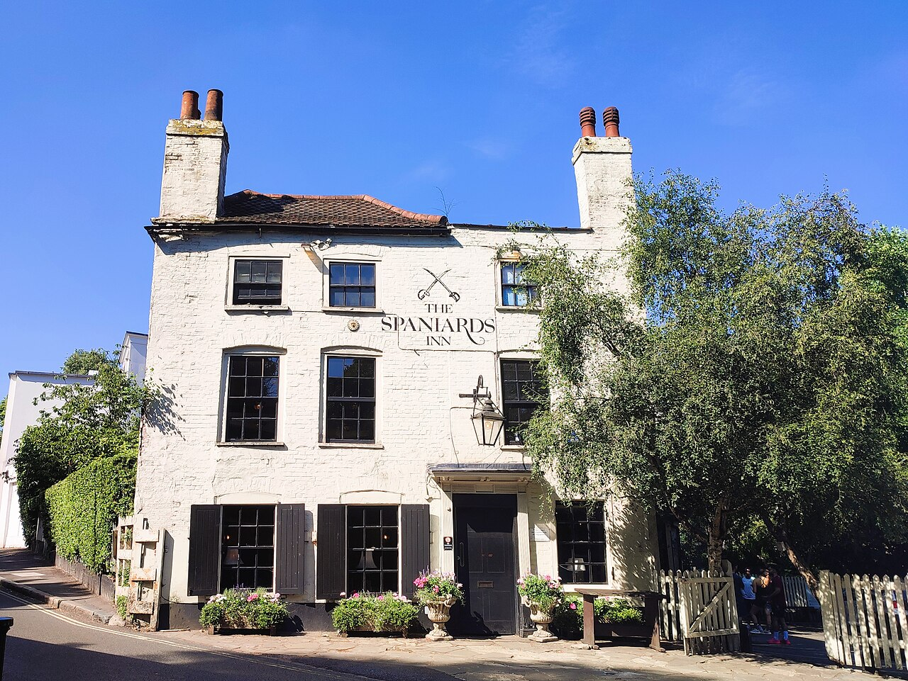

# 西班牙人客栈

从 Hampstead Heath 的南侧一路向北，草地、池塘与树林逐渐收窄，最后在一条窄路旁出现一栋白墙、黑窗框的两层建筑。它对面是一座小小的收费亭，路的另一侧就是 Heath 的开阔地。西班牙人客栈（The Spaniards Inn）的位置本身就说明了它的来历：它原本是进入主教地产与收费道路的关口，今天则成了伦敦北部最容易被写进文学轶事的酒馆之一。

图：Hampstead Heath 北缘的西班牙人客栈与门前道路；酒馆始于 1585 年，现存主体经过多次改建。图片：Ewan-M，CC BY-SA 4.0，via Wikimedia Commons（[原图页面](https://commons.wikimedia.org/wiki/File:Spaniard%27s_Inn,_Hampstead,_2026-07-11.jpg)）。

## 1585 年：西班牙人客栈的关键起点
官方与 Visit London 都把酒馆的起点定在 1585 年，最初是 Hampstead Heath 边缘的收费关卡与客栈；现在看到的主体大致是 18 世纪形成的，属于 Grade II 保护建筑。它位于 Barnet 与 Camden 的交界，门前的 Spaniards Road 至今仍因那座约 1710 年的收费亭而收窄成单车道。名字的来源有两种流行说法：一说来自西班牙驻詹姆斯一世宫廷的大使，一说来自两位西班牙兄弟；两种都缺少一锤定音的档案证据。Dick Turpin 的父亲曾在此做店主的说法、济慈在花园里写下《夜莺颂》的说法，也都属于“地方传说”，引用时应保留限定。1780 年戈登暴动期间，店主用酒拖住前往 Kenwood House 的暴徒，这个情节在地方史里流传很广，但细节同样需要谨慎。

再把几条线索拆开：收费亭约建于 1710 年，与酒馆一起构成旧时收费道路的节点；花园里还能看到 1755 年的界石。1780 年戈登暴动时，暴徒原本要去烧 Kenwood House，因为屋主 Mansfield 勋爵被指同情天主教；店主把人群引进酒馆、用酒拖时间，等 Horse Guards 赶到时人群已醉散，Kenwood 因此保住。这个版本来自地方史与 Visit London 的叙述，细节有不同说法，但“酒馆改变了暴动路线”是它最常被引用的历史角色。19 世纪，济慈从 Wentworth Place 穿过 Heath 走来，狄更斯在《匹克威克外传》里写到这里的茶点；20 世纪后，Bram Stoker 的《德古拉》与 Turpin 的公路传说又给这里添了鬼故事色彩。

## 空间与酒单

建筑外表是白墙与深色窗框，内部保留低梁、木饰、壁炉与多个小房间，整体比科文特花园的酒馆更“乡间客栈”。最出名的是围墙花园：面积大、桌子散，夏天像一座被树包围的院子，冬天则更适合回到壁炉旁。酒单以英式 cask ale 与常见瓶装啤酒为主，也有葡萄酒与烈酒；菜单是 pub classics，炸鱼薯条、Scotch egg、monkfish scampi、sticky toffee pudding 一类，周末与周日午餐需要提前订位。它不是“只喝酒”的酒吧，也不是精致餐厅，定位更接近“到 Heath 走一圈后吃一顿”的乡村式酒馆。

客栈的花园与 Hampstead Heath 步道相连，是伦敦少见的带大范围绿地的历史酒馆；天气好的时候，花园比室内更受欢迎。

## 怎么喝

最合适的玩法是把它放进一次 Heath 步行：从 Hampstead 地铁站穿过草地走来，先在花园喝一杯，再点一份主菜，然后继续往 Kenwood House 或 Parliament Hill 走。酒可以选择一款苦啤或金色艾尔，搭配炸鱼或烤肉；如果只想喝一杯，花园里的位置比室内更容易等。周末下午非常拥挤，工作日中午与傍晚之间最舒服。冬天不要急着坐室外，室内壁炉旁的小桌才是这间客栈的性格；夏天则相反，花园比室内更值得。

## 西班牙人客栈的地址与营业安排
地址是 Spaniards Road, Hampstead, London NW3 7JJ。最近的地铁是 Hampstead（Northern line），穿过 Heath 步行约 20 分钟；也可以坐公交到附近再走。酒馆没有大停车场，路边停车位有限，周末不建议开车。对外营业时间常见为周一 12:00–23:00、周二至周六 10:00–23:00、周日 11:30–22:30，节假日与天气会影响花园开放，出发前查官网。花园与室内都可以带狗，具体规则以店内提示为准；行动不便者建议先电话询问从哪一侧入口更平缓。

## 礼仪与常见误区

第一，1585 年是“酒馆起始年”，不是“这栋建筑的全部年代”；今天的主体经过多次改建。第二，Turpin、济慈、拜伦、狄更斯的名字常被并列成“常客名单”，但证据强度不同：狄更斯在《匹克威克外传》里写到这里是较明确的文学关联，Turpin 与济慈的细节更多是传说。第三，戈登暴动的故事不要把店主写成“英雄”或“阴谋家”，地方史的重点是暴徒被拖住、Kenwood House 得以保全。第四，这里是仍在营业的酒馆，花园不是公园：不要翻越围墙、不要占着桌子只拍照，也不要让狗追 Heath 上的野生动物。

## 从西班牙人客栈延伸到老主教冠酒馆
酒馆就在 Hampstead Heath 北缘，往南可到 Kenwood House、Parliament Hill 与游泳池塘，往东南可到 Keats House 与 Hampstead 老街。把它和市中心的酒馆放在同一天会太赶，比较合理的是“上午 Heath、下午酒馆、傍晚回城”。若想比较伦敦历史酒馆的不同类型，可以读[老主教冠酒馆](ref:ye-olde)与[兰姆与旗](ref:lamb-flag)；[伦敦经典酒吧步行路线](ref:london-route)适合市中心那一段，Hampstead 这一段更适合单独走。想理解酒馆与城市的关系，可读[认识一座城，从一间酒馆开始](ref:pub-city)与[酒馆史](ref:taverns)。

**关键事实。**

| 项目 | 内容 |
| --- | --- |
| 一句话定位 | 伦敦 Hampstead Heath 北缘的 1585 年历史客栈，曾为收费关卡与驿馆，以狄更斯、济慈、Turpin 传说和大型围墙花园闻名 |
| 地址 | Spaniards Road, Hampstead, London NW3 7JJ, United Kingdom |
| 城市/国家 | 伦敦 / 英国 |
| 营业状态 | 已核验营业 |
| 官网 | thespaniardshampstead.co.uk |

**来源与边界。** 本页关于「西班牙人客栈」的关键事实，主要由以下来源交叉核对：The Spaniards Inn（地址、营业时间、历史简介与订座入口）、Visit London（地址、电话与对外营业时间；1585 年、文学关联、Dick Turpin 传说、花园与交通建议）、London Evening Standard（酒馆的文学名声、深色木内饰与开放式壁炉的体验描述）等 5 条来源。产品、地址或营业状态变化较快时，以 thespaniardshampstead.co.uk 的最新页面为准；价格、批次与状态会变，涉及这些字段时以页面所列来源的最新版本为准。正文为项目自写，来源只作核验，不复制原文。

## 参考资料
- [认识一座城，从一间酒馆开始](ref:pub-city)
- [酒馆史：从酒肆、客栈到酒吧](ref:taverns)
- [伦敦经典酒吧步行路线](ref:london-route)
- [老主教冠酒馆](ref:ye-olde)
- [兰姆与旗](ref:lamb-flag)

本页于 2026-11-21 核对 Spaniards Inn 官方页面。常见营业时间为周一 12:00–23:00、周二至周六 10:00–23:00、周日 11:30–22:30，天气与节假日会影响花园开放；从 Hampstead 地铁站穿 Heath 步行约 20 分钟。1585 年是酒馆起始年而非现存建筑年代，Turpin、济慈、拜伦与狄更斯的“常客名单”证据强度不同，正文已逐条限定。本页图片是西班牙人客栈的白色外墙与门前道路，不是客房或餐厅内景；图注已逐张署名，图片许可见来源页。花园是否开放仍要看当天天气。
