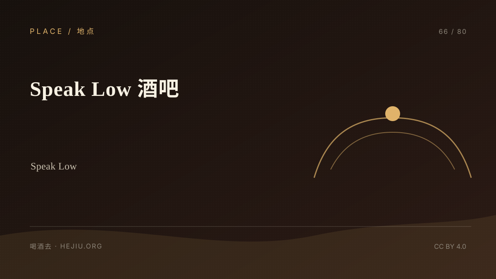

# Speak Low 酒吧

图：Speak Low 酒吧栏目示意图。项目自产或类别插图，用于酒吧与酒类语境，不是该对象的实拍。

> **先给结论**
> **一句话：** 这页判断Speak Low 酒吧值不值得专程去，以及到访前要核对什么。
>
> - **适合谁：** 正在计划去Speak Low 酒吧、想知道值不值得专程安排半天到一天的人。
> - **不适合谁：** 只想要“必去榜单”、不准备核对预约、交通和开放时间的人。
> - **先看这两点：**
>   - 先找到复兴中路 579 号的 OCHO，进门后不要只在货架前停留；暗门在店内，推开后上楼。
>   - 第一，隐藏入口不是密室逃脱；找不到就问 OCHO 店员，不要反复推货架或堵在门口。

## 2014 年：Speak Low 酒吧的关键起点
Speak Low 在上海前法租界的复兴中路 579 号，靠近瑞金二路。它 2014 年开业，是后闲信吾（Shingo Gokan）在上海开的第一家酒吧。店名来自他 2012 年在 Bacardi Legacy 全球调酒大赛中夺冠的那杯酒——以朗姆酒、雪莉酒、柚子与抹茶为骨架的原创作品。把比赛作品变成店名，再把这杯酒放进一个“如果禁酒令发生在上海”的场景里，是这家店最初的叙事。

后闲信吾此前在纽约的 Angel's Share 工作，熟悉日式与纽约酒吧的两种节奏。Speak Low 没有把“纽约”直接复制成美式运动酒吧，而是把禁酒令时期的“隐藏入口”、老上海法租界的街区尺度与日式调酒对细节的要求叠在一起。2017 年，它在世界 50 最佳酒吧榜排第 10 位，在亚洲 50 最佳酒吧榜排第 2 位；此后也多次出现在两张榜单上。排名不是全部，但它说明这家店在开业后的几年里确实影响了上海鸡尾酒吧的样貌。

需要说明的是，Speak Low 不是“百年老店”，也不是一栋被完整保留的历史建筑；它利用的是前法租界街区的旧建筑与街道气氛，入口做得像一间酒吧器具店。理解这一点，才不会把“隐藏入口”当成纯营销：它同时解决了临街店面小、需要把客人引到楼上的实际问题。

## 空间与酒单

入口在 OCHO 酒吧器具店内：推开店内的暗门，沿楼梯上楼。第一段楼梯把人从街面的零售空间带到酒吧层，这个“先看见商品、再看见酒”的顺序，是 Speak Low 体验的一部分。不要把 OCHO 当成普通工具店匆匆路过；找不到入口时，问店员即可。

空间分层，气氛不同。二层是主酒吧，铜色吧台、较亮的灯光与更快的节奏，适合第一次来、想感受“纽约式”热闹的人；三层更安静，以日式威士忌、精选烈酒与经典鸡尾酒为主，适合慢慢喝。50 Best 的条目把整栋建筑描述为多层、越往上越私密；具体哪一层对外开放、哪一层会员制或包场，以现场与官方渠道为准。

酒单以经典鸡尾酒与原创为主。第一次可以点同名招牌 Speak Low，判断自己是否喜欢朗姆酒、雪莉酒、柚子与抹茶组合出的酸香与茶感；也可以让调酒师按偏好推荐。二层更偏社交与果味、清爽的长饮，三层更偏威士忌与结构清楚的经典。具体酒款随季节调整，价格以官方菜单为准，页面核验日期 2026-11-08。

价格在上海高端鸡尾酒吧中属于中高水平；两个人的预算要按“每人两杯加小食”来估算，而不是按普通街区酒吧。店内空间不大，周末与节假日容易出现等位；不要用“隐藏酒吧就不用排队”的想象安排行程。

## 第一次去怎么点

先找到复兴中路 579 号的 OCHO，进门后不要只在货架前停留；暗门在店内，推开后上楼。第一次来，建议先去二层：气氛更开放，适合观察这家店的基本风格；喝完后如果还想安静，再问是否可以上三层。

点单时先说自己想要的基酒与口感，例如“金酒、清爽、酸一点”“威士忌、短饮、不要太甜”；如果想吃东西，可以问当日小食。招牌 Speak Low 值得点一杯，但不要把它当成唯一答案；同名的比赛作品与店内当前版本可能不同，点单时以菜单为准。两杯之间喝水，避免把酸甜长饮连着喝。

周末建议提前确认预订方式；平日较早的时段更容易现场入座。着装建议 smart casual，不需要正装，但不要穿运动短裤与拖鞋。小空间里不要大声说话、不要占住楼梯口拍照；想拍自己的酒，先问侍者，避免把其他客人拍进去。

## Speak Low 酒吧的地址与营业安排
地址是上海市黄浦区复兴中路 579 号（200041），近瑞金二路；电话 +86 21 6416 0133。乘地铁 1/10/12 号线到陕西南路站，或 1/7 号线到常熟路站，步行约 10 分钟；临街门面是 OCHO 酒吧器具店，入口在店内，按门牌找比按“网红酒吧”标签找可靠。

营业时间：周日至周四 18:00–01:30，周五、周六 18:00–02:30（上海市政府日文页与百度百科；政府页另记周五、周六 18:30 起，两处略有出入）。无门票，按杯消费，价格属上海高端鸡尾酒吧水平，按每人两杯加小食估算；是否收取服务费、低消或订位费，以下单时确认为准。二、三层可能包场或作为会员区，周末建议提前确认可否订位。

截至本次核验（2026-11-08），未发现可信的关闭或迁址公告：SG Group 官方页面、上海市政府 2026 年 7 月的酒吧名单与百度百科（2024 年十周年翻新）均显示仍在复兴中路 579 号营业；个别平台标注“永久关闭”无权威来源支持，不作为依据。经纬度未找到可核验来源，故 frontmatter 中留空（未核验）。

「Speak Low 酒吧」的开放时间、价格与预约，以[官网](https://sg-management.jp/en/establishments/speaklow/)的公开页面为准；核验日期为 2026-11-08，临时调整以官网当日公告为准。

## 礼仪与常见误区

第一，隐藏入口不是密室逃脱；找不到就问 OCHO 店员，不要反复推货架或堵在门口。第二，不要把这里当成夜店；音乐音量、座位与服务节奏都更偏“谈话与品饮”，大声喧哗会破坏气氛。第三，不要以为没有菜单就只能听安排；你可以明确说不要什么，也可以问调酒师推荐。第四，拍照要克制；不要拍其他客人，也不要在楼梯与吧台通道停留太久。第五，小费不是强制；如果账单含服务费，按账单支付即可。

常见误区有四个：把“隐藏酒吧”理解成“不用预订”（周末恰恰相反）；以为整栋楼所有层都对所有客人开放（部分区域可能用于包场或会员）；以为只有同名招牌值得喝（经典与季节酒款同样重要）；把 Speak Low 当成“上海唯一的鸡尾酒吧”（它是重要的一家，但不是全部）。另一个误区是只看排名：排名反映某个年份的评审结果，不代替你当晚的口味。

不适合来这里的人：大团体、只想蹦迪的人、预算很紧的人、赶时间只想站着喝一杯的人。它适合愿意花时间找入口、坐下来喝两杯、和调酒师聊几句的人。

隐藏入口与禁酒令主题是体验的一部分，不是可以反复打卡的拍照点；高峰时段需等位，点单前先确认楼层与座位规则，也别把调酒师当成景点。

## 上海的周边街区
Speak Low 在复兴中路靠近瑞金二路的一段，步行可到复兴公园、思南路与淮海中路；往东是田子坊与新天地方向，往西是衡山路与徐家汇方向。把 Speak Low 放在晚上：先在附近吃晚饭，再步行到 OCHO；或者下午逛复兴公园与思南路，傍晚喝第一杯，之后在淮海中路一带继续吃。

周末晚间复兴中路与淮海中路一带人流大，打车不如地铁稳；常熟路与陕西南路两个地铁站都在步行范围内。若想把上海鸡尾酒吧作为主题，一晚安排两家就够，Speak Low 适合作为“第一站”，因为它空间分层、酒单可读、对第一次来的人友好；想更安静，可以把第二站放在附近的小吧。

## 同城酒吧与延伸阅读
- [High Five 酒吧](ref:bar-high-five)：东京银座的无酒单专业酒吧，可与 Speak Low 的“多层空间 + 经典/原创”模式对照。
- [莱佛士长廊酒吧](ref:raffles-long-bar)：以新加坡司令闻名的酒店酒吧，代表“招牌长饮”的另一条路。
- [萨沃伊美式酒吧](ref:american-bar-savoy)：伦敦的经典酒店酒吧，适合比较服务传统与酒单结构。

补充阅读：[古典](ref:c-extra-1)、[认识一座城，从一间酒馆开始](ref:c-extra-2)。

相关条目：[High Five 酒吧](ref:bar-high-five)、[莱佛士长廊酒吧](ref:raffles-long-bar)、[萨沃伊美式酒吧](ref:american-bar-savoy)。
