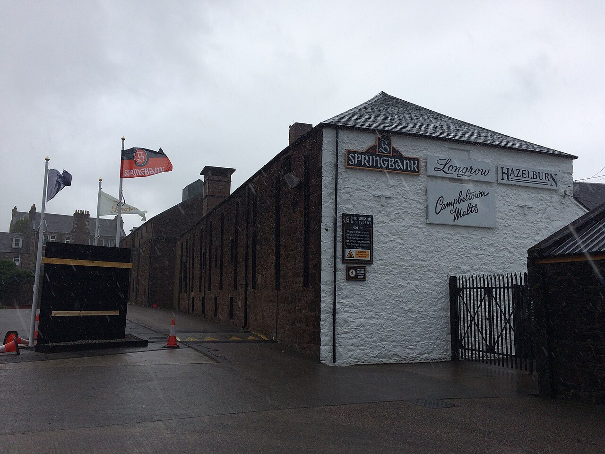
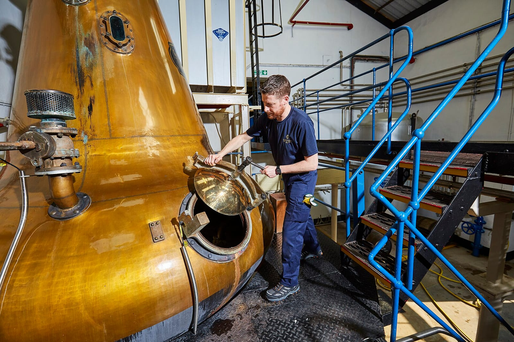

# 云顶酒厂

云顶（Springbank）在坎贝尔镇镇中心的 Well Close，从 Longrow 街拐进去就是。它不像许多建在郊外的酒厂：糖化间、蒸馏间、仓库、装瓶线与游客中心挤在同一片街区，居民日常就从门口经过。1828 年，Archibald Mitchell 在这块曾用于私蒸的土地上取得执照，云顶成为当时坎贝尔镇第 14 家合法酒厂。今天它仍由 Mitchell 家族一脉的 J&A Mitchell 持有，是坎贝尔镇仅存的三家酒厂之一，也是苏格兰少数把发麦到装瓶全部留在厂内完成的酒厂。

图：云顶酒厂。图片：Lirazelf，CC BY-SA 4.0，via Wikimedia Commons（[原图页面](https://commons.wikimedia.org/wiki/File:Springbank_Distillery,_Campbeltown.jpg)）。

## 一家把整条生产线留在镇上的酒厂

官方把云顶描述为“苏格兰最自给自足的酒厂”：大麦在厂内地板发麦，烘麦用泥煤与热风的组合，磨麦用 1940 年代的 Porteous 磨粉机，糖化槽是铸铁的，发酵使用六只 boatskin larch 木槽，蒸馏后进入仓库，最后在厂内装瓶。参观时很容易只盯着铜制蒸馏器拍照，但真正解释风格的是这些前后相连的步骤：发麦决定酚值与酶活性，发酵时间决定果香与酯类，蒸馏器的形状与取酒点决定酒体的厚薄。云顶不做冷凝过滤，也不加焦糖色，因此酒液在低温下可能略显浑浊，这不是缺陷。

## 1828 年：从私蒸到第 14 张执照

Mitchell 家族在 17 世纪来到坎贝尔镇，家族中有人以发麦为业。Archibald Mitchell 先与他人合伙经营 Rieclachan，随后在自家私蒸旧址上建起云顶；1828 年执照生效，云顶成为镇上第 14 家合法酒厂。1837 年，他的两个儿子 John 与 William 接手，后来形成 J&A Mitchell 公司。19 世纪的[坎贝尔镇](ref:campbeltown)一度是英国按人均计算最富的城镇之一，港口排队装桶；但 20 世纪初需求转向更清淡的调和酒，加上部分酒厂为赶产量牺牲质量，调酒商逐渐离开，酒厂一家家关闭。1934 年，镇上只剩云顶与[格兰帝](ref:glen-scotia)两家；2004 年 Glengyle 复产，坎贝尔镇才重新以独立产区身份被写回地图。2023 年，长期主持酒厂的 Hedley G. Wright 去世，公司所有权转入三个信托基金，家族成员进入董事会。

## 地板发麦与 2.5 次蒸馏

糖化与蒸馏用水来自坎贝尔镇周边的山丘，半岛气候潮湿多风，仓库里的酒液在缓慢的冷热循环中变得更圆润。厂内的仓库不大，桶架排列紧凑，参观时能闻到明显的酒香与木头味；这种“酒厂就在仓库旁边”的布局，让酒液从蒸馏到入桶的等待时间很短，也减少了运输对风味的影响。

云顶的[发麦](ref:malting)地板是参观重点。大麦浸泡后铺成约六英寸厚，工人定时翻动，让它发芽；随后进入烘麦炉，按酒款需要分别用泥煤、热风或两者组合烘干。糖化后的麦汁进入木制发酵槽，发酵时间可长达 110 小时，比许多商业酒厂更长。厂内有三只铜蒸馏器：酒汁蒸馏器、低度酒蒸馏器与烈酒蒸馏器，其中酒汁蒸馏器仍用明火加热。云顶本牌采用 2.5 次蒸馏，不是简单的“两次半”，而是在第二次蒸馏中取出一部分酒液回到下一轮，形成介于两次与三次之间的风格；Longrow 为两次蒸馏，Hazelburn 为三次蒸馏。新酒必须至少在橡木桶中陈放 3 年，才能依法称为[苏格兰威士忌](ref:scotland)。

## 三个酒名，三种性格

云顶本牌通常带轻度泥煤、油脂感、柑橘与海盐，是理解坎贝尔镇风格的基准。Longrow 在 1973 年首次蒸馏，用重泥煤麦芽与两次蒸馏做出接近艾雷岛的烟熏感；Hazelburn 在 1997 年首次蒸馏，完全不用泥煤，三次蒸馏带来更轻盈、更多花果与蜂蜜的轮廓。三者共用同一套厂房与同一批人，却因为麦芽处理与蒸馏次数不同而分道扬镳，这正是云顶参观最有价值的部分：风格不是酒标写出来的，而是工序选择的结果。酒单上还能看到桶强、单一桶、雪莉桶与年度限定版；如果第一次来，建议按“本牌—Longrow—Hazelburn”的顺序喝，先把三种[单一麦芽](ref:single-malt)工艺的差异建立起来，再进入桶型与年份的比较。

## 预约、动线与现场体验

导览必须在官网预约，周一至周六运行，周日通常关闭。Springbank Tour 约 1 小时，2026 年官网价格为每人 18 英镑，含品鉴；Kilkerran Tour 约 1 小时，14 英镑，去的是同属 J&A Mitchell 的 Glengyle 酒厂；Kilkerran Warehouse Tasting 约 1 小时，45 英镑；Barley to Bottle 约 4.5 至 5 小时，280 英镑，适合想完整走一遍工艺的人。每团人数有限，旺季与坎贝尔镇威士忌节期间很快售罄。官网建议提前 10 分钟到；超过 12 人的团体要发邮件给 tours@springbank.scot。只想喝酒的话，可以去 Washback Bar，或到 Bolgam 街的 Cadenhead's Tasting Room，后者与本店同属一家公司，酒单更宽。

## 到访前后容易忽略的细节

地址是 Springbank Distillery, Well Close, Campbeltown PA28 6ET；自驾从 Longrow 或 Glebe Street 的小路进停车场，车位不多。坎贝尔镇位于 Kintyre 半岛末端，从格拉斯哥乘巴士约需数小时，也可飞往坎贝尔镇机场；镇上三家酒厂彼此步行可达，把云顶与[格兰帝](ref:glen-scotia)、Glengyle 排在同一天并不困难，但导览时间要错开。厂区地面湿滑，仓库温度低，带一件外套。最重要的一条：不要开车参加品鉴。坎贝尔镇机场规模很小，航班受天气影响大，把酒厂预约安排在抵达当天最紧的时段并不明智；如果乘巴士，返程班次也要提前确认。酒厂没有公布可供引用的精确坐标，地图定位请以官方渠道与现场路牌为准。

对照阅读：[坎贝尔镇](ref:campbeltown)、[单一麦芽苏格兰威士忌](ref:single-malt)。

**关键事实。**

| 项目 | 内容 |
| --- | --- |
| 一句话定位 | 苏格兰坎贝尔镇 Well Close 的家族蒸馏厂，1828 年由 Archibald Mitchell 在私蒸旧址上创立，是少数在厂内完成地板发麦、糖化、蒸馏与装瓶的单一麦芽酒厂；Springbank、Longrow、Hazelburn 三种酒名分别对应 2.5 次、2 次与 3 次蒸馏 |
| 地址 | Springbank Distillery, Well Close, Campbeltown PA28 6ET, Scotland, United Kingdom |
| 城市/国家 | Campbeltown / 英国 |
| 营业状态 | 已核验营业 |
| 官网 | springbank.scot |

**来源与边界。** 本页关于「云顶酒厂」的关键事实，主要由以下来源交叉核对：J&A Mitchell & Co. Ltd（酒厂地址、品牌与当前参观入口；1828 年创立、Mitchell 家族、Longrow 与 Hazelburn 的起始年份、坎贝尔镇酒厂兴衰及 2023 年所有权安排）。产品、地址或营业状态变化较快时，以 springbank.scot 的最新页面为准；价格、批次与状态会变，涉及这些字段时以页面所列来源的最新版本为准。正文为项目自写，来源只作核验，不复制原文。

**并读。** 把「云顶酒厂」与「坎贝尔镇」、「苏格兰」、「单一麦芽苏格兰威士忌」放在一起读时，先确认它们是同一层级还是上下游关系：先确认地址与营业状态，再比较历史、空间与点单体验。本页负责给出场所的基本坐标，对照条目补上具体案例与差异；读完再回到本页，才能分清哪些差别属于场所本身，哪些只是产地、批次或品牌选择。

## 相关图像

图：格兰帝酒厂相关实景照片。图片：Abbieclements，CC BY-SA 4.0，via Wikimedia Commons（[原图页面](https://commons.wikimedia.org/wiki/File:Glen_Scotia_Still.jpg)）。关联图像：云顶酒厂。
