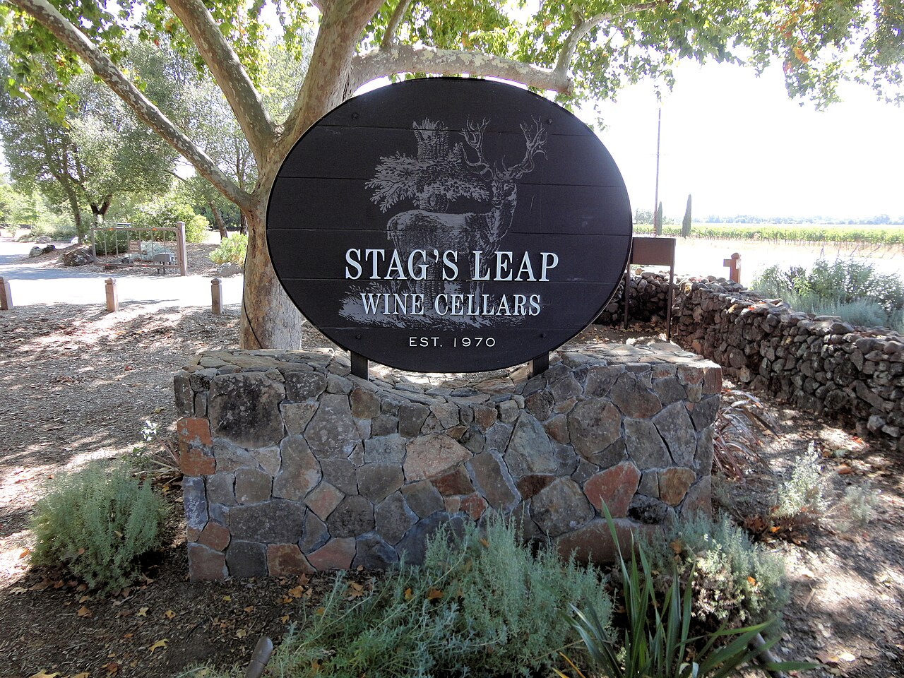

# 鹿跃酒庄

Silverado Trail 在纳帕谷东侧，路窄、车快，酒庄入口常在一段上坡之后。鹿跃酒庄的院子被橡树与橄榄树围住，远处是鹿跃区的火山岩崖壁。它出名不是因为建筑，而是因为一箱 1973 年的 S.L.V. 赤霞珠：1976 年，在巴黎举行的一场盲品里，这款酒在红葡萄酒组中名列第一，评委大多是法国葡萄酒界的重要人物。那场后来被称为“巴黎审判”的比赛，改变了加州酒在世界市场上的位置。今天走进酒庄，看到的是一座安静的品鉴室、地下酒窖与两块核心葡萄园，而不是“胜利纪念碑”。

图：Silverado Trail 入口的石墙与鹿跃酒庄铭牌。图片：Jim G from Silicon Valley, CA, USA，CC BY 2.0，via Wikimedia Commons（[原图页面](https://commons.wikimedia.org/wiki/File:Stag%27s_Leap_Wine_Cellars,_Napa_Valley,_California,_USA_(6199529950).jpg)）。

## 1970 年：鹿跃酒庄的关键起点
Warren Winiarski 在 1960 年代来到纳帕，先在 Chateau Souverain 与 Robert Mondavi 工作。1970 年，他买下鹿跃区 44 英亩土地，把 prune、樱桃与核桃园改种赤霞珠与梅洛，命名为 Stag’s Leap Vineyard（S.L.V.）。1972 年首个年份在租来的设施里酿造，1973 年是第一个在庄园内商业量产的年份；1976 年巴黎审判后，酒庄进入国际视野。1986 年，Winiarski 买下邻近的 FAY 葡萄园，面积几乎翻倍；1996 年，1973 年 S.L.V. 被史密森尼美国国家历史博物馆永久收藏，酒庄开始开挖地下酒窖。2000 年，Javier Barba 设计的 Arcade 入口与 34,000 平方英尺隧道完成，隧道里悬挂着一座傅科摆；2001 年，Artemis 首个年份发布。2007 年，Ste. Michelle Wine Estates 与 Antinori 接手；2013 年，1973 年 S.L.V. 被列入“美国制造之物”；2014 年，FAY Outlook & Visitors Center 开放；2023 年，Antinori 成为全资所有者。

## 建筑与空间

酒庄的建筑语言是“石、土、光”。品鉴室与办公区低矮，外墙用当地石材与暖色灰泥；地下酒窖由 Javier Barba 设计，入口是一排混凝土拱门，像把山体切开。隧道内部没有多余的装饰，只有拱顶、灯与桶列；傅科摆从天花板垂下，用摆动标记时间，也提醒访客：酒在黑暗里缓慢变化。2014 年开放的 FAY Outlook 位于坡上，玻璃与钢材更轻，视线越过 FAY 葡萄园，直到鹿跃崖壁。这里最值得看的不是建筑本身，而是建筑如何把“地下陈年”与“地上风景”分开：一边是恒温、安静、没有窗户的酒窖，一边是强光、开阔、能看见土壤与坡向的观景台。

## 酒单与味觉

核心是三条赤霞珠。S.L.V. 来自 1970 年种下的老藤，土壤是火山岩与冲积扇的混合，酒体紧、单宁多，年轻时黑色水果与雪松明显，陈年后出现皮革、烟草与矿物。FAY 来自 1986 年购入的邻园，果实更外向，红樱桃、黑醋栗与花香更早出现，单宁更细。CASK 23 是两者的调配，1985 年首次发布，名字来自 1973 年那批酒在酒窖里的桶号；它不是“最高级”，而是把 S.L.V. 的结构与 FAY 的香气合并。Artemis 是更早饮用的赤霞珠，果味直接、单宁较软，适合餐厅。白葡萄酒与梅洛产量小，但不是主角。品鉴时不要把 CASK 23 当成“超级 S.L.V.”；三款酒是三种表达，不是一条等级阶梯。

## 怎么喝

赤霞珠建议 16–18°C。S.L.V. 与 CASK 23 年轻年份提前 1–2 小时开瓶，FAY 可以稍短；老年份提前 30–60 分钟，避免暴力醒酒。配餐上，S.L.V. 配烤牛排、羊排、野味与硬质奶酪；FAY 配鸭胸、蘑菇、烤蔬菜与奶油酱；CASK 23 配熟成牛肉与松露。Artemis 配汉堡、披萨与烧烤。不要用重辣、重甜或大量醋的菜配高单宁赤霞珠，单宁会显得更干。若同时开三款，先 FAY，再 S.L.V.，最后 CASK 23；顺序反过来会让 FAY 显得单薄。

## 鹿跃酒庄的地址与营业安排
地址是 5766 Silverado Trail, Napa, CA 94558。酒庄每日 10:00–16:30 开放，最后一场品鉴 16:00，必须预约，每组最多 6 人；电话 707.261.6410。从 Napa 市区沿 Silverado Trail 向北约 10–15 分钟，入口在路东，看到石墙与金属字标后右转。品鉴室与 FAY Outlook 对轮椅友好，停车场在入口内侧。纳帕谷夏季中午炎热，预约尽量选上午；收成季节（8–10 月）周边道路会有卡车，留出时间。不要把“Stag’s Leap Wine Cellars”和北边 6150 Silverado Trail 的 “Stags’ Leap Winery” 混淆：两个名字相似，历史与所有权完全不同。

## 礼仪与常见误区

第一，巴黎审判是历史事实，不是酒庄每天重复的神话；不要要求工作人员复述“打败法国”的细节到夸张程度。第二，CASK 23 不是每一年都“最好”；它取决于调配，某些年份 S.L.V. 或 FAY 更值得喝。第三，不要把鹿跃区（Stags Leap District）与鹿跃酒庄混为一谈；产区里还有 Shafer、Cliff Lede、Odette 等酒庄。第四，品鉴必须预约，不要带 6 人以上未预约的团队；酒庄不设大规模接团。第五，酒窖是生产空间，不要触摸桶、不要用闪光灯、不要越过围栏。第六，纳帕酒精度偏高，品鉴后不要自驾；可以预约司机或使用叫车服务。

## 从鹿跃酒庄延伸到纳帕谷
鹿跃区在纳帕谷东侧，北边是 Yountville 与 Oakville，南边是 Napa 市区。若只有半天，酒庄品鉴加 FAY Outlook 的风景足够；一天可以加 [纳帕谷](ref:napa) 的其他酒庄、Yountville 的餐厅与 [美国](ref:usa) 葡萄酒历史博物馆。把 [赤霞珠](ref:cabernet) 与 [红葡萄酒](ref:red) 的背景放在一起读，会更容易理解为什么 1976 年的盲品影响这么大；[橡木桶陈年](ref:oak) 则解释 CASK 23 的结构来源。不要把鹿跃与蒙特莱纳安排在同一个上午：两者都需要预约，而且品鉴节奏不适合赶场。

**关键事实。**

| 项目 | 内容 |
| --- | --- |
| 一句话定位 | 纳帕谷鹿跃区的赤霞珠名庄，1970 年由 Warren Winiarski 创立；1973 年 S.L.V. 赤霞珠在 1976 年“巴黎审判”红葡萄酒组中名列第一，使加州酒进入国际视野 |
| 地址 | 5766 Silverado Trail, Napa, CA 94558, United States |
| 城市/国家 | 纳帕 / 美国 |
| 营业状态 | 已核验营业 |
| 官网 | stagsleapwinecellars.com |

**来源与边界。** 本页关于「鹿跃酒庄」的关键事实，主要由以下来源交叉核对：Stag’s Leap Wine Cellars（5766 Silverado Trail、Napa CA 94558、电话 707.261.6410 与预约品鉴；酒庄位于 Stags Leap District、Silverado Trail 东侧、入口位置、停车与无障碍信息）、Stags Leap District Winegrowers Association（三条庄园赤霞珠 S.L.V.、FAY、CASK 23、每日 10:00–16:30、最后品鉴 16:00、预约制与每组最多 6 人）。产品、地址或营业状态变化较快时，以 stagsleapwinecellars.com 的最新页面为准；价格、批次与状态会变，涉及这些字段时以页面所列来源的最新版本为准。正文为项目自写，来源只作核验，不复制原文。

**并读。** 把「鹿跃酒庄」与「纳帕谷」、「美国」、「赤霞珠」放在一起读时，先确认它们是同一层级还是上下游关系：先确认地址与营业状态，再比较历史、空间与点单体验。本页负责给出场所的基本坐标，对照条目补上具体案例与差异；读完再回到本页，才能分清哪些差别属于场所本身，哪些只是产地、批次或品牌选择。

**适用边界。** 对「鹿跃酒庄」而言，营业时间、预约方式与菜单会变；到访前以官网、电话或现场公告为准。

**更新提示。** 「鹿跃酒庄」最近核对于 2026-11-21；地址、营业时间、门票与预约会变，出行前以官网当日公告为准。

## 参考资料
- 同类对照：[napa-valley](ref:napa)、[usa](ref:usa)、[cabernet-sauvignon](ref:cabernet)、[red-wine](ref:red)、[oak-ageing](ref:oak)。
- 背景阅读：[napa-valley](ref:napa)、[usa](ref:usa)。
关于鹿跃酒庄，本页不绘制参观地图；开放时间、年份与价格以酒庄官网为准。

对照阅读：[纳帕谷](ref:napa)、[赤霞珠](ref:cabernet)。
