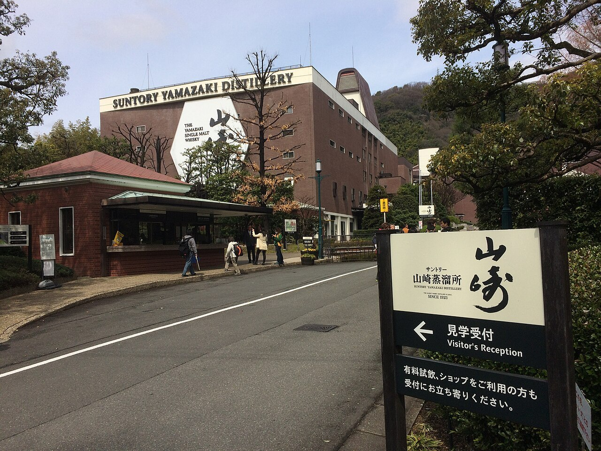

# 星光酒吧（银座）

星光酒吧（Star Bar Ginza）在东京银座一丁目、并木通一带，店面在地下一层，主理人是岸久（Hisashi Kishi）。它不属于靠主题装饰或调酒表演吸引人的那一类酒吧：空间安静，吧台是中心，酒以经典配方为主，冰被当成一项独立的手艺。把它看作银座老派酒吧的一个样本，比当作“东京必去榜单”的一站更接近它本来的样子。

图：栏目配图。摄影：见原图页。署名：Ujigis，CC BY-SA 4.0，来自 项目图库（类别配图）（[来源](https://commons.wikimedia.org/wiki/File:YamazakiDistillery_01.jpg)）。这张照片仅为场所栏目配图，不是星光酒吧（银座）的门店或场馆实拍。

> **先给结论**
> **一句话：** 这页判断星光酒吧（银座）值不值得专程去，以及到访前要核对什么。
>
> - **适合谁：** 正在计划去星光酒吧（银座）、想知道值不值得专程安排半天到一天的人。
> - **不适合谁：** 只想要“必去榜单”、不准备核对预约、交通和开放时间的人。
> - **先看这两点：**
>   - 本页把营业状态标为 unknown：官网仍在，但没有可核验的当日在营信息。
>   - 从并木通走进一栋普通的商业楼，按下楼键，才是店。

## 银座一丁目，并木通边的地下一层

从并木通走进一栋普通的商业楼，按下楼键，才是店。Time Out Tokyo 把它形容为“安静的地下一层”，吧台呈琥珀色，座椅是皮革凳；官方页面则强调这是星光酒吧的“原点”，有手削透明冰，也有被称作“忍者冰”的清冰。全店禁烟，这一点由官方明确写出。

空间不大，吧台座位是主体，桌位有限。一个人来，或两三个人并排坐下，最合适；大团体在这里会显得突兀，也很难同时被照顾到。入口不临街，按地址找比按“酒吧街”的印象找可靠。需要说明的是，本页的地址只写到“东京都中央区银座”这一级，门牌号与营业时间以官方渠道为准；较旧的媒体资料与官网之间可能存在差异，出发前请再确认一次。

收费结构比菜单更值得先弄明白。官方写明每人 1100 日元的座位费（cover charge），酒水另计；是否还有其他服务费、是否含税，以账单和店内说明为准。银座的专业酒吧普遍如此收费，不应按普通街区酒吧的预算来安排。

## 岸久与这家店的年轮

岸久在 1996 年拿到一项国际调酒赛事的世界冠军，当时 31 岁，这是 Time Out Tokyo 的记载。官方创始人页列出的身份更密：店主兼调酒师、日本调酒师协会会长、东京都优秀技能者（东京 Meister）、现代名工、银座社交饮料协会副理事长、银座调酒师学校校长。把这些职务放在一起看，他并不是只在自己店里把酒调好的“名店老板”，而是参与行业标准、也负责教下一代的从业者。

这也是理解星光酒吧的钥匙：它同时是一间营业中的酒吧和一套教学体系的门面。店里的出品标准、待客方式和学徒训练是同一件事的三个面，不像连锁品牌那样可以分开复制。

创立年份没有可核的官方数字。官方“About Us”只提到，介绍这家店的书出版已超过二十年，NHK 的《Professional 仕事の流儀》也拍过纪录片；这些说法证明它长期存在，却不能精确到某一年。本页因此不写创立年份，也不把“老店”当成卖点。店龄是背景，不是这杯酒好喝的理由。

## 经典鸡尾酒的“原样”与“原创”

官方对自家路线的表述是：用星光酒吧自己的方式，做经典鸡尾酒。这句话的顺序很重要——经典在前，原创在后。它不是靠一杯名字古怪的新酒建立名声，而是把结构清楚的经典做到极稳；Time Out Tokyo 用“几乎科学般精确”来形容这里的出品。官方还提到，店里库存许多威士忌与朗姆酒的老年份瓶，这为经典配方提供了更长的选择余地。

经典路线的难点都在看不见的地方：[搅拌](ref:stirring)的时间与力度、冰的用量、稀释速度、杯温与酒液温度、苦精或糖浆的微小比例。吧台后的动作越少，越考验基本功；反过来，动作越大，越可能是在掩盖配方上的不确定。

对客人来说，评价标准也应该换一换。不要先问“有什么创意”，可以先看一杯 [Old Fashioned](ref:oldfashioned) 是否干净、平衡、余味清楚；再看第二杯的温度与稀释是否一致。经典鸡尾酒的好，不在于惊艳，而在于可重复。把“稳定”当成一种风格，才看得懂这家店。

## 冰的三重奏

官方把冰写进了店史：星光酒吧让冰成为酒吧的主角，这种做法后来扩散到世界各地的酒吧。它同时使用三种冰——手削透明冰、自社天然冰、特殊机械制冰——并称按“放射”“对流”“传导”三种热传递方式来分工。最出名的是“忍者冰”（NINJA ICE）：因为过于透明，放进杯里像消失了一样，名字由此而来；官方称星光酒吧是这种冰的元祖。

天然冰的部分，官方说明其取得京都市内唯一的冰雪制造许可，用特殊机械把京都的名水冻成冰。这些属于店家自述，本页照录，但不替它背书；能核到的是“三种冰分工”与“手削透明冰”这两项，在官方页面和 Time Out Tokyo 的描述里互相印证。

功能上，大块透明冰融化慢，能控制稀释；不同冰型服务不同杯型与饮用速度。看调酒师取冰、切冰、把冰放进杯里，是理解这家店最快的方式，但它不是表演：冰的形状直接影响这杯酒在二十分钟里的味道走向。若只想拍照，这一段会被辜负。

## 坐在吧台前的一小时

这里的点单方式与“无酒单”酒吧不同：经典酒单是骨架，也可以直接告诉调酒师偏好。不要带着 High Five 式的“Omakase”预期进来，否则会觉得对方不够热情；星光酒吧卖的是准确，不是惊喜。若不确定，点一杯结构清楚的经典，喝完再决定第二杯的方向。

节奏是一杯一杯点，不要在桌上排成一列。银座的老派酒吧通常不喜欢客人把吧台当成拍照背景：压低音量，不拍摄其他客人，不把闪光灯对着吧台内部，不穿短裤和拖鞋。所谓“沉默服务”不是冷漠，而是把注意力从社交表演转回杯子；调酒师话不多，但会观察你喝的速度、剩多少、什么时候该加水。

[酒吧与城市](ref:pubcity)的关系在这里很具体：一家店的气质会影响整条街的夜晚。星光酒吧把声音压下来，周围的店也会跟着收敛；反过来，如果客人把这里当成喧闹的聚会场所，最先被破坏的是邻座的体验。结账时确认座位费与酒水费用，按账单支付即可，日本通常不强制小费。

## 从吧台到教室：银座的培训体系

岸久任银座调酒师学校校长，这条信息比任何“名店”标签都更能解释星光酒吧的影响力。银座的吧台传统靠两条腿传下去：店里带人，学校教系统知识。前者是站在旁边看、被纠正、重复练习；后者是把配方、温度、稀释、卫生与服务拆成可以讲授的单元。两者合起来，才让“银座风格”不只是一种气氛，而是一套可传递的技术。

上野秀嗣也曾在星光酒吧任职，后来在 2008 年开设 [High Five](ref:highfive)。两家店的关系不是复制，而是同一传统分出的两条路：一家保留经典与老派吧台，把标准守住；一家取消固定酒单，把“对话式服务”推到极致。把两家放在同一个晚上走完，比看十家网红店更能理解银座酒吧的层次。

## 到访前要确认的边界

本页把营业状态标为 unknown：官网仍在，但没有可核验的当日在营信息。固定休息日、最后点单时间、是否接受预约、包场与临时休业，都以官方渠道为准；本页不写具体门牌，也不写营业时间表。

坐标留空，也不绘制地图。银座街区门牌密集、楼宇入口不明显，星光酒吧（银座）的停靠顺序只作阅读顺序；精确导航请用实时地图并以现场标识为准。历史、头衔与排名只能说明履历，不能保证今晚这一杯；若想验证一家店，点两杯最普通的经典，比点一杯名字最长的原创更有效。

相关条目：[High Five 酒吧](ref:highfive)、[古典](ref:oldfashioned)、[搅拌](ref:stirring)。

## 参考资料

- [STAR BAR GINZA 店舗紹介](https://www.starbar.jp/store-introduction-ginza)，STAR BAR，核验银座一丁目店铺形态、手削透明冰与全席禁烟。
- [STAR BAR About Us](https://www.starbar.jp/about-us)，STAR BAR，核验经典鸡尾酒路线、三种冰与每人 1100 日元座位费。
- [THE FOUNDER](https://www.starbar.jp/master)，STAR BAR，核验岸久的职务与银座调酒师学校校长身份。
- [NINJA ICE](https://www.starbar.jp/ninja-ice)，STAR BAR，核验忍者冰命名与三种冰的分工。
- [Star Bar Ginza](https://www.timeout.com/tokyo/bars-and-pubs/star-bar-ginza)，Time Out Tokyo，核验并木通位置、1996 年夺冠与 31 岁。
- [Bar High Five — Staff](https://www.barhighfive.com/staff)，Bar High Five，核验上野秀嗣的星光酒吧经历与 2008 年开业。

页面核验日期 2026-11-09；门牌、营业时间、预约与价格以官方渠道为准。

补充阅读：[A Ginjinha](ref:c-extra-1)。
