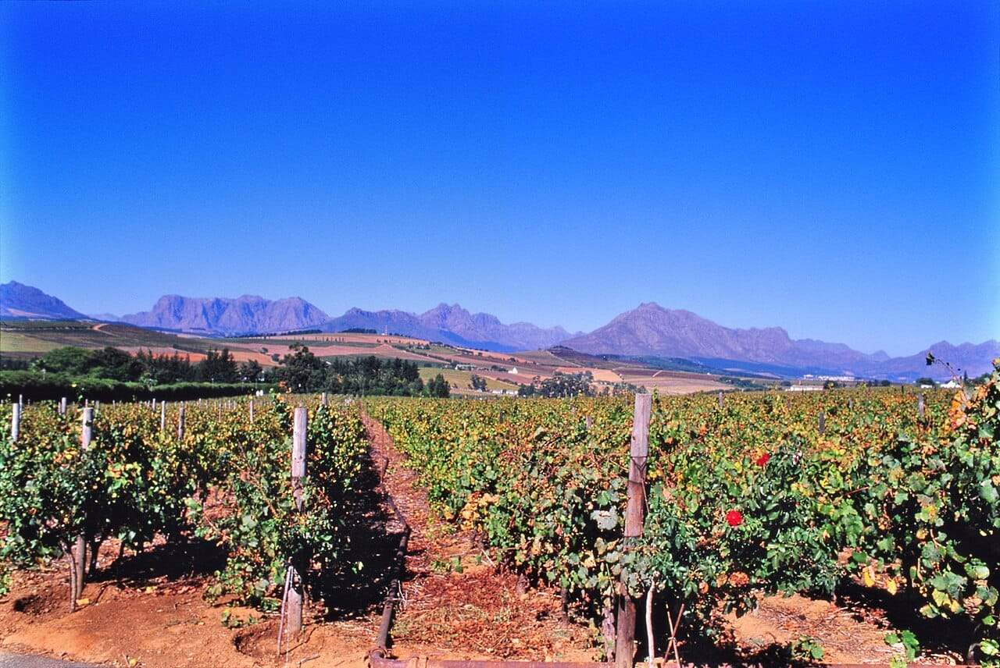
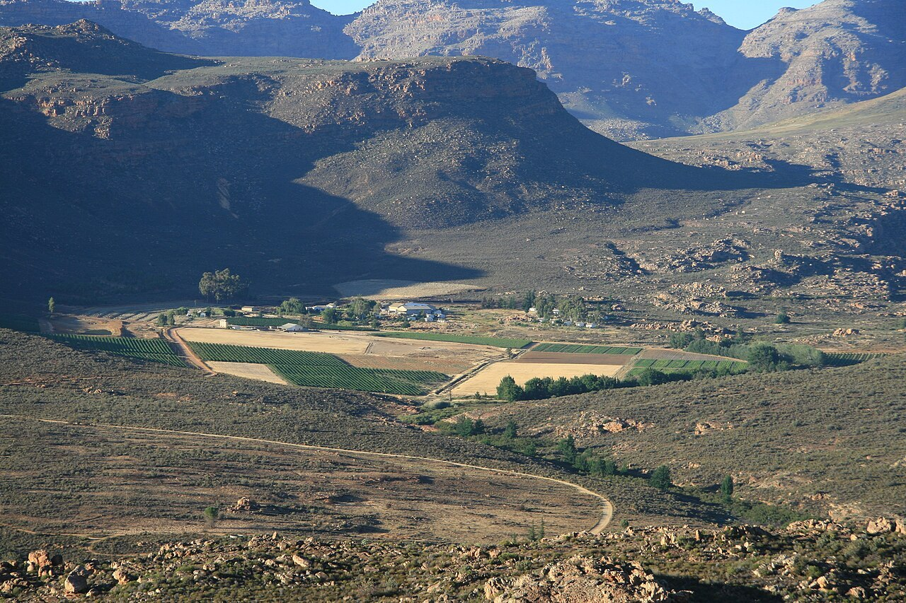

# 斯泰伦博斯

从开普敦向东，N1 与 M12 穿过一连串低矮山口，约 45 分钟后进入斯泰伦博斯。镇中心是被橡树遮住的 Dorp Street，白色山墙、深色木窗与石板路保存得比南非多数城镇完整；往外，葡萄园沿着 Jonkershoek、Simonsberg 与 Helderberg 的山脚展开。这里不是“一座酒庄”，而是一个由城镇、产区、150 多家酒庄与五条子路线组成的葡萄酒目的地。把它当作一个地方来读，比把它当作一个品牌更准确：上午看建筑与博物馆，下午去酒庄，晚上回镇上吃饭。

图：斯泰伦博斯谷地的葡萄园与山脉。图片：pedrik，CC BY 2.0，via Wikimedia Commons（[原图页面](https://commons.wikimedia.org/wiki/File:Vineyards_of_Stellenbosch_-_2000-4.jpg)）。

## 1679 年：斯泰伦博斯的关键起点
1679 年，开普总督 Simon van der Stel 把 Eerste River 上的一个小岛命名为 Stellenbosch；随后，荷兰移民发现这里的土壤与气候适合农业，葡萄藤很快沿山脚种下。1689 年，Muratie 一带出现最早的建筑；18 世纪，镇中心形成白色山墙的 Cape Dutch 建筑与橡树街道，得到“Eikestad”（橡树之城）的名字。1859 年，神学院建立；1918 年，斯泰伦博斯大学成立，镇逐渐成为南非的教育与文化中心。1971 年，Frans Malan、Niel Joubert 与 Spatz Sperling 在访问勃艮第的 Routes des Vins 后，建立了南非第一条官方葡萄酒路线；今天这条路线有 150 多家会员与五条子路线，仍是开普酒乡最完整的葡萄酒旅游网络。

## 建筑与空间

斯泰伦博斯的空间可以分三层。第一层是镇中心：Dorp Street 的白色山墙、荷兰式与乔治式民居、教堂、博物馆与橡树；建筑不高，尺度适合步行。第二层是酒庄：多数庄园离镇中心 5–15 分钟车程，入口常有长林荫道、白色农舍、酒窖与草坪，建筑从 17 世纪农庄到当代玻璃品鉴室都有。第三层是山地：Jonkershoek 与 Helderberg 的山脚、步道、水库与观景点，构成葡萄酒产区的自然背景。最值得看的是“白色山墙”的细节：弧形、梯形与装饰性山花不是统一风格，而是不同年代、不同家族品味的叠加；不要只拍一张全景就走。

## 酒单与味觉

斯泰伦博斯是南非最完整的葡萄酒产区之一，风格跨度很大。白葡萄酒以白诗南（Chenin Blanc）为核心，从清爽的未过桶风格到橡木桶陈年、带蜂蜡与杏桃的饱满风格都有；长相思、赛美蓉与白诗南混酿也常见。红葡萄酒以赤霞珠、品丽珠、梅洛与西拉为主，波尔多式混酿是经典；皮诺塔吉在这里也有重要位置，带李子、烟熏与香料。传统法起泡酒（Cap Classique）用霞多丽与黑皮诺，风格从柑橘到烤面包。产区内的子路线按地貌与风格划分，不能把“斯泰伦博斯”当成单一风格；同一品种在 Simonberg 山脚与 Helderberg 海风区可以完全不同。

## 怎么喝

白诗南建议 9–12°C；未过桶的年轻酒配海鲜、沙拉、鸡肉与山羊奶酪，过桶的饱满风格配烤鱼、奶油酱猪肉与香料菜。赤霞珠与波尔多混酿建议 16–18°C，配牛排、羊排、野味与硬质奶酪；皮诺塔吉 15–17°C，配烧烤、炖肉与烟熏菜。Cap Classique 6–8°C，配牡蛎、炸物与开胃菜。南非酒成熟度高，酒精感明显，配餐时优先考虑酸度与油脂的平衡；不要在高温下饮用，否则酒精会盖住果味。若在酒庄连续品鉴，吐酒桶不是摆设；开车的人不要喝。

## 斯泰伦博斯的地址与营业安排
斯泰伦博斯距开普敦约 45 公里，开车 40–50 分钟；从开普敦国际机场约 30–40 分钟。镇中心适合步行，酒庄之间需要汽车、出租车或预约司机；五条子路线分布在不同山脚，不能靠步行串联。多数酒庄 9:00–17:00 开放，部分周日休息；旺季与周末建议提前预约，热门酒庄常满。镇内有酒店、民宿与餐厅，采收季 2–4 月最忙，9–10 月春季花与 11–3 月秋冬季更安静。若只安排一天，选一条子路线、两到三家酒庄，加镇中心步行；两天以上再扩展。

## 礼仪与常见误区

第一，斯泰伦博斯是城镇与产区，不是单个酒庄；不要问“斯泰伦博斯酒庄在哪里”，先确定子路线与酒庄。第二，酒庄品鉴通常收费，部分可抵扣购酒；不要把品鉴室当成免费酒吧。第三，南非法定饮酒年龄 18 岁，带儿童参观要确认酒庄是否接待；部分庄园有花园与餐厅，适合家庭，但不是所有品鉴室都允许儿童。第四，不要酒后驾车；南非乡村道路窄、车速快，夜间照明差。第五，镇中心的历史建筑是居民与商户的空间，不要闯入院落或拍摄私人住宅。第六，不要用“南非酒都便宜”判断品质；斯泰伦博斯有大量高端酒，价格与旧世界重叠。

## 从斯泰伦博斯延伸到斯泰伦博斯
斯泰伦博斯周边可以接 [斯泰伦博斯](ref:stellenbosch) 的子路线、斯特兰德、帕尔与法国角（Franschhoek）；向南是开普敦与桌山，向西是西海岸。若只有半天，Dorp Street、镇博物馆与一家酒庄足够；一天可以加两条子路线；两天以上再考虑 [南非](ref:south-africa) 的整个开普酒乡。把 [白诗南](ref:chenin) 与 [赤霞珠](ref:cabernet) 做对照，是理解南非白红两端最快的办法；[红葡萄酒](ref:red) 的背景则帮助判断单宁与配餐。不要把斯泰伦博斯与开普敦同一天赶完：路上的时间比想象的长。

**关键事实。**

| 项目 | 内容 |
| --- | --- |
| 一句话定位 | 南非西开普省的历史葡萄酒小镇与产区，1679 年由开普总督 Simon van der Stel 命名；镇内是橡树成荫的 Dorp Street、荷兰式与乔治式建筑，周边有 150 多家酒庄与五条子路线 |
| 地址 | Stellenbosch, Western Cape, South Africa |
| 城市/国家 | 斯泰伦博斯 / 南非 |
| 营业状态 | 已核验营业 |
| 官网 | wineroute.co.za |

**来源与边界。** 本页关于「斯泰伦博斯」的关键事实，主要由以下来源交叉核对：Stellenbosch Wine Routes（1971 年由 Frans Malan、Niel Joubert 与 Spatz Sperling 创立、五条子路线、120 多家会员与南非葡萄酒旅游的经济贡献）、Visit Stellenbosch（斯泰伦博斯作为旅游目的地、酒庄、餐厅、步道与住宿的总体信息）、Stellenbosch Tourism。产品、地址或营业状态变化较快时，以 wineroute.co.za 的最新页面为准；价格、批次与状态会变，涉及这些字段时以页面所列来源的最新版本为准。正文为项目自写，来源只作核验，不复制原文。

**并读。** 把「斯泰伦博斯」与「斯泰伦博斯」、「南非」、「白诗南」放在一起读时，先确认它们是同一层级还是上下游关系：先确认地址与营业状态，再比较历史、空间与点单体验。本页负责给出场所的基本坐标，对照条目补上具体案例与差异；读完再回到本页，才能分清哪些差别属于场所本身，哪些只是产地、批次或品牌选择。

## 参考资料
- 同类对照：[stellenbosch](ref:stellenbosch)、[south-africa](ref:south-africa)、[chenin-blanc](ref:chenin)、[cabernet-sauvignon](ref:cabernet)、[red-wine](ref:red)。
- 背景阅读：[stellenbosch](ref:stellenbosch)、[south-africa](ref:south-africa)。
关于斯泰伦博斯，本页不绘制参观地图；开放时间、年份与价格以酒庄官网为准。

对照阅读：[斯泰伦博斯](ref:stellenbosch)、[白诗南](ref:chenin)。

## 相关图像

图：Vineyards in the Cederberg - South Africa。图片：Ltz Raptor，CC BY-SA 3.0，via Wikimedia Commons（[原图页面](https://commons.wikimedia.org/w/index.php?curid=4647540)）。关联图像：斯泰伦博斯。
