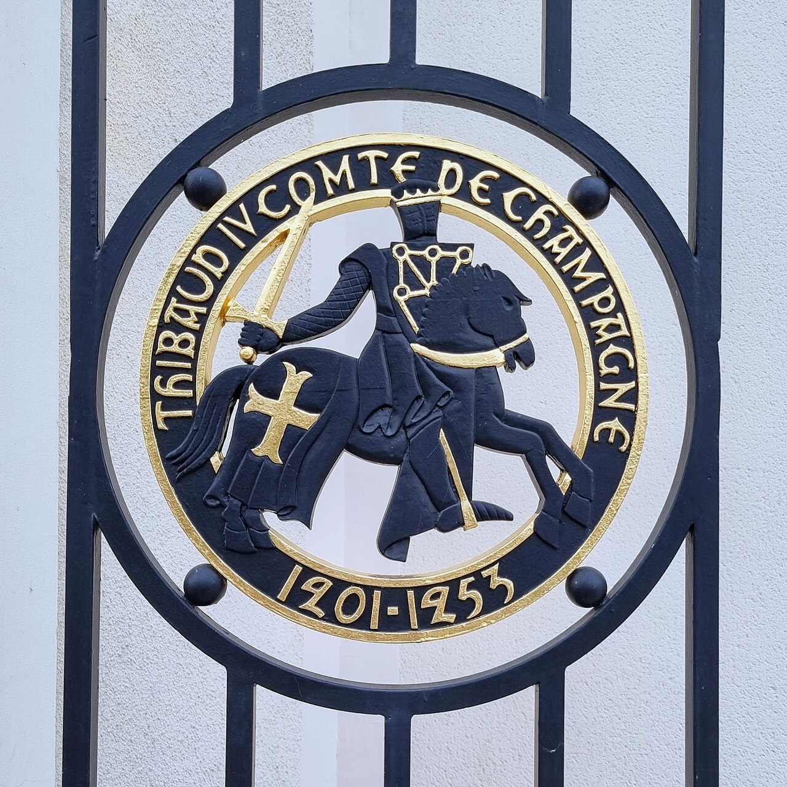
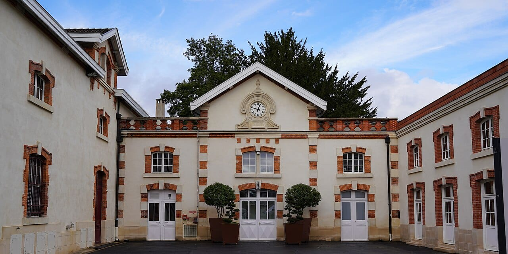

# 泰亭哲香槟

兰斯圣尼凯斯（Saint-Nicaise）的院子里，白垩岩壁与 19 世纪建筑贴在一起。这里曾经是圣尼凯斯修道院，法国大革命时被毁，地下白垩井却保留下来；今天它们属于泰亭哲，用来陈年最珍贵的 Comtes de Champagne。泰亭哲的故事有两条线：一条是 1734 年就开始卖酒的兰斯酒行，另一条是 1932 年搬进香槟区的 Taittinger 家族。两条线在圣尼凯斯交汇。

图：泰亭哲圣尼凯斯酒庄入口的骑士徽记。图片：UNTERMVIERENBERGE-2，CC0，via Wikimedia Commons（[原图页面](https://commons.wikimedia.org/wiki/File:F-Marne_(51)-Reims_-_Champagne_Taittinger_001.jpg)）。

## 1734 年：泰亭哲香槟的关键起点
泰亭哲把起源追溯到 1734 年，Jacques Fourneaux 在兰斯创立 Forest-Fourneaux 酒行，是香槟区最早的一批酒商之一。1932 年，Pierre Taittinger 买下 Château de la Marquetterie；1934 年，他又买下 Forest-Fourneaux，把酒行改名为 Taittinger。Pierre 在二战中受伤、被俘，战后回到兰斯重建酒庄；他的儿子 François 在 1960 年接任，把 Comtes de Champagne 做成酒庄的旗舰。

2005 年，Taittinger 家族把酒庄卖给 Starwood Capital；2006 年，家族又把股份买回来。今天酒庄仍由 Taittinger 家族控制，Claude Taittinger 的女儿们与家族成员参与管理。泰亭哲拥有约 288 公顷葡萄园，分布在 37 个 crus，白丘（Côte des Blancs）的 Chardonnay 比重高，是 Comtes de Champagne 的基础。

## 建筑与空间

圣尼凯斯遗址是兰斯最重要的香槟地下空间之一。4 世纪，人们在这里凿取白垩岩块用于建筑；900 年后，这些白垩井成为圣尼凯斯修道院的地下室。修道院在法国大革命中被毁，地下通道、墓室与酒窖保留下来。泰亭哲在 18 米深处陈年酒，部分空间属于 UNESCO“香槟山丘、酒庄与酒窖”遗产。

地面部分是 19 世纪的宅邸、接待处、品鉴室与精品店 Chromatique；地下部分是纵横的白垩廊道与酒窖。2025 年，酒庄在遗址内开设餐厅 Polychrome，以“调配”为主题做季节性菜单。参观从地面进入，沿石阶下到 18 米，温度骤降，墙壁上还能看到白垩开采与修道院的痕迹。这不是一座“新建的酒窖”，而是把历史层理直接暴露给访客。

## 酒单与味觉

Brut Réserve 是入口，以 Chardonnay 为主导，混入 Pinot Noir 与 Meunier，风格清爽、柑橘与白花明显，气泡细。Prestige Rosé 以 Pinot Noir 为主，颜色浅三文鱼，红莓与血橙香气，口感柔。Comtes de Champagne 是旗舰：1952 年首次酿造，只在好年份做，100% Chardonnay，来自白丘特级村，陈年至少 10 年；香气从柑橘、白花、杏仁到蜂蜡、奶油与矿物，口感极细，酸度高但不尖。Comtes de Champagne Rosé 则加入少量红葡萄酒，红莓、香料与烤面包并存。

Folies de la Marquetterie 是另一条线，来自 Château de la Marquetterie 周围葡萄园，Pinot Noir 比例高，风格更圆、更适合佐餐。Nocturne 是晚收风格的半干型，颜色金黄，适合甜点与蓝纹奶酪。不要把 Comtes de Champagne 当成“更贵的 Brut”：它是单一年份、单白丘、长时间陈年的另一套逻辑。

## 怎么喝

Brut Réserve 与 Prestige Rosé 建议 8–10°C；Comtes de Champagne 可以 10–12°C，温度太低会压住香气。用郁金香形或宽口白葡萄酒杯，不要用太窄的笛形杯。倒酒分两次，先少量，等泡沫稳定后再补；Comtes 可以提前 15–20 分钟开瓶，但不要剧烈醒酒。

配餐上，Brut Réserve 配生蚝、炸物、烤鸡与 Comté；Prestige Rosé 配三文鱼、草莓、地中海香料；Comtes de Champagne 配龙虾、螃蟹、白肉、奶油蘑菇与鱼子酱；Comtes Rosé 配鸭胸、红莓甜点。避免过甜、过辣的菜；泰亭哲的酸度清晰，食物需要有油脂与鲜味来平衡。

## 泰亭哲香槟的地址与营业安排
地址：9 Place Saint-Nicaise, 51100 Reims。参观从圣尼凯斯遗址接待处出发，酒庄提供四条不同深度的路线，含酒窖参观与品鉴；旺季与周末建议提前在官网预约，具体时段、语言与价格以预约页为准。酒窖常年 18 米深、温度低，夏天也带一件外套。圣尼凯斯广场周边以步行与短停为主，旅游旺季停车位紧张，建议乘电车或出租车到门口；酒窖内石阶较多，行动不便者应提前向酒庄确认无障碍路线。

从巴黎东站乘 TGV 到兰斯约 45 分钟，车站到圣尼凯斯步行约 20 分钟；自驾可停圣尼凯斯周边地下停车场，步行 5 分钟。周边可把兰斯主教座堂、Saint-Remi 与[香槟大道](ref:avenue) 串起来；若要去[库克](ref:krug) 或[堡林爵](ref:bollinger)，把品鉴分在两天，不要同一天连续喝三家。

## 礼仪与常见误区

第一，Comtes de Champagne 不是“入门款之上的选择”，而是单一年份、单产区的旗舰；不要用“有没有气泡”判断它。第二，酒窖不是博物馆，白垩壁、铁门与老酒都很脆弱；不要触摸、不要用闪光灯、不要越过围栏。第三，参观路线有不同价格与内容，不要买了基础票却要求进入 Comtes 的私人酒窖。

第四，Polychrome 是餐厅，不是酒庄的“免费休息区”；用餐需单独预约，酒单与套餐价格以餐厅为准。第五，香槟不是越冰越好；8–10°C 比 4°C 更能闻到香气。第六，泰亭哲家族拥有酒庄，但不要用“家族秘方”替代酿造事实；Comtes 的风格来自白丘 Chardonnay、长时间陈年与严格年份选择。

酒窖属于遗产空间，参观路线与温度控制有严格限制；把品鉴当成普通餐厅点酒，会忽略预约、着装与拍摄规则，出发前先看官网。

288 公顷与 37 个 crus 是酒庄资产，不等于每款酒都来自这些园；Comtes de Champagne 另有自己的地块与年份。

## 从泰亭哲香槟延伸到香槟大道
兰斯一天可以这样走：上午主教座堂与 Saint-Remi，中午在市区吃饭，下午泰亭哲酒窖参观，傍晚回[香槟大道](ref:avenue) 或[香槟大道步行路线](ref:route)。如果想去葡萄园，白丘的 Le Mesnil-sur-Oger、Oger 与 Avize 在兰斯以南约 30 分钟，是 Comtes 的原料核心；不要只看兰斯城里的酒窖。

两天的话，把泰亭哲与[堡林爵](ref:bollinger) 或[库克](ref:krug) 分开：一天兰斯与圣尼凯斯，一天阿伊与埃佩尔奈。香槟区的路窄、村多，导航要留余量；不要把品鉴安排在开车前。

**关键事实。**

| 项目 | 内容 |
| --- | --- |
| 一句话定位 | 兰斯圣尼凯斯（Saint-Nicaise）的家族香槟酒庄，历史可追溯到 1734 年的 Forest-Fourneaux 酒行，1932 年由 Pierre Taittinger 接手；拥有约 288 公顷葡萄园、37 个 crus，地下酒窖深 18 米、属 UNESCO 香槟山丘与酒庄遗产 |
| 地址 | 9 Place Saint-Nicaise, 51100 Reims, France |
| 城市/国家 | 兰斯 / 法国 |
| 营业状态 | 已核验营业 |
| 官网 | taittinger.com |

**来源与边界。** 本页关于「泰亭哲香槟」的关键事实，主要由以下来源交叉核对：Champagne Taittinger（兰斯与圣尼凯斯的历史、家族价值观、酒庄与葡萄园分布；圣尼凯斯遗址、18 米深高卢-罗马白垩井、UNESCO 遗产、四条参观路线、Polychrome 餐厅与 Chromatique 精品店）。产品、地址或营业状态变化较快时，以 taittinger.com 的最新页面为准；价格、批次与状态会变，涉及这些字段时以页面所列来源的最新版本为准。正文为项目自写，来源只作核验，不复制原文。

## 参考资料
- 香槟对照：[库克](ref:krug)、[堡林爵](ref:bollinger)、[香槟大道](ref:avenue)、[香槟大道步行路线](ref:route)。
- 背景阅读：[香槟产区](ref:champagne)。
- 本页不提供地图；参观路线、餐厅与价格以官方渠道为准。

## 相关图像

图：兰斯 Krug 酒庄建筑（Boulevard Lundy 一侧）。图片：G.Garitan，CC BY-SA 4.0，via Wikimedia Commons（[原图页面](https://commons.wikimedia.org/wiki/File:Krug_boulevard_Lundy_1512968.jpg)）。关联图像：泰亭哲香槟。
