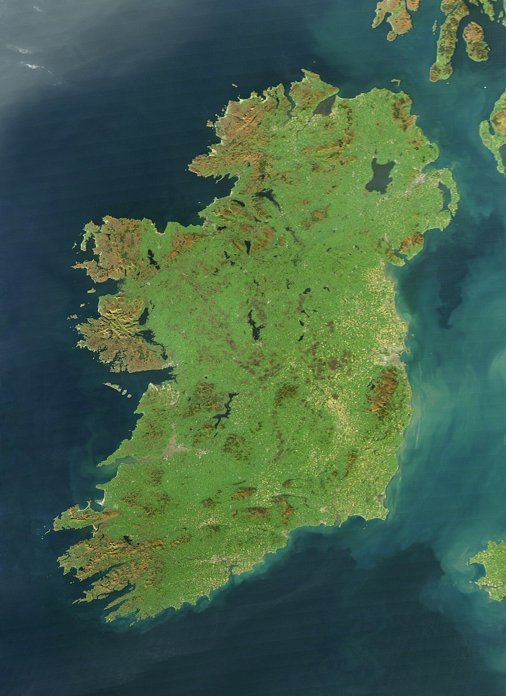

# 铜头酒馆

图：铜头酒馆所在的爱尔兰风貌配图。图片：Jeff Schmaltz，Public domain，via Wikimedia Commons（[原图页面](https://commons.wikimedia.org/wiki/File:Ireland_(MODIS).jpg)）。这张照片用于说明产区环境与访问语境，不标定铜头酒馆的门店、酒庄或活动现场。

## 它如何讲述自己的历史

如果你想在都柏林找一间能把“老”字讲清楚、又不至于像主题公园的酒馆，铜头酒馆是一个合适的起点。它在下桥街 20 号，紧邻利菲河上的马修神父桥，门外就是都柏林最初渡口的位置。店方把开业时间追溯到 1198 年，并自称“爱尔兰最老酒馆”；但真正站在你面前的建筑是 1754 年重建的客栈。把这两个时间分开，是理解这家店的关键：它卖的不是某个中世纪房间，而是一个在同一地点持续招待旅人与市民的场所。今天它仍每天开门，白天供应爱尔兰家常菜，晚上有传统音乐 session，游客与本地人共用同一个吧台。

## 从渡口到 1754 年建筑

都柏林的爱尔兰语名字 Baile Átha Cliath 意为“芦苇编栅渡口之城”，指的正是这一带的利菲河浅滩。店方说，最初人们把芦苇垫铺在河床上，让旅人在退潮时安全过河；马修神父桥就建在这条古老渡口附近。酒馆自称此地自 1198 年便有招待所，1653 年的文献中已出现“The Brazen Head”这个名字，现存建筑则建于 1754 年，当时用作 coaching inn（驿马车客栈）。1750 年代的一则广告还提到，桥街的 Christopher Quinn 把房子改配了“整洁的客房与宽敞的酒窖”。

需要提醒的是，1198 年属于店方与常见地方叙事中的传统说法，并没有同一时期的连续经营档案可以逐项印证；“爱尔兰最老”也因此常被历史学者当作一种有根据但不宜绝对化的称号。近年有研究把铜头列为“世界第五老酒馆”，店方也乐于引用，但这类排名往往依赖各店自己提供的起始年份，统计口径并不统一。对旅行者来说，更稳妥的理解是：这是一处有长期文献记录、同一地点持续经营数百年的酒馆，而不是一间原封不动保存到今天的 12 世纪建筑。把它放回[酒馆的历史](ref:taverns)里看，会发现“地点古老”和“建筑古老”本来就是两件事。

## 空间、音乐与酒单

室内是低矮天花板、石墙、深色木料与多个相连的小房间，走廊窄，转弯多，第一次来容易在吧台与后厅之间迷路。最值得停留的是前部吧台一带：晚上传统音乐通常在这里进行，乐手不搭高台，就坐在客人中间。官方页面曾列出每天 12:00 开门、周日至周四厨房供餐到 21:00、周五周六到 21:30，音乐则从 21:00 开始、周日下午另有一场；这些安排会随季节和活动调整，出发前应以官方渠道为准。

酒单的核心是[啤酒](ref:beer)，尤其是健力士与爱尔兰世涛：吧台会按标准的两段式倒法打酒，等泡沫沉降后再补满。除此之外，通常还能找到爱尔兰红艾尔、苹果酒、威士忌与爱尔兰咖啡。吃的方面以酒馆家常菜为主，爱尔兰炖菜、牛肉与健力士炖锅、炸鱼薯条、派与三明治都比较常见；菜单会换，不要拿旧攻略点菜。这里不是精酿酒吧，也不需要背一长串风格名；点一杯本地世涛，配一份热菜，就是最贴近这家店的用法。

## 今天怎么去

地址是 20 Lower Bridge St, Usher's Quay, Dublin 8, D08 WC64, Ireland，位于利菲河南岸、马修神父桥南侧。从圣三一学院或 Temple Bar 一带步行过来约 15–20 分钟；从都柏林城堡、基督座堂或圣帕特里克座堂过来更近。公共交通方面，Luas 红线在 Four Courts 或 Jervis 站下车后步行约 5–8 分钟；多路公交车沿 Usher's Quay 与 Merchant's Quay 行驶。都柏林市中心停车不便且昂贵，不建议自驾。

它适合被安排在“老城西侧”的半日路线里：先看基督座堂与圣帕特里克座堂，再沿利菲河走到下桥街，喝完一杯后继续去健力士仓库或返回 Temple Bar。周末晚上与旅游旺季，门口会有等位与团队客人；如果想安静看建筑，工作日下午比晚上更合适。无障碍方面，老建筑的门口与内部通道并不平整，轮椅或婴儿车通行前最好先电话确认。

## 点单与现场礼仪

爱尔兰酒馆的默认规则是“先到吧台点，再找位置”，不要坐下等服务员来。轮到你时，说清楚要什么：一杯健力士可以说 “a pint of Guinness, please”；想要小杯就说 “a glass” 或 “a half pint”。如果同行几人一起点，店员通常会先把所有饮品摆好再结账，不要一杯一杯反复插队。都柏林酒吧一般接受银行卡，但小店或忙碌时段备一点现金更稳妥；吧台不需要给小费，坐下来用餐时按账单取整或给约一成是常见做法。

音乐 session 不是舞台演出：乐手在角落围坐，曲目之间可以鼓掌，但不要在他们演奏时大声聊天、开闪光灯录像，也不要频繁点歌。想拍照，先看周围是否有人在认真听；想支持乐手，最简单的方式是点一杯酒、安静听完，并在结束后买一张他们自己的唱片或周边。铜头也是本地人常来的店，别把整个前厅当成旅行团的集合点；大团体最好提前联系店方，确认能否接待。

## 误解清单与步行范围

第一个误解是把“1198 年”当成建筑年代：现存主体是 18 世纪客栈，1198 年指的是地点上的招待传统。第二个误解是把“爱尔兰最老”当成没有争议的定论；更准确的说法是“店方与地方叙事常这样称”。第三个误解是以为这里全天都有传统音乐，实际上音乐集中在晚上，周日下午只是额外一场。第四个误解是把它当成只卖酒的景点：这里厨房正常运作，很多人是来吃晚饭的。

周边可以顺路看马修神父桥、Four Courts 与利菲河岸，再往东是都柏林城堡与 Temple Bar，往南是基督座堂与圣帕特里克座堂，往西可到健力士仓库。若想把“爱尔兰酒馆”放回更大的城市脉络，可以读[酒吧与城市](ref:pub-and-city)；若关心爱尔兰的啤酒与酒馆传统，则读[爱尔兰](ref:ireland)。把铜头当作路线上的一站，而不是唯一目的地，通常更舒服。

补充阅读：[A Ginjinha](ref:c-extra-1)。

对照阅读：[啤酒](ref:beer)、[爱尔兰](ref:ireland)。

相关条目：[酒馆史：从酒肆、客栈到酒吧](ref:taverns)。

**关键事实。**

| 项目 | 内容 |
| --- | --- |
| 一句话定位 | 都柏林下桥街的爱尔兰老酒馆，店方称此地自 1198 年即有酒馆、现存建筑为 1754 年所建；以传统音乐、健力士与爱尔兰家常菜闻名，今天仍在营业 |
| 地址 | 20 Lower Bridge St, Usher's Quay, Dublin 8, D08 WC64, Ireland |
| 城市/国家 | 都柏林 / 爱尔兰 |
| 营业状态 | 已核验营业 |
| 官网 | thebrazenhead.com |
