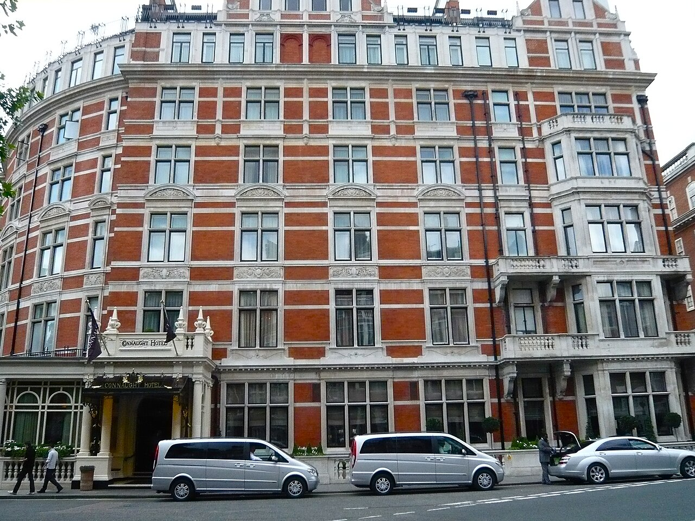
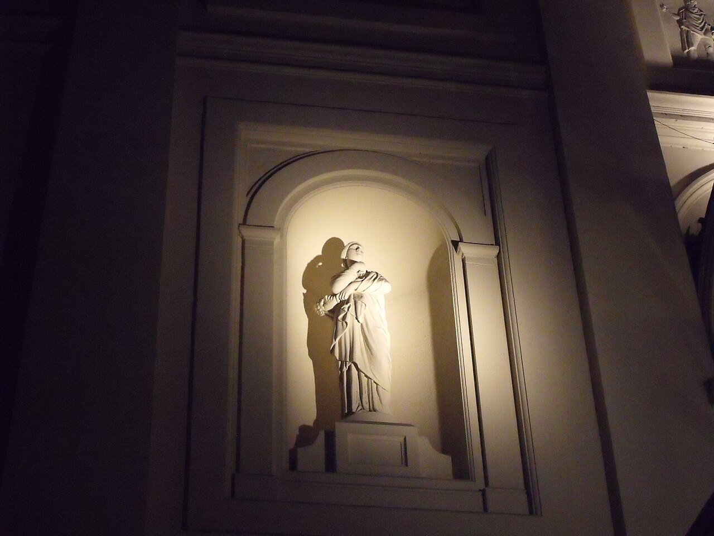

# 康诺特酒吧

康诺特酒吧在梅费尔卡洛斯广场（Carlos Place）的康诺特酒店内，2008 年随酒店整修开业。它不是一个从爱德华时代一直开到今天的百年老店，而是伦敦“新酒店酒吧”那一代的代表：把酒店的资源、设计感和调酒师的个人风格放在同一个房间里。理解这一点，比记住它拿过多少奖更有用。

图：康诺特酒吧。图片：Herry Lawford from Stockbridge, UK，CC BY 2.0，via Wikimedia Commons（[原图页面](https://commons.wikimedia.org/wiki/File:Mount_St_(3768612442).jpg)）。

## 2008 年：康诺特酒吧的关键起点
康诺特酒店位于梅费尔，门牌是 Carlos Place，靠近 Mount Street 与 Berkeley Square。酒吧于 2008 年开业，是酒店整体改造的一部分；官方页面至今仍以“自 2008 年起”描述它的历史。这个年份很重要：它的空间与酒单都是为现代客人设计的，而不是对某个旧酒吧的修复。

空间的室内设计由 David Collins Studio 完成，官方说法是融合 1920 年代英国与爱尔兰立体主义艺术，并带现代、优雅的收尾。酒吧的调酒由 Agostino Perrone 与 Giorgio Bargiani 领导；前者在官方叙述里被视为这间酒吧近二十年的核心人物。2025 年官方页面称其在 The World’s 50 Best Bars 排名第 6；2026 年的 The 50 榜单把它列在第 8。奖项会变，但它长期留在榜单上这件事，说明它的服务水平与酒单稳定性经得起反复检验。

## 空间与酒单

酒吧在酒店底层，入口在 Carlos Place 一侧。大理石地面、皮质沙发、镜面与偏暗的灯光构成一种“可以穿正装、也可以只穿一件好外套”的正式感。它不像夜店那样靠音量，也不像街角酒馆那样靠拥挤；空间的重点是让人坐得住，并把注意力放在桌上的酒。

酒单的核心是马天尼手推车。客人先选金酒或伏特加，再从几款自制苦精里挑一支，常见方向有佛手柑与人参、零陵香豆、薰衣草、芫荽籽和小豆蔻。调酒师在桌边把酒液从搅拌杯“抛”进马天尼杯，最后表达一片柠檬皮。这个过程不是表演噱头，而是这间酒吧的招牌服务；第一次来，点一杯手推车马天尼几乎等于完成了一次入门仪式。

酒单同时保留“Masterpieces”一栏，收录自 2008 年开业以来反复出现的经典与自家作品，例如 Number 11、Faraway Collins、Mulata Daisy；Bloody Mary 也常被列为这一栏的代表。季节性特调会更换，常见做法是在经典结构上加入当季水果、香料或低酒精选项。除此之外还有陈年鸡尾酒、葡萄酒与烈酒单，以及可以配酒的 canapés。酒吧也推出了自家蒸馏的 Connaught Bar Gin，具体供应以官方渠道为准。

## 怎么喝/点什么

第一次来，最稳妥的顺序是“一杯手推车马天尼 + 一杯自家特调”。马天尼负责校准：你可以据此判断这家店的温度、稀释与苦精处理；第二杯再按心情选清爽或偏苦的方向。若同行者不喝烈酒，可以问当季的低酒精或长饮选项，不要勉强用一杯马天尼“打卡”。

点单时说清楚偏好：金酒还是伏特加、偏干还是偏润、要不要柠檬皮、苦精想走柑橘还是香料方向。手推车服务需要时间，店里不接受预订，高峰时段吧台与桌位都靠现场安排；最从容的时段通常是刚开门的下午四点，或晚上十点以后。不要一次点四五杯，马天尼的酒精密度高，喝到第三杯时味觉已经开始迟钝。

如果只想聊天，选靠里的沙发；想看调酒过程，尽量坐吧台附近，但不要为了拍摄挡住服务动线。配酒的小食分量不大，适合两人分食；把它当正餐会失望。

## 康诺特酒吧的地址与营业安排
地址是 The Connaught, Carlos Place, London W1K 2AL, United Kingdom，位于梅费尔，入口在 Carlos Place 一侧。最近的地铁站是 Bond Street（Central、Jubilee 线，另有 Elizabeth 线）与 Green Park（Jubilee、Piccadilly、Victoria 线），步行均约 5–8 分钟；从 Green Park 穿过 Mayfair 的街区走过来，比在 Bond Street 的地下通道里绕行更容易找到方向。公交可乘 2、8、19、22、38 路等到 Park Lane 或 Berkeley Square 一带，再步行数分钟。

官方页面列出的营业时间是周一至周六 16:00–01:00，周日休息；不接受预订，全部现场入座，高峰时段会在门口安排等位。价格属于伦敦高端酒店酒吧的最高一档，Time Out 把它标为四星价位；菜单上个别陈年鸡尾酒会出现很高的标价，但并非每杯都如此。官方页面没有列出硬性着装要求，按酒店酒吧的惯例穿 smart casual 到 elegant 更稳妥，运动装与沙滩装不合适。带小孩的客人可以入场，但需成人陪同，店内没有放置婴儿车的空间；圣诞节与特殊活动期间可能调整营业时间，以官方渠道当日公告为准。最新营业时间、等位规则与节日安排以 Connaught Bar 官方页面为准；页面核验于 2026-11-08。

## 礼仪与常见误区

第一个误区是把康诺特酒吧当成“百年老酒吧”。酒店建筑有历史，酒吧本身却是 2008 年的作品；它的魅力来自设计、服务与酒单，而不是某件维多利亚时代的家具。第二个误区是把“世界最佳酒吧”理解成“可以随便穿、随便坐”。它没有夜店式的门槛，但有酒店酒吧的节奏：说话压低、不要占着桌位拍照、不要催手推车。

第三个误区是只盯着最贵的陈年鸡尾酒。那些酒确实存在，也确实是菜单上的话题，但多数客人点的是常规马天尼与当季特调；先问清楚价格与分量，再决定要不要“仪式感升级”。第四，不接受预订意味着不要带一大群人在周五晚上突然出现；分桌、早到或改天再来，都比在门口争执有效。最后，结账时确认服务费是否已经计入，不要用美式小费习惯覆盖账单上已有的费用。拍照可以，但不要拍到其他客人的正脸，也不要在手推车服务中途举着手机贴近调酒师。

## 伦敦的周边街区
从酒吧出来，沿 Carlos Place 走到 Mount Street，可以看到一排精品店与老建筑；再走几分钟就是 Berkeley Square，天气好时适合站着喝完最后一口。往东到 Bond Street 是购物区，往南穿过 Green Park 可到 Buckingham Palace，往西则是 Mayfair 的住宅街。若想把“酒店酒吧”与“街角酒馆”放在一起比较，可以白天先去 Soho 或 Covent Garden 的 pub，晚上再回到这里；两边的音量、价格与坐姿会立刻显出差别。周日酒吧休息，安排路线时不要把这一天当作参观日。

## 同城酒吧与延伸阅读
同城可对照萨沃伊美式酒吧（American Bar at The Savoy）：它把 1893 年以来的酒店酒吧传统写进酒单，康诺特则更像 21 世纪对同一传统的重新设计。若想看更小、更私密的马天尼服务，可以读杜克斯酒吧（Dukes Bar）。把这三间店放在一起，能看出伦敦酒店酒吧的三种尺度：历史叙事、设计叙事与仪式叙事。

## 同城酒吧与延伸阅读
- [伦敦经典酒吧步行路线](ref:london-classic-bar-walk)
- [萨沃伊美式酒吧](ref:american-bar-savoy)
- [干马天尼](ref:dry-martini)

补充阅读：[A Ginjinha](ref:c-extra-1)、[À la Mort Subite](ref:c-extra-2)。

相关条目：[伦敦经典酒吧步行路线](ref:london-classic-bar-walk)、[萨沃伊美式酒吧](ref:american-bar-savoy)、[干马天尼](ref:dry-martini)。

## 相关图像

图：Royal Opera House - Bow Street, London - statue (6446853425)。图片：Elliott Brown from Birmingham, United Kingdom，CC BY 2.0，via Wikimedia Commons（[原图页面](https://commons.wikimedia.org/w/index.php?curid=22459244)）。关联图像：康诺特酒吧。
