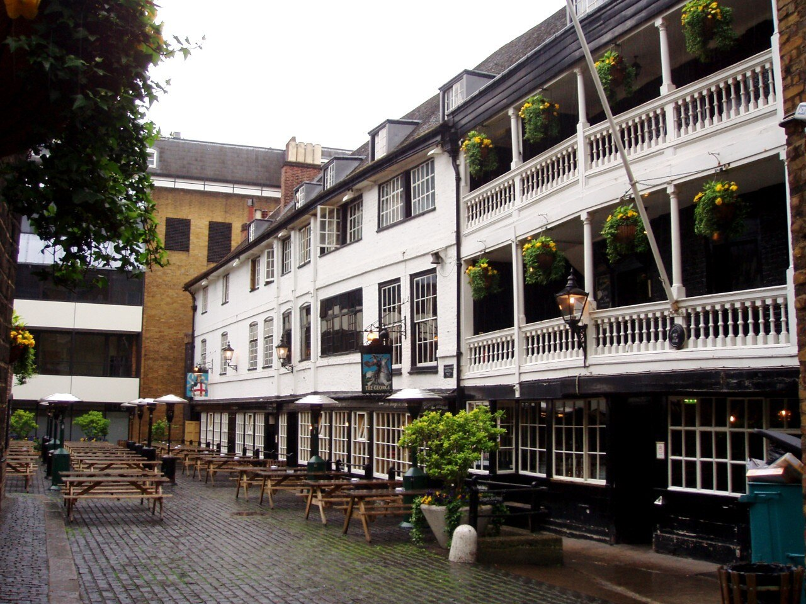

# 乔治客栈

图：乔治客栈。摄影：The George Inn 1。署名：Ewan Munro from London, UK，CC BY-SA 2.0，来自 Wikimedia Commons（[来源](https://commons.wikimedia.org/w/index.php?curid=6048166)）。

## 定位：伦敦仅存的廊式客栈

乔治客栈在泰晤士河南岸的 Borough High Street 77 号，入口不是一个宽阔门面，而是一条从街边穿进去的院子。它由国家信托（National Trust）所有，交给 Greene King 作为酒馆经营，所以这里既是被保护的历史建筑，也是每天开门做生意的 pub。国家信托给它的定位很直接：这是伦敦仅存的带廊式客栈（galleried inn）。所谓“廊式”，指客房与走道沿着庭院三面围出木制外廊，旅客可以站在廊上看院子里的马车、货物与人。

“客栈”与“酒馆”在这里不是同义词。coaching inn 曾同时提供住宿、马厩、热食与酒，是公路旅行时代的基础设施；今天的乔治只保留了酒馆与餐饮功能，楼上空间用于用餐或活动。理解这一点，就不会把院子当成纯粹的景点，也不会奇怪为什么这里没有“客栈前台”。它仍在营业，而且生意不错，周末与比赛日尤其忙。

## 建筑与庭院

现存建筑属于 17 世纪。国家信托明确说，原来的乔治客栈在 1676 年毁于火灾，随后重建；不同资料会把重建年份写成 1676 或 1677，指的都是火灾之后这一轮工程。今天看到的木构外廊、深色木梁与狭窄楼梯都来自这个时期，而不是中世纪。国家信托还提醒，带外廊的客栈在伦敦曾经很常见，但许多同类建筑在第二次世界大战中被毁，乔治因此成了孤例。

从 Borough High Street 走进 George Inn Yard，视线会先被院子收住：三面外廊围合出一个相对安静的空地，酒馆的门口在院子一侧。外廊是拍照的好地方，但它们是建筑构件，不是观景台；不要翻越栏杆、攀爬楼梯或把酒杯放在栏杆上。院子在白天是通行与用餐空间，晚上则更接近站着的社交场；如果只想看建筑，工作日上午到中午最合适，那时光线进得来，人也没那么密。

## 文学与舞台记忆

乔治客栈最常被提起的文学连接是狄更斯。国家信托说，狄更斯在它还兼作咖啡屋时到过这里，并在《小杜丽》（Little Dorrit）里写到它。注意这里的层次：他到访过、小说提到过，不等于他在这里写作，也不等于小说里的每个场景都能在院子里一一对应。把“文学地标”当成“作家书房”，是游客最常见的误会。

另一条更古老的线索是戏剧。南岸的客栈庭院在 16 世纪末常被巡演剧团借用，院子三面围廊、中间空地的形制，后来被认为影响了伦敦最早的固定剧场。乔治所在的位置与这一传统有关，也有“莎士比亚在此演出或饮酒”的长期传说；但这类说法缺少同时代的确凿记录，宜写成“据传”而不是事实。可以确定的是，Borough High Street 曾是伦敦南岸客栈最密集的街道之一，《坎特伯雷故事集》里的塔巴德客栈也在这一带；乔治是这条街上留下来的最后一间。把它放回[酒馆的历史](ref:taverns)里看，院子本身就是一种早期的公共表演空间。

## 喝什么、怎么点

酒单以英式啤酒为主：Greene King 体系内的桶装艾尔（cask ale）、会话 IPA、拉格与世涛都能见到，也会随季节换款。想喝得本地一点，可以先问吧台当天有哪些 cask ale，试喝一小口再决定；这类酒讲究新鲜与温度，不是越冰越好。除啤酒外还有葡萄酒、金酒、鸡尾酒与软饮，适合不喝啤酒的同伴。吃的方面是标准英式酒馆菜：周日烤肉、炸鱼薯条、汉堡、派与素食选项；菜单与价格会变，以官方渠道为准。

点单在吧台完成。先找桌号或记住自己坐的位置，再到吧台点酒与食物；如果需要开tab，按店员指示留下卡或说明。国家信托建议提前订位，尤其是周末、周日午餐与演出前后；直接走进来通常也能找到站位，但不要假定院子里的桌子可以随便占。这里欢迎家庭与狗，院子前部有户外座位，天气好时比室内更舒服。

## 实用信息与到达

地址是 The George Inn Yard, 77 Borough High Street, Southwark, London SE1 1NH, United Kingdom。最近的车站是 London Bridge（Jubilee 与 Northern 线），出站后沿 Borough High Street 向南步行约 5 分钟；Borough 站（Northern 线）也很近。多路公交沿 Borough High Street 行驶，具体线路与时刻以 Transport for London 为准。它离 Borough Market 只有两三分钟步行距离，适合把市场与酒馆排在一起。

官方页面列出的营业时间大致为周一至周三 10:00–23:00、周四至周六 10:00–次日 01:00、周日 10:00–23:00，厨房通常营业到 22:00 左右；节假日、比赛日与私人活动会调整，出发前请查 Greene King 页面或致电 +44 20 7407 2056。这里不收门票，按菜单消费；不需要预订也能喝酒，但用餐建议预订。历史建筑的门槛、楼梯与厕所通道不平整，轮椅使用者与推婴儿车者应先电话确认动线。

## 礼仪、误区与周边

最常见的误区有三个。第一，把“莎士比亚在这里演过戏”当成确定事实；更准确的说法是，客栈庭院演戏是那个时代的普遍做法，乔治的前身与这一传统有关，但具体到莎士比亚本人，没有可靠记录。第二，把国家信托所有当成“博物馆”：这里由租户正常经营，卖酒、卖饭、接受订位，只是建筑受保护。第三，把 1676 年当成“中世纪”：现存主体是 17 世纪火灾后的重建，真正的中世纪客栈早已不存。

在院子里喝酒，注意不要把外廊当成攀爬架，也不要把自行车锁在历史木构件上。高峰时拼桌很常见，坐下前问一句“Is this seat free?”更礼貌。周日烤肉与大型赛事前后人多，带小孩或想安静聊天的人应避开这些时段。周边可以顺路去 Borough Market、南岸座堂、莎士比亚环球剧场、泰特现代美术馆与 The Shard；若想把伦敦酒馆放回更大的城市生活里，读[酒吧与城市](ref:pub-and-city)；若关心英国啤酒传统，读[英国](ref:uk)。这里的桶装艾尔属于更广的[啤酒](ref:beer)家族，点一杯 cask ale 再逛市场，是最顺的走法。

补充阅读：[A Ginjinha](ref:c-extra-1)。

相关条目：[啤酒](ref:beer)、[酒馆史：从酒肆、客栈到酒吧](ref:taverns)、[英国](ref:uk)。

**关键事实。**

| 项目 | 内容 |
| --- | --- |
| 一句话定位 | 伦敦南岸 Borough High Street 的历史客栈，国家信托所有、Greene King 经营；现存建筑为 17 世纪火灾后重建，是伦敦仅存的带廊式客栈，狄更斯《小杜丽》曾提及 |
| 地址 | The George Inn Yard, 77 Borough High Street, Southwark, London SE1 1NH, United Kingdom |
| 城市/国家 | 伦敦 / 英国 |
| 营业状态 | 已核验营业 |
| 官网 | nationaltrust.org.uk |

**来源与边界。** 本页关于「乔治客栈」的关键事实，主要由以下来源交叉核对：National Trust（地址、17 世纪建筑、1676 年火灾、伦敦仅存廊式客栈、狄更斯与《小杜丽》、出租经营状态）、Greene King（营业时间、餐饮供应、预订建议、宠物与家庭友好信息）、Guide London（客栈庭院演戏传统、1676 年建筑与南岸客栈背景）等 4 条来源。产品、地址或营业状态变化较快时，以 nationaltrust.org.uk 的最新页面为准；价格、批次与状态会变，涉及这些字段时以页面所列来源的最新版本为准。正文为项目自写，来源只作核验，不复制原文。
