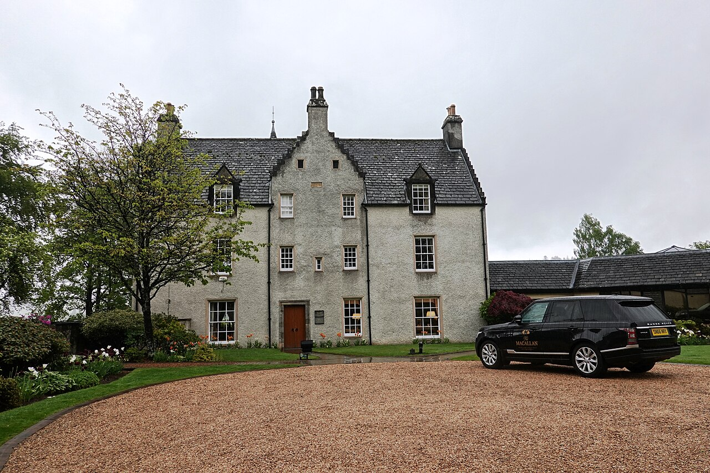

# 麦卡伦庄园

从 Craigellachie 往北，A941 沿 Spey 河走一小段，转入一条穿过草坡与树林的车道，才到麦卡伦的庄园。这里没有“路边酒厂”的随意感：大门、停车场、游客中心与厂房都被安排在 Easter Elchies 的坡地里，屋顶起伏，远看像把草地掀起来又盖回去。麦卡伦是世界上最知名的单一麦芽品牌之一，但它的参观体验首先是一套被设计过的“进入庄园”的流程——没有预约，通常连门都进不去。

图：麦卡伦庄园的 Easter Elchies House（建于 1700 年）。图片：יאיר צפורי，CC BY-SA 4.0，via Wikimedia Commons（[原图页面](https://commons.wikimedia.org/wiki/File:Macallan_Easter_Elchies_House_Built_in_1700.jpg)）。

> **先给结论**
> **一句话：** 这页判断麦卡伦庄园值不值得专程去，以及到访前要核对什么。
>
> - **适合谁：** 正在计划去麦卡伦庄园、想知道值不值得专程安排半天到一天的人。
> - **不适合谁：** 只想要“必去榜单”、不准备核对预约、交通和开放时间的人。
> - **先看这两点：**
>   - 麦卡伦的品鉴不适合“一口闷”。
>   - 这里是生产与接待并存的场所。

## 1824 年：麦卡伦庄园的关键起点
麦卡伦的合法历史从 1824 年开始。这一年，Alexander Reid 在 Easter Elchies 一带取得执照；在此之前，Spey 河谷已有大量非法蒸馏，地处的森林、泉水与隐蔽谷地是当时蒸馏者的条件。酒标上的 Easter Elchies House 建于 1700 年，是一座高地庄园宅邸，也是品牌最常使用的视觉符号。把“1824 年合法化”和“1700 年宅邸”分开看，才不会把两个时间混成一句“历史悠久”。

酒厂长期由 Edrington 持有。2012 年，麦卡伦公布新酒厂与游客体验的方案；2014 年 12 月动工，2018 年启用。新厂由 Rogers Stirk Harbour + Partners 设计，最醒目的特征是覆土屋顶与起伏的体量，内部则把糖化、发酵、蒸馏、陈酿与游客动线放在同一个大屋顶下。旧厂并没有被简单抹去，它在新厂旁边保留下来，成为庄园叙事的一部分。对新访客来说，最重要的是：今天看到的“麦卡伦”是一座 2018 年之后的现代工厂，而不是 19 世纪的小作坊。

麦卡伦的风格常被概括为“雪莉桶”。更准确地说，它长期以西班牙 Jerez 地区经雪莉酒润桶的橡木桶为核心，欧洲橡木与美国橡木分别带来干果、香料与香草、柑橘的差异；酒厂同时强调小型蒸馏器与较窄的取酒段，让新酒更厚、更油。风格不是某一个桶决定的，而是麦芽、蒸馏、桶源与陈年环境叠加的结果。

## 建筑与空间

进入庄园需要提前在官网选择体验并预约。游客中心、餐厅、酒吧与商店集中在入口建筑；The Macallan Bar 只接待 18 岁以上客人，并执行 Challenge 25 的证件检查。参观通常从品牌与庄园的介绍开始，再进入生产区，看糖化槽、发酵槽、蒸馏器与桶陈空间。新厂的动线宽敞、光线充足，和许多老酒厂的狭窄石墙形成对比；这不是“更高级”，而是把生产过程展示给大量访客的工程选择。

蒸馏器是参观的重点。麦卡伦的蒸馏器以“小”著称，官方常用 curiously small stills 来形容；小型蒸馏器意味着单位时间内与铜接触的表面比例更高，回流与风味选择更精细。新厂的蒸馏器数量比旧厂多，产能也更大，但酒厂仍强调只取蒸馏中段的一小部分，酒心之外的酒头与酒尾会被分离。站在蒸馏器旁，听讲解说“取哪一段”，比记住“雪莉桶”三个字更能理解酒体为什么厚。

庄园本身也值得留时间。Easter Elchies House 在坡地上，周围是草地、树木与 Spey 河的方向；新厂的屋顶与地形结合，是建筑爱好者会专门来看的对象。游客中心有品牌历史、桶样与酒款展示，餐厅提供正式用餐，酒吧可以单点。不要只把这里当成“买 18 年的地方”，它更像一个把酒厂、庄园、建筑与餐饮打包在一起的目的地。

## 酒单与味觉

麦卡伦的产品线很宽，常见读法是“桶型—年份—渠道”。Sherry Oak 系列以雪莉桶熟成为核心，12 年、18 年、25 年、30 年是常见阶梯，风味从干果、柑橘皮、黑巧克力走向更深的香料、皮革与木质；Double Cask 系列把欧洲橡木与美国橡木的雪莉桶结合，口感通常更圆、香草与蜂蜜更明显；Triple Cask 之类面向特定渠道的系列，则把不同桶型的比例再作调整。不同市场与年份的包装、名称会变化，买之前看背标比记系列名更可靠。

第一次来，最有效的对比是同一系列的两个年份，或同一年的 Sherry Oak 与 Double Cask。前者让你看到陈年带来的复杂度，后者让你看到欧洲橡木与美国橡木的差异。麦卡伦的官方资料强调自然色泽，不添加焦糖色；这并不意味着颜色越深酒越老，桶的烘烤程度、木材种类与陈年时间都会影响颜色。品鉴时先闻后喝，少量慢饮，喝不完可以吐掉。

高年份酒款价格很高，酒厂限定与单桶的供应也有限。若预算有限，先把基础款喝明白，再决定是否为某个年份买单。不要用“雪莉桶”给所有麦卡伦下结论：同一品牌内部，桶型、年份与取酒段的变化足以让两杯酒听起来像两个产区。

## 怎么喝

麦卡伦的品鉴不适合“一口闷”。先看颜色，再闻香：雪莉桶的干果、橙皮、黑巧克力，Double Cask 的香草、蜂蜜、柑橘，Triple Cask 的轻盈与花香，都会在杯口先出现。入口后让酒液在舌面停两秒，感受酒体与单宁，再咽下或吐掉；不要急着加冰，冰会把香气锁住。

如果要点单，先从 12 年 Sherry Oak 或 Double Cask 开始，再对比 18 年；同一系列的两个年份，比跨系列乱点更能看出陈年与桶型差异。想喝重泥煤，不要在麦卡伦找；去艾雷岛的 [Lagavulin](ref:lagavulin)、[Laphroaig](ref:laphroaig) 或 [Ardbeg](ref:ardbeg) 更直接。想喝果香与雪莉桶的对照，可以到 [Glenfiddich](ref:glenfiddich) 与 [Glenlivet](ref:glenlivet) 各点一杯基础款，再回到麦卡伦比较。

加水要少量：高酒精度或桶强的酒，滴两三滴水能让香气打开；低年份的 40% 款不必加水。不要加苏打水或可乐，也不要在品鉴前吃重辣、重蒜或重甜的东西。开车的人只闻不喝；酒厂酒吧与品鉴都执行 18 岁以上与 Challenge 25 证件检查。

## 麦卡伦庄园的地址与营业安排
地址是 The Macallan Distillery, Easter Elchies, Craigellachie, Moray AB38 9RX, Scotland。自驾从 Craigellachie 沿 A941 向北，按路牌进入庄园；从 Elgin、Aberlour 或 Dufftown 出发都在半小时上下。公共交通不直接到门口，最近的车站是 Elgin 或 Keith，之后需要出租车或参加含接送的行程；不自驾的话，建议提前预约当地一日游。庄园入口有停车场，但车位与预约绑定，不要临时改时间。

庄园的进入方式是“先预约、再到访”。官网把参观、餐厅、酒吧与商店分成不同入口，预约时要确认你订的是哪一种：有的体验含生产区与品鉴，有的只含品鉴或餐饮；年龄限制也不同。生产区地面湿滑、设备有高温与运转部件，穿防滑鞋、不要穿凉鞋；厂房内温度偏低，带一件外套。行动不便的访客要提前说明，新厂的无障碍设施比老厂好，但不同体验的路线仍需确认。

开放时间、票价、场次与菜单会调整，页面核验日期 2026-11-08，出发前以官网当日信息为准。旺季与节假日很快满员，建议提前数周；冬季部分体验减少，但庄园与餐厅仍可能开放。若当天还要开车，酒吧与品鉴都不要参加，或把司机单独安排。

## 礼仪与常见误区

这里是生产与接待并存的场所。没有预约不要进入庄园，不要在生产区触摸设备、桶架与展品；拍照前看标识，蒸馏器与部分工艺细节可能不允许拍摄。品鉴时不要喷浓香水，不要大声讲解；把酒吐掉是正常礼仪，不是浪费。带儿童的家庭要先确认年龄政策，酒吧与部分品鉴只对成年人开放。

开车的人全程不喝。苏格兰的酒驾上限比英格兰更严，乡村道路窄、弯多，一杯也可能影响判断。最稳妥的是包车、指定司机或参加含接送的行程；若同行者都不喝酒，可以把重点放在建筑、庄园与餐厅。

常见误区是把“雪莉桶”当成“所有麦卡伦都一样”。事实上，Sherry Oak、Double Cask、Triple Cask 的桶型与比例不同，年份也不同；同一品牌内部可以差得很远。另一个误区是把“颜色深”当成“年份老”：桶的烘烤、木材与陈年环境都会影响颜色，麦卡伦又不加焦糖色。第三，麦卡伦不是“重泥煤”酒厂；想喝泥煤，去艾雷岛更合适。

## 从麦卡伦庄园延伸到Glenfiddich
周边可以顺路去 Craigellachie 的 Speyside Cooperage 看制桶，或到 Aberlour、Dufftown 继续酒厂路线；往北到 Elgin 看大教堂，往南到 Glenlivet 与 Ballindalloch。把麦卡伦与 [Glenfiddich](ref:glenfiddich)、[Glenlivet](ref:glenlivet) 串成一天是可行的，但三场预约之间要留足车程与午餐时间；更完整的安排看 [斯佩塞麦芽路线](ref:speysideroute)。

想换到泥煤风格，可以往西去艾雷岛，走 [艾雷岛威士忌路线](ref:islayroute)，在 [Lagavulin](ref:lagavulin)、[Laphroaig](ref:laphroaig) 与 [Ardbeg](ref:ardbeg) 之间做对比。斯佩塞与艾雷岛不适合硬塞进同一天：一个在内陆，一个要坐船，至少各留两天。

## 参考资料
- 想理解“产地与工艺”的关系，可以读[产地与工艺](ref:place-and-process)；想先建立威士忌的基本框架，则从[苏格兰威士忌](ref:scotch)与[斯佩塞](ref:speyside)开始。
- 斯佩塞对照：[Glenfiddich](ref:glenfiddich)、[Glenlivet](ref:glenlivet)、[斯佩塞麦芽路线](ref:speysideroute)。
- 艾雷岛对照：[Lagavulin](ref:lagavulin)、[Laphroaig](ref:laphroaig)、[Ardbeg](ref:ardbeg)、[艾雷岛威士忌路线](ref:islayroute)。
- 官方来源见页首 sources：酒厂参观页、新酒厂页、VisitScotland 与 Edrington 母公司页。
