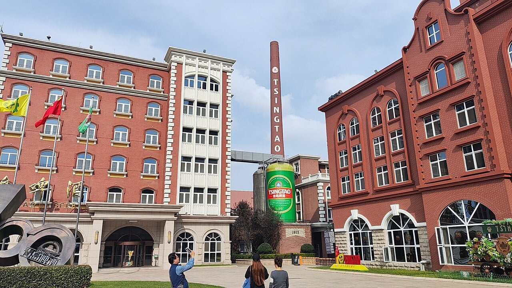

# 青岛啤酒厂（登州路厂区）

登州路 56 号是青岛啤酒的诞生地，也是今天仍在运转的老厂区。很多游客把这里直接叫“啤酒博物馆”，但厂区与博物馆并不是两个可以分开买票的景点：博物馆坐落在厂区里，参观动线从百年厂房、老设备一直走到贴着生产车间的玻璃廊道。理解这层关系，才知道自己看的是一座“活着的工厂”，不是一座把机器封存起来的展馆。

图：青岛啤酒厂登州路厂区的红砖院落，烟囱与绿色啤酒罐装置上可见 TSINGTAO 字样。图片：Suginami，CC0 1.0，via [原图页面](https://commons.wikimedia.org/wiki/File:Tsingtao_Brewery_Museum_inside_2024.jpg)。

## 厂区与城市

1903 年，德资啤酒厂在青岛建立，厂址就在今天的登州路。青岛当时是德国租借地，红砖厂房、坡屋顶、糖化锅与地下贮酒空间，带着明显的德式工业建筑特征。青岛啤酒厂早期建筑后来被列为全国重点文物保护单位；保护身份主要对应早期建筑，不是整座仍在生产的厂区。这个区别很重要：厂区首先是一个生产单位，其次才是参观对象。

登州路今天被城市包围，厂区尺度大、街道窄，红砖墙与老街形成强烈反差。青岛啤酒厂是青岛啤酒多家生产厂中的老厂，它的意义不只在产能，更在“原址仍在酿酒”这件事。游客站在厂区里，能同时看到 1903 年的建筑、老电机与玻璃后的现代灌装线，这种“旧与新同框”是登州路厂区最独特的参观点。

## 与博物馆的关系

青岛啤酒博物馆 2003 年 8 月 15 日开馆，那天是青岛啤酒的百年华诞；馆址就是 1903 年德资啤酒厂的原址。博物馆通常分 A、B 两馆：A 馆讲百年历史与老设备，B 馆紧贴生产车间，游客站在玻璃廊道里可以看到酿造与出厂流程。青岛市政府国资委 2026 年的报道明确说，博物馆坐落在登州路 56 号仍在运转的老厂区内，B 馆的玻璃廊道能看到啤酒酿造出厂的全过程。

所以“青岛啤酒厂”与“青岛啤酒博物馆”是同一地址上的两层体验：博物馆是游客接口，厂区是生产实体。没有博物馆的展线与预约，游客不能自行进入车间；反过来，只看博物馆而忽略厂区仍在生产，也会把“工业遗产”误读成“停产遗址”。如果只想看展，博物馆足够；如果想理解“老厂还在工作”，就要在 B 馆的玻璃廊道多停一会儿。

## 德式拉格与生产

青岛啤酒的底层风格是德式拉格。拉格用下面酵母，在较低温度下主发酵，再经过一段低温贮酒（lagering），酒体更干净、香气更稳定。原料是水、麦芽、酒花与酵母；青岛的水质、德式设备与早期的德国酿酒师，共同塑造了这座城市啤酒的底色。具体配方与工艺参数属于企业信息，参观时不必追问“比例是多少”，看糖化、煮沸、发酵与灌装的流程，已经足够理解一杯拉格是怎么来的。

参观中最容易被问到的是原浆与纯生的差别。原浆通常保留更多酵母与悬浮物，口感厚、麦香明显，需要冷藏且保质期短；纯生经过过滤与无菌处理，不依赖高温杀菌，口感更清爽、稳定。博物馆的常见票种会含原浆与纯生各一杯，具体包含什么以票务页与现场为准。先喝原浆再喝纯生，或反过来，都能明显感到“厚与爽”的差别；但不要把品鉴当成无限量试饮，酒精与饱腹感都会影响判断。

## 怎么参观

地址是山东省青岛市市北区登州路 56 号。开放时间分季节调整：官网给出的一月至四月、十一月至十二月为 8:30–17:30（16:30 停止入场），五月至六月、九月至十月为 8:00–18:30（17:30 停止入场），七月至八月为 7:30–19:30（18:30 停止入场）；节假日与临时闭馆以公告为准。建议预留两到三小时，先看 A 馆的历史与老设备，再走 B 馆的生产廊道，最后到品鉴区。

门票通常通过“青岛啤酒博物馆”微信公众号实名预约购买，也可在 OTA 平台购票；普通票含 A+B 馆参观与原浆、纯生各一杯，另有品鉴票、联票与 VIP 票，价格与内容以票务页为准。旺季、周末与节假日建议提前买票。最佳时段是开馆后一小时或下午三点以后，旅行团多集中在上午十点到下午三点；夏季闭馆更晚，可以利用傍晚。

厂区不是自由参观的工业园区。不要脱离参观路线、不要推开生产门、不要触摸设备与管道；玻璃廊道可以看，但不能进入车间。拍照前看现场提示，老设备、档案与生产区可能禁止闪光灯或禁止拍摄。带孩子的家庭可以把重点放在老设备、玻璃产线与互动体验，品鉴环节要看票种与年龄规定，未成年人不得饮酒。

## 实用信息与礼仪

交通上，地铁 1 号线、2 号线台东站出站后步行可达；也可乘公交到“青岛啤酒博物馆”站。登州路老城道路窄、停车位有限，建议地铁加步行，打车则让司机在登州路附近靠边下客，不要把车开进厂区门口。夏天青岛日照强、海边风大，排队进馆时注意防晒与补水；冬天闭馆早，下午三点后到就可能赶不上完整参观。

票务与预约要分开看：门票含参观与品鉴，讲解、定制酒标、剧游与夜游可能是另收费项目；买票前看清包含内容，现场补买容易超预算。品鉴后不要驾车，青岛老城路况复杂，酒后排险与找路都麻烦。不要在厂区门口长时间聚集拍照，影响运输与居民通行；团队参观提前向馆方报备。

最后，把“1903”读准：1903 年是啤酒厂创立年份，博物馆是 2003 年才开馆；展板上的 1903 多在讲厂史，不是馆史。“全国重点文物保护单位”对应早期建筑，不等于整座厂区都能自由进入；“国家一级博物馆”评价的是博物馆的收藏、研究与公共服务，不是啤酒等级。把这几个概念分开，参观时就不会被宣传语带着走。

相关条目：[拉格啤酒](ref:lager)。

## 另见

青岛啤酒厂把[拉格](ref:lager)的德式传统落在一座仍在运转的老厂里，也让[青岛啤酒](ref:tsingtao-beer)从品牌名变成可触摸的建筑与设备。想理解更广的啤酒风格，可以回到[啤酒](ref:beer)的总览；想看这家企业的产品脉络，可以继续读[生产者档案](ref:producer)与[中国](ref:china)近代工业史的相关条目。

对照阅读：[啤酒](ref:beer)、[青岛啤酒股份有限公司](ref:producer)。

## 相关图像

图：拉格啤酒。图片：Lars Curfs ( Grashoofd )，CC BY-SA 3.0 nl，via Wikimedia Commons（[原图页面](https://commons.wikimedia.org/wiki/File:Bitburger_Glass.JPG)）。关联图像：青岛啤酒厂（登州路厂区）。
